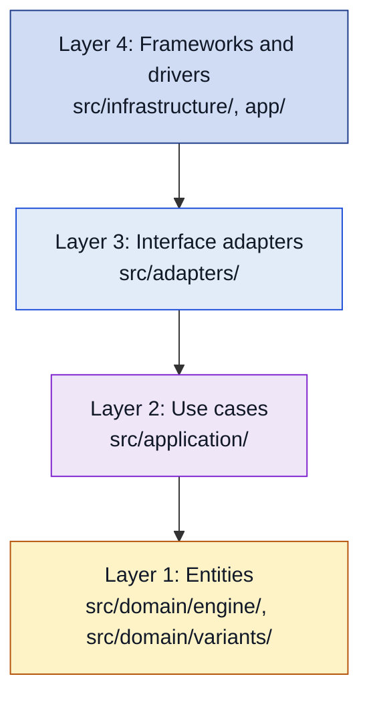
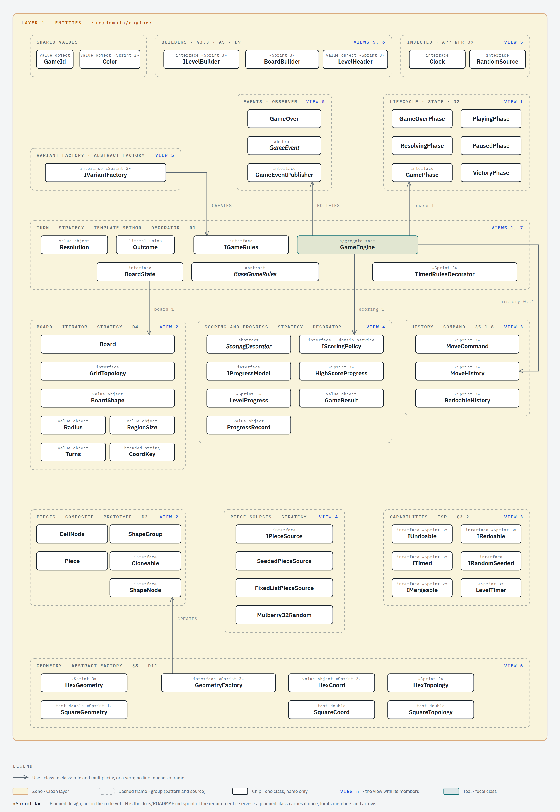
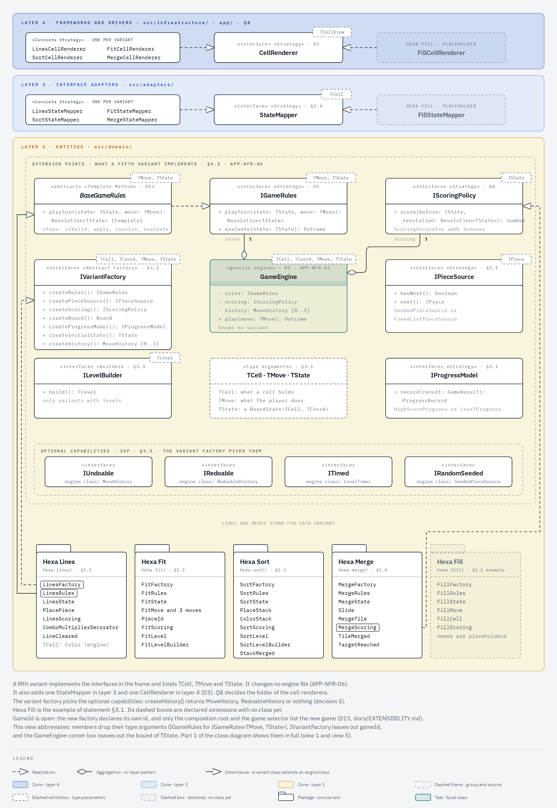

<!-- The banner comes from brand/tools/profile-assets/gen.py --repo hexablock-app in Hexablock-Suite/.github. Regenerate it there; do not edit the SVG files by hand. -->
<picture>
  <source media="(prefers-color-scheme: dark)" srcset="docs/assets/banner-dark.svg">
  
</picture>

# HexaBlock Suite — Mobile App

## Project Title & Badges

[](https://github.com/Hexablock-Suite/hexablock-app/actions/workflows/ci.yml)

Mobile client: the four games on one generic engine.

## Description

HexaBlock Suite is one mobile app with four puzzle games on hexagonal boards: Hexa Lines, Hexa Fit, Hexa Sort and Hexa Merge. The four games run on one generic engine. Each game is a variant that gives the engine its cell type, its move, its state, its rules and its scoring policy. The engine never knows which game it runs. The app is built with Expo SDK 58, Expo Router and TypeScript, and it talks to the [hexablock-api](https://github.com/Hexablock-Suite/hexablock-api) backend for accounts, progress sync, leaderboards and levels.

| Variant    | Move                                     | Resolution                                       | Progress                           | Undo                 |
| ---------- | ---------------------------------------- | ------------------------------------------------ | ---------------------------------- | -------------------- |
| Hexa Lines | Place a piece from a tray of 3           | Clear full lines on the 3 axes; combos           | High score                         | No                   |
| Hexa Fit   | Place, remove or rotate a piece          | None; check that the figure is covered           | Levels with stars (moves and time) | Unlimited, with redo |
| Hexa Sort  | Place the offered stack on an empty cell | Same-color tiles move between stacks, in cascade | Levels                             | No                   |
| Hexa Merge | Slide all tiles in one of 6 directions   | Two equal tiles that collide merge               | High score                         | One move             |

The full product table and every requirement are in [docs/REQUIREMENTS.md](docs/REQUIREMENTS.md). The sprint plan is in [docs/ROADMAP.md](docs/ROADMAP.md). The game code is not written yet: today `src/` holds one README per layer folder and the API client. The sections below describe the design that the code follows.

## Demo / Screenshots

TODO: add screenshots or a short video of each variant.

## Architecture

The client follows Clean Architecture with four layers (statement §3.4). Every dependency points inward, toward layer 1.

| Layer                     | Folder                                                 | What lives there                                                                                                      | May depend on                                                                                        |
| ------------------------- | ------------------------------------------------------ | --------------------------------------------------------------------------------------------------------------------- | ---------------------------------------------------------------------------------------------------- |
| 1. Entities               | `src/domain/engine/`, `src/domain/variants/<variant>/` | The generic engine and the four variants: board, rules, pieces, scoring, the variant factories                        | Only `src/domain/`. The engine never imports a variant, and a variant never imports another variant. |
| 2. Use cases              | `src/application/`                                     | The generic use cases, their ports, the request and response models, `Result` and the aspect decorators               | Only `src/domain/` and `src/application/`                                                            |
| 3. Interface adapters     | `src/adapters/`                                        | MVP presenters and view models, state mappers, `GameEventBus`, the local repositories, `InMemoryRunningGameStore`     | Layers 1 and 2 and its own folder                                                                    |
| 4. Frameworks and drivers | `src/infrastructure/`, `app/`                          | The HTTP client and repositories, storage, session, audio, clock, random source, logger; Expo Router routes in `app/` | Every inner layer and any package                                                                    |



This sketch shows only the layers and the direction of the dependencies. The full layer diagram, with every component, port and adapter, is the Mermaid source in [docs/architecture/layers.md](docs/architecture/layers.md). The repository has no rendered image of it yet.

**The gate.** `pnpm arch` runs [dependency-cruiser](https://github.com/sverweij/dependency-cruiser) over `src/` and `app/` with the rules in `.dependency-cruiser.cjs`, and CI runs it inside `pnpm verify`. The rules are `domain-imports-only-domain`, `domain-no-framework`, `engine-no-variants`, `variants-isolated`, `application-imports-only-domain` and `adapters-imports-only-inner-layers`. `test/gates/architecture-gate.test.ts` tests each rule. Layer 4 has no rule yet. A lint rule keeps `Math.random`, `Date.now` and `new Date()` out of the domain and the application layers, so time and randomness come by injection (rule R-domain-determinism).

**Presentation.** The screens follow Model-View-Presenter. The view is a route in layer 4, for example `GameScreen` with `BoardView`. The presenter (`GamePresenter`) and the view model (`GameViewModel`) live in layer 3. The presenter calls a use case through `UseCase` and maps the plain response to the view model.

**Use case flows.** [docs/architecture/flows.md](docs/architecture/flows.md) follows five use cases through the four layers, each with a class view and a sequence diagram: `ApplyMove` stays inside the app, `SaveProgress` sends a result to `hexablock-api`, `StartGame` wires a variant from its factory, `UndoMove` runs the Command history, and `Login` signs in against the backend and keeps the session. A table there names the path of every other use case.

One placement differs from statement §3.4 on purpose. The statement puts the repository implementations and the DTO mappers in layer 3, interface adapters. The HTTP repositories and their DTO mapper live in layer 4, `src/infrastructure/api/`, next to the HTTP client, and implement the layer 2 ports directly. In layer 3 they needed a `BackendApi` port whose methods named transport types, which ties the use cases to the shape of the HTTP data. The local repositories stay in layer 3. See Q7 in [docs/architecture/layers.md](docs/architecture/layers.md) and decision 22 in [docs/architecture/classes.md](docs/architecture/classes.md).

Two placements are still open with the professor: where the cell renderers live (Q8) and where the composition root lives (Q9). Both are in [docs/architecture/layers.md](docs/architecture/layers.md).

## Generic Engine

> **Design, not code yet.** This section describes the design in [docs/architecture/classes.md](docs/architecture/classes.md). The engine code starts in sprint 1 of [docs/ROADMAP.md](docs/ROADMAP.md). Today `src/domain/engine/` holds only a README, with no engine class and no engine test.

The engine lives in `src/domain/engine/`. It is written once and runs the four games. It knows no variant, no geometry and no UI framework (APP-NFR-03). The class diagram is in [docs/architecture/classes.md](docs/architecture/classes.md).



The four core types:

- **`GameEngine<TCell, TCoord, TMove, TState>`** is the aggregate root of a game. It runs each turn through `IGameRules`, scores it with `IScoringPolicy`, holds the `GamePhase` and an optional `MoveHistory`, and publishes events through `GameEventPublisher`. A game changes only through `play()`. `snapshot()` returns a clone of the state (decision 26).
- **`IGameRules<TMove, TState>`** is the rules contract of §3.1: `isValid()`, `validMoves()`, `apply()`, `resolve()` and `evaluate()`. The abstract `BaseGameRules` holds the turn skeleton in its template method `playTurn()`, and each variant extends it (decision 21). `GameEngine` depends only on the interface. `validMoves()` is a lazy generator: the «no valid move» end of Lines, Sort and Merge stops at the first move (decision 33).
- **`Board<TCell, TCoord>`** is the `HexBoard<TCell>` of §3.1, with no geometry in its name. It stores the cells (`get()`, `set()`, `cells()`), walks the board with `line()`, `ring()` and `neighborhood()`, and clones itself for undo and the piece preview.
- **`GridTopology<TCoord>`** does every coordinate calculation: `neighbors()`, `directions()`, `axes()`, `rotate()`, `translate()` and `region()`. A coordinate only holds its values. `HexTopology` with `HexCoord` is the real geometry. The square topology of `SquareGeometry` exists for the engine tests, to prove that the engine does not depend on hexagons (D4, APP-NFR-13).

### Type parameters

| Parameter | What it is                                 | Bound on it                                 |
| --------- | ------------------------------------------ | ------------------------------------------- |
| `TCell`   | The content of one cell (§1.5)             | `IMergeable<TCell>` in `MergeRules` only    |
| `TCoord`  | The coordinate type of one geometry        | None                                        |
| `TMove`   | The move a player makes                    | None                                        |
| `TState`  | The full state of a game, board included   | `BoardState<TCell, TCoord>` in `GameEngine` |
| `TPiece`  | What a piece source gives (`IPieceSource`) | None                                        |

`IGameRules` and `BaseGameRules` take two type parameters, `TMove` and `TState`, because none of their members names a cell or a coordinate (decision 16).

### Why each bound exists

Statement §3.1 asks the README to explain each bound (APP-NFR-05). The design has two.

- **`TState extends BoardState<TCell, TCoord>` on `GameEngine`.** `BoardState` gives the `board`, the `score` and `clone()`. The engine needs all three for every variant: it clones the state before each move to keep the undo snapshot (decision 34), and `snapshot()` returns a clone so that no caller changes the board (decision 26). Without the bound, the engine could not clone or read a state it does not know.
- **`TCell extends IMergeable<TCell>` on `MergeRules`.** The Merge rules merge two equal tiles into one of double value. The bound states the capability that the rules need from a cell, and nothing more (decision 8). The Merge factory binds it to `MergeTile`, a value object that wraps an integer, because a primitive integer cannot implement an interface (A1).

### How each variant binds the engine

| Variant    | `TCell`                      | `TMove`                                    | `TState`                | Undo                        | Piece source                           | Progress                   |
| ---------- | ---------------------------- | ------------------------------------------ | ----------------------- | --------------------------- | -------------------------------------- | -------------------------- |
| Hexa Lines | `Color`                      | `PlacePiece`                               | `LinesState`            | none                        | `SeededPieceSource`                    | `HighScoreProgress`        |
| Hexa Fit   | `PieceId`                    | `FitMove`: place, remove or rotate a piece | `FitState`              | `RedoableHistory`, no limit | `FixedListPieceSource`                 | `LevelProgress` with stars |
| Hexa Sort  | `ColorStack`                 | `PlaceStack`                               | `SortState`             | none                        | seeded or fixed, chosen per level (A4) | `LevelProgress`            |
| Hexa Merge | `MergeTile`, an `IMergeable` | `Slide`                                    | `MergeState<MergeTile>` | `MoveHistory`, limit 1      | `SeededPieceSource`, tiles of 2 or 4   | `HighScoreProgress`        |

The variant classes stay generic over `TCoord`, so a variant runs on any geometry. Today the composition root passes `HexGeometry`, so a running game binds `TCoord` to `HexCoord` (decisions 16 and 17). Each variant writes one factory that implements `IVariantFactory`. The factory creates the rules, the piece source, the scoring policy and the board, and picks the engine classes for progress and undo (decision 31).

### Adding a fifth variant

A new variant adds classes and data. It changes no engine file, no other variant, no use case and no presenter (APP-NFR-06). [docs/EXTENSIBILITY.md](docs/EXTENSIBILITY.md) lists the files it adds and the files it does not touch, with Hexa Fill as the example. The [extensibility diagram](docs/architecture/extensibility.md) shows the extension points:



## Design Patterns

The fourteen patterns of statement §3.3 all appear in the design (D14). Each row names the requirement behind the pattern and the quality it protects: what breaks if the pattern is missing. The code does not exist yet: it starts in sprint 1 of [docs/ROADMAP.md](docs/ROADMAP.md). So each link points to the design view in [docs/architecture/classes.md](docs/architecture/classes.md#patterns). The links move to the source files as the code lands.

| Pattern          | Classes                                                                                                                          | Reason                                                                                                                                                          | Quality protected          | Design                                                                                                                                                                                                                                                                                                                                 |
| ---------------- | -------------------------------------------------------------------------------------------------------------------------------- | --------------------------------------------------------------------------------------------------------------------------------------------------------------- | -------------------------- | -------------------------------------------------------------------------------------------------------------------------------------------------------------------------------------------------------------------------------------------------------------------------------------------------------------------------------------- |
| Strategy         | `IGameRules`, `IScoringPolicy`, `IPieceSource`, `IProgressModel`, `GridTopology<TCoord>`; `StateMapper`, `CellRenderer`          | Mandatory (§3.3). The variation dimensions of §1.5 (D1, D4).                                                                                                    | Extensibility              | [View 1](docs/architecture/classes.md#view-1-the-turn)                                                                                                                                                                                                                                                                                 |
| Abstract Factory | `IVariantFactory` and one factory per variant; `GeometryFactory<TCoord>` with `HexGeometry` and `SquareGeometry`                 | Mandatory (§3.3). One coherent family per variant; the geometry family absorbs the square, triangle and 3D rows (D4, D11).                                      | Extensibility, correctness | [View 5](docs/architecture/classes.md#view-5-wiring-a-variant), [view 6](docs/architecture/classes.md#view-6-geometry-and-board)                                                                                                                                                                                                       |
| Template Method  | `BaseGameRules.playTurn()`                                                                                                       | The turn skeleton of §3.1, in an abstract base class as §3.3 describes it (D13).                                                                                | Correctness                | [View 7](docs/architecture/classes.md#view-7-the-rules-template)                                                                                                                                                                                                                                                                       |
| State            | `GamePhase` and its five phases                                                                                                  | The game lifecycle (§3.3, D2). The menu is navigation in the presentation layer, so no `MenuState` exists (D14).                                                | Correctness                | [View 1](docs/architecture/classes.md#view-1-the-turn)                                                                                                                                                                                                                                                                                 |
| Command          | `MoveCommand`, `MoveHistory`, `RedoableHistory`                                                                                  | Undo and redo (§3.3, §5.1.8): unlimited with redo in Fit, one move in Merge.                                                                                    | Correctness                | [View 3](docs/architecture/classes.md#view-3-undo-and-redo)                                                                                                                                                                                                                                                                            |
| Memento          | `MoveCommand.before`                                                                                                             | A merge loses data, so undo keeps the whole previous state. `GameEngine` is the originator, the cloned `TState` the memento, `MoveHistory` the caretaker (D18). | Correctness                | [View 3](docs/architecture/classes.md#view-3-undo-and-redo)                                                                                                                                                                                                                                                                            |
| Prototype        | `Cloneable`: `Board`, `Piece`, `BoardState`                                                                                      | Undo snapshots, rotation and the piece preview (§3.3, D3). The board changes in place, so each safe copy is a clone.                                            | Safety                     | [View 2](docs/architecture/classes.md#view-2-board-and-pieces)                                                                                                                                                                                                                                                                         |
| Composite        | `ShapeNode`, `CellNode`, `ShapeGroup`                                                                                            | Pieces made of cells, Fit figures made of regions (piece shape row of §8). Only the shapes: Fit stars are data (D20).                                           | Extensibility              | [View 2](docs/architecture/classes.md#view-2-board-and-pieces)                                                                                                                                                                                                                                                                         |
| Iterator         | `Board.line()`, `ring()`, `neighborhood()`; `IPieceSource`; `IGameRules.validMoves()`                                            | Traversal by axis, ring and neighbors (§3.1). The piece sequence, finite or endless (D16). The lazy list of valid moves (D17).                                  | Extensibility, correctness | [View 2](docs/architecture/classes.md#view-2-board-and-pieces), [view 4](docs/architecture/classes.md#view-4-piece-sources-scoring-and-progress), [view 7](docs/architecture/classes.md#view-7-the-rules-template); code: [`IPieceSource`](src/domain/engine/piece-source.ts), [`IGameRules.validMoves()`](src/domain/engine/rules.ts) |
| Decorator        | `ScoringDecorator`, `ComboMultiplierDecorator`; `TimedRulesDecorator`; `UseCaseAspect` and its four aspects                      | The Lines combo and streak (§1.1) and the scoring row of §8. Fit stars use time (§1.2, D14). The aspects of §3.5 (A2).                                          | Extensibility              | [View 4](docs/architecture/classes.md#view-4-piece-sources-scoring-and-progress), [view 3.1](docs/architecture/classes.md#view-31-the-use-case-contract-and-its-aspects)                                                                                                                                                               |
| Builder          | `ILevelBuilder`, `FitLevelBuilder`, `SortLevelBuilder`; `BoardBuilder`                                                           | Levels of parts from configuration files, built step by step (§3.3, §5.1.5), with the Fit check of A5. Two construction paths for the board (D9).               | Correctness                | [View 5](docs/architecture/classes.md#view-5-wiring-a-variant), [view 6](docs/architecture/classes.md#view-6-geometry-and-board)                                                                                                                                                                                                       |
| Observer         | `GameEventPublisher` and the `GameEvent` classes; `GameEventBus` in layer 3                                                      | Score, audio and screens react to game events, and the engine never knows them (§3.3).                                                                          | Extensibility              | [View 4.3](docs/architecture/classes.md#view-43-game-events-and-sound)                                                                                                                                                                                                                                                                 |
| Adapter          | `LocalProgressRepository` and the other local repositories; `ApiProgressRepository` and the other HTTP repositories; the drivers | A new database or backend means a new adapter, and the use cases do not change (§3.3, §3.4).                                                                    | Tests                      | [View 4.2](docs/architecture/classes.md#view-42-repositories)                                                                                                                                                                                                                                                                          |
| Facade           | `AudioManager`                                                                                                                   | Sound effects and music behind one interface, with mute (§3.3, §5.1.10).                                                                                        | Simplicity                 | [View 4.3](docs/architecture/classes.md#view-43-game-events-and-sound)                                                                                                                                                                                                                                                                 |
| Singleton        | `AudioManager` and `SessionManager`, created once by `CompositionRoot`                                                           | §3.3 allows single-scope dependency injection in place of a classic Singleton. No class has a static `instance()` (D12).                                        | Tests                      | [View 4.4](docs/architecture/classes.md#view-44-wiring)                                                                                                                                                                                                                                                                                |

Notes on the decided design:

- **Iterator in two more places.** `IPieceSource<TPiece>` is a Strategy and an Iterator: it keeps `hasNext()` and `next()` and adds `[Symbol.iterator]()`, so a caller reads pieces with `for...of`. `SeededPieceSource` never ends, and `FixedListPieceSource` ends after its last piece (decision 32). `IGameRules.validMoves(state): Iterable<TMove>` yields one valid move at a time (decision 33).
- **Memento inside Command.** Memento is not one of the fourteen patterns of §3.3, so the class diagram names it inside the Command row (decision 34). `MoveHistory` keeps the commands and never reads the state inside them.

### Considered and not used

- **Visitor.** D3 allows a Visitor only inside the shape Composite, where the node types are closed and the operations grow. `ShapeNode` declares each operation, and no class implements a Visitor. A Visitor over the variants would make every new variant edit every visitor, which breaks the extensibility test of APP-NFR-06 (decision 35).
- **Mediator.** `GameEventBus` is an Observer: it implements `GameEventPublisher` and sends each event to its listeners. It does not coordinate classes that call each other, so the design does not claim Mediator (decision 35).
- **Composites for end conditions and star rules.** No source declares a variation there. Fit stars are data: two thresholds per star, a move count and a time, in each level file (decision 36).

## SOLID Principles

Each example comes from the class diagram. The links point to the design decisions; they move to the source files as the code lands.

- **Single responsibility.** `FitLevelBuilder` builds the level from plain `LevelDefinition` data, and an adapter in an outer layer reads the level file ([decision 24](docs/architecture/classes.md#decisions-to-check-with-the-team)).
- **Open/closed.** A fifth variant adds a factory that declares its own open `GameId` and changes no engine file ([decision 30](docs/architecture/classes.md#decisions-to-check-with-the-team), [EXTENSIBILITY.md](docs/EXTENSIBILITY.md)).
- **Liskov substitution.** `GameEngine` takes any `IGameRules`: `LinesRules`, `FitRules`, or `FitRules` wrapped in `TimedRulesDecorator`. The engine has no conditional on the variant type ([decision 21](docs/architecture/classes.md#decisions-to-check-with-the-team), APP-NFR-08).
- **Interface segregation.** `IUndoable`, `IRedoable`, `ITimed` and `IRandomSeeded` are separate interfaces, so Hexa Lines never implements `IUndoable` and Hexa Merge undoes without redo ([decisions 3 and 4](docs/architecture/classes.md#decisions-to-check-with-the-team)).
- **Dependency inversion.** The use cases depend on layer 2 ports such as `ProgressRepository`. `LocalProgressRepository` in layer 3 and `ApiProgressRepository` in layer 4 implement it ([decisions 22 and 25](docs/architecture/classes.md#decisions-to-check-with-the-team)).

## AOP

The cross-cutting concerns of §3.5 are our own decorators over the generic use case, not a library interceptor (A2). They live in layer 2, `src/application/`.

- Every use case implements one generic input port, `UseCase<TRequest, TResponse>`, whose `execute(request)` returns `Promise<Result<TResponse>>` (decisions 9 and 28).
- The abstract `UseCaseAspect` implements `UseCase` and keeps the inner `UseCase` it wraps. Each aspect extends it:
  - `LoggingAspect` logs each call through the `Logger` port.
  - `TimingAspect` measures each call with the engine `Clock` and logs it through `Logger`.
  - `RetryAspect` runs the inner use case again while the error of its `Result` is retryable.
  - `AuthorizationAspect` reads the `SessionStore` port before `SaveProgress` and `SyncLeaderboard` run.
- The composition root wraps each use case, for example `new LoggingAspect(new AuthorizationAspect(saveProgress))`.

The use cases are generic, so one aspect covers the four variants, and the use case it wraps holds no line of the aspect's code (APP-NFR-11). An aspect never calls `Date.now`: it reads the time through `Clock` (rule R-domain-determinism). A new aspect extends `UseCaseAspect`. See [view 3.1](docs/architecture/classes.md#view-31-the-use-case-contract-and-its-aspects).

## Getting Started

Requirements: Node 26 (see `.node-version`), pnpm 11 (pinned in `package.json`), and Expo Go on a phone. The team uses [fnm](https://github.com/Schniz/fnm) to pick the Node version.

```bash
fnm use               # reads .node-version and switches to Node 26
corepack enable pnpm
pnpm install          # also installs the git hooks (prepare script)
pnpm start            # Expo dev server; scan the QR code with Expo Go
pnpm android          # open on an Android emulator or device
pnpm web              # open in the browser
```

When `fnm use` does not take effect in the shell, run a command through `fnm exec --using=26`, for example `fnm exec --using=26 pnpm verify`.

The API client in `src/infrastructure/api/` uses types generated from the backend OpenAPI document. With [hexablock-api](https://github.com/Hexablock-Suite/hexablock-api) running, refresh them and commit the result:

```bash
pnpm api:generate     # reads $BACKEND_URL/docs-json (default http://localhost:3000)
```

To build the installable Android APK, push a version tag. The `Release APK` workflow runs `npx expo prebuild --platform android` and `./gradlew assembleRelease` on JDK 17, then attaches the APK to a GitHub Release. A manual run (Actions tab, `workflow_dispatch`) keeps the APK as a workflow artifact only. The APK is signed with the React Native debug keystore, so Android asks to allow installs from unknown sources.

```bash
git tag v0.1.0 && git push origin v0.1.0
```

Each sprint of [docs/ROADMAP.md](docs/ROADMAP.md) closes with a `v0.N.0` tag, the same tag as hexablock-api. The final delivery is `v1.0.0` (rule R-sprint-release).

Check the git hooks with `pnpm exec vp hooks status`. When a global `core.hooksPath` blocks the install, run `GIT_CONFIG_GLOBAL=/dev/null pnpm exec vp hooks enable`.

## Running Tests

```bash
pnpm test             # Jest 30 with jest-expo
pnpm test test/gates  # only the gate tests (lint, architecture, commit message)
pnpm lint             # Oxlint through Vite+
pnpm format:check     # Oxfmt through Vite+
pnpm typecheck        # tsc --noEmit
pnpm arch             # dependency-cruiser layer rules
pnpm pact:check       # fails when pnpm test rewrote a pact file that is not committed
pnpm verify           # lint, format:check, typecheck, test, pact:check, arch; CI job verify
```

Contract tests ([Pact](https://docs.pact.io/)) run inside `pnpm test`. The consumer test calls the real API client against a Pact mock server and writes `pacts/hexablock-app-hexablock-api.json`, which is committed. The backend CI verifies that file from this repository's `main`. Against a running backend:

```bash
export BACKEND_URL=http://localhost:3000
pnpm contract:verify  # the backend honors the committed pact
pnpm api:check        # src/infrastructure/api/schema.d.ts matches the backend OpenAPI document
```

The CI job `contract` builds and starts hexablock-api `main`, then runs both commands.

Test titles follow `should_<expected_result>_when_<condition>`. The linter and `test/gates/test-title-gate.test.ts` reject other `it` and `test` titles. Tests check behavior through the public interface of the engine and the use cases. Test doubles replace only the boundaries: the layer 2 ports and the engine interfaces `Clock`, `RandomSource` and `GameEventPublisher` (APP-NFR-12).

## AI Usage Documentation

TODO: summarize AI tool use here; the full log lives in [AI_USAGE.md](AI_USAGE.md).

## Contributing

Read [AGENTS.md](AGENTS.md) for the repository rules and [docs/REQUIREMENTS.md](docs/REQUIREMENTS.md) before you change behavior.

- **Commits.** Messages follow [Conventional Commits](https://www.conventionalcommits.org/) in English. The `commit-msg` hook runs commitlint.
- **Hooks.** `pnpm install` installs them. The `pre-commit` hook lints and formats the staged files. The `pre-push` hook runs `pnpm lint`, `pnpm typecheck` and `pnpm arch`. Never bypass a hook with `--no-verify`.
- **Before a pull request.** Run `pnpm verify`. When a requirement, an assumption or a professor answer changes, update `docs/REQUIREMENTS.md` in the same pull request. Log AI use in [AI_USAGE.md](AI_USAGE.md).
- **Pull requests.** Branch from `main` and open a pull request to `main` with the template in `.github/pull_request_template.md`. The `main` ruleset requires a pull request, the CI checks `verify` and `contract`, and a branch that is up to date with `main`. It allows merge commits only and blocks force pushes and deletion of `main`.

## License

MIT. See [LICENSE](LICENSE).
