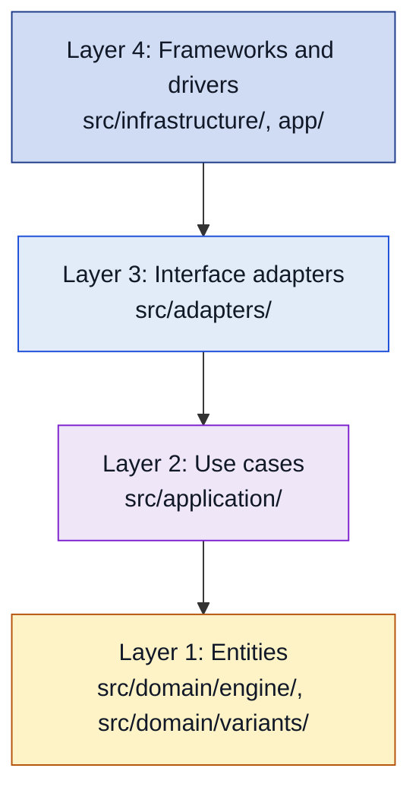

<!-- The banner comes from brand/tools/profile-assets/gen.py --repo hexablock-app in Hexablock-Suite/.github. Regenerate it there; do not edit the SVG files by hand. -->
<picture>
  <source media="(prefers-color-scheme: dark)" srcset="docs/assets/banner-dark.svg">
  
</picture>

# HexaBlock Suite — Mobile App

## Project Title & Badges

[](https://github.com/Hexablock-Suite/hexablock-app/actions/workflows/ci.yml)

Mobile client: the four games on one generic engine.

## Description

HexaBlock Suite is one mobile app with four puzzle games on hexagonal boards: Hexa Lines, Hexa Fit, Hexa Sort and Hexa Merge. The four games run on one generic engine. Each game is a variant that gives the engine its cell type, its move, its state, its rules and its scoring policy. The engine never knows which game it runs. The app is built with Expo SDK 58, Expo Router and TypeScript, and it talks to the [hexablock-api](https://github.com/Hexablock-Suite/hexablock-api) backend for accounts, progress sync, leaderboards and levels.

| Variant    | Move                                     | Resolution                                       | Progress                           | Undo                 |
| ---------- | ---------------------------------------- | ------------------------------------------------ | ---------------------------------- | -------------------- |
| Hexa Lines | Place a piece from a tray of 3           | Clear full lines on the 3 axes; combos           | High score                         | No                   |
| Hexa Fit   | Place, remove or rotate a piece          | None; check that the figure is covered           | Levels with stars (moves and time) | Unlimited, with redo |
| Hexa Sort  | Place the offered stack on an empty cell | Same-color tiles move between stacks, in cascade | Levels with stars (moves)          | No                   |
| Hexa Merge | Slide all tiles in one of 6 directions   | Two equal tiles that collide merge               | High score                         | One move             |

The full product table and every requirement are in [docs/REQUIREMENTS.md](docs/REQUIREMENTS.md). The sprint plan is in [docs/ROADMAP.md](docs/ROADMAP.md). The engine and the four variants exist in `src/domain/`, and the first use cases, `StartGame` and `ApplyMove`, exist in `src/application/`. The game screens and the adapters are planned: `app/` holds only a home screen, and `src/adapters/` holds only its README. The sections below describe the design that the code follows.

## Demo / Screenshots

TODO: add screenshots or a short video of each variant.

## Architecture

The client follows Clean Architecture with four layers (statement §3.4). Every dependency points inward, toward layer 1.

| Layer                     | Folder                                                 | What lives there                                                                                                      | May depend on                                                                                        |
| ------------------------- | ------------------------------------------------------ | --------------------------------------------------------------------------------------------------------------------- | ---------------------------------------------------------------------------------------------------- |
| 1. Entities               | `src/domain/engine/`, `src/domain/variants/<variant>/` | The generic engine and the four variants: board, rules, pieces, scoring, the variant factories                        | Only `src/domain/`. The engine never imports a variant, and a variant never imports another variant. |
| 2. Use cases              | `src/application/`                                     | The generic use cases, their ports, the request and response models, `Result` and the aspect decorators               | Only `src/domain/` and `src/application/`                                                            |
| 3. Interface adapters     | `src/adapters/`                                        | MVP presenters and view models, state mappers, `GameEventBus`, the local repositories, `InMemoryRunningGameStore`     | Layers 1 and 2 and its own folder                                                                    |
| 4. Frameworks and drivers | `src/infrastructure/`, `app/`                          | The HTTP client and repositories, storage, session, audio, clock, random source, logger; Expo Router routes in `app/` | Every inner layer and any package                                                                    |



This sketch shows only the layers and the direction of the dependencies. The full layer diagram, with every component, port and adapter, is the Mermaid source in [docs/architecture/layers.md](docs/architecture/layers.md). The repository has no rendered image of it yet.

**The gate.** `pnpm arch` runs [dependency-cruiser](https://github.com/sverweij/dependency-cruiser) over `src/` and `app/` with the rules in `.dependency-cruiser.cjs`, and CI runs it inside `pnpm verify`. The rules are `domain-imports-only-domain`, `domain-no-framework`, `engine-no-variants`, `variants-isolated`, `application-imports-only-domain`, `application-no-variants` and `adapters-imports-only-inner-layers`. `test/gates/architecture-gate.test.ts` tests each rule. Layer 4 has no rule yet. A lint rule keeps `Math.random`, `Date.now` and `new Date()` out of the domain and the application layers, so time and randomness come by injection (rule R-domain-determinism).

**Presentation.** The screens follow Model-View-Presenter. The view is a route in layer 4, for example `GameScreen` with `BoardView`. The presenter (`GamePresenter`) and the view model (`GameViewModel`) live in layer 3. The presenter calls a use case through `UseCase` and maps the plain response to the view model.

**Use case flows.** [docs/architecture/flows.md](docs/architecture/flows.md) follows five use cases through the four layers, each with a class view and a sequence diagram: `ApplyMove` stays inside the app, `SaveProgress` sends a result to `hexablock-api`, `StartGame` wires a variant from its factory, `UndoMove` runs the Command history, and `Login` signs in against the backend and keeps the session. A table there names the path of every other use case.

One placement differs from statement §3.4 on purpose. The statement puts the repository implementations and the DTO mappers in layer 3, interface adapters. The HTTP repositories and their DTO mapper live in layer 4, `src/infrastructure/api/`, next to the HTTP client, and implement the layer 2 ports directly. In layer 3 they needed a `BackendApi` port whose methods named transport types, which ties the use cases to the shape of the HTTP data. The local repositories stay in layer 3. See Q7 in [docs/architecture/layers.md](docs/architecture/layers.md) and decision 22 in [docs/architecture/classes.md](docs/architecture/classes.md).

Two placements are still open with the professor: where the cell renderers live (Q8) and where the composition root lives (Q9). Both are in [docs/architecture/layers.md](docs/architecture/layers.md).

## Generic Engine

> **Engine code.** `src/domain/engine/` holds the generic engine: the board, the topology, the pieces, the rules contract, the turn cycle, the phases, the piece sources, the strategy interfaces, the geometry family and `BoardBuilder`. Undo comes in a later sprint of [docs/ROADMAP.md](docs/ROADMAP.md). The full design is in [docs/architecture/classes.md](docs/architecture/classes.md).

The engine lives in `src/domain/engine/`. It is written once and runs the four games. It knows no variant and no UI framework, and its generic types name no geometry (APP-NFR-03). A geometry family comes in by composition. The class diagram is in [docs/architecture/classes.md](docs/architecture/classes.md).


The four core types:

- **[`GameEngine<TCell, TCoord, TMove, TState>`](src/domain/engine/game-engine.ts)** is the aggregate root of a game. Its `MatchId` is its identity, and `equals()` compares two games by it. It runs each turn through `IGameRules`, scores it with `IScoringPolicy`, holds the `GamePhase`, and publishes `GameOver` through `GameEventPublisher`. A game changes only through `play()`, and only while `currentPhase().canPlay()` is true. `start()` clones the first state, and `snapshot()` returns the immutable photo of the state, a `BoardSnapshot` (decisions 26 and 34). The optional `MoveHistory` comes with undo in Sprint 3.
- **[`IGameRules<TMove, TState>`](src/domain/engine/rules.ts)** is the rules contract of §3.1: `isValid()`, `validMoves()`, `apply()`, `resolve()` and `evaluate()`. The abstract `BaseGameRules` holds the turn skeleton in its template method `playTurn()`, and each variant extends it (decision 21). `GameEngine` depends only on the interface. `validMoves()` is a lazy generator, and `BaseGameRules.noValidMove()` stops at the first move, for the «no valid move» end of Lines, Sort and Merge (decision 33).
- **[`Board<TCell, TCoord, TAxis>`](src/domain/engine/board.ts)** is the `HexBoard<TCell>` of §3.1, with no geometry in its name. It stores the cells (`get()`, `set()`, `cells()`), walks the board with `line()`, `ring()` and `neighborhood()`, and clones itself for undo and the piece preview. A cell is a value: `clone()` shares the cell objects, so a caller sets a new cell and never changes one in place. A shape holds at least one coordinate, and two coordinates with the same topology key are a `RangeError`. `line()` through a coordinate outside the shape yields nothing. The constructor throws a `RangeError` for an initial entry outside the shape and for an entry whose key differs from `topology.key()` of its coordinate. It copies each entry, so the caller and the board share no tuple.
- **[`GridTopology<TCoord, TAxis, TDirection>`](src/domain/engine/grid-topology.ts)** answers every coordinate question of the engine: `key()`, `neighbors()`, `neighbor()`, `directions()`, `axes()`, `fullTurn()`, `rotate()`, `translate()`, `line()`, `ring()` and `region()`. A coordinate is a value object with private values, `equals()` and the operations on its own values, such as `plus()`, `opposite()` and `turned()` (classes.md decision 44). The topology does what belongs to the grid, and the generic engine reads no coordinate: `TCoord` has no bound, so it compares two coordinates through `key()`. Each topology declares its axes and its directions as two classes with a closed set of instances, such as `HexAxis.q` and `SquareDirection.north` (classes.md decision 45). Each one is a value object with `equals()`, and it steps from a cell on its own: an axis has `forward()` and `backward()`, and a direction has `neighborOf()`. So `line()` with a text, or with an axis of another topology, does not compile, and the same holds for `neighbor()` and a direction. A cast passes the compiler, so each topology also checks the class at runtime and throws a `RangeError`. `ring()` takes a `Radius`, `region()` a `RegionSize` and `rotate()` a `Turns`: each value object checks its number once, in `of()`. `of()` accepts only a safe integer and stores `-0` as `0`. `key()` returns a branded `CoordKey`, so a free string cannot stand in for a key. [`HexTopology`](src/domain/engine/hex-topology.ts), [`SquareTopology`](src/domain/engine/square-topology.ts) and [`TriangleTopology`](src/domain/engine/triangle-topology.ts) are the real topologies, and `test/domain/engine/topology-contract.test.ts` runs the same tests on all three. `region(size)` is a different figure on each one: a hexagon of distance less than `size`, a square of `size` × `size` cells, or a rhombus of `size` × `size` lattice cells of two triangles each. The engine tests run on the square and triangle topologies, so they prove that the engine depends on no geometry (D4, APP-NFR-13). A test translates a piece by an odd offset on the triangle topology, so code that adds coordinates one component at a time fails (decision 16).

[`GeometryFactory<TCoord>`](src/domain/engine/geometry-factory.ts) is the Abstract Factory that creates the coordinate, the topology and the piece shapes of one geometry (decision 17, D11). Each family names itself with `id`, a `TopologyId`: `TopologyId.hex`, `TopologyId.square` or `TopologyId.triangle`. It is a class with a closed set of instances (classes.md decision 45). A level file holds the text of the id in `topology`, and `TopologyId.of()` turns the text into the id and refuses an unknown text. [`HexGeometry`](src/domain/engine/hex-geometry.ts), [`SquareGeometry`](src/domain/engine/square-geometry.ts) and [`TriangleGeometry`](src/domain/engine/triangle-geometry.ts) are the real families. Each one holds its piece shapes as one data list, with 1 to 5 cells per piece. [`BoardBuilder<TCoord>`](src/domain/engine/board-builder.ts) builds a `Board` from a geometry, with `withRegion()` or `withFigure()`. Each step returns the builder, and only `build()` returns the board. `build()` calls the `Board` constructor, so the checks of the board apply (decision 15, D9).

### Type parameters

The Status column says whether a bound is in the code today (`code`) or only in the design (`design`). `test/docs/generic-bounds.test.ts` reads the engine with the TypeScript parser. It checks that every bounded type parameter of `src/domain/engine/`, whatever its name, has a `code` row, and that every `code` row exists in the code.

| Parameter    | What it is                                 | Bound                                                 | Where                                                          | Status | Reason                                                                                                                                                                                                                                             |
| ------------ | ------------------------------------------ | ----------------------------------------------------- | -------------------------------------------------------------- | ------ | -------------------------------------------------------------------------------------------------------------------------------------------------------------------------------------------------------------------------------------------------- |
| `TCoord`     | The coordinate type of one geometry        | None                                                  |                                                                |        |                                                                                                                                                                                                                                                    |
| `TMove`      | The move a player makes                    | None                                                  |                                                                |        |                                                                                                                                                                                                                                                    |
| `TState`     | The full state of a game, board included   | `BoardState<TCell, TCoord> & Cloneable<TState>`       | `GameEngine`, `IVariantFactory`                                | code   | The engine clones the state for each turn, reads its photo and restores it for the undo (decisions 26 and 34).                                                                                                                                     |
| `TState`     | The state that the engine copies           | `Cloneable<TState>`                                   | `copy()` in `game-engine.ts`, private                          | code   | The helper calls `clone()` and returns the same type, with no cast.                                                                                                                                                                                |
| `TState`     | The state that the engine photographs      | `BoardState<TCell, TCoord>`                           | `photoOf()` in `game-engine.ts`, private                       | code   | The helper calls `snapshot()` and gives the photo the type of its variant, `SnapshotOf<TState>`, with one cast.                                                                                                                                    |
| `TInner`     | The policy that a scoring decorator wraps  | `IScoringPolicy<TState>`                              | `ScoringDecorator`                                             | code   | A bonus binds it to its own base policy, so it reads members such as `LinesScoring.lineBonus()` (issue #146).                                                                                                                                      |
| `TPiece`     | What a piece source gives (`IPieceSource`) | None                                                  |                                                                |        |                                                                                                                                                                                                                                                    |
| `TAxis`      | The axis class of one topology             | [`GridAxis`](src/domain/engine/grid-topology.ts)      | `GridTopology`, `Board`, `ReadonlyBoard`, `checkOwnSnapshot()` | code   | Each topology binds it to its own axis class, a closed set of instances, so the compiler rejects a text and an axis of another topology (issues #86 and #207). On `GridTopology`, `Board` and `ReadonlyBoard` the default is `GridAxis`, any axis. |
| `TDirection` | The direction class of one topology        | [`GridDirection`](src/domain/engine/grid-topology.ts) | `GridTopology`                                                 | code   | Each topology binds it to its own direction class, a closed set of instances, so the compiler rejects a text and a direction of another topology (issues #86 and #207). The default is `GridDirection`, any direction.                             |

`IGameRules` and `BaseGameRules` take two type parameters, `TMove` and `TState`, because none of their members names a cell or a coordinate (decision 16). `GameEngine`, `IGameRules` and `BoardState` name no axis: only the topology and the board do (issue #86).

### Variant bounds

A variant may bound a type parameter of its own classes and functions. `test/docs/generic-bounds.test.ts` reads every file of `src/domain/variants/` with the TypeScript parser. It checks that every bounded type parameter has a `code` row that names its place in the Where column, and that every place a `code` row names has that bound in the code. A place is a class, a function, or `Class.method` for a method. Private functions count too. Every place below is in `src/domain/variants/hexa-merge/`.

| Parameter | What it is                     | Bound                                                              | Where                                                                                     | Status | Reason                                                                                                                                                                                                                              |
| --------- | ------------------------------ | ------------------------------------------------------------------ | ----------------------------------------------------------------------------------------- | ------ | ----------------------------------------------------------------------------------------------------------------------------------------------------------------------------------------------------------------------------------- |
| `TCell`   | The content of one cell (§1.5) | [`IMergeable<TCell>`](src/domain/variants/hexa-merge/mergeable.ts) | `MergeRules`, `MergeState`, `MergeSnapshot`, `isSameCell()` (private), `pack()` (private) | code   | The Merge rules need a cell that can merge with an equal cell (decision 8). `MergeState.slide()` packs the tiles of each line with `pack()` and compares two cells with `isSameCell()`, so the three need the same capability.      |
| `TAxis`   | The axis class of the topology | [`GridAxis`](src/domain/engine/grid-topology.ts)                   | `MergeRules`, `linesOf()` (private), `MergeState`, `MergeSnapshot`, `MergeScoring`        | code   | Each one passes `TAxis` on to the engine `Board` or `GridTopology`, which bound it to `GridAxis`. A type argument must meet the bound of the parameter it fills, so the bound repeats here (issues #86 and #207).                   |
| `TAxis`   | The axis that a slide follows  | [`GridAxis`](src/domain/engine/grid-topology.ts)                   | `Slide`, `Slide.of()`                                                                     | code   | A slide holds one axis of the topology and compares it with `GridAxis.equals()`. The topology binds `TAxis` to its own axis class, so a slide on a text, or on an axis of another topology, does not compile (issues #86 and #207). |

### Why each bound exists

Statement §3.1 asks the README to explain each bound (APP-NFR-05). The engine has the state bound, written in two places, the axis bound and the direction bound of the topology, and the inner bound of the scoring decorator. The Merge variant adds the mergeable bound and repeats the axis bound.

- **`TState extends BoardState<TCell, TCoord> & Cloneable<TState>` on `GameEngine` (code).** `BoardState` gives `addPoints()`, `belongsTo()`, `equals()`, `clone()`, `snapshot()` and `restore()`. The engine needs all but `equals()` for every variant. `snapshot()` gives the photo of the state, a `BoardSnapshot` with the board, the score and the `view()` of the screen, and `restore()` takes a photo back (decision 34). The fields of a state are private, so the photo is the only way to read a state. `start()` refuses a first state that does not belong to the match of the game, because the state is an entity of the aggregate (decision 26). The state has its own `GameStateId`, and `equals()` compares two states by it. It also keeps the `MatchId` of its game, and `belongsTo()` reads it. Its `Board` is an entity too, with its own `BoardId`, and `Board.equals()` compares two boards by it (decision 7). The engine plays each turn on a clone of the state, so a turn that throws changes nothing. The scoring policy reads the photo before the move and the photo after it, and the undo history keeps the photo before the move (decision 34). `start()` clones the first state, and `snapshot()` gives a photo, so that no caller changes the board (decision 26). It adds the points of each turn through `addPoints()`, so it writes no field of the state. Without the bound, the engine could not clone or score a state it does not know. `BoardState.clone()` promises only a `BoardState`, so `Cloneable<TState>` makes `clone()` return the variant state itself: a copy keeps the type of the state, with no cast. The private helper `copy()` in the same file needs only `Cloneable<TState>`, because it only calls `clone()`.
- **`TAxis extends GridAxis` and `TDirection extends GridDirection` on `GridTopology`, and `TAxis extends GridAxis` on `Board` (code).** An axis or a direction is a value object with a closed set of instances (classes.md decision 45, issue #207). Each topology binds the parameter to its own class, for example `SquareAxis` with `SquareAxis.col` and `SquareAxis.row` for the square topology. So `line('nort', …)` does not compile, and `line(HexAxis.q, …)` does not compile on the square topology. [`GridAxis` and `GridDirection`](src/domain/engine/grid-topology.ts) hold only `equals()`, the one operation that code with no geometry needs: `Slide` compares two axes with it. The step along an axis and the neighbor in a direction belong to the classes of each topology, which know their coordinate. Each parameter defaults to its bound. So `GridTopology<TCoord>` is a topology with any axis and any direction, and `Board<TCell, TCoord>` is a board with any axis. `Board` reads no direction, so it takes a topology with any direction. `BoardState` holds a board with any axis, so `GameEngine`, `IGameRules` and `BoardState` need no axis parameter. A variant state narrows its `board` to the board of its own topology. Before #207 the bound was `string`, and each topology bound the parameter to a closed union of texts.
- **`TInner extends IScoringPolicy<TState>` on [`ScoringDecorator`](src/domain/engine/scoring-decorator.ts) (code).** The abstract Decorator of the scoring keeps the policy it wraps in `inner`, and its `score()` returns the inner score unchanged. A bonus extends it and changes that score. The bound makes every inner object a scoring policy of the same state. A bonus binds `TInner` to its own base policy, so it reads the members of that policy with no cast. `ComboMultiplierDecorator` binds it to `LinesScoring` and reads `inner.lineBonus()`. The default is `IScoringPolicy<TState>`, so a bonus that needs no extra member names only the state. The engine still names no variant (issue #146).
- **`TCell extends IMergeable<TCell>` on [`MergeRules`](src/domain/variants/hexa-merge/merge-rules.ts) (code).** The Merge rules merge two equal tiles into one of double value. The bound states the capability that the rules need from a cell, and nothing more (decision 8). `MergeState` carries the same bound, because its `slide()` merges the tiles. [`MergeTile`](src/domain/variants/hexa-merge/merge-tile.ts) is a value object that wraps an integer and implements the bound, because a primitive integer cannot implement an interface (A1). The Merge factory binds `TCell` to it.
- **`TAxis extends GridAxis` on the Merge classes and functions (code).** `MergeRules`, `MergeState`, `MergeScoring` and `linesOf()` hand `TAxis` to the engine `Board` or `GridTopology`. TypeScript asks a type argument to meet the bound of the parameter it fills, so each one repeats `extends GridAxis`. `Slide` and `Slide.of()` hold the axis that a slide follows, so the axis class of the topology also limits the slides. A slide needs the bound for itself too: `isAlong()` and `equals()` compare two axes with `GridAxis.equals()`. The sense of a slide is a `SlideSense`, a class with the two instances `forward` and `backward` (classes.md decision 45).

### Primitive types

The professor asked that the primitive types of the design tend to zero, and that each one that stays has a reason (APP-NFR-25). A `boolean` needs no reason. `test/docs/primitive-types.test.ts` lists every `number` and `string` in the public signatures of `src/domain/engine/`. When a member has no written type, such as `count = 0`, the gate reads the type that the TypeScript checker infers. It fails when one has no row here, and when a row names a place that the code lacks. A place is `Type.member`, `Type<TParam>` for a bound, or the name of a type or a function. The domain redesign empties most of this table. The numbers of the score left it with #203: `Score` replaces them, and only its factory, its readable value and the factor of `times()` keep a row (classes.md decision 41). The numbers and the text of the counters left it with #204: `Moves`, `ElapsedTime`, `Stars` and `LevelId` replace them, and only the factory and the readable value of each one keep a row (decision 42). The numbers of the coordinates left it with #206 (decision 44). The closed unions left it with #207: `Outcome`, `TopologyId` and the axis and direction classes of the three topologies replace the texts, the bound `string` of `TAxis` and `TDirection` is gone, and only the two factories and the text of each class keep a row (decision 45). The gate reads no closed union of texts as a primitive, so it never listed `Outcome` or `TopologyId`: the design decision of 2026-11-09 counts such a union as a primitive, and the classes replace them. The rows of the seed leave the table with #210 (decision 48).

| Primitive | Where                                                                                                                                                 | Reason                                                                                                                                                                                                                                                                                                                                                                                                                                                                                                                                                                    |
| --------- | ----------------------------------------------------------------------------------------------------------------------------------------------------- | ------------------------------------------------------------------------------------------------------------------------------------------------------------------------------------------------------------------------------------------------------------------------------------------------------------------------------------------------------------------------------------------------------------------------------------------------------------------------------------------------------------------------------------------------------------------------- |
| `number`  | `Radius.of`, `RegionSize.of`, `Turns.of`                                                                                                              | The value object wraps the number, and `of()` checks it. The rest of the engine takes the value object.                                                                                                                                                                                                                                                                                                                                                                                                                                                                   |
| `number`  | `Radius.offsets`, `Radius.measures`, `RegionSize.indexes`, `RegionSize.offsets`, `RegionSize.holds`                                                   | `Radius` and `RegionSize` keep their number private (#206, classes.md decision 44). A topology builds a ring or a region through these operations. `offsets()` and `indexes()` give the whole numbers that the topology turns into coordinates with `hex()`, `square()` or `triangle()`. `measures()` and `holds()` take a distance, a count of steps, and answer with a `boolean`.                                                                                                                                                                                       |
| `number`  | `Compare`, `Range.ofNumbers`                                                                                                                          | `Compare` returns the order of two values as a negative number, zero or a positive number, as `Array.prototype.sort` does. `Range.ofNumbers()` builds a range from two number bounds. A value object such as `GoalCount` keeps the range private and checks its own value (issue #129).                                                                                                                                                                                                                                                                                   |
| `number`  | `Score.value`, `Score.of`                                                                                                                             | `Score` is the score of a game and the points of one turn (#203, classes.md decision 41). `of()` takes a safe integer of 0 or more, the rule of the backend `Score` (hexablock-api#87), and `-0` counts as 0. `value` stays readable, as in the backend `Score`: the professor names the operation that gives the number to an adapter in the class of 2026-11-13. Until then only an adapter of the edge reads `value`, and the domain and the use cases call `add()`, `times()`, `equals()` and `isHigherThan()`.                                                       |
| `number`  | `Score.times`                                                                                                                                         | The factor of a product, such as the combo multiplier of Hexa Lines (`lines + streak - 1`). It is a count, not a score: a safe integer of 0 or more, and any other factor throws a `RangeError`. `ComboMultiplierDecorator` calls it, so the line bonus never leaves its `Score` (#203, classes.md decision 41).                                                                                                                                                                                                                                                          |
| `number`  | `Moves.value`, `Moves.of`                                                                                                                             | `Moves` is the move count of one play (#204, classes.md decision 42). `of()` takes a safe integer of 0 or more, the rule of the backend `Moves` (hexablock-api#88), and `-0` counts as 0. `value` stays readable, as in the backend `Moves`: the professor names the operation that gives the number to an adapter in the class of 2026-11-13. Until then only an adapter of the edge reads `value`, and the domain and the use cases call `plusOne()`, `isFewerThan()` and `equals()`.                                                                                   |
| `number`  | `ElapsedTime.value`, `ElapsedTime.ofMs`                                                                                                               | `ElapsedTime` is the time of play of one game, in milliseconds (#204, classes.md decision 42). `ofMs()` takes a safe integer of 0 or more, the rule of the backend `ElapsedTime` (hexablock-api#88), and `-0` counts as 0. `value` stays readable for the same reason as `Moves.value`: the screen and the sync request need the number, and the operation that gives it has no name yet. The domain and the use cases call `isShorterThan()` and `equals()`.                                                                                                             |
| `number`  | `Clock.now`                                                                                                                                           | Milliseconds from an origin that layer 4 chooses (rule R-domain-determinism). A caller only subtracts two readings.                                                                                                                                                                                                                                                                                                                                                                                                                                                       |
| `number`  | `Stars.value`, `Stars.of`                                                                                                                             | `Stars` is the star count of one won level (#204, classes.md decision 42). `of()` takes a safe integer of 0 or more, the rule of the backend `Stars` (hexablock-api#88), and `-0` counts as 0. `value` stays readable for the same reason as `Moves.value`. The domain and the use cases call `equals()`.                                                                                                                                                                                                                                                                 |
| `number`  | `RandomSource.next`, `Mulberry32Random.next`                                                                                                          | A number from 0 up to 1, the contract of every random source. A draw function turns it into a piece.                                                                                                                                                                                                                                                                                                                                                                                                                                                                      |
| `number`  | `IRandomSeeded.seed`, `SeededPieceSource.seed`, `Mulberry32Random.constructor`                                                                        | A seed is a whole number from 0 to 4294967295; any other number throws a `RangeError`. A test or a replay writes the seed as a literal.                                                                                                                                                                                                                                                                                                                                                                                                                                   |
| `number`  | `ShapeNode.area`, `CellNode.area`, `ShapeGroup.area`                                                                                                  | A count of cells that a caller adds and compares.                                                                                                                                                                                                                                                                                                                                                                                                                                                                                                                         |
| `number`  | `HexCoord.of`, `hex`, `SquareCoord.of`, `square`, `TriangleCoord.of`, `triangle`, `GeometryFactory.createCoord`, `HexGeometry.createCoord`            | The factory methods of the coordinates (#206, classes.md decision 44). A coordinate keeps its values private. `of()` checks each value once, and `hex()`, `square()` and `triangle()` are its short names. `createCoord()` takes the values of a level file as a list, because a level file has no types.                                                                                                                                                                                                                                                                 |
| `number`  | `HexCoord.distanceTo`                                                                                                                                 | The count of steps between two hex cells. `HexTopology` passes it to `Radius.measures()` and `RegionSize.holds()`, and no other code reads it.                                                                                                                                                                                                                                                                                                                                                                                                                            |
| `string`  | `HexCoord.toString`, `SquareCoord.toString`, `TriangleCoord.toString`                                                                                 | The text of a coordinate, such as `1,-2`. Its topology brands the text as a `CoordKey` in `key()`, because a `Map` and a `Set` compare a string by value.                                                                                                                                                                                                                                                                                                                                                                                                                 |
| `number`  | `SquareGeometry.createCoord`, `TriangleGeometry.createCoord`                                                                                          | `createCoord()` takes the values of a level file as a list, as `HexGeometry.createCoord()` does.                                                                                                                                                                                                                                                                                                                                                                                                                                                                          |
| `string`  | `Outcome.of`, `TopologyId.of`                                                                                                                         | The factory methods of two closed sets (#207, classes.md decision 45). A JSON body keeps the text of an outcome, and a level file keeps the text of a topology. `of()` turns the text into the shared instance of the class, and an unknown text throws a `RangeError`. No other domain code reads a text to know an outcome or a topology.                                                                                                                                                                                                                               |
| `string`  | `Outcome.toString`, `TopologyId.toString`                                                                                                             | The text of an outcome, such as `game-over`, and of a topology id, such as `hex` (#207, classes.md decision 45). A use case result carries the `Outcome` itself, by the rule of #203. A screen and a JSON body need the text, and the professor names the operation that gives it to an adapter in the class of 2026-11-13. Until then only an adapter of the edge and the text of an error read `toString()`: `FitFactory` names the two topologies in the error of a level of another family. The domain and the use cases call `equals()` and `Outcome.endsTheGame()`. |
| `string`  | `HexAxis.toString`, `HexDirection.toString`, `SquareAxis.toString`, `SquareDirection.toString`, `TriangleAxis.toString`, `TriangleDirection.toString` | The name of an axis or a direction, such as `q` or `north-east` (#207, classes.md decision 45). A topology writes it in the error of an axis or a direction of another topology. The domain compares two axes or two directions with `equals()`, and it steps with `forward()`, `backward()` and `neighborOf()`.                                                                                                                                                                                                                                                          |
| `string`  | `CoordKey`, `coordKey`                                                                                                                                | The base of the branded key. A `Map` compares a string by value and an object by reference, so the key stays text.                                                                                                                                                                                                                                                                                                                                                                                                                                                        |
| `string`  | `GameId.of`                                                                                                                                           | An open id: a new variant brings its own id and changes no engine file (decision 30). The id keeps its value private, and `equals()` compares two ids. `of()` rejects an empty id and any id that is not a lowercase kebab-case slug, such as `hexa-lines`.                                                                                                                                                                                                                                                                                                               |
| `string`  | `MatchId.of`                                                                                                                                          | The id of one match is a text that the `MatchIdGenerator` of layer 4 makes. The id keeps its value private, and `equals()` compares two ids. `of()` rejects an empty or blank id (decision 30).                                                                                                                                                                                                                                                                                                                                                                           |
| `string`  | `BoardId.of`                                                                                                                                          | The id of one board is a text that the `BoardIdGenerator` of layer 4 makes. The id keeps its value private, and `equals()` compares two ids. `of()` rejects an empty or blank id (decision 7).                                                                                                                                                                                                                                                                                                                                                                            |
| `string`  | `GameStateId.of`                                                                                                                                      | The id of one game state is a text that the `GameStateIdGenerator` of layer 4 makes. The id keeps its value private, and `equals()` compares two ids. `of()` rejects an empty or blank id (decision 26).                                                                                                                                                                                                                                                                                                                                                                  |
| `string`  | `LevelTimerId.of`                                                                                                                                     | The id of one level timer is a text that the `LevelTimerIdGenerator` of layer 4 makes. The id keeps its value private, and `equals()` compares two ids. `of()` rejects an empty or blank id (classes.md decisions 19 and 50).                                                                                                                                                                                                                                                                                                                                             |
| `string`  | `Color.of`                                                                                                                                            | A color is a name, such as `red`, that a level or a test writes. The color keeps its name private. `of()` rejects an empty or blank name, and `equals()` compares two colors by name (issue #129).                                                                                                                                                                                                                                                                                                                                                                        |
| `string`  | `LevelId.value`, `LevelId.of`                                                                                                                         | `LevelId` is the id of one level, such as `fit-01` (#204, classes.md decision 42). The level file gives the text, and `of()` rejects an empty or blank id, the rule of the backend `LevelId` (hexablock-api#88). `value` stays readable for the same reason as `Moves.value`: the sync request needs the text. The domain and the use cases call `equals()`.                                                                                                                                                                                                              |

### How each variant binds the engine

| Variant    | `TCell`                      | `TMove`                                    | `TState`                | Undo                        | Piece source                           | Progress                   |
| ---------- | ---------------------------- | ------------------------------------------ | ----------------------- | --------------------------- | -------------------------------------- | -------------------------- |
| Hexa Lines | `Color`                      | `PlacePiece`                               | `LinesState`            | none                        | `SeededPieceSource`                    | `HighScoreProgress`        |
| Hexa Fit   | `PieceId`                    | `FitMove`: place, remove or rotate a piece | `FitState`              | `RedoableHistory`, no limit | `FixedListPieceSource`                 | `LevelProgress` with stars |
| Hexa Sort  | `ColorStack`                 | `PlaceStack`                               | `SortState`             | none                        | seeded or fixed, chosen per level (A4) | `LevelProgress` with stars |
| Hexa Merge | `MergeTile`, an `IMergeable` | `Slide`                                    | `MergeState<MergeTile>` | `MoveHistory`, limit 1      | `SeededPieceSource`, tiles of 2 or 4   | `HighScoreProgress`        |

Each variant has its state, rules, scoring and factory in its folder under [`src/domain/variants/`](src/domain/variants/), and each rules class extends `BaseGameRules`. Each factory implements [`IVariantFactory`](src/domain/engine/variant-factory.ts). Each factory receives a `GeometryFactory<TCoord>` and builds its board with `BoardBuilder` (APP-FR-16, D11), so the figure of a game changes with that one argument. `MergeFactory` binds `TAxis` to `string`, because the family contract names its axes as `string`. A Fit level is a [`FitLevel`](src/domain/variants/hexa-fit/fit-level.ts) value object that checks itself in `FitLevel.of()` (classes.md decision 46). It names its family in its topology, `FitFactory` asks it with `isOf()` and throws a `RangeError` for any other family (S3-08 in #151, «Propuesta, pendiente del equipo»). The suite `test/domain/variants/variant-factories.test.ts` plays the four variants through one code path that reads only `IVariantFactory`.

The use cases `StartGame`, `ApplyMove` and `UndoMove` in [`src/application/`](src/application/) run a game of any variant through the same factory. `StartGame` asks [`GameFactory`](src/domain/engine/game-factory.ts) for the started `GameEngine` and keeps it behind the `RunningGameStore` port. `GameFactory` takes the `IVariantFactory`, a `MatchIdGenerator`, a `GameStateIdGenerator`, a `BoardIdGenerator` and the event publisher. It gives the first state its own [`GameStateId`](src/domain/engine/game-state-id.ts) and its board its own [`BoardId`](src/domain/engine/board-id.ts), and it gives each game its own [`MatchId`](src/domain/engine/match-id.ts): `GameId` says which game it is, and `MatchId` says which match of that game (decisions 30 and 40). `GameEngine.equals()` compares two games by that id, and `GameOver` carries both ids. The timer of a Hexa Fit game is an entity inside the same aggregate: `FitFactory` takes a `LevelTimerIdGenerator` next to the `Clock` and gives each new `LevelTimer` its own [`LevelTimerId`](src/domain/engine/level-timer-id.ts), and `LevelTimer.equals()` compares two timers by that id (decisions 19, 26 and 50). `ApplyMove` plays one move with `GameEngine.tryPlay()`. The engine saves a turn before it publishes `GameOver`, so when the publisher throws, `ApplyMove` answers success with the saved turn and passes the publisher failure to the `Logger` port (#132). Both implement `UseCase`, return a `Result` and never throw, and their response `MoveResult` holds copies of the cells, the score, the outcome and the undo and redo flags, the `hasUndo` flag and the `payload` that the `view()` of the photo returns, never the `Board` or the engine (decisions 9, 28 and 29). The payload is the plain data of the variant, and each variant state builds it (#158). `IVariantFactory.createHistory()` gives the undo history of the variant, and `UndoMove` asks `GameEngine.undoable()` for the capability and returns a failed `Result` when the variant has no history (#159). The undo gives back the photo of the state before the move with its piece source, so the same random tiles come back. Until `RedoableHistory` comes (#178), Hexa Fit undoes with a plain `MoveHistory` and has no redo. The suite `test/application/game-use-cases.test.ts` runs the four variants through them.

The variant classes stay generic over `TCoord`, so a variant runs on any geometry. The composition root chooses the family, so a running game binds `TCoord` to the coordinate of that family (decisions 16 and 17). Each variant writes one factory that implements `IVariantFactory`. The factory creates the rules, the piece source, the scoring policy and the board, and picks the engine classes for progress and undo (decision 31).

### Scoring

Each variant gives the engine one `IScoringPolicy` (APP-FR-06). After each accepted turn, the engine adds the points of the policy to the game score. The points and the score are [`Score`](src/domain/engine/score.ts) values: a safe integer of 0 or more, as in the backend. A policy that gives any other number throws a `RangeError`, and the turn is not saved. Each policy reads only the facts of the turn in the new state, so it keeps no game data (decision 26). Each constant below is a named export of its file, so a new value is a one-line change.

> **Accepted on 2026-11-06 (D22).** Every value and formula in this section is the accepted rule of [#59](https://github.com/Hexablock-Suite/hexablock-app/issues/59). The team accepted the proposal of that issue as it stands for Lines, Merge and Fit, and added stars by moves to Sort. The Fit move count of [#60](https://github.com/Hexablock-Suite/hexablock-app/issues/60) is decided too: see «Hexa Fit» below. The team closed DS-4 on 2026-11-06 ([hexablock-api#24](https://github.com/Hexablock-Suite/hexablock-api/issues/24)): the best result of a level has more stars, then fewer moves, then less time, and a full tie keeps the stored result. The backend keeps that best result per level, and the same order ranks the per-level leaderboard of Fit and Sort.

#### Hexa Lines

A placement scores its placed cells and a bonus for each line that it clears. The bonus grows with the combo and the streak (statement §1.1).

- Base: [`LinesScoring`](src/domain/variants/hexa-lines/lines-scoring.ts) gives `POINTS_PER_CELL` = 1 per placed cell and `POINTS_PER_LINE` = 10 per cleared line.
- Multiplier: [`ComboMultiplierDecorator`](src/domain/variants/hexa-lines/combo-multiplier-decorator.ts) wraps the base and multiplies the line bonus by `lines + streak - 1`. The cell points keep factor 1.
- Formula: `cells × 1 + lines × 10 × (lines + streak - 1)`. The streak counts the current placement, so the first clearing placement has streak 1. A placement that clears no line has no bonus.
- Examples from [`lines-scoring.test.ts`](test/domain/variants/hexa-lines/lines-scoring.test.ts): one cell that clears one line with streak 1 gives `1 + 10 × 1 × 1` = 11. One cell that clears two lines in one placement gives `1 + 10 × 2 × 2` = 41. A second clearing placement in a row (streak 2, one line) gives `1 + 10 × 1 × 2` = 21.

#### Hexa Merge

A slide scores the sum of the values that its merges make (statement §1.4).

- Policy: [`MergeScoring`](src/domain/variants/hexa-merge/merge-scoring.ts) adds the values of the tiles in `merged` of the photo after the turn (`MergeSnapshot`). The policy has no constant.
- The new tile of the turn adds nothing, and a slide that merges no tile gives 0.
- Example from [`merge-scoring.test.ts`](test/domain/variants/hexa-merge/merge-scoring.test.ts): the row `2 2 4 4` slides into a 4 and an 8, so the slide gives `4 + 8` = 12.

#### Hexa Sort

A turn scores each tile of every stack that it clears. Statement §1.3 defines no points. A won level also gets stars by moves.

- Policy: [`SortScoring`](src/domain/variants/hexa-sort/sort-scoring.ts) gives `SORT_POINTS_PER_TILE` = 10 per tile of a cleared stack.
- Formula: `cleared tiles × 10`. A turn that clears no stack gives 0.
- Example from [`sort-scoring.test.ts`](test/domain/variants/hexa-sort/sort-scoring.test.ts): a turn clears one stack of 11 tiles (one blue below ten reds), so it gives `11 × 10` = 110.
- Stars: [`sortStars(play, thresholds)`](src/domain/variants/hexa-sort/sort-stars.ts) counts the stars of a won level by moves: a star needs `moves <= maxMoves`. The level file holds one `maxMoves` threshold per star, and the caller counts the moves. The stars are cumulative: star N needs star N-1, so the count stops at the first threshold that the play misses. The play is a `SortPlay`, each threshold is a `SortStarThreshold` whose `isMetBy(play)` tells whether the play meets it, and the result is a [`Stars`](src/domain/engine/stars.ts) value (decision 42). The moves are a [`Moves`](src/domain/engine/moves.ts) value: a move count that is not a whole number of 0 or more throws a `RangeError`.
- Example from [`sort-stars.test.ts`](test/domain/variants/hexa-sort/sort-stars.test.ts): with a first star of 10 moves and a second star of 20 moves, a play of 15 moves gets no star, because it misses the first star.

#### Hexa Fit

Fit grades a won level with stars by moves and time, not with points (statement §1.2).

- Policy: [`FitScoring`](src/domain/variants/hexa-fit/fit-scoring.ts) gives `FIT_POINTS_PER_TURN` = 0 on every turn.
- Stars: [`fitStars(play, thresholds)`](src/domain/variants/hexa-fit/fit-stars.ts) counts the stars of a won level by moves and time: a star needs both `moves <= maxMoves` and `elapsedMs <= maxElapsedMs`. The level file holds the thresholds. The stars are cumulative: star N needs star N-1, so the count stops at the first threshold that the play misses. The play is a `FitPlay`, each threshold is a `FitStarThreshold` whose `isMetBy(play)` tells whether the play meets it, and the result is a `Stars` value (decision 42). The moves are a `Moves` value and the time is an [`ElapsedTime`](src/domain/engine/elapsed-time.ts) value: a move count or a time in milliseconds that is not a whole number of 0 or more throws a `RangeError`.
- Moves ([#60](https://github.com/Hexablock-Suite/hexablock-app/issues/60)): every accepted place, rotate and remove counts one move, and a rejected move counts nothing. [`FitState.moves`](src/domain/variants/hexa-fit/fit-state.ts) holds the count as a `Moves` value, so undo restores the count before the move. Undo itself comes with `MoveHistory` in Sprint 3.
- Example from [`fit-scoring.test.ts`](test/domain/variants/hexa-fit/fit-scoring.test.ts): with one star of 10 moves and 60 000 ms, a play of 10 moves and 60 000 ms gets the star. A play of 10 moves and 60 001 ms gets no star, because only the moves meet the threshold.

### Adding a fifth variant

A new variant adds classes and data. It changes no engine file, no other variant, no use case and no presenter (APP-NFR-06). [docs/EXTENSIBILITY.md](docs/EXTENSIBILITY.md) lists the files it adds and the files it does not touch, with Hexa Fill as the example. The [extensibility diagram](docs/architecture/extensibility.md) shows the extension points:


## Design Patterns

The fourteen patterns of statement §3.3 all appear in the design (D14). Each row names the requirement behind the pattern and the quality it protects: what breaks if the pattern is missing. The code starts in sprint 1 of [docs/ROADMAP.md](docs/ROADMAP.md). Each link points to the design view in [docs/architecture/classes.md](docs/architecture/classes.md#patterns), and each row links its source file after `code:`, or says `none yet` until the code lands.

| Pattern          | Classes                                                                                                                                    | Reason                                                                                                                                                                                                                                                                                     | Quality protected          | Design                                                                                                                                                                                                                                                                                                                                                                                                                                                                                                |
| ---------------- | ------------------------------------------------------------------------------------------------------------------------------------------ | ------------------------------------------------------------------------------------------------------------------------------------------------------------------------------------------------------------------------------------------------------------------------------------------ | -------------------------- | ----------------------------------------------------------------------------------------------------------------------------------------------------------------------------------------------------------------------------------------------------------------------------------------------------------------------------------------------------------------------------------------------------------------------------------------------------------------------------------------------------- |
| Strategy         | `IGameRules`, `IScoringPolicy`, `IPieceSource`, `IProgressModel`, `GridTopology<TCoord, TAxis, TDirection>`; `StateMapper`, `CellRenderer` | Mandatory (§3.3). The variation dimensions of §1.5 (D1, D4).                                                                                                                                                                                                                               | Extensibility              | [View 1](docs/architecture/classes.md#view-1-the-turn); code: [`IGameRules`](src/domain/engine/rules.ts), [`IScoringPolicy`](src/domain/engine/scoring-policy.ts), [`IPieceSource`](src/domain/engine/piece-source.ts), [`IProgressModel`](src/domain/engine/progress-model.ts), [`GridTopology`](src/domain/engine/grid-topology.ts)                                                                                                                                                                 |
| Abstract Factory | `IVariantFactory` and one factory per variant; `GeometryFactory<TCoord>` with `HexGeometry`, `SquareGeometry` and `TriangleGeometry`       | Mandatory (§3.3). One coherent family per variant; the geometry family absorbs the square, triangle and 3D rows (D4, D11).                                                                                                                                                                 | Extensibility, correctness | [View 5](docs/architecture/classes.md#view-5-wiring-a-variant), [view 6](docs/architecture/classes.md#view-6-geometry-and-board); code: [`IVariantFactory`](src/domain/engine/variant-factory.ts), [`LinesFactory`](src/domain/variants/hexa-lines/lines-factory.ts), [`FitFactory`](src/domain/variants/hexa-fit/fit-factory.ts), [`SortFactory`](src/domain/variants/hexa-sort/sort-factory.ts), [`MergeFactory`](src/domain/variants/hexa-merge/merge-factory.ts); the geometry family is Sprint 3 |
| Template Method  | `BaseGameRules.playTurn()`                                                                                                                 | The turn skeleton of §3.1, in an abstract base class as §3.3 describes it (D13).                                                                                                                                                                                                           | Correctness                | [View 7](docs/architecture/classes.md#view-7-the-rules-template); code: [`BaseGameRules.playTurn()`](src/domain/engine/rules.ts)                                                                                                                                                                                                                                                                                                                                                                      |
| State            | `GamePhase` and its five phases                                                                                                            | The game lifecycle (§3.3, D2). The menu is navigation in the presentation layer, so no `MenuState` exists (D14).                                                                                                                                                                           | Correctness                | [View 1](docs/architecture/classes.md#view-1-the-turn); code: [`GamePhase`](src/domain/engine/game-phase.ts)                                                                                                                                                                                                                                                                                                                                                                                          |
| Command          | `MoveCommand`, `MoveHistory`, `RedoableHistory`                                                                                            | Undo and redo (§3.3, §5.1.8): unlimited with redo in Fit, one move in Merge.                                                                                                                                                                                                               | Correctness                | [View 3](docs/architecture/classes.md#view-3-undo-and-redo); code: [`MoveCommand`](src/domain/engine/move-command.ts), [`MoveHistory`](src/domain/engine/move-history.ts); `RedoableHistory` is not coded yet                                                                                                                                                                                                                                                                                         |
| Memento          | `MoveCommand.before`, `BoardSnapshot`                                                                                                      | A merge loses data, so undo keeps the whole previous state. `GameEngine` is the originator, the photo of the state the memento, `MoveHistory` the caretaker (D18).                                                                                                                         | Correctness                | [View 3](docs/architecture/classes.md#view-3-undo-and-redo); code: [`MoveCommand`](src/domain/engine/move-command.ts), [`BoardSnapshot`](src/domain/engine/board-state.ts)                                                                                                                                                                                                                                                                                                                            |
| Prototype        | `Cloneable`: `Board`, `Piece`, `BoardState`, `RandomSource`                                                                                | The copy of each turn, the copies in a photo, rotation and the piece preview (§3.3, D3). The board changes in place, so each safe copy is a clone. A piece source is a value object, so no copy clones it: `SeededPieceSource` clones only its `RandomSource` before a draw (decision 51). | Safety                     | [View 2](docs/architecture/classes.md#view-2-board-and-pieces), [view 4](docs/architecture/classes.md#view-4-piece-sources-scoring-and-progress); code: [`Cloneable`](src/domain/engine/cloneable.ts), [`Board`](src/domain/engine/board.ts), [`Piece`](src/domain/engine/piece.ts), [`BoardState`](src/domain/engine/board-state.ts), [`RandomSource`](src/domain/engine/random-source.ts)                                                                                                           |
| Composite        | `ShapeNode`, `CellNode`, `ShapeGroup`                                                                                                      | Pieces made of cells, Fit figures made of regions (piece shape row of §8). Only the shapes: Fit stars are data (D20).                                                                                                                                                                      | Extensibility              | [View 2](docs/architecture/classes.md#view-2-board-and-pieces); code: [`ShapeNode`](src/domain/engine/shape-node.ts)                                                                                                                                                                                                                                                                                                                                                                                  |
| Iterator         | `Board.line()`, `ring()`, `neighborhood()`; `IPieceSource`; `IGameRules.validMoves()`                                                      | Traversal by axis, ring and neighbors (§3.1). The piece sequence, finite or endless (D16). The lazy list of valid moves (D17).                                                                                                                                                             | Extensibility, correctness | [View 2](docs/architecture/classes.md#view-2-board-and-pieces), [view 4](docs/architecture/classes.md#view-4-piece-sources-scoring-and-progress), [view 7](docs/architecture/classes.md#view-7-the-rules-template); code: [`IPieceSource`](src/domain/engine/piece-source.ts), [`IGameRules.validMoves()`](src/domain/engine/rules.ts)                                                                                                                                                                |
| Decorator        | `ScoringDecorator`, `ComboMultiplierDecorator`; `TimedRulesDecorator`; `UseCaseAspect` and its four aspects                                | The Lines combo and streak (§1.1) and the scoring row of §8. Fit stars use time (§1.2, D14). The aspects of §3.5 (A2).                                                                                                                                                                     | Extensibility              | [View 4](docs/architecture/classes.md#view-4-piece-sources-scoring-and-progress), [view 3.1](docs/architecture/classes.md#view-31-the-use-case-contract-and-its-aspects); code: [`UseCaseAspect`](src/application/use-case-aspect.ts), [`LoggingAspect`](src/application/logging-aspect.ts); the other aspects come later                                                                                                                                                                             |
| Builder          | `ILevelBuilder`, `FitLevelBuilder`, `SortLevelBuilder`; `BoardBuilder`                                                                     | Levels of parts from configuration files, built step by step (§3.3, §5.1.5), with the Fit check of A5. Two construction paths for the board (D9).                                                                                                                                          | Correctness                | [View 5](docs/architecture/classes.md#view-5-wiring-a-variant), [view 6](docs/architecture/classes.md#view-6-geometry-and-board); code: [`IVariantFactory`](src/domain/engine/variant-factory.ts), [`LinesFactory`](src/domain/variants/hexa-lines/lines-factory.ts), [`FitFactory`](src/domain/variants/hexa-fit/fit-factory.ts), [`SortFactory`](src/domain/variants/hexa-sort/sort-factory.ts), [`MergeFactory`](src/domain/variants/hexa-merge/merge-factory.ts); the geometry family is Sprint 3 |
| Observer         | `GameEventPublisher` and the `GameEvent` classes; `GameEventBus` in layer 3                                                                | Score, audio and screens react to game events, and the engine never knows them (§3.3).                                                                                                                                                                                                     | Extensibility              | [View 4.3](docs/architecture/classes.md#view-43-game-events-and-sound); code: [`GameEventPublisher`](src/domain/engine/game-events.ts)                                                                                                                                                                                                                                                                                                                                                                |
| Adapter          | `LocalProgressRepository` and the other local repositories; `ApiProgressRepository` and the other HTTP repositories; the drivers           | A new database or backend means a new adapter, and the use cases do not change (§3.3, §3.4).                                                                                                                                                                                               | Tests                      | [View 4.2](docs/architecture/classes.md#view-42-repositories); code: none yet                                                                                                                                                                                                                                                                                                                                                                                                                         |
| Facade           | `AudioManager`                                                                                                                             | Sound effects and music behind one interface, with mute (§3.3, §5.1.10).                                                                                                                                                                                                                   | Simplicity                 | [View 4.3](docs/architecture/classes.md#view-43-game-events-and-sound); code: none yet                                                                                                                                                                                                                                                                                                                                                                                                                |
| Singleton        | `AudioManager` and `SessionManager`, created once by `CompositionRoot`                                                                     | §3.3 allows single-scope dependency injection in place of a classic Singleton. No class has a static `instance()` (D12).                                                                                                                                                                   | Tests                      | [View 4.4](docs/architecture/classes.md#view-44-wiring); code: none yet                                                                                                                                                                                                                                                                                                                                                                                                                               |

Notes on the decided design:

- **Iterator in two more places.** `IPieceSource<TPiece>` is a Strategy and an Iterator: it has `hasNext()`, `take()` and `[Symbol.iterator]()`, so a caller reads pieces with `for...of`. `SeededPieceSource` never ends, and `FixedListPieceSource` ends after its last piece (decision 32). A source is a value object: `take()` returns the piece and the next source as `{ piece, rest }`, and no operation changes the source, so a second `for...of` gives the same pieces (decision 51). A variant state holds its source and keeps `rest` in its place after a draw. The state, its photo and its copy share the source with no `clone()`, so the rollback of a turn covers the source ([decision 31](docs/architecture/classes.md#decisions-to-check-with-the-team)). `IGameRules.validMoves(state): Iterable<TMove>` yields one valid move at a time (decision 33).
- **Memento inside Command.** Memento is not one of the fourteen patterns of §3.3, so the class diagram names it inside the Command row (decision 34). `MoveHistory` keeps the commands and never reads the state inside them.

### Considered and not used

- **Visitor.** D3 allows a Visitor only inside the shape Composite, where the node types are closed and the operations grow. `ShapeNode` declares each operation, and no class implements a Visitor. A Visitor over the variants would make every new variant edit every visitor, which breaks the extensibility test of APP-NFR-06 (decision 35).
- **Mediator.** `GameEventBus` is an Observer: it implements `GameEventPublisher` and sends each event to its listeners. It does not coordinate classes that call each other, so the design does not claim Mediator (decision 35).
- **Composites for end conditions and star rules.** No source declares a variation there. Fit stars are data: two thresholds per star, a move count and a time, in each level file (decision 36). Sort stars are data too: one move count per star (D22).

## SOLID Principles

Each principle has one example from the code, with a link to its source file. The design decisions behind them are in [classes.md](docs/architecture/classes.md#decisions-to-check-with-the-team).

- **Single responsibility.** `LoggingAspect` only logs each call of a use case through the `Logger` port, so `StartGame` and `ApplyMove` hold no code that logs a call ([logging-aspect.ts](src/application/logging-aspect.ts)). `ApplyMove` only reports a publisher failure that the call itself cannot return.
- **Open/closed.** A new variant adds a class that implements `IVariantFactory` and declares its own open `GameId`, and no engine file changes ([variant-factory.ts](src/domain/engine/variant-factory.ts)). `ComboMultiplierDecorator` adds the combo bonus around `LinesScoring` and does not change it.
- **Liskov substitution.** `GameEngine` takes any `IGameRules`, and `LinesRules`, `FitRules`, `SortRules` and `MergeRules` all extend `BaseGameRules`, which fixes the order of the turn ([rules.ts](src/domain/engine/rules.ts)). The engine never branches on the game id: no `if`, `switch`, ternary, `&&`, `||`, `??` or table lookup reads it, and the gate `test/gates/engine-game-id-gate.test.ts` checks it (rule R-engine-no-game-id in `AGENTS.md`, APP-NFR-08).
- **Interface segregation.** `IRandomSeeded` is separate from `IPieceSource`: `SeededPieceSource` implements both, and the finite `FixedListPieceSource` of Hexa Fit implements only `IPieceSource`, so it declares no seed ([piece-source.ts](src/domain/engine/piece-source.ts)). The undo and redo interfaces come with the `MoveHistory` of Sprint 3.
- **Dependency inversion.** `StartGame` depends on `GameFactory` and on the `RunningGameStore` port and never names a variant ([start-game.ts](src/application/start-game.ts)). `GameFactory` depends on the interfaces `IVariantFactory`, `MatchIdGenerator`, `GameStateIdGenerator`, `BoardIdGenerator` and `GameEventPublisher`, and the composition root injects the factory of the chosen game ([game-factory.ts](src/domain/engine/game-factory.ts)). `FitFactory` depends on the interfaces `Clock` and `LevelTimerIdGenerator` for the time and the id of its timer ([fit-factory.ts](src/domain/variants/hexa-fit/fit-factory.ts)).

## AOP

The cross-cutting concerns of §3.5 are our own decorators over the generic use case, not a library interceptor (A2). They live in layer 2, `src/application/`.

- Every use case implements one generic input port, `UseCase<TRequest, TResponse>`, whose `execute(request)` returns `Promise<Result<TResponse>>` (decisions 9 and 28).
- The abstract `UseCaseAspect` implements `UseCase` and keeps the inner `UseCase` it wraps. Each aspect extends it and puts its concern in `around()`. `execute()` turns every exception, from the inner use case or from the aspect itself, into a failed `Result` with the code `unexpected-failure`, so no aspect throws to the presenter (#132):
  - `LoggingAspect` logs each call through the `Logger` port. It passes one `UseCaseLogEntry` with the use case name, the outcome and the `UseCaseError` of a failure, and formats no message (decision 37). The adapter of layer 4 writes the text. An empty or blank name throws a `RangeError`.
  - `TimingAspect` measures each call with the engine `Clock` and logs it through `Logger`.
  - `RetryAspect` runs the inner use case again while the error of its `Result` is retryable.
  - `AuthorizationAspect` reads the `SessionStore` port before `SaveProgress` and `SyncLeaderboard` run.
- The composition root wraps each use case, for example `new LoggingAspect(new AuthorizationAspect(saveProgress))`.

The use cases are generic, so one aspect covers the four variants, and the use case it wraps holds no line of the aspect's code (APP-NFR-11). An aspect never calls `Date.now`: it reads the time through `Clock` (rule R-domain-determinism). A new aspect extends `UseCaseAspect`. `UseCaseAspect` and `LoggingAspect` are in [`src/application/`](src/application/), and the suite `test/application/logging-aspect.test.ts` wraps the use cases of the four variants with one `LoggingAspect`. The other three aspects are not coded yet. See [view 3.1](docs/architecture/classes.md#view-31-the-use-case-contract-and-its-aspects).

## Getting Started

Requirements: Node 26 (see `.node-version`), pnpm 11 (pinned in `package.json`), and Expo Go on a phone. The team uses [fnm](https://github.com/Schniz/fnm) to pick the Node version.

```bash
fnm use               # reads .node-version and switches to Node 26
corepack enable pnpm
pnpm install          # also installs the git hooks (prepare script)
pnpm start            # Expo dev server; scan the QR code with Expo Go
pnpm android          # open on an Android emulator or device
pnpm web              # open in the browser
```

When `fnm use` does not take effect in the shell, run a command through `fnm exec --using=26`, for example `fnm exec --using=26 pnpm verify`.

The API client in `src/infrastructure/api/` uses types generated from the backend OpenAPI document. With [hexablock-api](https://github.com/Hexablock-Suite/hexablock-api) running, refresh them and commit the result:

```bash
pnpm api:generate     # reads $BACKEND_URL/docs-json (default http://localhost:3000)
```

To build the installable Android APK, push a version tag. The `Release APK` workflow runs `npx expo prebuild --platform android` and `./gradlew assembleRelease` on JDK 17, then attaches the APK to a GitHub Release. A manual run (Actions tab, `workflow_dispatch`) keeps the APK as a workflow artifact only. The APK is signed with the React Native debug keystore, so Android asks to allow installs from unknown sources.

```bash
git tag v0.1.0 && git push origin v0.1.0
```

Each sprint of [docs/ROADMAP.md](docs/ROADMAP.md) closes with a `v0.N.0` tag, the same tag as hexablock-api. The final delivery is `v1.0.0` (rule R-sprint-release).

Check the git hooks with `pnpm exec vp hooks status`. When a global `core.hooksPath` blocks the install, run `GIT_CONFIG_GLOBAL=/dev/null pnpm exec vp hooks enable`.

## Running Tests

```bash
pnpm test             # Jest 30 with jest-expo
pnpm test test/gates  # only the gate tests (lint, architecture, commit message)
pnpm lint             # Oxlint through Vite+
pnpm format:check     # Oxfmt through Vite+
pnpm typecheck        # tsc --noEmit
pnpm arch             # dependency-cruiser layer rules
pnpm pact:check       # fails when pnpm test rewrote a pact file that is not committed
pnpm verify           # lint, format:check, typecheck, test, pact:check, arch; CI job verify
```

Contract tests ([Pact](https://docs.pact.io/)) run inside `pnpm test`. The consumer test calls the real API client against a Pact mock server and writes `pacts/hexablock-app-hexablock-api.json`, which is committed. The backend CI verifies that file from this repository's `main`. Against a running backend:

```bash
export BACKEND_URL=http://localhost:3000
pnpm contract:verify  # the backend honors the committed pact
pnpm api:check        # src/infrastructure/api/schema.d.ts matches the backend OpenAPI document
```

The CI job `contract` builds and starts hexablock-api `main`, then runs both commands.

Test titles follow `should_<expected_result>_when_<condition>`. The linter and `test/gates/test-title-gate.test.ts` reject other `it` and `test` titles. Tests check behavior through the public interface of the engine and the use cases. Test doubles replace only the boundaries: the layer 2 ports and the engine interfaces `Clock`, `RandomSource` and `GameEventPublisher` (APP-NFR-12). A rules suite may also pass an `IScoringPolicy` double, because the scoring of each variant has its own suites.

## AI Usage Documentation

TODO: summarize AI tool use here; the full log lives in [AI_USAGE.md](AI_USAGE.md).

## Contributing

Read [AGENTS.md](AGENTS.md) for the repository rules and [docs/REQUIREMENTS.md](docs/REQUIREMENTS.md) before you change behavior.

- **Commits.** Messages follow [Conventional Commits](https://www.conventionalcommits.org/) in English. The `commit-msg` hook runs commitlint.
- **Hooks.** `pnpm install` installs them. The `pre-commit` hook lints and formats the staged files. The `pre-push` hook runs `pnpm lint`, `pnpm typecheck` and `pnpm arch`. Never bypass a hook with `--no-verify`.
- **Before a pull request.** Run `pnpm verify`. When a requirement, an assumption or a professor answer changes, update `docs/REQUIREMENTS.md` in the same pull request. Log AI use in [AI_USAGE.md](AI_USAGE.md).
- **Pull requests.** Branch from `main` and open a pull request to `main` with the template in `.github/pull_request_template.md`. The `main` ruleset requires a pull request, the CI checks `verify` and `contract`, and a branch that is up to date with `main`. It allows merge commits only and blocks force pushes and deletion of `main`.

## License

MIT. See [LICENSE](LICENSE).
