# Class diagram

Status: draft for review with the professor, 2026-10-30. This first part covers layer 1: the generic engine and the four variants. The use cases, the adapters and the presenters come in the next parts.

This page answers statement §4.1 for the domain. It shows the generic types in UML template notation, how each variant instantiates them, and the design patterns that live in the domain. Nine small views carry the reading, with at most seven classes each. A full map of each part follows its views. IDs such as A1, D1 and Q8 refer to [`docs/REQUIREMENTS.md`](../REQUIREMENTS.md). The layers themselves are in [layers.md](layers.md).

## How to read it

- The colored zone is the Clean layer, with the colors of [layers.md](layers.md). Every class on this page is in layer 1, entities, so every zone is yellow.
- A dashed frame groups the classes of one GoF pattern or one design principle. Its label names the source, for example `STRATEGY · §3.3 · D1`.
- A stereotype such as `«Strategy»` marks the role of one class in that pattern. Zone, frame and stereotype never carry the same information.
- The dashed box at the top right of a class holds its type parameters. This is the UML template notation that §4.1 asks for.
- The teal class is the focal class of the view.
- In the variant views, a lollipop (a circle on a short line) is an engine interface that the class implements. Its label names the type that each parameter takes, for example `IGameRules‹Color, PlacePiece, LinesState›`.
- `«port»` marks an interface that an outer layer implements.
- Every class is planned. `src/domain/` holds only README files today.

## Part 1: the generic engine

`src/domain/engine/`. It imports no variant and no framework (rules `domain-no-framework` and `engine-no-variants`).

### View 1: the turn

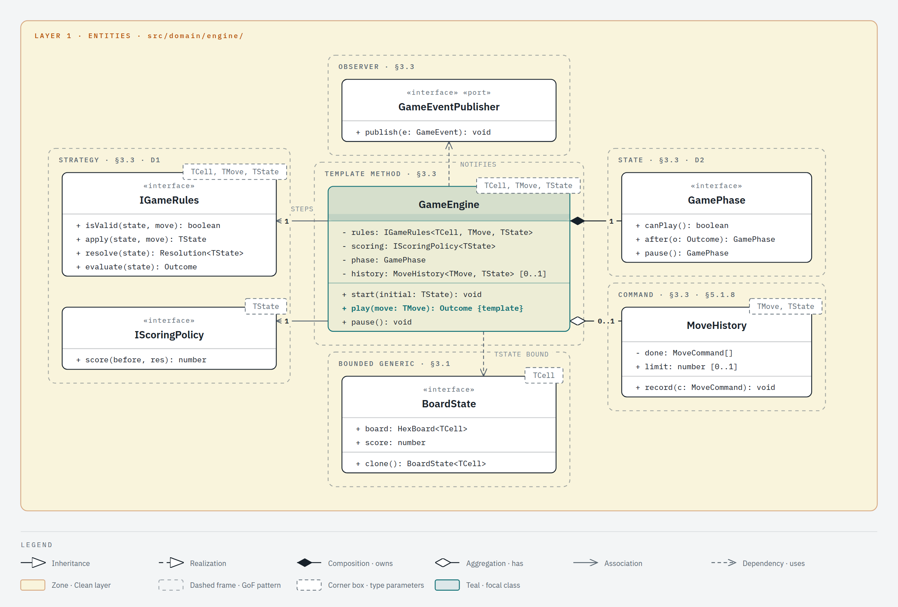

### View 2: board and pieces

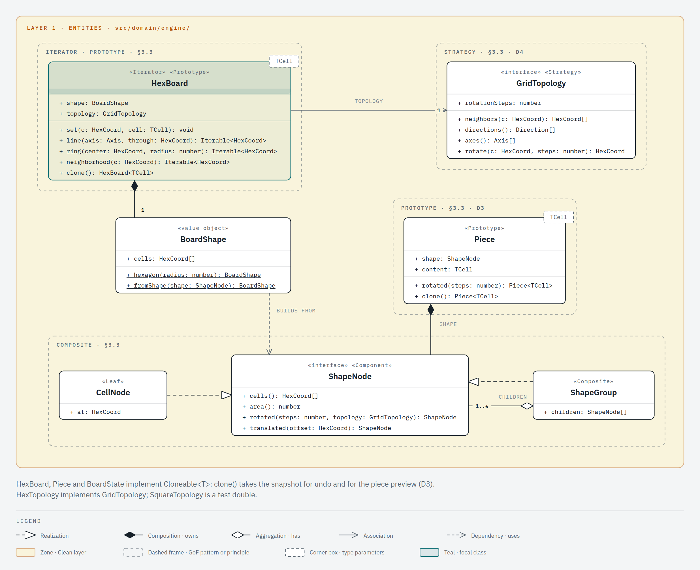

### View 3: undo and redo

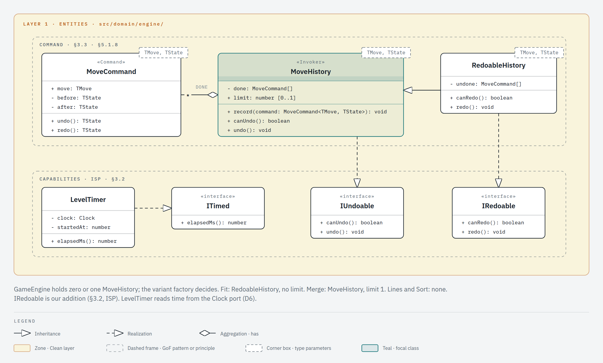

### View 4: piece sources, scoring and progress

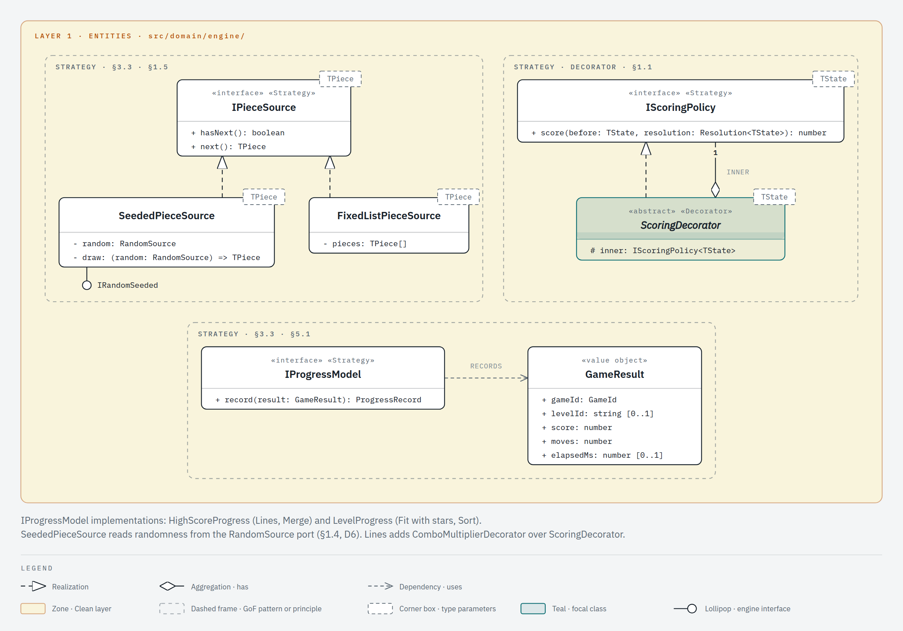

### View 5: wiring a variant

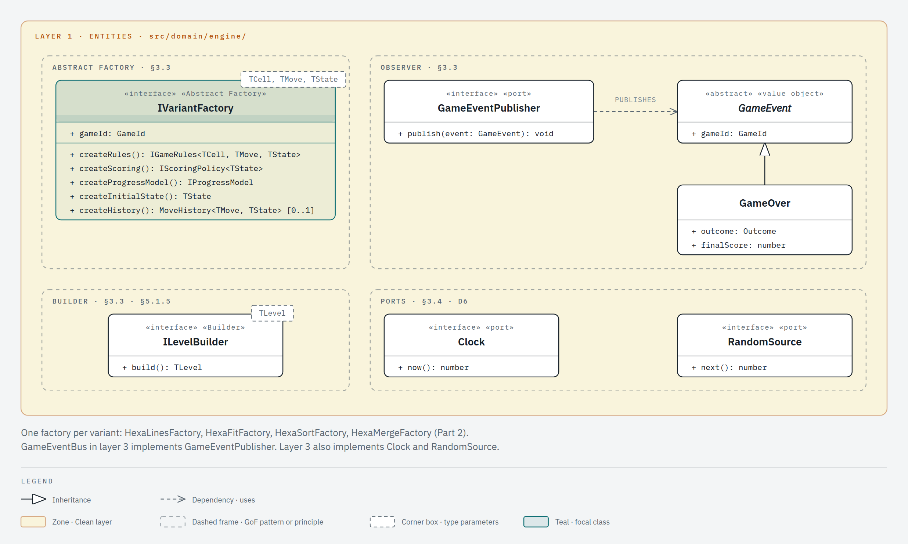

### Full map of the engine

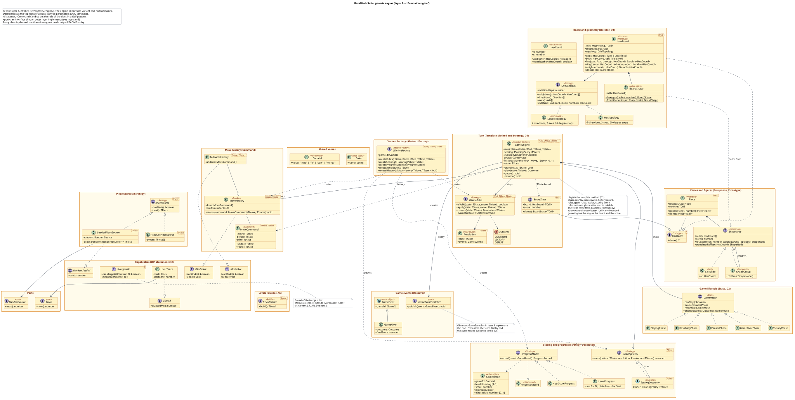

## Part 2: the four variants

`src/domain/variants/<variant>/`. Each variant imports the engine and never another variant (rule `variants-isolated`).

### Hexa Lines

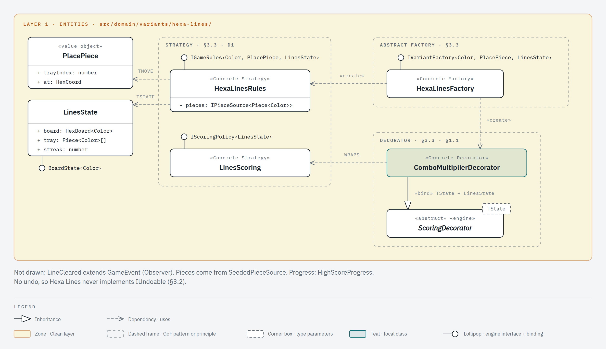

### Hexa Fit

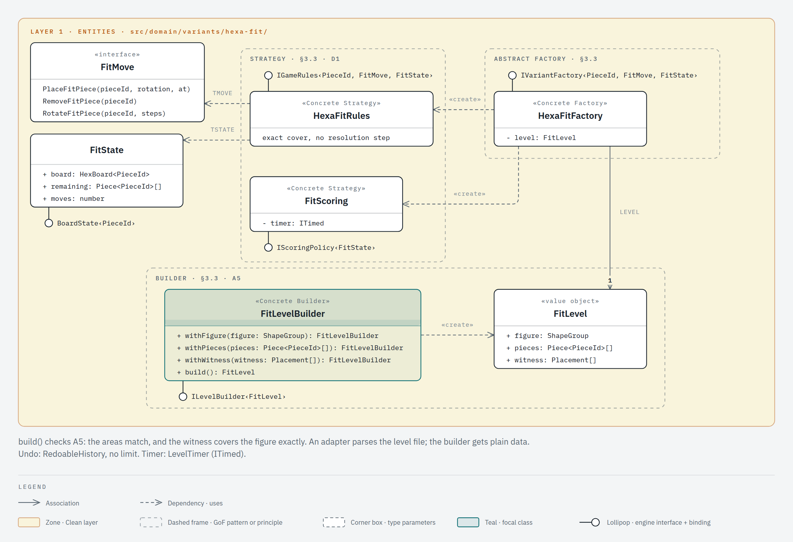

### Hexa Sort

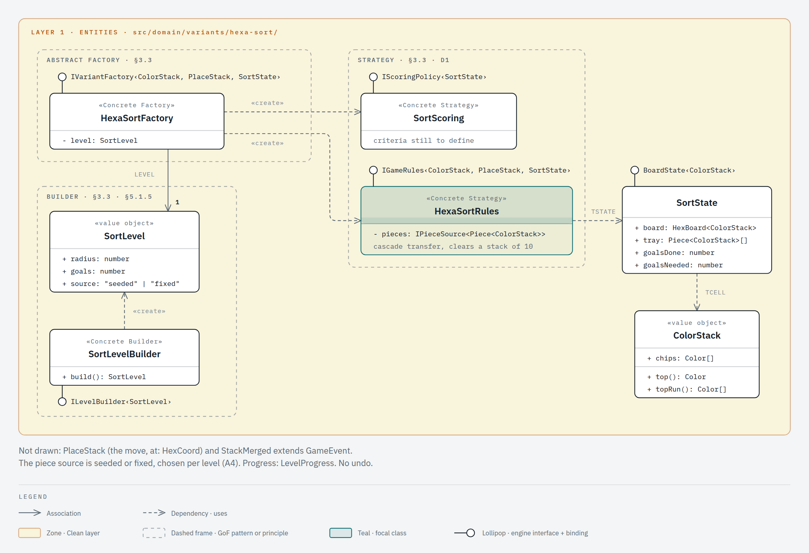

### Hexa Merge

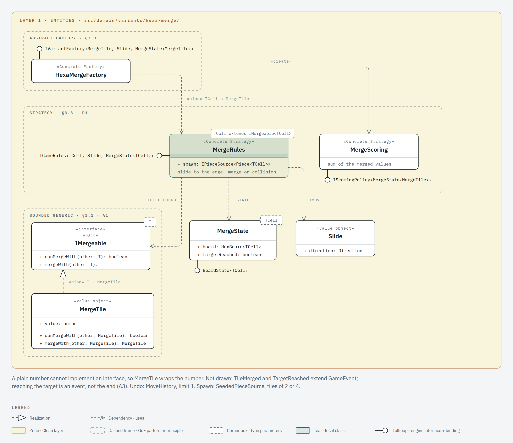

### Full map of the variants

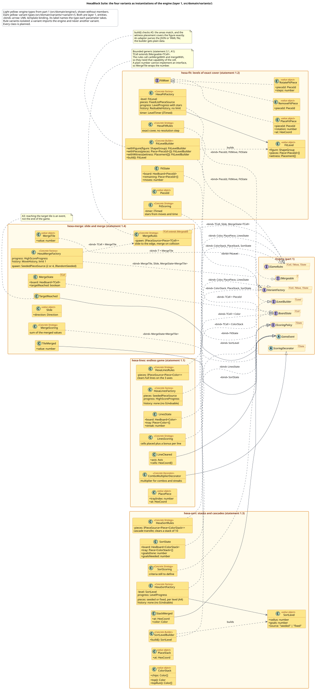

| Variant    | `TCell`                      | `TMove`                                    | `TState`                | Undo                        | Piece source                           | Progress                   |
| ---------- | ---------------------------- | ------------------------------------------ | ----------------------- | --------------------------- | -------------------------------------- | -------------------------- |
| Hexa Lines | `Color`                      | `PlacePiece`                               | `LinesState`            | none                        | `SeededPieceSource`                    | `HighScoreProgress`        |
| Hexa Fit   | `PieceId`                    | `FitMove`: place, remove or rotate a piece | `FitState`              | `RedoableHistory`, no limit | `FixedListPieceSource`                 | `LevelProgress` with stars |
| Hexa Sort  | `ColorStack`                 | `PlaceStack`                               | `SortState`             | none                        | seeded or fixed, chosen per level (A4) | `LevelProgress`            |
| Hexa Merge | `MergeTile`, an `IMergeable` | `Slide`                                    | `MergeState<MergeTile>` | `MoveHistory`, limit 1      | `SeededPieceSource`, tiles of 2 or 4   | `HighScoreProgress`        |

## Patterns in the domain

Eleven of the fourteen patterns of §3.3 live in layer 1. D7 asks for a written reason for each one, so the last column names the requirement behind it.

| Pattern          | Classes                                                                          | Reason                                                                           | Views                         |
| ---------------- | -------------------------------------------------------------------------------- | -------------------------------------------------------------------------------- | ----------------------------- |
| Strategy         | `IGameRules`, `IScoringPolicy`, `IPieceSource`, `IProgressModel`, `GridTopology` | Mandatory (§3.3). The variation dimensions of §1.5. D1 and D4.                   | 1, 2, 4 and the four variants |
| Abstract Factory | `IVariantFactory` and one factory per variant                                    | Mandatory (§3.3).                                                                | 5 and the four variants       |
| Template Method  | `GameEngine.play()`                                                              | The turn skeleton (§3.1, §3.3, D1).                                              | 1                             |
| State            | `GamePhase` and its five phases                                                  | The game lifecycle (§3.3, D2).                                                   | 1                             |
| Command          | `MoveCommand`, `MoveHistory`, `RedoableHistory`                                  | Undo and redo (§3.3, §5.1.8).                                                    | 1, 3                          |
| Prototype        | `Cloneable`: `HexBoard`, `Piece`, `BoardState`                                   | Undo snapshots, rotation and the piece preview (§3.3, D3).                       | 2                             |
| Composite        | `ShapeNode`, `CellNode`, `ShapeGroup`                                            | Pieces made of cells, Fit figures made of regions (§3.3, piece shape row of §8). | 2                             |
| Iterator         | `HexBoard.line()`, `ring()` and `neighborhood()`                                 | Traversal by axis, ring and neighbors (§3.1, §3.3).                              | 2                             |
| Decorator        | `ScoringDecorator`, `ComboMultiplierDecorator`                                   | The Lines combo and streak multiplier (§1.1), scoring row of §8.                 | 4, Lines                      |
| Builder          | `ILevelBuilder`, `FitLevelBuilder`, `SortLevelBuilder`                           | Levels from configuration files (§3.3, §5.1.5), the Fit check of A5.             | 5, Fit, Sort                  |
| Observer         | `GameEventPublisher` and the `GameEvent` classes; `GameEventBus` in layer 3      | Score, audio and screens react to game events (§3.3).                            | 1, 5                          |

The other three patterns live outside the domain, so the next parts draw them: Adapter (the repositories and the API client, layer 3), Facade (audio, layer 4) and Singleton (single-scope injection in the composition root).

## Decisions to check with the team

1. **Template Method by composition.** §3.3 describes Template Method as an abstract class with the variant steps in subclasses. D1 keeps the skeleton in `GameEngine.play()` and takes the steps from `IGameRules` (Strategy), so a variant never extends the engine. The cost: the professor may expect the inheritance form, with an abstract turn class and one subclass per variant.
2. **`GamePhase`, not `GameState`.** The State pattern classes are phases, because `TState` already names the state of a game. [layers.md](layers.md) uses the same name.
3. **Undo is optional per variant.** `GameEngine` holds zero or one `MoveHistory`, and the variant factory decides. Fit gets `RedoableHistory` with no limit, Merge gets `MoveHistory` with limit 1, and Lines and Sort get none. So Hexa Lines never implements `IUndoable` (§3.2).
4. **`IRedoable` is our addition.** The statement lists `IUndoable`, `ITimed` and `IRandomSeeded`. Merge undoes one move and never redoes, so redo gets its own interface (§3.2 ISP, §5.1.8).
5. **`Color` and `GameId` live in the engine.** Lines and Sort both use `Color`, and rule `variants-isolated` forbids one variant from importing another.
6. **One piece type for the four variants.** Every piece is a `Piece<TCell>`: a shape plus the content it puts on the board. A Sort piece is one cell with a stack, and a Merge spawn is one cell with a tile. So `IPieceSource<Piece<TCell>>` serves the four variants.
7. **The board changes in place.** `HexBoard.set()` changes the board, and `clone()` takes the snapshot for undo and for the piece preview. The alternative is an immutable board, where each move returns a new board. Then undo keeps the old board, and Prototype applies only to pieces.
8. **The Merge rules are generic.** `MergeRules<TCell extends IMergeable<TCell>>` is the bounded generic of §3.1. The Merge factory binds it to `MergeTile`. Only one cell type uses it today. The bound states which capability the rules need from a cell.

## Render the images

The `.svg` images come from the `.puml` files. After you edit a `.puml` file, run this from the repository root:

```sh
docker run --rm -u "$(id -u):$(id -g)" -v "$PWD/docs/architecture/classes:/data" plantuml/plantuml:1.2026.9 -tsvg /data/engine-core.puml /data/engine-variants.puml
```

Commit each `.puml` file together with its `.svg` image.

The nine views come from the HTML files in [`classes/views/`](classes/views/). Each file holds one inline SVG drawn with the diagram-design skill. Open the file in a browser to see the view. The `.png` image next to it is that SVG rendered at scale 2 by a headless browser. After you edit a view, export the image again with `/diagram-design:export-diagram docs/architecture/classes/views/<view>.html --png-only`, then run `pnpm format`. The formatter changes the HTML layout only; the drawing stays the same. Commit each `.html` file together with its `.png` image.
