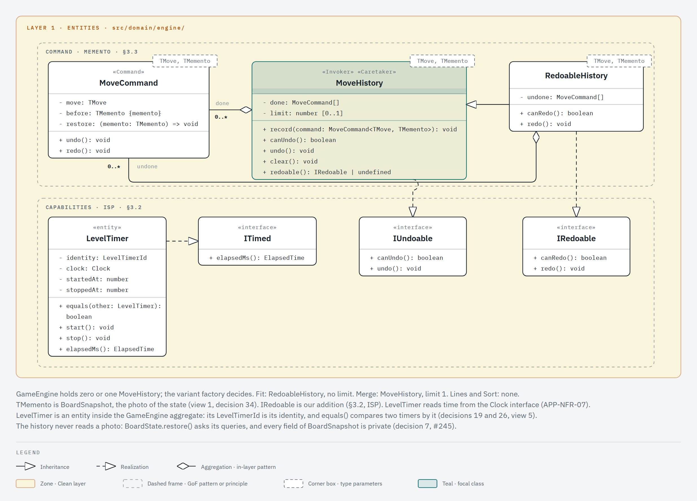
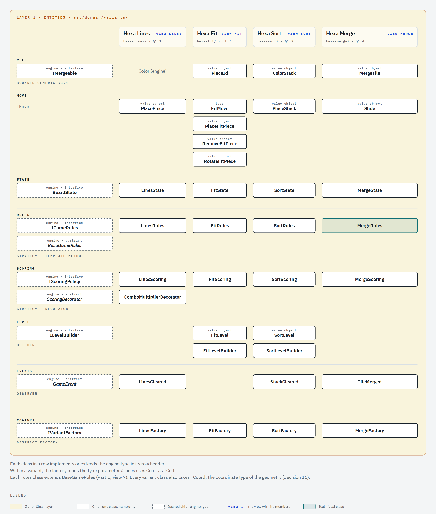
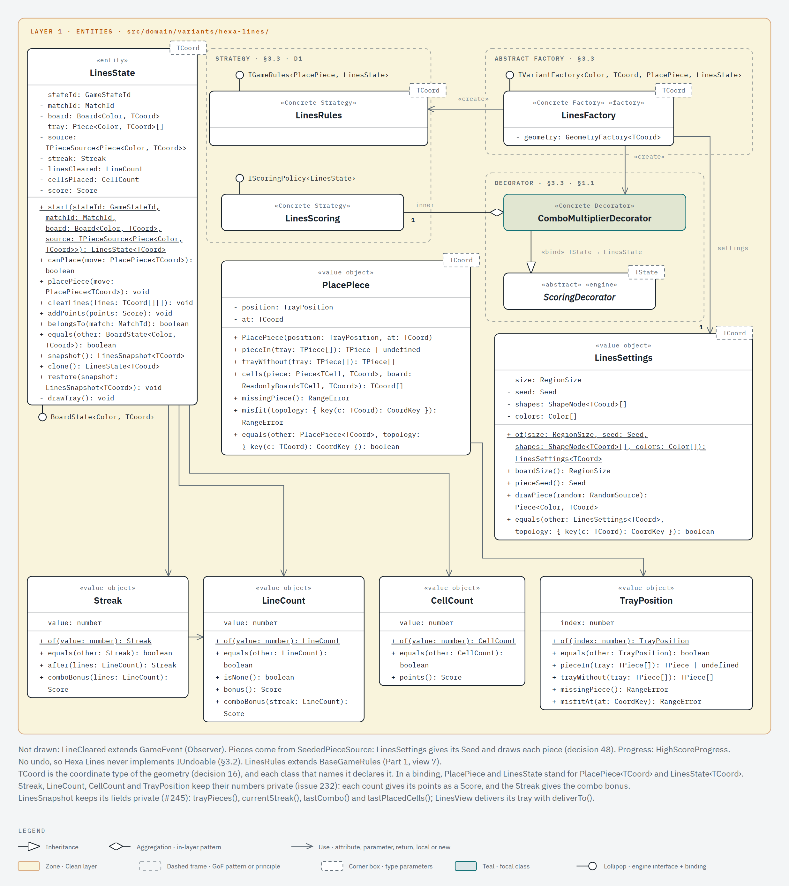
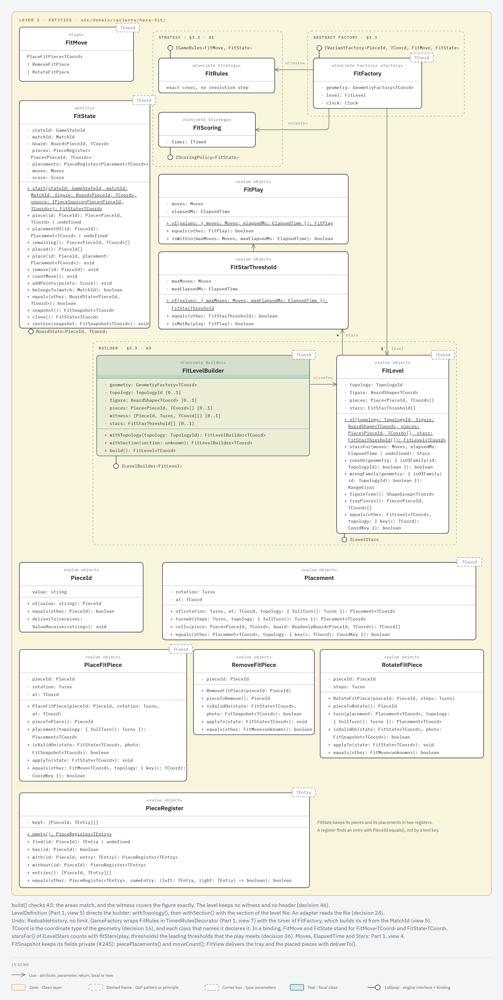
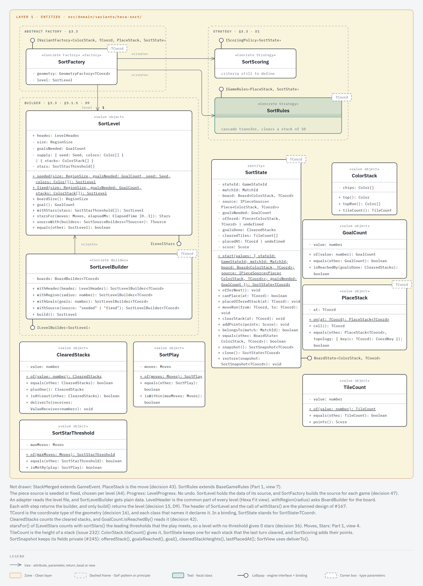
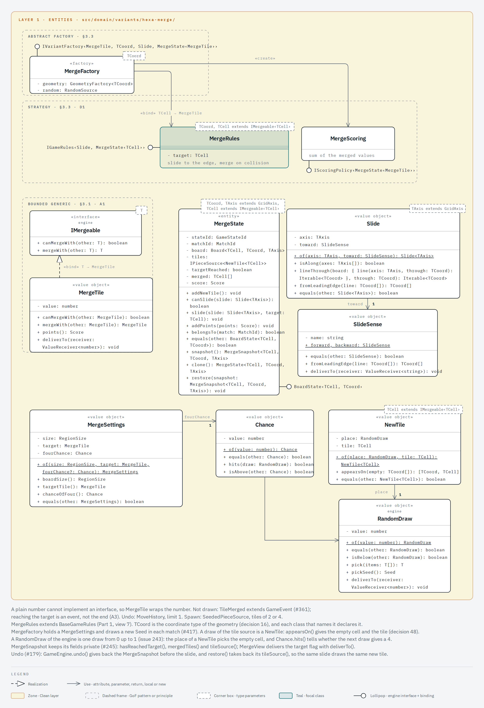
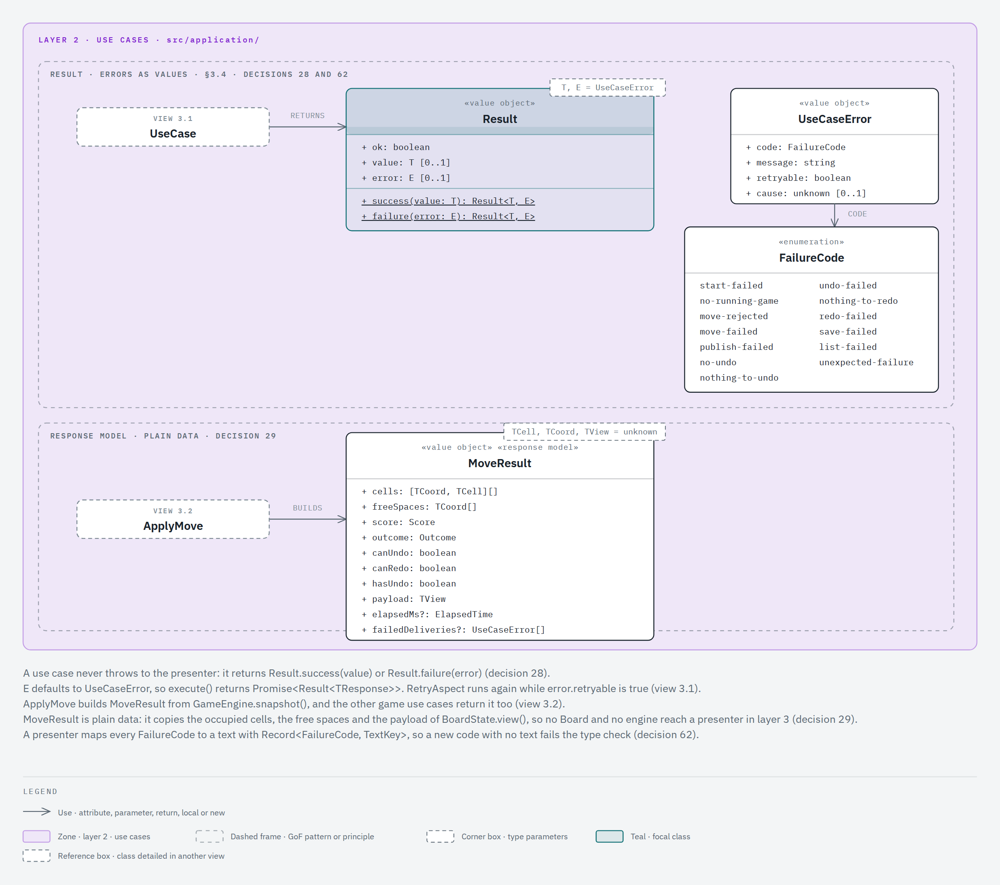
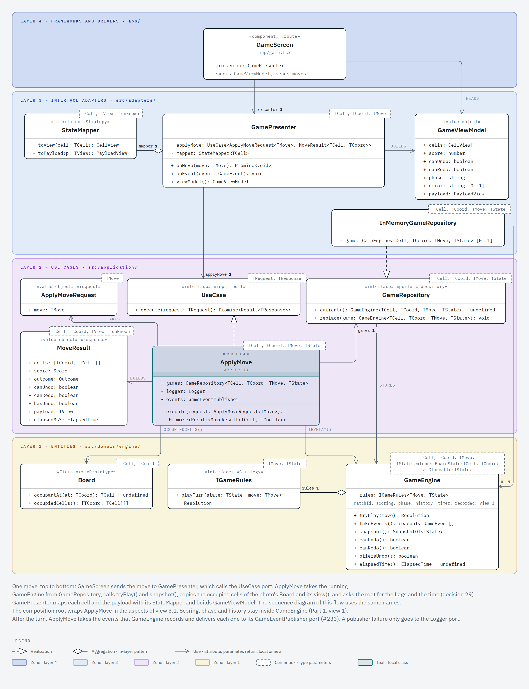
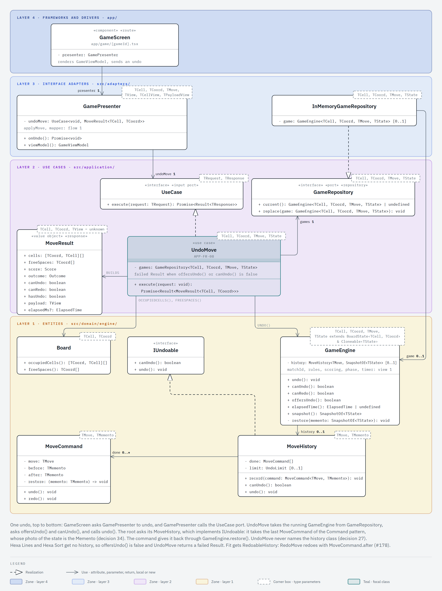

# Class diagram

Status: draft for review with the professor, 2026-10-30. Updated on 2026-10-31 with the team decisions that follow the class and the consultation of 2026-10-30 (decisions 15 to 24), with the design review proposals of decisions 25 to 31, and with the pattern decisions 32 to 36 of 2026-11-01. Updated on 2026-11-02 with the corrections of that class: uses between layers (decision 23), an `execute()` in every use case, and a `Logger` port that takes a log entry (decision 37). Parts 1 and 2 cover layer 1: the generic engine and the four variants. Parts 3 and 4 cover layers 2 to 4: the use cases, the adapters, the presenters and the drivers.

This page answers statement §4.1 for the client. It shows the generic types in UML template notation, how each variant instantiates them, the layers each class lives in, and the design patterns. Each part opens with a map that names every class, grouped by pattern, with no members. Small views then show the members. Seven classes is the target for a small view, and the table [Views above seven classes](#views-above-seven-classes) names each view above it, with its count and the reason. IDs such as A1, D1 and Q8 refer to [`docs/REQUIREMENTS.md`](../REQUIREMENTS.md). The layers themselves are in [layers.md](layers.md). The extensibility diagram, with the engine in the center and the extension points around it, is in [extensibility.md](extensibility.md). The use case flows, each with a class view and a sequence diagram, are in [flows.md](flows.md).

## Views above seven classes

Seven classes is a target, not a limit: a view that needs more boxes to show one idea keeps them, and no view is split for the count (decision of 2026-11-10 on #212). The count is the number of class boxes of the view, and it includes the dashed boxes of classes that another view details. Nineteen of the twenty-one small views of parts 1 to 4 are above the target. A new view above seven classes enters this table with its count and its reason.

| View                                                             | Classes | Reason                                                                                                                                                                                                                                                                                                                                                                                                                                                                                                                                                                                                                                                                                                                                                                |
| ---------------------------------------------------------------- | ------- | --------------------------------------------------------------------------------------------------------------------------------------------------------------------------------------------------------------------------------------------------------------------------------------------------------------------------------------------------------------------------------------------------------------------------------------------------------------------------------------------------------------------------------------------------------------------------------------------------------------------------------------------------------------------------------------------------------------------------------------------------------------------- |
| View 5, wiring a variant (`engine-5-factory`)                    | 14      | `MatchIdGenerator` and its `MatchId` stand with the three local ids built from it: five boxes (decisions 7, 26, 30, 50 and 52). `GameFactory`, `IVariantFactory` and the engine interfaces that the wiring injects take the rest, and `LevelDefinition` (decision 24). `Score` stands next to `GameEnded`, which carries it (decision 41).                                                                                                                                                                                                                                                                                                                                                                                                                            |
| View 1, the turn (`engine-1-turn`)                               | 14      | One turn touches the aggregate root, its two Strategies, its phase, its history and the event that it records, the state with its photo and the photo type `SnapshotOf`, the `Resolution`, the `Outcome` and the `Score` of the turn, and the reference boxes of `Board` and `ITimed`, the type of the timer, inside the frame of the aggregate (#21, #373).                                                                                                                                                                                                                                                                                                                                                                                                          |
| View 4, piece sources, scoring and progress (`engine-4-sources`) | 20      | Three Strategies stand side by side with their concrete classes and value objects. `Moves`, `ElapsedTime`, `Stars` and `LevelId` stand below `GameResult` and `ProgressRecord`, which hold them (decision 42). `Seed` stands by `SeededPieceSource` (decision 48). The progress models stand by the star rules `IStarsByMoves` and `IStarsByMovesAndTime`, by `IStarThreshold` with `starsOf()`, and by `GameProgress` (#156, #424).                                                                                                                                                                                                                                                                                                                                  |
| Hexa Fit (`variant-2-fit`)                                       | 15      | A variant view shows the whole family of one variant. Fit adds the level, its builder, five value objects: `PieceId`, `Placement`, `FitPlay`, `FitStarThreshold` (decision 42) and `PieceRegister` (decision 49), and the three moves `PlaceFitPiece`, `RemoveFitPiece` and `RotateFitPiece` (decision 43).                                                                                                                                                                                                                                                                                                                                                                                                                                                           |
| View 2, board and pieces (`engine-2-board`)                      | 8       | The board comes with its shape, its space and its topology, next to the three classes of the shape Composite.                                                                                                                                                                                                                                                                                                                                                                                                                                                                                                                                                                                                                                                         |
| Hexa Sort (`variant-3-sort`)                                     | 13      | The whole family of Sort, with its cell `ColorStack`, its move `PlaceStack`, its level, its builder, `GoalCount`, `ClearedStacks`, `SortPlay` and `SortStarThreshold` (decision 42), and `TileCount` (decision 54).                                                                                                                                                                                                                                                                                                                                                                                                                                                                                                                                                   |
| Hexa Merge (`variant-4-merge`)                                   | 12      | The whole family of Merge, with the bound `IMergeable`, the move `Slide` and its `SlideSense`, and three value objects: `MergeSettings`, `Chance` and `NewTile` (decision 48), and the engine `RandomDraw` that `NewTile` and `Chance` take (decisions 48 and 54).                                                                                                                                                                                                                                                                                                                                                                                                                                                                                                    |
| Hexa Lines (`variant-1-lines`)                                   | 12      | The whole family of Lines, with the engine `ScoringDecorator`, the move `PlacePiece` and the value object `LinesSettings` (decision 48). The three counts of a placement and the `TrayPosition` of a move stand in one row below them (decision 54).                                                                                                                                                                                                                                                                                                                                                                                                                                                                                                                  |
| View 3.1, the use case contract (`uc-1-contract`)                | 9       | The four aspects are one box each around `UseCase` and `UseCaseAspect`, with the `Logger` port and its entry. `SyncProgress` stands for the use cases that implement `UseCase`, with its binding (#46).                                                                                                                                                                                                                                                                                                                                                                                                                                                                                                                                                               |
| View 3.2, playing a game (`uc-2-game`)                           | 8       | The four game use cases share the `GameRepository` port, and `StartGame` also keeps the `GameFactories` port that gives the factory of the chosen level (#172) and the level and progress ports that refuse a locked level (#397).                                                                                                                                                                                                                                                                                                                                                                                                                                                                                                                                    |
| View 3.3, progress, levels and leaderboard (`uc-3-progress`)     | 19      | The use cases and their ports stand above `GameProgress`, the object of one game that `ProgressRepository` loads and saves (S3-04): the high score and the best result of each level (#156). `LoadProgress` joins `SaveProgress` to read the progress back (#181). `ListLevels` returns a `LevelSummary` with its `LevelStatus`, which lives in layer 1 since #326 (#168). `AchievementCounterRepository` loads and saves `AchievementCounters`, its own aggregate, with its two `AchievementCount` values (#363). `SyncProgress` joins with its ports `AnonymousProgress` and `ProgressGateway`, the `SyncFailure` that the gateway throws and the reference box of `SessionStore` (#46), and `ProgressOwner`, the owner that the progress ports take (decision 66). |
| View 4.4, wiring (`ad-4-wiring`)                                 | 19      | The root creates each driver once: three drivers of today and the two planned single-scope managers, and it receives `ApiClient`. It keeps `GameRegistry` and `BoardFigure`, creates the five adapters of layer 3, keeps one `LocalProgressRepository`, and gives one `LocalAchievementCounterRepository` to the counter listener (decision 18, #172, #188, #323, #363). For the sync it creates `ApiDtoMapper` and `ApiProgressGateway`, builds `SyncProgress` through `decorate()` and gives it to `ResultPresenter` and `AccountPresenter` (#46).                                                                                                                                                                                                                  |
| View 4.2, repositories (`ad-2-repositories`)                     | 13      | The two local repositories share the `KeyValueStore` driver interface and its driver, and each one implements its own port: `ProgressRepository` and `AchievementCounterRepository` (#164, #363). `LocalProgressRepository` also implements `AnonymousProgress`, keeps `SessionStore` for the owner of the progress and keeps one queue per key. `ApiProgressGateway`, its mapper and its transport interface `ProgressApi` stand in layer 3 and implement `ProgressGateway`, and `ApiClient`, their driver, in layer 4 (decisions 22 and 66). The reference boxes of the five ports stand in layer 2.                                                                                                                                                                |
| View 3, undo and redo (`engine-3-history`)                       | 8       | The Command history with its redo (#178), the three capability interfaces of §3.2 that the history and the timer implement, and `LevelTimer` with the `ClockReading` of its start and its stop (#238).                                                                                                                                                                                                                                                                                                                                                                                                                                                                                                                                                                |
| View 6, geometry and board (`engine-6-geometry`)                 | 16      | The geometry family stands with its coordinates, `TopologyId`, the axis classes of the three topologies (decision 45) and their internal direction classes (decision 16), next to `BoardBuilder` and the reference box of `Board`.                                                                                                                                                                                                                                                                                                                                                                                                                                                                                                                                    |
| View 7, the rules template (`engine-7-rules`)                    | 8       | The rules contract with its template and its decorator and the `Resolution` of a turn take four boxes. The reference boxes of `GameEngine`, `LinesRules`, `FitRules` and `LevelTimer` show who calls, extends and times the rules (#21).                                                                                                                                                                                                                                                                                                                                                                                                                                                                                                                              |
| View 3.6, achievements (`uc-6-achievements`)                     | 19      | The achievements cross four layers: the screen, its presenter with two view models, the `UseCase` port, `ListAchievements` with its summary and its `Achievement` values, the three repository ports, and in layer 1 the goal interface with four goals, the `LevelStatus` that two of them count with, and the reference boxes of `GameProgress` and `AchievementCounters` (#188, #326, #364).                                                                                                                                                                                                                                                                                                                                                                       |
| View 4.1, presenting a game (`ad-1-presenter`)                   | 16      | One game screen joins the board with its cell renderer and the three figure layouts (#165), the move controls of each game (#175, #177), and the presenter with its view model and the state mappers (#170).                                                                                                                                                                                                                                                                                                                                                                                                                                                                                                                                                          |
| View 4.3, game events and sound (`ad-3-events`)                  | 8       | The Observer frame holds the bus, the listener interface and `AchievementCounterListener`, the first listener (#362), next to the publisher port, the event and the audio Facade with its sound library and the presenter.                                                                                                                                                                                                                                                                                                                                                                                                                                                                                                                                            |

The five class views of the use case flows draw 12 to 17 classes, because a flow crosses the four layers. [flows.md](flows.md) holds them and sets no target.

## Whole model in draw.io

[`classes.drawio`](classes.drawio) holds the whole class model in one draw.io file, with 6 pages. Open it in draw.io or diagrams.net.

- Page 1, `All classes`, holds every class, interface and type of the model once, by layer: layer 4 at the top and layer 1 at the bottom, so every dependency points down.
- Pages 2 to 6, `Engine`, `Variants`, `Use cases`, `Adapters` and `Infrastructure`, hold one part each. A part page shows the types of its part in full. A grey box with the name only is a type of another part that one of its lines touches, and its eyebrow names the page that details it.
- A solid box is a type that existed in the code at the commit of the last generation. The title of each page names that commit. A dashed box with `«planned»` is design from the views of this page that the code does not have yet. It keeps the `«Sprint N»` of its view when the view gives one.
- A function component is code too (#392, option A). The generator reads `app/` and `src/`: the default export of each route of `app/`, such as `GameScreen`, and each exported function component of a `.tsx` file of `src/`, such as `BoardView`, is a code type of kind `component`. [`classes.config.json`](classes.config.json) places `app/` in layer 4, part `Adapters`, next to `src/infrastructure/`. A component box carries `«component»`, its name and its props as attributes. The generator follows a use into a top-level function of the same file, such as `wonCountOf()` for `LevelsWon` → `LevelStatus`.
- A grey line marked `planned` between two solid boxes is a use or a realization that a view draws and that the generator does not see in the code. Each one has a reason. `GameScreen` reaches `BoardView`, `GamePresenter`, `GameViewModel` and `MoveControls` through `GameStage` and `useGameSession()`, and `AchievementsScreen` reaches `AchievementsPresenter` through `useAchievements()`: the generator follows no function or component of another file. `ApplyMove`, `StartGame` and `UndoMove` read the cells and the free spaces through `moveResultOf()` of `move-result.ts`, another file, and that function reads a `ReadonlyBoard` from `BoardSnapshot.boardCopy()`, not a `Board`. View `engine-1-turn` draws no `IScoringPolicy` → `BoardSnapshot`: `score()` takes `SnapshotOf‹TState›`, a conditional type with `infer` that names no `BoardSnapshot`, and `IScoringPolicy‹TState›` does not bound `TState`, so the generator sees no such use. The view draws the code line `IScoringPolicy` → `SnapshotOf` instead, and each photo of a state is still a `BoardSnapshot` (decision 34). `LinesRules`, `FitRules`, `SortRules` and `MergeRules` → `IGameRules` are indirect: each rules class extends `BaseGameRules`, which implements `IGameRules`. `CompositionRoot` → `ConsoleLogger` «create» is in the default value of a constructor parameter, which the generator does not read. `GamePresenter` → `GameEventListener` is design of view `ad-3-events` that the code does not have yet.
- `members not designed yet` marks a planned class that no view details.
- A box with no operation says why. `«dataType»` marks a class in the code with no operation: it only carries data. No class of the app needs it today, so no legend lists it. An interface with no operation carries `«interface»`, next to the stereotypes of its views, such as `«value object»`, and never `«dataType»` on top. A union of literals, such as `Language`, carries `«enumeration»` and one literal per line. A type alias, such as `FitMove` or `ApiClient`, carries no kind word: its box shows its name and the aliased type or its members. **The change of 2026-11-24:** until that day the generator put `«dataType»` on every type in the code with no operation, interfaces included, and printed `«union»` and `«type»` as stereotypes. The views `variant-2-fit`, `flow-2-save-progress` and `flow-5-login` drew `«type»` on `FitMove` and `ApiClient` until then.
- A line of structure (extends, implements, composition) is thick. A `use` line is thin and light, and it lives in the draw.io layer `use lines`. Hide that layer in Edit > Layers to read the structure alone.
- Inside a group of 12 boxes or more, a frame holds the boxes of one view of this page. The frame title is the file name of the view in [`classes/views/`](classes/views/), for example `view engine-1-turn` for `engine-1-turn.png`.
- The pages follow the reading rules of the next section, and each page has a legend.

The file is generated from the code at that commit plus the views of this page, by the tool [`drawio-clases`](https://github.com/Hexablock-Suite/.github/tree/main/tools/drawio-clases) of the organization repository. The README of the tool gives the commands. [`classes.config.json`](classes.config.json) maps the folders and the views to layers and parts. [`classes.layout.json`](classes.layout.json) fixes the order of the groups of each band and of the boxes of each group.

A hand edit of that order survives. Move the boxes in draw.io, run `pin.mjs` of the tool to write the order into `classes.layout.json`, and generate the file again. Commit `classes.drawio` and `classes.layout.json` together. Any other hand edit is lost at the next generation: a pixel position, a line route, a text or a style.

## How to read it

- The colored zone is the Clean layer, with the colors of [layers.md](layers.md). Parts 1 and 2 are layer 1, entities, so their zones are yellow.
- In parts 3 and 4, one view can show several layers. The zones are bands, with the outer layer at the top and the inner layer at the bottom, so every dependency points down.
- A dashed frame groups the classes of one GoF pattern or one design principle. Its label names the source, for example `STRATEGY · §3.3 · D1`. A dark dashed frame labelled `AGGREGATE` marks the boundary of an aggregate (decision 52).
- The title of a frame names its pattern, or a note of the view names it. No box carries a role label of a pattern, such as `«Strategy»` or `«Decorator»`: the interface of a pattern carries only `«interface»`, and a concrete piece of a pattern carries no role label (decision 23). Zone, frame and stereotype never carry the same information.
- The dashed box at the top right of a class holds its type parameters. This is the UML template notation that §4.1 asks for. A class declares there every parameter that its members name, for example `TCoord`. A bound on a parameter goes in the same box, for example `TState extends BoardState‹TCell, TCoord› & Cloneable‹TState›` on `GameEngine`. No line draws a bound, because a bound is not a parameter, a return value or a local variable.
- Every operation shows the type of each parameter and its return type. One operation has the same signature in every view. Every use case box shows `execute()` with the request and response types of its `UseCase` binding. In the class of 2026-11-02 the professor said that a class with no operations, or with operations that leave out their parameters, is wrong.
- The teal class is the focal class of the view.
- An italic class name or operation is abstract.
- An underlined operation is static, for example `Score.of()`.
- A solid line with an open arrowhead is a use: the other class is an attribute, a parameter, a return value, a local variable or a `new`. Every dependency between two layers is a use. When the class keeps the other class in an attribute, the arrow end names the attribute and its multiplicity, even when it is 1, for example `games 1`. Otherwise the line carries a verb, for example `PLAY()` or `«create»`.
- A filled diamond (composition) at the end of the aggregate root marks each internal entity of its aggregate. The other end names the attribute and its multiplicity. A hollow diamond (aggregation) at the end of a decorator joins it to the type that it wraps, with the label `decorate` and the multiplicity `1` at the other end. An aspect is a decorator. The diamond sits on the class that declares the wrapped attribute. A decorator that inherits that attribute draws no second diamond: `ComboMultiplierDecorator` extends `ScoringDecorator`, which declares `inner` and carries the diamond to `IScoringPolicy`, and the subclass shows its `extends` and a use `«bind»` to `LinesScoring`. Any other attribute is a use with the attribute name and its multiplicity: a value object, the Strategy of a context, a port, the children of the Composite `ShapeGroup` and every other piece of a GoF pattern, because the class box already shows the attribute. The title of a frame names each pattern, and the interface of a pattern carries only `«interface»`. This is the form of the professor's solution of the exercise of 2026-11-06, which he handed out in the class of 2026-11-14, and the team took it on 2026-11-15 (decision 23). Every view follows it since #52. The hollow diamond of a decorator is the form of the class of 2026-11-23, and the views `engine-4-sources`, `engine-7-rules`, `uc-1-contract` and `map-3-usecases` draw it since 2026-11-24 (decision 23).
- No line starts or ends on a dashed frame. A map draws a line between two groups from the chip of the class that holds, calls or implements to the chip of the class it needs, with the same rule as a view: an attribute shows its name and multiplicity, for example `phase 1`, and any other use shows a verb, for example `CREATES`. A line from frame to frame would claim that every class of one group uses every class of the other. In the session of 2026-11-03 the professor asked about such a line: «todas esas usan los tres bloques de abajo, a lo mejor la respuesta es no». A map draws only the main dependencies, one or a few for each pair of groups. The view of each group shows the rest.
- The legend of each view lists only the line kinds that the view draws. A view lists `Composition` only when it draws a filled diamond, and `Aggregation` only when it draws the hollow diamond of a decorator.
- In the variant views, a lollipop (a circle on a short line) is an engine interface that the class implements. Its label names the type that each parameter takes, for example `IGameRules‹PlacePiece, LinesState›`.
- In a map, a chip is one class with its name only. Every line of a map starts and ends on a chip. The group header names the view that shows the members, for example `VIEW 2`.
- In the variants map, a dashed chip is an engine type. Each class in its row implements or extends it.
- A dashed box with no members is a class that another view details. Its eyebrow names that view, for example `PART 1 · VIEW 1`.
- Under the name of a use case, an ID such as `APP-FR-08` names the requirement it serves.
- `UseCase` and `UseCaseAspect` name architecture roles, not game concepts. `UseCase` is the generic input port, the «input boundary» of Clean Architecture, and every use case implements it (decision 9). `UseCaseAspect` is the abstract base of the AOP decorators of view 3.1. APP-NFR-11 asks one aspect to cover the four variants, so all use cases need one shared contract, and its name states that role. The professor's rule «Tiene que tener semántica del problema» (class of 2026-10-16) applies to the entities, the concrete use cases and the ports, and they follow it: for example `ApplyMove`, `MoveHistory` and `GameRepository`.
- `«port»` marks an interface of layer 2 that an outer layer implements. Ports live in the application layer (decision 25). The engine and layer 3 have other interfaces that an outer layer implements, such as `Clock`, `KeyValueStore` and `HealthApi`. They carry `«interface»` only. `«aggregate root»` marks the entity that guards a game (decision 26). `«value object»`, `«entity»`, `«aggregate root»`, `«domain event»`, `«factory»` and `«repository»` are the tactical stereotypes of the domain design. A factory box carries `«factory»`, next to `«interface»` on an interface such as `GeometryFactory`, and no role label: the title of its frame names its design pattern, for example `HexGeometry` in the `ABSTRACT FACTORY` frame of view 6. A repository port carries `«repository»` next to `«port»`, and a repository adapter carries `«repository»` only. A box with no tactical stereotype is a piece of a design pattern: the title of its frame or a note of the view names the pattern (decision 23). `GameRepository` carries `«repository»` next to `«port»`: it is the repository of the game aggregate (decision 10). A question in the stereotype line, such as `«composition root» · Q9`, marks a placement that the professor's answer can move. The screens, such as `GameScreen`, and `BoardView` are React components of layer 4, not classes. No box carries a label for it: a note of each view that draws one says so.
- The code holds the engine in `src/domain/engine/`, its shared leaves in `src/domain/shared/`, the progress and the levels in `src/domain/progress/` and the achievements in `src/domain/achievements/` (decision 64), the four variants in `src/domain/variants/`, of layer 2 `StartGame`, `ApplyMove`, `UndoMove`, `RedoMove` (#178), `SaveProgress`, `LoadProgress` (#181), `LoggingAspect` and their ports in `src/application/`, of layer 3 `InMemoryGameRepository`, `GameEventBus` with `GameEventListener` and `AchievementCounterListener` (#362), `LocalProgressRepository` (#164) and `LocalAchievementCounterRepository` (#363) in `src/adapters/`, and of layer 4 `CompositionRoot`, `GameRegistry`, `BoardFigure` (#171), `SystemClock`, `SeededRandomSource`, `ConsoleLogger` and `SequentialMatchIds` in `src/infrastructure/` (#162), the driver interface `KeyValueStore` in `src/adapters/` and its driver `DeviceKeyValueStore` in `src/infrastructure/` (#155), and `BoardView` and `CellRenderer` in `src/infrastructure/board/` (#165), with `BoardLayout`, `HexLayout`, `SquareLayout` and `TriangleLayout` of layer 3 in `src/adapters/board/` (#165, #393), and `ApiClient` in `src/infrastructure/api/`, which implements `HealthApi`, the transport interface of layer 3 in `src/adapters/api/` (#404). A class with a `«Sprint N»` stereotype is planned. View 2 draws two members that the code adds: `GridTopology.key(c: TCoord): CoordKey`, because the board stores its cells by a key, and a `contains: (c: TCoord) => boolean` parameter on `GridTopology.line()`, so the topology stops the line at the edge of the board. `Board.contains(c: TCoord): boolean` exposes the same test. `Board.line()` through a coordinate outside the shape yields nothing. The `Board` constructor throws a `RangeError` for an initial entry outside the shape and for an entry whose key differs from `GridTopology.key()` of its coordinate. It copies each entry, so the caller and the board share no tuple. `Piece.translated(offset: TCoord, topology: GridTopology<TCoord>): Piece<TCell, TCoord>` moves the shape through `ShapeNode.translated()`, so the triangle test of decision 16 can translate a piece. Issue #86 closes the primitive types of view 2 (APP-NFR-25): `GridTopology<TCoord, TAxis extends string, TDirection extends string>` and `Board<TCell, TCoord, TAxis extends string>` carry the closed axis and direction unions of each topology, `ring()` takes a `Radius` (a whole number of zero or more), `region()` a `RegionSize` (a whole number of one or more), `rotate()` and `rotated()` a `Turns` (any whole number). Each `of()` accepts only a safe integer (`Number.isSafeInteger`) and stores `-0` as `0`, and `key()` returns `CoordKey`, a value object since #246 (decision 44). Since #207 an axis and a direction are classes with a closed set of instances (decision 45), and `TAxis` and `TDirection` default to `GridAxis` and `GridDirection`. `Board` and the shape operations take a topology with any direction, and `BoardSnapshot.board` is a `ReadonlyBoard<TCell, TCoord>`, a board with any axis, so `GameEngine`, `IGameRules` and `BoardState` gain no type parameter. Since #416 `GridTopology` names no direction: `TDirection`, `GridDirection`, `neighbor()` and `directions()` are gone, and each topology keeps its direction class private (decision 16). The README table «Primitive types» gives the reason for each primitive that stays. `GamePhase.resume(): GamePhase` ends a pause. A phase keeps its name private: `GamePhase.checkAcceptsMove(): void` and `checkAcceptsUndo(): void` throw the `RangeError` that names the phase when the phase refuses a move or an undo, so `GameEngine` does not read the name. `Resolution` is a value object that holds an `accepted` flag and the `Outcome`, and no state: `equals()` compares both values (decision 26), and `Outcome` is a value object with the closed set of instances `playing`, `victory` and `gameOver` (decision 45). `GameEngine` takes its `MatchId` and its `GameId` in the constructor, answers its phase through `currentPhase()`, has `resume()`, and takes an optional history, an `IUndoable`, for undo (APP-FR-08, decisions 3 and 27) and an optional timer (decision 19, #234). It takes no `GameEventPublisher`: it records its events, and `ApplyMove` takes them with `takeEvents()` and delivers them (#233). `SeededPieceSource` takes a `Seed` and builds its own `Mulberry32Random` with `Mulberry32Random.from(seed)`, an engine `RandomSource` with the Mulberry32 generator, so the same seed gives the same pieces. A source is a value object: `take()` returns the piece and the next source, and no operation changes the source (decision 51). `Mulberry32Random` has `clone()`, which copies the generator state (decision 31). A `Seed` holds an integer from 0 to 4294967295, and `Seed.of()` throws a `RangeError` for any other number, so no seed is truncated into another (decision 48). `FixedListPieceSource` throws a `RangeError` on a list that holds `undefined`, and it copies its list once and freezes the copy. `IRandomSeeded` keeps its `Seed` private, and `isSeededWith(seed)` tells whether the object draws from a seed (#234). `BaseGameRules` adds the protected step `noValidMove(state: TState): boolean`, the end check of decision 33, so each variant `evaluate()` reuses it. `ProgressRecord` keeps the `GameId` and the `Score` of a result, and the record of a level also keeps its `LevelId`, `Stars`, `Moves` and `ElapsedTime` (decision 56). Its fields are private, and `deliverTo()` gives them to a repository of the edge (decision 57). `GameResult.of()` and `ProgressRecord.of()` take value objects, and each value object checks its own value: `Score.of()`, `Stars.of()`, `Moves.of()` and `ElapsedTime.ofMs()` throw a `RangeError` for a number that is not a safe integer of 0 or more (decisions 41 and 42).

## Part 1: the generic engine

`src/domain/engine/`, with its sibling folders `src/domain/shared/`, `src/domain/progress/` and `src/domain/achievements/` (decision 64). It imports no variant and no framework (rules `domain-no-framework` and `engine-no-variants`). Three folder rules keep the four folders free of cycles: `shared-imports-only-shared`, `progress-imports-only-shared` and `achievements-imports-only-shared-and-progress`.

### Map of the engine

### View 1: the turn

![The turn: a dark dashed frame marks the game aggregate, GameEngine with its internal entities BoardState, Board and the timer; the root joins the state and the timer, an ITimed, with a filled diamond, and the board and ITimed are reference boxes; BoardState declares no board; GameEngine, the aggregate root of a game, runs each turn through IGameRules, whose playTurn() is the template method of BaseGameRules, and scores with IScoringPolicy, the two interfaces of the Strategy frame; GamePhase stands in the State frame, MoveHistory in the Command frame and GameEvent in the Observer frame; it records the GameEvent objects of its turns, and ApplyMove takes them with takeEvents(); each turn returns a Resolution, a value object that carries an Outcome, the value object with the closed set playing, victory and gameOver; BoardState creates BoardSnapshot, the immutable photo of the Memento pattern that the scoring reads and the undo keeps, and IScoringPolicy reads the photos through the type alias SnapshotOf; Score is the value object of the score and of the points of a turn](classes/views/engine-1-turn.png)

### View 2: board and pieces

### View 3: undo and redo

### View 4: piece sources, scoring and progress

### View 5: wiring a variant

![Wiring a variant: IVariantFactory creates the rules, piece source, scoring and board; LevelDefinition, the data of one level file, directs ILevelBuilder, the game events, the Clock and RandomSource interfaces of the engine, the MatchIdGenerator, which gives the MatchId of each new match, the local ids that keep that MatchId (the GameStateId of its state, the BoardId of its board and the LevelTimerId of the timer of a timed game), and GameFactory, the factory of the aggregate, which creates the started GameEngine; GameEnded extends the abstract GameEvent, keeps its fields private and carries the final Score](classes/views/engine-5-factory.png)

### View 6: geometry and board

### View 7: the rules template

## Part 2: the four variants

`src/domain/variants/<variant>/`. Each variant imports the engine and never another variant (rule `variants-isolated`).

### Map of the variants

### Hexa Lines

### Hexa Fit

### Hexa Sort

### Hexa Merge

| Variant    | `TCell`                              | `TMove`                                    | `TState`                | Undo                        | Piece source                           | Progress                   |
| ---------- | ------------------------------------ | ------------------------------------------ | ----------------------- | --------------------------- | -------------------------------------- | -------------------------- |
| Hexa Lines | `Color` of the engine                | `PlacePiece`                               | `LinesState`            | none                        | `SeededPieceSource`                    | `HighScoreProgress`        |
| Hexa Fit   | `PieceId`                            | `FitMove`: place, remove or rotate a piece | `FitState`              | `RedoableHistory`, no limit | `FixedListPieceSource`                 | `LevelProgress` with stars |
| Hexa Sort  | `ColorStack` of engine `Color` tiles | `PlaceStack`                               | `SortState`             | none                        | seeded or fixed, chosen per level (A4) | `LevelProgress` with stars |
| Hexa Merge | `MergeTile`, an `IMergeable`         | `Slide`                                    | `MergeState<MergeTile>` | `MoveHistory`, limit 1      | `SeededPieceSource`, tiles of 2 or 4   | `HighScoreProgress`        |

The variant classes stay generic over `TCoord`, like the engine, so a variant runs on any geometry (decisions 16 and 17). Each variant class that names `TCoord` declares it in its template box. Each variant factory keeps the `GeometryFactory<TCoord>` it receives in its `geometry` attribute. The player chooses the figure on the home screen, and the composition root gives the family of that figure to each variant factory (decision 18, #171), so a running game binds `TCoord` to the coordinate of that family. In a lollipop binding, a variant state such as `LinesState` stands for `LinesState<TCoord>`. Hexa Lines and the other game names stay as display names. The class names drop the `Hexa` prefix.

## Part 3: the use cases

`src/application/`, layer 2. It imports only `src/domain/` and `src/application/` (rule `application-imports-only-domain`), and never `src/domain/variants/` (rule `application-no-variants`). Each use case names the requirement it serves.

### Map of the use cases

![Map of the use cases: the 50 classes of layer 2 in eight groups, AchievementCounterRepository of #363 among the output ports, AccountFailure of #45 among the models, SyncProgress of #46 among the progress use cases with its ports AnonymousProgress and ProgressGateway among the output ports and SyncProgressRequest and SyncFailure among the models, the achievements of #188 among them, with LevelDefinition, LevelStatus, AchievementGoal, LevelsWon, EveryLevelWon, BestCountReached and TotalCountReached of layer 1 as dashed chips, each group with the view that shows its members; UseCaseAspect, StartGame, SaveProgress, LoadProgress and Register implement UseCase, and RedoMove, SyncLeaderboard and UpdateSettings keep an output port](classes/views/map-3-usecases.png)

### View 3.1: the use case contract and its aspects

![The use case contract: every use case implements UseCase, as SyncProgress does with its binding to SyncProgressRequest and void (#46), and the composition root wraps each one through decorate(), today in LoggingAspect alone; the aspect decorators wrap it for logging, timing, retry and authorization; AuthorizationAspect stays planned for SyncLeaderboard because SyncProgress reads the session itself, and RetryAspect is planned with no sprint because #46 delivered APP-FR-13 without it; the Logger port takes a UseCaseLogEntry, which also carries the failed deliveries of a success](classes/views/uc-1-contract.png)

Since D27 in [REQUIREMENTS.md](../REQUIREMENTS.md) (#325), `SaveProgress` and `ListLevels` need no session. Since #46 `SyncProgress` reads the session itself through the `SessionStore` port and sends nothing with no session (decision 66), so no aspect checks the session before it. `AuthorizationAspect` stays planned. This view draws `SyncProgress` and its realization of `UseCase` since #46, and its footnote keeps `AuthorizationAspect` for `SyncLeaderboard` only (#338). View 3.3 and flow 2 draw the ports of `SyncProgress`.

### View 3.2: playing a game

### View 3.3: progress, levels and leaderboard

![Progress, levels and leaderboard: SaveProgress, LoadProgress, ListLevels and SyncLeaderboard over their repository ports; LoadProgress reads the progress of the game of its request back, or undefined when the game has none (#181, #410); ListLevels takes the game and the chosen figure and returns one LevelSummary with a LevelStatus per level; LevelStatus in layer 1 gives the status of each level with ofEach() and reads GameProgress; LevelRepository also finds one level of a game by its id; ProgressRepository gives the ProgressOwner with owner(), the last signed-in user or the anonymous owner, and loads and updates GameProgress of that owner in one queue per key, the one object of a game with the high score and the best result of each level, which gives the stars of a level; AchievementCounterRepository loads and saves AchievementCounters, the counters of the achievements of one game in their own aggregate, with a best count and a total, each an AchievementCount (#363); SyncProgress (#46) reads the session through SessionStore, merges the anonymous progress into the owner of the session through mergeAnonymousInto() of AnonymousProgress, loads the progress and merges the answer through load() and update() of ProgressRepository, and sends the progress through ProgressGateway, which throws a SyncFailure; GameProgress merges another progress of its game with mergeWith()](classes/views/uc-3-progress.png)

### View 3.4: account and settings

![Account and settings: Register, Login and UpdateSettings over the AccountGateway, SessionStore and SettingsStore ports; Register and Login also keep an optional AnonymousMerge, so a sign-in merges the progress played with no account into its user (#46); AccountGateway returns a Session and rejects with an AccountFailure; SessionStore reads, writes and clears the session and gives owner(), the user of the last sign-in, and SyncProgress of view 3.3 clears the token when the backend refuses it, which keeps the owner (#46)](classes/views/uc-4-account.png)

### View 3.5: results and response models

The `Result` box sums up two declarations of `src/application/result.ts`: the union type `Result<T, E>`, which is `{ ok: true, value }` or `{ ok: false, error }`, and the companion object `Result` with `success()` and `failure()`. The box draws the union as one class with the three fields, and the two creators of the object as static operations. The note of the view says the same.

### View 3.6: achievements

![Achievements: AchievementsScreen in layer 4 keeps the AchievementsPresenter of its hook; the presenter keeps the UseCase port and an AchievementsViewModel with two AchievementSection values; ListAchievements keeps LevelRepository, ProgressRepository, which gives the owner with owner() and its progress with load(owner, gameId) (#46), AchievementCounterRepository and a list of Achievement values, each with an optional AchievementGoal of layer 1 that LevelsWon, EveryLevelWon, BestCountReached and TotalCountReached implement, and returns one AchievementSummary per achievement; LevelsWon and EveryLevelWon count the levels that LevelStatus.ofEach() of layer 1 gives as completed; AchievementCounterRepository loads the AchievementCounters of layer 1 that AchievementGoal reads (#364)](classes/views/uc-6-achievements.png)

## Part 4: adapters, presenters and drivers

Layer 3, `src/adapters/`, and layer 4, `src/infrastructure/` and `app/`. Layer 3 imports only layers 1 and 2 and its own code (rule `adapters-imports-only-inner-layers`). Layer 4 has no dependency rule yet ([layers.md](layers.md)). Every class that implements a port of layer 2 lives in layer 3, and layer 4 keeps only the frameworks and the glue code: the routes and the components, the drivers, the configuration and the composition root ([the rule of layers 3 and 4](layers.md#the-rule-of-layers-3-and-4)). The planned HTTP repositories and their DTO mapper live in layer 3, `src/adapters/api/`, and implement the ports of layer 2 over the transport interfaces of that folder. `ApiClient` in layer 4 is their driver (decision 22).

### Map of the adapters, presenters and drivers

![Map of layers 3 and 4: routes, the board with its figure layouts, drivers with SequentialMatchIds and DeviceSecretStore, sound, the HTTP client ApiClient, the driver, and the composition root with GameRegistry and ScreenServices in layer 4; presenters, view models, state mappers, events with GameEventBus and AchievementCounterListener, the local repositories with LevelGameFactories and SessionManager (#45), the driver interfaces KeyValueStore and SecretStore, and the HTTP repositories with ApiProgressGateway (#46), ApiDtoMapper, ApiFailure and the transport interfaces HealthApi, ProgressApi and AccountApi in layer 3 (#404); class-to-class lines join GameScreen to BoardView and GamePresenter, CompositionRoot to InMemoryGameRepository, GamePresenter to StateMapper, DeviceKeyValueStore and LocalProgressRepository to KeyValueStore, and DeviceSecretStore to SecretStore; LocalAchievementCounterRepository of #363 stands with the local repositories; LevelSelectorViewModel of #173 stands with the view models](classes/views/map-4-adapters.png)

### View 4.1: presenting a game

### View 4.2: repositories

![Repositories: LocalProgressRepository in layer 3 implements the ProgressRepository and AnonymousProgress ports of layer 2 over KeyValueStore with owner(), load(), update() and mergeAnonymousInto(), keeps SessionStore for the owner of the key and keeps one queue per key; ApiProgressGateway in layer 3 implements the ProgressGateway port over the transport interface ProgressApi with ApiDtoMapper, and ApiClient in layer 4, the driver, implements ProgressApi (#46); LocalAchievementCounterRepository in layer 3 keeps the same KeyValueStore and implements the AchievementCounterRepository port (#363)](classes/views/ad-2-repositories.png)

Since D27 in [REQUIREMENTS.md](../REQUIREMENTS.md) (#325), only `LocalProgressRepository` implements the `ProgressRepository` port, and the progress reaches the backend through the gateway port of `SyncProgress`. Since #46 `ApiProgressGateway` implements that port, `ProgressGateway`, and `LocalProgressRepository` also implements `AnonymousProgress` (decision 66). Flow 2 and this view draw both.

### View 4.3: game events and sound

### View 4.4: wiring

![Wiring: CompositionRoot in src/infrastructure/composition-root.ts creates SeededRandomSource, ConsoleLogger and SequentialMatchIds once, receives ApiClient, the transport that implements AccountApi and ProgressApi, keeps GameRegistry and the LevelRepository, and creates the one GameEventBus, InMemoryGameRepository, LevelGameFactories and LocalProgressRepository in layer 3, keeps that LocalProgressRepository as progress, and gives ListAchievements, whose goals live in layer 1, and loadProgress(), the one LoadProgress of every game (#181, #410), and listLevels(), the one ListLevels of the level selector (#173); it implements ScreenServices, the closed interface of the screens (#411); over the same store it creates one LocalAchievementCounterRepository and gives it to the counter listener of the bus (#363) and to ListAchievements (#364); it creates the one SessionManager in layer 3 for Register and Login (#45) and gives it to LocalProgressRepository, which implements ProgressRepository and AnonymousProgress and keeps one queue per key, and with the store it gives Register and Login that repository in its anonymous role and the id of each game, so a sign-in merges the anonymous progress (#46); it creates the one ApiDtoMapper and ApiProgressGateway over ApiClient as ProgressApi, builds SyncProgress once through decorate() over SessionManager, LocalProgressRepository and that gateway, and gives it to the ResultPresenter of gameSession() and to the AccountPresenter of accountPresenter() (#46); the planned AudioManager gets a single scope the same way](classes/views/ad-4-wiring.png)

## Use case flows

One use case can cross every layer. [flows.md](flows.md) follows one call through the layers: a class view of that use case only, and a UML sequence diagram with the same class names. It draws one flow for each distinct path and names the path that each other use case follows.

### Flow 1: apply a move

### Flow 2: save progress

![SaveProgress and SyncProgress flow: VictoryScreen and ApiClient, the driver, in layer 4; GamePresenter, ResultPresenter, LocalProgressRepository, ApiDtoMapper, the transport interface ProgressApi, ApiProgressGateway and SessionManager in layer 3; UseCase, SaveProgress, SyncProgress, which creates the ProgressOwner of the session, and the ProgressRepository, AnonymousProgress, ProgressGateway and SessionStore ports in layer 2, the progress ports with the owner, owner(), load(), update() and mergeAnonymousInto(), and SessionStore with owner(); LocalProgressRepository keeps one queue per key; IProgressModel, GameProgress with mergeWith(), GameResult and ProgressRecord in layer 1](classes/views/flow-2-save-progress.png)

Since #46 this view draws the path of D27 in [REQUIREMENTS.md](../REQUIREMENTS.md) (#325): `SaveProgress` saves to `LocalProgressRepository`, and `SyncProgress` takes the path to the backend after each save (decision 66, [flows.md](flows.md#use-case-2-save-progress)).

### Flow 3: start a game

### Flow 4: undo a move

### Flow 5: sign in

![Login flow: DeviceSecretStore, ApiClient, the drivers, and AccountScreen in layer 4; AccountPresenter, ApiAccountGateway, ApiDtoMapper, the transport interface AccountApi, SessionManager and the driver interface SecretStore in layer 3; UseCase, Login, which also keeps an optional AnonymousMerge (#46), Credentials, Session and the SessionStore and AccountGateway ports in layer 2; SessionStore and SessionManager read, write and clear the session and give owner(), and SecretStore and DeviceSecretStore also remove a key](classes/views/flow-5-login.png)

## Patterns

The fourteen patterns of §3.3 all appear, and all fourteen stay after the team audit of 2026-10-30 (D14). Eleven live in layer 1; Adapter, Facade and Singleton live in layers 3 and 4. D7 asks for a written reason for each one, so the Reason column names the requirement behind it. A view names each pattern in the title of a frame or in a note, and no box carries the role of its class in the pattern (decision 23). In the Views column, a plain number is a view of part 1, and `3.1` is view 1 of part 3.

| Pattern          | Classes                                                                                                                                                                                      | Reason                                                                                                                                                                       | Views                              |
| ---------------- | -------------------------------------------------------------------------------------------------------------------------------------------------------------------------------------------- | ---------------------------------------------------------------------------------------------------------------------------------------------------------------------------- | ---------------------------------- |
| Strategy         | `IGameRules`, `IScoringPolicy`, `IPieceSource`, `IProgressModel`, `GridTopology<TCoord, TAxis>`; `StateMapper` and `CellRenderer` in the outer layers                                        | Mandatory (§3.3). The variation dimensions of §1.5. D1 and D4.                                                                                                               | 1, 2, 4, 7, the four variants, 4.1 |
| Abstract Factory | `IVariantFactory` and one factory per variant; `GeometryFactory<TCoord>` with `HexGeometry`, `SquareGeometry` and `TriangleGeometry`                                                         | Mandatory (§3.3). The geometry family absorbs the square, triangle and 3D rows of §8 (D4, D11).                                                                              | 5, 6 and the four variants         |
| Template Method  | `BaseGameRules.playTurn()`                                                                                                                                                                   | The turn skeleton (§3.1, §3.3). An abstract base class, as §3.3 describes it (D13).                                                                                          | 1, 7                               |
| State            | `GamePhase` and its five phases                                                                                                                                                              | The game lifecycle (§3.3, D2). The menu is navigation in the presentation layer, so no `MenuState` exists (D14).                                                             | 1                                  |
| Command          | `MoveCommand`, `MoveHistory`, `RedoableHistory`; the Mementos `BoardSnapshot` in `MoveCommand.before` and `after`                                                                            | Undo and redo (§3.3, §5.1.8). The photos in `MoveCommand.before` and `after` are the Mementos: `GameEngine` is the originator and `MoveHistory` the caretaker (decision 34). | 1, 3                               |
| Prototype        | `Cloneable`: `Board`, `Piece`, `BoardState`, `RandomSource`                                                                                                                                  | The engine plays each turn on a clone of the state, and each photo holds a board clone (§3.3). Pieces and piece sources never change: no copy clones them (decision 51).     | 2, 4                               |
| Composite        | `ShapeNode`, `CellNode`, `ShapeGroup`                                                                                                                                                        | Pieces made of cells. A Fit figure is a flat group of cells too, and no region type exists (§3.3, piece shape row of §8). Only the shapes: Fit stars are data (decision 36). | 2                                  |
| Iterator         | `Board.line()`, `ring()` and `neighborhood()`; `IPieceSource`; `IGameRules.validMoves()`                                                                                                     | Traversal by axis, ring and neighbors (§3.1, §3.3). The piece sequence, finite or endless (decisions 32 and 51). The lazy list of valid moves (§3.1, decision 33).           | 2, 4, 7                            |
| Decorator        | `ScoringDecorator`, `ComboMultiplierDecorator`; `TimedRulesDecorator`; `UseCaseAspect` and its four aspects                                                                                  | The Lines combo and streak multiplier (§1.1), scoring row of §8. Fit stars use time (§1.2, D14). The aspects of §3.5 (A2).                                                   | 4, 7, Lines, 3.1                   |
| Builder          | `ILevelBuilder`, `FitLevelBuilder`, `SortLevelBuilder`; `BoardBuilder`, the DDD factory of the board                                                                                         | Levels of parts from configuration files, built step by step (§3.3, §5.1.5), the Fit check of A5. Two construction paths for the board (D9).                                 | 5, 6, Fit, Sort                    |
| Observer         | `GameEventPublisher`, a port of layer 2, and the `GameEvent` classes; `GameEventBus` in layer 3                                                                                              | Score, audio and screens react to game events (§3.3). `GameEventBus` is not a Mediator (decision 35).                                                                        | 1, 5, 4.3                          |
| Adapter          | `LocalProgressRepository` and the other local repositories in layer 3; `ApiProgressGateway` and the other HTTP adapters in layer 3; `DeviceKeyValueStore`, `ApiClient` and the other drivers | A new database or backend means a new adapter, and the use cases do not change (§3.3, §3.4).                                                                                 | 4.2, 4.4                           |
| Facade           | `AudioManager`                                                                                                                                                                               | Sound effects and music behind one interface, with mute (§3.3, §5.1.10).                                                                                                     | 4.3                                |
| Singleton        | `AudioManager` and `SessionManager`, created once by `CompositionRoot`                                                                                                                       | §3.3 allows single-scope dependency injection in place of a classic Singleton. One instance for the whole app (D12, Q9).                                                     | 4.3, 4.4                           |

Two patterns outside the fourteen are named on purpose. Memento lives inside the Command row and adds no row (decision 34). Visitor is discarded: D3 allows it only inside the shape Composite, and no class implements it (decision 35).

## Decisions to check with the team

Decisions 41 to 49 planned the units of the domain redesign, and each one names the issue that brought it to the code. All nine are as built since #211, the last one: no decision of this list is planned. A class or a member that is still planned carries a `«Sprint N»` stereotype in its view.

1. **Template Method by composition.** Replaced by decision 21 on 2026-10-30. This draft kept the skeleton in `GameEngine.play()` and took the steps from `IGameRules` (Strategy), so a variant never extended a base class. The professor may expect the inheritance form of §3.3, with an abstract turn class and one subclass per variant.
2. **`GamePhase`, not `GameState`.** The State pattern classes are phases, because `TState` already names the state of a game. [layers.md](layers.md) uses the same name.
3. **Undo is optional per variant.** `GameEngine` holds zero or one history, an `IUndoable` (decision 27), and the variant factory decides. Fit gets `RedoableHistory` with no limit, Merge gets `MoveHistory` with limit 1, and Lines and Sort get none. So Hexa Lines never implements `IUndoable` (§3.2). Since #243 the limit is an `UndoLimit` in `src/domain/engine/undo-limit.ts`, not a number: `UndoLimit.of(value)` takes a safe integer of one or more and throws a `RangeError` for any other number, `equals()` compares two limits, and `newestOf(items)` gives the newest items that the limit keeps. The constructor of `MoveHistory` takes the optional `UndoLimit` and makes no check, and `MergeFactory` passes `UndoLimit.of(1)`. Since #178 `FitFactory` gives a `RedoableHistory` in `src/domain/engine/redoable-history.ts`, with no limit, so Fit undoes and redoes every move. `RedoableHistory<TMove, TMemento>` extends `MoveHistory` and keeps each undone `MoveCommand` in its private `undone` list, newest last. `MoveHistory.undo()` gives each undone command to its protected hook `keepUndone(command)`: a plain history forgets the command, and `RedoableHistory` keeps it. `redo()` plays the newest undone command again and puts it back among the done commands, so an undo can take it back again. A refused redo keeps the command, as a refused undo does. `record()` and `clear()` forget the undone commands: a new move, a new game and a finished game start another line of play, and a redo after them would give back a board of the old line. The root is the only door to the history: a caller asks `GameEngine.undo()`, `redo()`, `canUndo()`, `canRedo()` and `offersUndo()`, and the root asks its history (decision 27, #234). Since #179 the Merge game screen undoes one slide through the root: the undo button of `MergeControls` calls `GamePresenter.onUndo()`, `UndoMove` calls `GameEngine.undo()`, and the root asks its `MoveHistory` with `UndoLimit.of(1)`. The history keeps one move, so a second undo in a row finds none: the button takes no press, and `UndoMove` answers `nothing-to-undo` and changes nothing (APP-FR-08).
4. **`IRedoable` is our addition.** The statement lists `IUndoable`, `ITimed` and `IRandomSeeded`. Merge undoes one move and never redoes, so redo gets its own interface (§3.2 ISP, §5.1.8). `RedoableHistory` implements it, and its `redoable()` returns the history itself (#178). `RedoMove` in `src/application/redo-move.ts` asks the root, as `UndoMove` does: it asks `GameEngine.canRedo()`, returns a failed `Result` with the code `nothing-to-redo` when it is false, and then calls `GameEngine.redo()`. The root has no `offersRedo()`: a variant with no redo always answers `canRedo()` false, so `RedoMove` needs no other failure. A redo that the engine refuses, for example in a paused game, gives `redo-failed`, and a repository with no game gives `no-running-game`. A redo gives back the photo after the move (decision 34), so in Fit an undo and then a redo give back the same board, the same score and the same move count (APP-FR-08). The root still has no `offersRedo()` after #179. The view model of Merge keeps a `redo` entry that is never enabled, and `MergeControls` do not draw it, because the controls of each game choose their buttons (decision 55). A root query and a `MoveResult` flag for redo would change the answer of every game use case for one button that no screen shows.
5. **`Color` and `GameId` live in the engine.** Lines and Sort both use `Color`, and rule `variants-isolated` forbids one variant from importing another. `GameId` is open, so a new variant does not change it (decision 30). Since issue #129 the code holds it: `Color.of(name)` in `src/domain/engine/color.ts` rejects an empty or blank name with a `RangeError`, and `equals()` compares two colors by name, because `of()` makes a new object on each call. A Lines cell is a `Color`, and each tile of a Sort `ColorStack` is a `Color`.
6. **`Piece` is the cell-made piece of Lines and Fit, and each variant chooses its `TPiece`.** Every piece of Lines and Fit is a `Piece<TCell, TCoord>`: a shape plus the content it puts on the board. The `TPiece` of `IVariantFactory` is a `Piece<TCell, TCoord>` by default, so `IPieceSource<Piece<TCell, TCoord>>` serves Lines and Fit. A variant whose draw has no shape binds its own `TPiece`. Hexa Merge binds it to `NewTile<MergeTile>`: one draw gives the new tile and the empty cell where it appears (decision 48). Since #423 Hexa Sort binds it to `ColorStack`: `SortFactory.createPieceSource()` gives an `IPieceSource<ColorStack>`, `SortState` and `SortSnapshot` keep a tray of `ColorStack` slots (#353), and `SortView`, `SortViewReceiver` and `SortStateMapper` take no `TCoord`. Until #423 a Sort piece was a `Piece` with a shape of one cell on the first cell of the level region, and no code read that shape: the player names the cell of a placement, and the state mapper reads only the stack. The rule `sort-and-merge-no-cell-piece` of `.dependency-cruiser.cjs` keeps `hexa-sort` and `hexa-merge` from importing `engine/piece` and `engine/shape-node`, and `test/gates/architecture-gate.test.ts` checks it on the fixture `sort-imports-piece`. In Hexa Fit the content is a `PieceId`. The id is part of the value of the piece, as the color is in Hexa Lines, and it is not an identity of the piece (design decision of 2026-11-15). A piece never changes, so it has no life cycle that an identity must follow, and `Piece.equals()` compares the shape and the content: two pieces with one shape and one id are the same piece. The level still uses the id as the key of a tray piece, because a move names its piece by the id, and `FitLevel.of()` refuses two pieces with one id (decision 46). So inside one level an id picks exactly one piece. That key is a fact of the level, not an identity that the piece carries.
7. **The board and the state change in place, only through business methods.** The board is an entity inside the state, and the state is an entity inside the aggregate of decision 26. Each entity has its own id (class of 2026-11-09). Only the root has global identity, so the id of an entity inside the aggregate is local: it has a meaning only inside its aggregate (decision 52). So the board has its own `BoardId`, a value object: `Board.equals(other)` compares two boards by that id only, and `clone()` keeps it. `GameFactory` builds the id of each new board from the `MatchId` of the root with `BoardId.of(matchId)`, and passes it to `IVariantFactory.createInitialState()`, which builds the board with `createBoard(boardId)` (decision 40). The id keeps the `MatchId` of its match, and two ids are equal when their matches are equal. No operation gives the match away (rule R-no-delivery-call). `Board.occupy(c, cell)` puts a cell on a coordinate, and `Board.vacate(c)` frees it. Both throw a `RangeError` for a coordinate outside the shape, and `vacate()` also throws for a free coordinate. A vacated coordinate counts as a new write when a cell occupies it again, so `occupiedCells()` gives the same order as a board built again from the cells that stay. No rule builds a new board to clear cells. Each variant state changes only through methods with business names: `LinesState.placePiece()` and `clearLines()`, `SortState.placeStack()`, `moveRun()` and `clearStack()`, `MergeState.addNewTile()` and `slide()`, and `FitState.place()`, `remove()` and `countMove()`. `BoardState.addPoints()` adds the points of a turn, a `Score` (decision 41). The rules decide and call these methods. They assign no field of a state, and the engine assigns none either; the gate `test/gates/state-writes-gate.test.ts` checks it. A refused input throws a `RangeError` and leaves the whole state as it was. One mutation style holds for every state: an entity keeps its object, so every business method changes the state in place and returns nothing. `MergeState.slide()` and `FitState.place()`, `remove()` and `countMove()` follow it too. `IGameRules.apply(state, move): TState` keeps its signature and returns the same state object. The engine plays each turn on a copy of its state, so a turn that throws midway leaves the state of the game as it was (decision 34). Every field of a state is private (unit R8 of the redesign). Since #245 every field of its photo and of its view is private too: the design decision of 2026-11-15 gives no exception to a carrier of data. `BoardState.snapshot()` returns a frozen photo. The abstract class `BoardSnapshot<TCell, TCoord, TAxis>` keeps the two ids of the state, a copy of its board as a `ReadonlyBoard` and the score in private fields. `ReadonlyBoard` has no `clone()`, so the photo hands out no board that a caller owns, and only a state copies its own board (#234). `TAxis` lets the Merge photo give the board of its topology. Each variant photo, `LinesSnapshot`, `FitSnapshot`, `SortSnapshot` or `MergeSnapshot`, extends it with the private data of the variant and the piece source, a value object that the photo shares with the state (decision 51), and implements `view()`. The photo has the Memento role and no tactical stereotype: nobody asks which photo is which, and the class of 2026-11-09 makes an object an entity only when that question matters. How a reader reads the photo and the view depends on where it stands. Inside the domain or in a use case, a reader asks a query with a business name, never a field and never a getter. Each query returns a value object, the read-only board, a list of them, a coordinate, `undefined` for a value that the state does not have, or a `boolean`, never a primitive (APP-NFR-25). `isPhotoOf(state)` and `belongsTo(match)` tell whose state the photo shows, `boardCopy()` gives the read-only board, and `scoreSoFar()` gives the score. The Lines photo answers `trayPieces()`, `currentStreak()`, `lastCombo()`, `lastPlacedCells()` and `pieceSource()`. The Fit photo answers `piecePlacements()` and `moveCount()`. The Sort photo answers `trayStacks()`, `goalsReached()`, `goal()`, `clearedStackHeights()`, `lastPlacedAt()` and `pieceSource()`. The Merge photo answers `hasReachedTarget()`, `mergedTiles()` and `tileSource()`. The rules ask the photo and the state queries with business names (`canPlace()`, `canSlide()`, `piece()`, `placementOf()`, `placed()`, `remaining()`), the scoring policies ask two photos, the engine asks the photo after the last turn for the final score of `GameEnded`, `BoardState.restore()` asks the queries of the photo that it takes back, and `moveResultOf()` asks the photo of `GameEngine.snapshot()`. At the edge, a reader receives the data by delivery and never gets a returned datum. `LinesView`, `FitView`, `SortView` and `MergeView` keep their data in private fields and have no query: `deliverTo(receiver)` gives the data to a `LinesViewReceiver`, `FitViewReceiver`, `SortViewReceiver` or `MergeViewReceiver` and returns nothing, as `GameEnded.deliverTo()` does. An adapter of the edge implements the receiver, such as the state mapper of a screen, and no code of `src/domain/` or `src/application/` calls `deliverTo()` (rule R-no-delivery-call): `moveResultOf()` puts the view in `MoveResult.payload` and reads nothing of it. The edge never reads a photo, because `MoveResult` carries copies of its data. `BoardState.restore(snapshot)` takes a photo of the same state back in place, through `Board.restore()`. `checkOwnSnapshot()` asks the photo `isPhotoOf()` and compares the board with `boardCopy()`, so a photo of another state or of another board throws a `RangeError` before any change. `clone()` gives the copy on which the engine plays a turn. The alternative is an immutable board, where each move returns a new board. Then undo keeps the old board, and Prototype applies only to pieces. A cell is a value: `clone()` copies the references to the cells and shares the cell objects, so nobody changes a cell in place. `BoardShape.of()` rejects an empty shape with a `RangeError`. `BoardShape` has no topology, so it cannot compare two coordinates: the `Board` constructor rejects a shape where two coordinates have the same `GridTopology.key()`, which also catches a topology whose keys collide.
8. **The Merge rules are generic.** `MergeRules<TCell extends IMergeable<TCell>>` is the bounded generic of §3.1. The Merge factory binds it to `MergeTile`. Only one cell type uses it today. The bound states which capability the rules need from a cell. `MergeTile.points()` gives the points of a tile, so `MergeScoring` does not read the number of a tile. Since #426 `MergeState` keeps the target tile in a private field, as `SortState` keeps its goal. The state decides when a merge makes the target (`targetReached`), and the domain object holds both the data and the rule (class of 2026-11-09), so the state owns the target. `MergeRules` has no constructor parameter, `MergeState.slide(slide)` takes only the slide, and `MergeFactory.createInitialState()` gives the target of the settings to the state. The target never changes in a match: `clone()` copies it, `restore()` keeps it, and the photo holds no copy of it. View Merge.
9. **One generic input port.** Every use case implements `UseCase<TRequest, TResponse>`, so one aspect class can wrap any use case (§3.5). [layers.md](layers.md) shows the same generic port. Each use case binds it, for example `UseCase‹ApplyMoveRequest‹TMove›, MoveResult‹TCell, TCoord››`. The cost: a use case cannot add a second method to its port.
10. **`GameRepository`, the repository of the game aggregate (proposal).** The game use cases need the running engine between two calls. `GameRepository`, a port in layer 2, is the repository of the game aggregate of decision 26, and `InMemoryGameRepository` in layer 3 implements it. The reason is the rule of the classes of 2026-11-13 and 2026-11-14 (decision 52): each aggregate has its repository in the design, also when its implementation keeps the data in memory, and only the root of an aggregate has one. The repository saves and gives back the whole root, `GameEngine`, with the parts inside the boundary of decision 26: `replace(game)` saves it, and `current()` gives it back. It has no search by an id, because the game use cases ask only for the running game. A requirement for more than one game, or for a saved game that goes on, adds a search by `MatchId` to this repository, not a new port. The alternative: the presenter keeps the engine and passes it in each request, which puts a domain object inside the request model. Before #235 the port had another name, and this decision said that it was not a repository, because it holds one game and has no search by an id. `InMemoryGameRepository` exists in `src/adapters/in-memory-game-repository.ts` since #162: it keeps zero or one root and gives back the same object. It runs the contract suite of the port, `test/support/contracts/game-repository-contract.ts`, the same suite as the test fake. The composition root builds one repository for each registered game, so two variants never share a running game.
11. **`AccountGateway`.** `Register` and `Login` call the backend through this port. [layers.md](layers.md) shows it. `ApiAccountGateway` in layer 3, `src/adapters/api/`, implements it (decision 22). Since #45 the port lives in `src/application/account-gateway.ts`: `register(credentials)` and `login(credentials)` each give the `Session` of the account, and a known failure throws an `AccountFailure` with its failure code (decision 65).
12. **`SettingsStore` (proposal).** `UpdateSettings` keeps the mute option and the language through this port. [layers.md](layers.md) shows it. `LocalSettingsStore` implements it over `KeyValueStore`.
13. **Singleton in the composition root.** Replaced by decision 18 on 2026-10-30. This draft gave `CompositionRoot` a static `instance()`, the classic form of §3.3. Q9 still decides its file.
14. **State mappers, cell renderers and move controls.** `StateMapper<TCell, TView, TCellView, TPayloadView>` in layer 3, `src/adapters/state-mapper.ts`, turns the plain response into the data of the screen (decision 29, #170). `toView(cell)` gives the view of a space that a cell occupies, `freeView()` gives the view of a free space, and `toPayload(payload)` gives the view of the `payload`. The mapper repeats no rule: each payload field is a value that the variant state already computed. The payload is a closed view, so `toPayload()` receives its data through `deliverTo(receiver)` (decision 7, #245). `GamePresenter` holds one mapper and builds `GameViewModel` (decision 55). `GameViewModel.cells` holds one pair of a coordinate and a cell view for each space of the board, free or occupied: the occupied cells of `MoveResult.cells`, then the coordinates of `MoveResult.freeSpaces`. One `CellRenderer` per variant draws the cell views (D3). Q8 decides where the renderers live and whether the variant factory provides them. The game registry of the composition root ties each game to them (S3-07 in #151, «Propuesta, pendiente del equipo»). Since #165, `CellRenderer<TCellView>` and `BoardView` live in layer 4, `src/infrastructure/board/`, by the same proposal, and Q8 can still move them. `CellRenderer.render(cell: TCellView, shape: CellShape): ReactNode` draws one cell in the box of its shape. Since #296 the renderer draws the outline that the shape gives, so a space shows the figure of its cell: a hexagon, a square, or a triangle that points up or down. `BoardView` takes the pairs of `GameViewModel.cells`, the `BoardLayout` of the figure (decision 17), the `CellRenderer` of the variant and the accessible name of the board, a text of the catalog. It gives each cell a touch box around its inner circle, at the place that the layout gives, and it hands the cell and its `CellShape` to the renderer, which draws the whole outline over that box and lets it take no press (#296). It never calls a method of `Board` or of a photo (#234), and it holds no `if`, `switch`, conditional expression or table lookup, so it never branches on the figure or on the game (gate `test/gates/board-view-gate.test.ts`). `GameRegistry` in `src/infrastructure/game-registry.ts` exists since #162: it maps each `GameId` to a `RegisteredGame`. The entry holds the id, the variant factory and the `ScreenParts` of the game: its state mapper, its cell renderer and `layoutOf(size)`, the layout of its figure for a cell size (#170). The factory keeps its id private and answers `isFor()` (decision 30, #234), and `GameFactory` cannot check the pair, because the engine never branches on a game id (rule `engine-no-variants`). So `registered(gameId, factory, screen, tone, levels?)` is the one place that pairs an id with its factory: it asks the factory with `isFor()`, and a factory of another game throws a `RangeError`. Its type parameters tie the mapper to the cell and the payload of the factory, the layout to its coordinate and the renderer to the cell view of the mapper. Two games with one id throw a `RangeError` too. The registry holds variants with different type arguments, so `RegisteredGame.withFactory(use: FactoryUse<TResult>)` gives the id and the typed factory to one call and keeps the type of the state, and `RegisteredGame.screen` holds the screen parts with their type arguments hidden: a screen only passes the cell views of the mapper to the renderer of the same entry. The composition root gives that id and that factory to `GameFactory`. Each game registers the state mapper, the cell renderer and the move controls of its variant (#174 to #177), and since #405 its move mapper, and the registry has no default parts (#390). `SpaceView` in `src/adapters/space-view.ts` tells a free space from an occupied one, and `SpaceCellRenderer` draws a socket for a free space and a stone for an occupied one in the outline of the cell, so it fits every figure (#296). The cell renderer of each variant holds one and draws a free space with it. Since #171 each game takes the layout of the board figure of its registry, `BoardFigure.layoutOf(size)`: `HexLayout` on the hexagon, `SquareLayout` on the square and `TriangleLayout` on the triangle (decision 18). `src/infrastructure/registered-games.ts` lists the four games, so a fifth variant adds one line there (step 10 of [EXTENSIBILITY.md](../EXTENSIBILITY.md)). Since #175 the `ScreenParts` of each entry also hold the move controls of the game, `MoveControls<TCoord, TCellView, TPayloadView, TIntent>` in layer 4, `src/infrastructure/ui/move-controls.ts`, a Strategy (D3) by the same proposal. `render(props)` gets the last `GameViewModel`, the texts of the screen, the figure layout, `play(intent)`, which gives the intent of the controls to `GamePresenter.onMove()` (#405), `undo()` and `redo()`, which call `GamePresenter.onUndo()` and `onRedo()` (#178), and `board(onPressSpace)`, which draws `BoardView` in its wood frame. So `GameStage` names no variant, and the controls lay out the board with their own parts and keep their own state. **The move mappers (#405, option A of the issue, decided on 2026-11-26).** The controls build no domain move. They send a plain intent with primitives, such as `{ kind: 'place', piece: 'a', rotation: 2, at }`, and they import no class of `src/domain/variants/`. `MoveMapper<TIntent, TMove>` in layer 3, `src/adapters/move-mapper.ts`, a Strategy (D3), turns the intent into the domain move with `toMove(intent)`. Each variant has its own mapper in `src/adapters/`: `LinesMoveMapper` turns a tray index into a `TrayPosition`, `FitMoveMapper` turns a text id into a `PieceId` and a number into `Turns`, `SortMoveMapper` turns a slot index into a `TraySlot` and builds `PlaceStack.on(slot, at)` (#353), and `MergeMoveMapper` gives the `Slide` of a compass name. `ScreenParts.moves` holds the mapper of the game, and `registered()` ties its intent to the intent of the controls and its move to the move of the factory. `GamePresenter.onMove(intent)` calls the mapper before `ApplyMove` (decision 55). The reason: the rule of layers 3 and 4 puts the code that converts data between the use cases and an outside technology in layer 3 (statement §3.4, [layers.md](layers.md#the-rule-of-layers-3-and-4)), and `PieceId.of(text)` and `Turns.of(number)` are such a conversion. Outside the domain the values are primitives, and a converter maps them to value objects when they enter the domain (class of 2026-11-14). So the view stays a humble object (Martin, _Clean Architecture_, p. 204 and pp. 212-213), the conversion is tested without React, and a replacement of React Native keeps it. The selection of a piece and its rotation step stays React state of the controls, because it is state of the screen, not data of a move. Rule `ui-no-variants` of `.dependency-cruiser.cjs` keeps the variants out of `src/infrastructure/ui/`. `BoardView` takes `onPressSpace(at, cell)` and hands it the coordinate and the cell view of a pressed space; it reads no cell and still holds no branch. Hexa Fit registers its own parts (#175). `FitStateMapper<TCoord>` in `src/adapters/fit-state-mapper.ts` maps a `PieceId` to a `FitCellView` with the text id of the piece, a free space to a `FitCellView` with no piece, and the `FitView` to a `FitPayloadView`: each tray piece with its cells at each rotation step of the topology, the ids of the placed pieces and the move count. It receives the text of a `PieceId`, the data of the `FitView` and the number of the `Moves` with `deliverTo()`, and the topology of the figure turns each tray piece, so it repeats no rule and the screen calculates no coordinate. `FitCellRenderer` in `src/infrastructure/board/fit-cell-renderer.tsx` draws a free space as the socket of `SpaceCellRenderer` and a covered space as a stone in the color of its piece, in the outline of the cell. The tray draws each piece through `BoardView` with the same renderer parts, so a tray piece shows the outline of the figure too (#296). `FitControls<TCoord>` in `src/infrastructure/ui/fit-controls.tsx` show what to do next, the move count, the tray, the rotate button and, since #178, the undo and the redo buttons of the view model, each disabled while no move can go back or forward. The player picks a tray piece, turns it by the rotation step of the topology (a piece never mirrors, C7) and presses a free space: the controls send a place intent, and `FitMoveMapper` builds the `PlaceFitPiece` that puts the origin of the piece on that space, and the tray marks that origin. Since #365 the board figure gives the offset of the move, as it does for Lines since #174: `BoardFigure.fitPlacementAt?(at, rotation)` gives it. Since #405 the move mapper asks the figure, not the controls: `fitScreen(figure)` builds `new FitMoveMapper(figure.fitPlacementAt)`, and `linesScreen(figure)` builds `new LinesMoveMapper(figure.linesPlacementAt)`. The hexagon and the square give no step, so the offset is the pressed space, as before. On the triangle an offset counts lattice cells and a rotation step turns around the origin vertex, so the turned origin is another cell. `triangleFitPlacementAt()` gives the lattice cell of the pressed space minus the lattice cell of the turned origin: the origin of the piece at its rotation step lands on the pressed space, in any order of the pieces. When the pressed space has the other orientation, the origin lands on the other triangle of the same lattice cell, as a Lines shape does. No engine or variant file changes. View 4.4 draws the two optional steps of `BoardFigure`. A press on a space of a placed piece sends a remove intent, and the mapper builds a `RemoveFitPiece`. The rules decide each move, so a piece that does not fit gives the rejected move text and stays chosen. `registeredGames()` gives the Fit parts with `fitScreen(figure)`, and `linesScreen()` and `sortScreen()` give the parts of Lines and Sort (#174, #176). Hexa Merge registers its own parts since #177. `MergeStateMapper` in `src/adapters/merge-state-mapper.ts` maps a tile to a `MergeCellView` with its number, which `MergeTile.deliverTo()` gives, a free space to a view with no number, and the `MergeView` to a `MergePayloadView` with the target flag, which `MergeView.deliverTo()` gives. `MergeCellRenderer` in `src/infrastructure/board/merge-cell-renderer.tsx` draws a free space as the socket of `SpaceCellRenderer` and a tile as a stone in the outline of the cell, in the tone of its value with its number on the circle inside the cell (#296). `MergeControls<TCoord>` in `src/infrastructure/ui/merge-controls.tsx` draw the board and, below it, one slide button for each way of the figure, and a press on a space plays nothing. `slideWays()` in `src/adapters/merge-slide-ways.ts` gives one `Slide` for each axis and sense of the topology, with the way of its tiles on the screen of the figure: from the last to the first cell of its longest line, in the order of `Slide.fromLeadingEdge()`. Since #409 the file lives next to the Merge mappers, not in `src/adapters/board/`: it names the `Slide` of Hexa Merge, and the board folder serves every variant (rule `board-layouts-no-variants`). So the hexagon has six slide buttons and the square four, and each button names its way with a compass text. The controls read only the compass name and the angle of each way, a `ScreenWay`. A press sends a `MergeIntent` with the compass name, and `MergeMoveMapper` keeps the `SlideWay` pairs and gives the `Slide` of that name (#405). When the payload says that a merge made the target tile, a prompt offers to continue, as in 2048 (A3). The rules never answer a victory for Merge, so the prompt reads the flag of the payload, not the outcome. The flag stays true while the game goes on, so the prompt opens once. Since #179 an undo button below the ring takes back the last slide through `undo()`, and it takes no press while no slide can go back. The controls draw no redo button, because Merge never redoes (decision 4). An undo of the slide that made the target gives the flag back as false, and the controls forget that the player continued: the game is again before its first target, so the prompt opens again when a merge makes the target again. `registeredGames()` gives the Merge parts with `mergeScreen(figure)`. Since #292 a swipe anywhere on the board plays a slide too, and on the web the arrow keys and the keys Q, E, Z and C play one. `nearestWay(ways, angle)` in `merge-slide-ways.ts` gives the way whose angle on the screen is nearest to an angle, the first of two equally near ways clockwise from the north, so each figure answers with its own ways and no code branches on the figure. `MergeControls` wrap the board in a pan gesture of `react-native-gesture-handler` 3.3: when the finger lifts, `swipedWay(ways, dx, dy)` in `src/infrastructure/ui/slide-input.ts` plays the way nearest to the angle of the swipe, and a swipe shorter than 24 px plays nothing. The gesture area holds the board only, so a press that starts on a slide button or on the undo button is a press, not a swipe. `useSlideKeys(ways, play)` in the same file listens to the key events of the page only when `Platform.OS` is `web`: the right arrow has 0°, the left arrow 180°, the up arrow -90°, the down arrow 90°, E -60°, Q -120°, Z 120° and C 60°, and a key that the system repeats plays nothing more. Only layer 4 reads the platform, and no presenter or use case knows the input. The ring of slide buttons stays, so a screen reader can still play. `app/_layout.tsx` wraps the app in `GestureHandlerRootView`, which the gesture needs.
15. **Builder on the levels and on the board.** The statement puts Builder on the levels of Fit and Sort (§3.3), so `ILevelBuilder`, `FitLevelBuilder` and `SortLevelBuilder` stay. A builder builds an object made of parts, never a flat record, and each step returns the builder. Since #166 `ILevelBuilder<TLevel>` in `src/domain/progress/level-builder.ts` has two steps and `build()`: `withTopology(topology: TopologyId)` and `withSection(section: unknown)`. `LevelDefinition` is the Director of the pattern: `buildWith(builder)` gives the builder the topology of the level file, then the section of the game, and then it asks for the level (decision 24). `FitLevelBuilder<TCoord>` in `src/domain/variants/hexa-fit/fit-level-builder.ts` holds the `GeometryFactory` that it receives. `withTopology()` refuses a topology of another family with a `RangeError` that carries the topology and the geometry as its `cause`. So the builder reads each coordinate of the file through the geometry that the topology of the level names: `createCoord()` turns each list of numbers into a `TCoord` (decision 17). `withSection()` adds the figure, the pieces, the witness and the stars, each through its own private step. It checks at runtime each field that it reads, because a level file has no compile-time types, and a value that it refuses goes into the error as its `cause`. Since #424 both builders read each JSON object of a section with the one function `fieldsOf(value, names, refusal)` of `src/domain/progress/level-fields.ts`: a value that is no object, or that lacks a field of `names`, throws the error that `refusal` builds, and the result names exactly the fields of `names`. Its type parameter `TName extends PropertyKey` keeps the field names out of the signature as texts (APP-NFR-25), and each field stays `unknown` until the builder checks it. `build()` checks A5: the areas of the pieces add up to the area of the figure, and the witness places each piece once and covers each cell of the figure once. Then it creates the level through `FitLevel.of()`, so a level with two pieces of one id cannot exist (decision 46). The level keeps no witness: only `build()` reads it. Since #167 `SortLevelBuilder<TCoord>` in `src/domain/variants/hexa-sort/sort-level-builder.ts` has the same two steps. It holds the `GeometryFactory` that it receives, and `withTopology()` refuses a topology of another family with the same kind of `RangeError`, because the topology of the level says which board the radius gives. `withSection()` checks the section at runtime and turns each number and each text of the file into its value object: the radius r into the `RegionSize` r + 1, the goals into a `GoalCount`, the seed into a `Seed`, each color name into a `Color`, each stack into a `ColorStack` and each star into a `SortStarThreshold`. The hex region of size n holds the cells at distance n - 1 or less from its center, so the radius 2 gives the 19 cells of the format. The square and triangle regions grow from a corner, so on those topologies the radius r gives a region of r + 1 cells per side. A source with a seed and stacks, or with neither, throws a `RangeError`. `build()` creates the level through `SortLevel.seeded()` or `SortLevel.fixed()`, so the level checks its own data, and `withStars()` gives it the thresholds of the file (decision 47). Only `build()` returns the level. In class on 2026-10-30 the professor put a builder on the board too. It builds the logical structure of the board and nothing more. In DDD terms, this builder is the factory of the board. So `BoardBuilder` in layer 1 is a Builder and the DDD factory of the board. It holds a `GeometryFactory` and has two construction paths: `withRegion(size)` for Lines, Sort and Merge, and `withFigure(figure)` for the Fit figure (§1.2). `SortFactory` asks it for the board region of the level, `FitFactory` asks it for the figure board, and `LinesFactory` and `MergeFactory` use it with no level. Reasons: the two construction paths, the square, triangle and 3D rows of §8 (D4), and the generic coordinate of decision 16. Team decision D9. Views 5 and 6.
16. **A generic engine: the engine asks the topology for every coordinate calculation.** The engine names carry no geometry: `Board<TCell, TCoord, TAxis>` and `GridTopology<TCoord, TAxis>`. `TAxis` is the axis class of one topology (issues #86 and #207, decision 45): a value object with a closed set of instances, `HexAxis`, `SquareAxis` or `TriangleAxis`. The bound is the engine interface `GridAxis`, which holds only `equals()`, and the parameter defaults to its bound, so `GridTopology<TCoord>` is a topology with any axis and `Board<TCell, TCoord>` is a board with any axis. An axis steps along itself from a cell with `forward()` and `backward()`, so a topology keeps no table of steps by name: `line()` asks the axis. The topology names no direction (#416, option A, decided on 2026-11-26). Until #416 `GridTopology` took a third parameter, `TDirection extends GridDirection`, for `neighbor()` and `directions()`, and only tests called them. A slide is an axis and a sense: Hexa Merge slides along `Slide.axis` with a `SlideSense`, and the triangle grid has 3 directions but 6 slide ways, so a direction cannot model a slide. Each topology keeps its direction class, `HexDirection`, `SquareDirection` or `TriangleDirection`, private to its file: a direction holds a step, and `neighbors()` asks its `neighborOf()`. So a new topology, such as triangular cells or a 3D board, writes no public direction class. `HexCoord` and `HexTopology` are only the hexagonal family (decision 17). `Board` is the `HexBoard<TCell>` of statement §3.1, which calls its names «orientativos». `TCoord` reaches `Piece`, `ShapeNode`, `BoardShape`, `BoardState` and the moves (`PlacePiece.at`, `PlaceStack.at`). `GameEngine` declares `TCoord` next to `TCell`, `TMove` and `TState`, and bounds `TState` by `BoardState<TCell, TCoord> & Cloneable<TState>` in its template box. `IVariantFactory`, `GameRepository` and the game use cases declare `TCoord` too, because their members name `Board<TCell, TCoord>`, `Piece<TCell, TCoord>` or `MoveResult<TCell, TCoord>`. `IGameRules` and `BaseGameRules` take two type parameters, `TMove` and `TState`: none of their members names a cell or a coordinate. The variant classes drop the `Hexa` prefix, for example `LinesRules` and `FitFactory`. `GridTopology` owns `rotate()`, `translate()` and `region()`, and the engine reaches a coordinate only through it. Since #206 the work has two owners (decision 44). A coordinate is a value object that does the calculations on its own values: it compares itself with `equals()`, and it gives its sum, its opposite, its distance, its turn of one step and its text. The topology does what belongs to the grid: the key, the neighbors, the axes, the lines, the rings and the regions, and the count of steps of a rotation. Adding two coordinates one component at a time works for hexagons and squares, so `HexCoord` and `SquareCoord` have `plus()`. It fails for triangles, because the parity of column plus row decides whether a triangle points up or down, so `TriangleCoord` has no `plus()`: it has `translated(offset)`, which counts lattice cells. With this rule, triangular cells and a 3D board (§8) each mean one more coordinate type and one more topology, plus new level data. In class on 2026-10-30 the professor asked for one generic board for hexagons, triangles and squares. The square topology cannot catch the parity coupling, because a square adds coordinates the same way a hexagon does. Issue #69 adds an engine test that translates a piece by an odd offset on the triangle topology. The type system also enforces the rule of issue #69. `TCoord` has no bound, so engine code cannot read a component of a coordinate and cannot call an operation of one: `c.q` and `c.equals()` do not compile there. Engine code must ask the topology for every calculation, and it compares two coordinates through `GridTopology.key()`. Issue #206 decided to keep `TCoord` without a bound. Team decision D10. Views 1, 2 and 6.
17. **A geometry family (Abstract Factory).** `GeometryFactory<TCoord>` in layer 1 creates the coordinate, the topology and the piece shapes of one geometry. `HexGeometry`, `SquareGeometry` and `TriangleGeometry` are the real families, and the engine tests run on the square and triangle families (D4, APP-NFR-13). `BoardBuilder`, the level builders and each `IVariantFactory` receive it by composition, so no class exists per game and geometry. The factory gives the parts, and the Builder assembles them. Screen layout per geometry stays outside the domain factory. Since #165 it is `BoardLayout<TCoord>`, one Strategy per figure: `HexLayout`, `SquareLayout` and `TriangleLayout`. Since #393 it lives in layer 3, `src/adapters/board/`: a layout converts a domain coordinate into screen numbers and imports no package, so the rule of layers 3 and 4 puts it there ([layers.md](layers.md#the-rule-of-layers-3-and-4)). `BoardView` and the renderers stay in layer 4. `cellSize(): number` gives the diameter of the largest circle inside a cell, and `centerOf(at: TCoord): ScreenPoint` gives the center of that circle. Since #296 `outlineOf(at: TCoord): readonly ScreenPoint[]` gives the corners of the cell around that center: six for the hexagon, which points up, four for the square, and three for the triangle, which points up or down as `TriangleCoord.isUp()` says. Two neighbor outlines share one whole side, so the cells touch with no gap and no overlap (test `test/adapters/board/board-layouts.test.ts`). `cellBoxOf(layout, at)` turns the outline into a `CellShape`: the box that holds the outline, the corners and the center of the circle in that box, and the diameter of the circle. `BoardView` and `fittedCellSize()` read the box, so the frame of the board holds every whole outline, and the renderers draw the corners with `react-native-svg`. The touch box of a cell stays the square of the side `cellSize()` around its inner circle: it holds the center of its cell and no center of a neighbor, so a press never reaches a neighbor, while the box of a triangle outline covers half of each side neighbor (test `test/infrastructure/board/board-view.test.tsx`). Until #296 the contract gave only the circle, and decision 17 said that a renderer that draws inside the circle fits every figure. That was true for the place of a cell but not for its look: every figure showed round cells, and the player saw no change of figure (APP-FR-16). So the layout of the figure now gives the outline, and `BoardView` and the renderers still hold no branch on the figure. An SVG polygon draws the three outlines and an empty outline alike; native views cannot draw the outline of a hexagon or of a triangle that points down. A layout reads the two values of a coordinate through its `deliverTo(receiver)` (decision 44). View 4.1. Issue #153 adds `GeometryFactory`, `HexGeometry`, `HexTopology`, `HexCoord` and `BoardBuilder` to `src/domain/engine/`. Since #206 `HexCoord`, `SquareCoord` and `TriangleCoord` are classes with private values (decision 44), and view 6 draws the three. Issue #160 adds `SquareGeometry`, `SquareTopology`, `TriangleGeometry` and `TriangleTopology`, which replace the test doubles. It also adds `GridTopology.neighbor(c: TCoord, direction: TDirection): TCoord`, which view 2 does not draw, so each topology rejects a direction that it lacks at runtime. #416 removes it with `directions()`, because only tests called them (decision 16). Issue #161 gives the family to the four variant factories: each one keeps a `GeometryFactory<TCoord>` and builds its board with `BoardBuilder`. Since #166 `FitLevelBuilder` keeps one too, and turns each coordinate of a level file into a `TCoord` with `createCoord()` (decision 15). `GeometryFactory` keeps the `TopologyId` of its family private, and `isOfFamily(id)` tells whether the geometry is of a family (#234). Since #207 `TopologyId` is a value object with the closed set `hex`, `square` and `triangle` (decision 45), and view 6 draws that use with the verb `ISOFFAMILY()`. `MergeFactory` binds `TAxis` to `GridAxis`, because the family contract gives a topology with any axis. `FitLevel` adds `topology`, and `FitFactory` throws a `RangeError` for a level of another family (S3-08 in #151, «Propuesta, pendiente del equipo»). Team decision D11. View 6 and view 3 of [extensibility.md](extensibility.md).
18. **Single scope, not a static Singleton.** §3.3 names «Singleton (o inyección de dependencias con alcance único)», with `AudioManager` and `SessionManager` as its examples. `CompositionRoot` creates `AudioManager` and `SessionManager` once and injects them. No class has a static `instance()`, so a test can pass its own. `AudioManager` was `AudioFacade`, and it stays the audio Facade. `SessionManager` was `SecureSessionStore`, and it implements `SessionStore`. Team decision D12. Views 4.3 and 4.4. Since #162, `CompositionRoot` lives in `src/infrastructure/composition-root.ts` (S3-06 in #151, «Propuesta, pendiente del equipo»), and Q9 can still move it. It is the only module that imports from every layer, and `app/_layout.tsx` only calls it through `CompositionRootProvider`. It takes a `RootDrivers` with a `Clock` and a `Logger`: the app gets `SystemClock` and `ConsoleLogger`, and a test passes its own. From the clock it builds `SeededRandomSource`, the one `RandomSource` of the root, and `registeredGames()` gives it to `LinesFactory`, `MergeFactory` and the `SortFactory` of every Sort level. Each of them draws a new `Seed` from it in each match (#417, decision 25). It also builds `SequentialMatchIds`, the one id generator of `MatchId` (decision 52). It builds one `GameEventBus`, subscribes `AchievementCounterListener` to it, and gives the bus to every `ApplyMove` (#233, #362). `gameUseCases(gameId, figure)` builds one `StartGame`, `ApplyMove`, `UndoMove` and `RedoMove` per game and figure over one `InMemoryGameRepository`, each through `decorate()`, and gives the same `GameUseCases` on each call for that game on that figure. Since #323 every use case of the root goes through one private `decorate(useCase, name)`. It builds the chain of aspects with `wrapInAspects()` of `src/application/use-case-aspect.ts`, from the outside in: the first aspect sees the call first and the result last. Today the chain holds `LoggingAspect` only, so a later aspect enters it in one place. `StartGame` takes one `LevelGameFactories` over the one `BundledLevelRepository` of the root, so it starts every level of its game (decision 59). **The board figure (#171, APP-FR-16).** The root builds one `GameRegistry` for each `BoardFigure` of `boardFigures()` in `src/infrastructure/registered-games.ts`: the hexagon, the square and the triangle, in the order of the figure selector, and keeps them in `games: Map<TopologyId, GameRegistry>`. A `BoardFigure<TCoord>` holds the `TopologyId` of its family, its `GeometryFactory<TCoord>`, the `layoutOf(size)` of its `BoardLayout<TCoord>` and the Fit level of the first content on the figure, if the figure has one. One helper builds each figure, so the geometry, the layout and the level name one coordinate type. `registeredGames(figure, clock, random)` gives every variant factory the geometry of the figure, so the choice of the figure changes only the `GeometryFactory` that the root passes, and no engine or variant file differs. `figures()` lists the `TopologyId` of each figure, `registry(figure)` gives the registry of a figure, and `gameUseCases(gameId, figure)` the use cases of a game on it. `registry()` and `gameUseCases()` take the hexagon when the caller names no figure, as before #171, and a value that is not a figure of the root throws a `RangeError`. A game on two figures has two sets of use cases over two repositories, so the figures share no running game. Hexa Fit offers only the levels whose `topology` names the figure (S3-08 in #151, «Propuesta, pendiente del equipo»). Since #354 the first content has one Fit level on each figure: `firstFitLevel(topology, geometry)` builds three cells in a row through the geometry of the figure, so the registry of each figure holds a Fit entry, and each map shows four worlds. Since #173 the map opens the level selector of Fit and Sort, which starts a bundled level by its id, and a game route with no level id still starts that first content (decision 63). Since #168 `ListLevels` gives an empty list when no level matches the figure, a proposal that the team confirms with S3-08 (decision 58). Since #417 the root draws no seed when it builds a registry: each match draws its own seed, in the order of the matches of the app session. `AudioManager` is planned, and the root creates it the same way. Since #45 the root builds one `SessionManager` in layer 3 over the `SecretStore` of its drivers, and gives it to `Register` and `Login` (decision 65). `RootDrivers` takes the transport `api` and the secure storage `secrets` for them: the app gets `ApiClient` and `DeviceSecretStore`. **The saved progress (#181).** With the local store of its drivers, the root builds one `LocalProgressRepository` and keeps it as `progress` for every consumer of the saved progress (#323). Over it, the root builds `ListAchievements` once (#188) and `ListLevels` once (#173, decision 63), and it builds `LoadProgress` once (#410), each through `decorate()`: `loadProgress(): UseCase<LoadProgressRequest, GameProgress | undefined>` gives it. Its request names the game, as the request of `ListLevels` does, so one instance reads every game. The store stays optional: a root with no store offers none of them, so `listAchievements()`, `listLevels()` and `loadProgress()` throw a `RangeError`, as for a board figure that the root does not offer. **The screens (#411).** The root builds the presenter of each screen: `homePresenter(figure, saved)`, `achievementsPresenter()`, `levelSelectorPresenter(gameId, figure)`, `accountPresenter()` (#45) and `gameSession(gameId, figure)`, whose `GamePresenter` takes the four game use cases of `gameUseCases()` and the state mapper and the move mapper (#405) of the registry entry of the game. The root knows every piece that a presenter takes, so the root is the one place that builds it, as it builds the use cases. Each call builds a new presenter, because a presenter keeps the state of one screen: the hook of the screen keeps it in React state for the life of that screen, and the hook keeps no other state. `ScreenServices` in `src/infrastructure/ui/screen-services.ts` is the closed interface of the screens: these five operations, `gameIds(figure)`, `gameTone(figure, gameId)`, `hasLevels(figure, gameId)`, `figureShape(figure, size)` and `loadProgress()`. `CompositionRoot` implements it. `CompositionRootProvider` in `src/infrastructure/root-provider.tsx` builds the root once and puts it in the React context as `ScreenServices`, and a hook reads it with `useScreenServices()`. So a hook or a route asks for these pieces and for no other piece of the root: the root is no service locator (Seemann and van Deursen, ch. 5). The rule `only-provider-imports-root` of `.dependency-cruiser.cjs` keeps every other module of `src/` and `app/` from importing the root, and `test/gates/architecture-gate.test.ts` tests it. The web export reads the ids of its pages from `gameRouteIds()` and `levelRouteIds()` of `src/infrastructure/route-ids.ts`, which list the entries of `registeredGames()` and build no root. Each new driver and adapter runs the contract suite of its interface or port in `test/support/contracts/`, the same suite as the test fake.
19. **`TimedRulesDecorator`.** It implements `IGameRules`, wraps an inner `IGameRules` and times the game with a `LevelTimer` that reads the time through `Clock` (rule R-domain-determinism). Each reading of `Clock.now()` is a `ClockReading`, and the timer keeps its start and its stop as two `ClockReading` values (#238). `GameEngine` calls only `playTurn()`, and `BaseGameRules.playTurn()` calls its own `evaluate()`. So the decorator wraps `playTurn()`. `LevelTimer` starts on the first accepted turn and stops when that turn ends the game, so `evaluate()` ends the game inside the turn (#157). Since #413 `IGameRules` declares only `validMoves()` and `playTurn()` (decision 21), so the decorator wraps two members: `validMoves()` only passes to the inner rules, so a question outside a turn does not move the clock. A rejected move starts nothing and stops nothing. The timer lives outside the cloned state, so an undo takes the move back and the clock goes on. `LevelTimer` is an entity inside the aggregate of decision 26: it changes in place through `start()`, `stop()`, `pause()` and `resume()`, so it is not a value object. Its `LevelTimerId`, a value object, is its identity: the timer takes the id in its constructor, the id never changes, and `LevelTimer.equals(other)` compares two timers by that id only, whatever their `ClockReading` values hold (decision 50). **A pause stops the clock (#428, option A1, decided on 2026-11-26).** Until #428 a pause did not stop the clock, and the reason was that the engine does not tell the rules about a pause. That reason was about the rules, but the root holds the timer (decision 26), and the root is the only class that knows about a pause. The time of a Fit level counts for its stars (DS-6), so a clock that runs during a pause punishes the player for an interruption. And after any operation on the aggregate, all its invariants hold (class of 2026-11-13), so the root tells its timer about a pause. So option A1 won: `ITimed` declares `pause()` and `resume()` beside `elapsedMs()`, and `GameEngine.pause()` and `resume()` call them for a timed game. `LevelTimer` keeps the `ClockReading` of the pause in progress as `pausedAt` and the sum of the ended pauses as the `ElapsedTime` `pausedFor`, and `elapsedMs()` leaves both out with `ElapsedTime.plus()` and `minus()` (decision 42). It never changes `startedAt`. A timer that has not started, that has stopped or that is already paused ignores a pause, so a pause before the first turn, a second pause and a pause after the end change no time. A resume with no pause changes nothing. `start()` does not end a pause, so the call of the decorator on each accepted turn cannot undo one. A paused game refuses a move and an undo, so the clock stays paused until `resume()`. A second `GameEngine.start()` puts the game back in the playing phase, so it resumes the timer too, and the time of play so far stays (the implementer's answer to the open question of #428). The rules need no change: the decorator wraps only `playTurn()` and `validMoves()`. No use case pauses a game yet: `PauseGame` and `ResumeGame` come with #295, the task that has a caller. The recommended option without its step 3 is option A1. The other option kept the decision and dropped the pause criterion of #295, so the clock of a Fit level kept running while the pause sign was on the screen. `ClockReading.elapsedSince(earlier)` gives the time between two readings, so a clock that goes back gives a time of 0, never a negative time. After a rollback of the last turn the next accepted turn clears the stop, and the retried last turn gives the real end. `FitFactory` gives each game a new timer over the injected `Clock`, because Fit stars use time (§1.2). `FitFactory` takes the `Clock`, and `createTimer(matchId)` builds the id of each new timer from the `MatchId` of the game with `LevelTimerId.of(matchId)`, so each timer has the local id of its match (decisions 50 and 52). `FitRules` holds no timer code. Since #46 `SortFactory` takes the `Clock` too and gives each game a timer in the same way: the backend asks for the time of each level result (DS-5), though Sort gives no star by time (D22, decision 66). Only Lines and Merge have no timer. **The path of the time (#234).** The variant factory gives the timer as an optional part of the aggregate, as it gives the history (decision 3): `IVariantFactory.createTimer(matchId)` returns a new `LevelTimer`, or `undefined` for a variant with no timer. `GameFactory` wraps the plain rules of `createRules()` in `TimedRulesDecorator` with that timer and gives the same timer to the root (decision 40). So the decorator starts and stops the timer, and the root reads it. The root keeps the timer as `ITimed`, which shows no id, and it hands out no timer: `GameEngine.elapsedTime()` returns the `ElapsedTime` of a timed game, or `undefined` for a game with no timer (decision 27). `moveResultOf()` copies that time into `MoveResult.elapsedMs` for a timed game (decision 29). `IGameRules` has no `timed()`, so no rules class answers for a timer. `elapsedMs()` returns the `ElapsedTime` of `elapsedSince()`, a whole number of milliseconds of 0 or more, so the reading drops a fraction of a millisecond that the clock gives (decision 42). A later presenter builds `GameResult` from it (#180). It follows the Decorator example of §3.3. View 7 joins the decorator to the `IGameRules` that it wraps with a hollow diamond on the side of the decorator, labelled `decorate 1` (decision 23, change of 2026-11-24). Team decision D14. Views 1, 3 and 7.
20. **No `MenuState`.** State keeps D2: `GamePhase` covers the lifecycle of one game, and the menu is navigation in the presentation layer. A `MenuState` in layer 1 would put navigation in the domain. Team decision D14. View 1.
21. **Template Method in an abstract base class.** The abstract `BaseGameRules` implements `IGameRules`. Its template method `playTurn()` calls the abstract steps `isValid()`, `apply()`, `resolve()` and `evaluate()`. Each variant rules class extends it. **The contract keeps two members (#413, option A-strict, decided on 2026-11-26).** `IGameRules` declares only `validMoves()` and `playTurn()`. `GameEngine` calls only `playTurn()`, so a contract with the four steps made the engine depend on members that it never uses (statement §3.2, ISP). `validMoves()` stays public, because statement §3.1 says that the rules define the valid moves, and decision 33 gives it a reader. The four steps are `protected abstract` in `BaseGameRules` and `protected` in the four variant rules classes: in the Template Method of GoF the primitive operations are protected, so only the template method calls them (statement §3.3). `TimedRulesDecorator` wraps the two members, and no test calls a step: the variant tests pin each outcome through `playTurn()` (statement §3.6). The abstract class still holds the four duties that statement §3.1 lists, so the deviation is only in the interface. `resolve()` never rejects a move in the four variants today: only a test double of `BaseGameRules` rejects there. #413 records it and changes nothing. When `resolve()` rejects the move, `playTurn()` returns that rejected resolution and does not call `evaluate()`. A rejected move never ends the game, and two guards enforce it. `Resolution.evaluated()` on a rejected resolution throws a `RangeError`, so a custom `playTurn()` that evaluates a rejected resolution fails, and `GameEngine.tryPlay()` rethrows that error with the state kept. For a rejected resolution that still carries a final outcome, `GameEngine.tryPlay()` returns a rejected resolution with the outcome `playing`, keeps the phase `playing` and publishes no event. The engine computes the next phase before it commits the turn. An outcome that the phases do not know throws a `RangeError`, and the state and the phase stay as they were. When a turn throws, the rollback covers the whole state and the phase. The piece source lives in the state (decision 31), and a draw replaces it only in the copy of the turn (decision 51). So a turn that is retried after a throw draws the same piece, and a move that `resolve()` rejects leaves the source at its old position. A `Resolution` holds no state, only `accepted` and the `Outcome`: the rules change the state that they receive in place, so the engine reads the copy that it gave them. `GameEngine` depends only on the interface `IGameRules`, so the Strategy of D1 stays, and a decorator such as `TimedRulesDecorator` can wrap any rules. This is the inheritance form of §3.3, and it replaces decision 1. Team decision D13. Views 1 and 7.
22. **The HTTP repositories live in layer 3 (Q7, option A3, #404).** The HTTP repositories, their DTO mapper and the DTO types live in layer 3, `src/adapters/api/`. `ApiProgressRepository`, `ApiLevelRepository`, `ApiLeaderboardGateway` and `ApiAccountGateway` implement the layer 2 ports, and `ApiDtoMapper` turns DTOs into domain values. `ApiAccountGateway` and `ApiDtoMapper` exist since #45 (decision 65). Since #46 `ApiProgressGateway` implements the `ProgressGateway` port of `SyncProgress` over the transport interface `ProgressApi`, in place of the planned `ApiProgressRepository` (decision 66). The others are planned, and #47 and #48 build them in that folder. `pnpm api:generate` writes two files: `src/adapters/api/dto.d.ts` with the DTO schemas of the backend OpenAPI document, and `src/infrastructure/api/schema.d.ts` with the paths and the operations, which imports the DTO types. `pnpm api:check` compares both. Layer 3 owns one transport interface per resource of the backend, such as `HealthApi` and `AccountApi` (#45), and its methods take and give DTO types. A call that fails rejects with `ApiFailure` of layer 3, which keeps the HTTP status and no type of the HTTP library. `ApiClient` of layer 4 is the driver: `createApiClient()` implements each transport interface with `openapi-fetch`. The reason: statement §3.4 and the rule of layers 3 and 4 put repository implementations and DTO mappers in layer 3, and since option C of hexablock-api#212 every class that implements a port of layer 2 lives in layer 3. A transport interface is not a port: layer 2 never sees it, so it ties no use case to HTTP, and a change of HTTP library rewrites `client.ts` only. The cost: one transport interface per resource to keep, and two generated files. Option B, closed on 2026-10-30, put these classes in layer 4 next to the client, the one exception of the rule. Option C of #404 typed the transport with `unknown` and checked each shape at run time. Since D27 in [REQUIREMENTS.md](../REQUIREMENTS.md) (#325), the progress reaches the backend through the gateway port of `SyncProgress`, not through `ProgressRepository`: #46 builds it (decision 66). View 4.2, the map of Part 4 and flows 2 and 5.
23. **Uses between layers, a filled diamond for the composition of an aggregate, and a hollow diamond for a decorator.** In the consultation of 2026-10-30 the professor said that a port kept as an attribute is an aggregation. In the class of 2026-11-02 he corrected it. He asked for explicit dependencies (use, extend, implement) between layers, and for a diamond only where it is needed, such as an entity that holds a Strategy. He added that the rule is for the relations between layers. So every dependency between two layers is a use: a solid line with an open arrowhead. When the class keeps the other class in an attribute, the arrow end names the attribute and its multiplicity. Until 2026-11-15, a diamond stayed inside one layer only where it made a GoF pattern visible: «Aquí sí porque quiero hacer visible el patrón estratégico». The class of 2026-11-14 changed that. The professor's solution of the exercise of 2026-11-06 joins the aggregate root to each internal entity with a filled diamond and its multiplicity, because an internal entity exists only inside its aggregate, and only the root creates and changes it. The same solution reaches the value objects, the Strategy and the object that the Decorator wraps with use arrows, although each one is an attribute. His class document of 2026-11-09 also joins the root of its aggregate to its internal entity with a filled diamond. So on 2026-11-15 the team took one rule for the diamond: a filled diamond goes only from the aggregate root to each internal entity of its aggregate, with its multiplicity. Every other attribute is a use with the attribute name and its multiplicity, a piece of a GoF pattern included, because the class box already shows the attribute: for example `GameEngine` with `IGameRules` and `IScoringPolicy`, `Board` with its `BoardShape`, and `Piece` with its `ShapeNode`. A pattern stays visible through the title of its frame. The interface of a pattern carries only `«interface»`, and a concrete piece of a pattern carries no role label, as in the professor's drawings of the class of 2026-11-14 (design decision of 2026-11-15). A use case that keeps a port of its own layer is a use too. Views 1, 3 and 7 and the map of Part 1 follow this rule since #21, and every other class view and the four views of [extensibility.md](extensibility.md) follow it since #52. **The change of 2026-11-24: a decorator gets a hollow diamond.** In the class of 2026-11-23 the professor drew `<aspect> Autorizador` and `<aspect> Logging` joined to `CommandService<TCommand>` by a hollow diamond on the side of the aspect, with the label `decorate` and the multiplicity `1`, while each aspect also realizes that interface. So since 2026-11-24 a decorator joins the type that it wraps with a hollow diamond on the side of the decorator, with the label `decorate` and the multiplicity `1`. An aspect is a decorator. The decorator keeps its own realization line to the same type. The diamond sits on the class that declares the wrapped attribute, and a decorator that inherits that attribute draws no second diamond. `ComboMultiplierDecorator` extends `ScoringDecorator`, which declares `inner` and carries the diamond to `IScoringPolicy`. So view `variant-1-lines` shows the `extends` of the subclass and its use `«bind»` to `LinesScoring`, the type that it binds to the inner policy, as the code says. Everything else of the rule of 2026-11-15 stays: a filled diamond goes from an aggregate root to each internal entity, and a use arrow reaches a value object, the Strategy of a context, a port and the children of the Composite `ShapeGroup`. A Strategy and a Composite keep that form until the professor answers about them. The views `engine-4-sources`, `engine-7-rules`, `uc-1-contract` and `map-3-usecases` draw the pairs `ScoringDecorator` to `IScoringPolicy`, `TimedRulesDecorator` to `IGameRules` and `UseCaseAspect` to `UseCase` that way, each with `Aggregation` in its legend, and [`classes.drawio`](classes.drawio) draws each pair as an aggregation labelled `decorate 1`. Views of parts 1 to 4 and of [extensibility.md](extensibility.md).
24. **An adapter reads the level file, and `LevelDefinition` lives in layer 1.** An adapter in an outer layer reads each level file and creates a `LevelDefinition`. `FitLevelBuilder` and `SortLevelBuilder` get that data and never read a file. In class on 2026-10-30 the professor said that a domain builder builds the logical structure and nothing more, and that storage or messaging would make it no longer a domain builder. The first draft drew `LevelDefinition` in layer 2, next to the `LevelRepository` port, but a builder of layer 1 cannot import layer 2. Since #166 it lives in `src/domain/progress/level-definition.ts`: the builders of the variants read it, and layer 2 still names it in `LevelRepository.list()`. It is a value object with a private constructor, private fields and `equals()`. `LevelDefinition.of(level)` takes the data of the file: the text and the numbers of the file stay in the parameter of `of()` and in private fields, the two places where APP-NFR-25 allows a primitive, so the two domain gates need no baseline entry. `of()` turns the topology into a `TopologyId`, which refuses an unknown text, and it refuses a file with no section. The engine knows no variant, so the section stays plain data. The definition keeps it as JSON text, and `buildWith(builder)` gives each builder a new copy as `unknown`. The builder of the variant checks it at runtime, as `GeometryFactory.createCoord()` checks its list of numbers. So neither the caller nor a builder can change a definition. A builder reads the topology and the section. Since #168 the definition also holds the level id as a `LevelId` and the order, the two fields of the common part that the list of levels reads (decision 58). `of()` refuses an order that is not a whole number of 1 or more with a `RangeError`, and the error carries the order as its `cause`. `levelId()` names the level, `isPlayedOn(figure: TopologyId)` tells whether the topology of the level is the chosen figure, and `comesBefore(other)` compares the two orders. `equals()` compares the level id and the order too. The definition keeps no `version`: DS-11 compares two copies of a level later. The bundled level files live in `src/adapters/levels/<game>/`, one JSON file per level in the shared level format of hexablock-api `docs/level-format.md` (S3-02 in hexablock-api#76, confirmed on 2026-11-16). The first Fit level holds the complete Fit example of that document, and since #167 the first Sort level holds its complete Sort example. Layer 3 may import the files, so `BundledLevelRepository` imports each one as a JSON module since #168 (decision 58). Since #172 a definition reaches the builder when a game starts: `LevelGameFactories` asks `LevelRepository.levelOf()` for the definition of the chosen level, and the `LevelVariant` of the game gives the level builder of the variant to `buildWith()` (decision 59). Views 3.3, 5, Fit and Sort, and the map of Part 3.
25. **Ports live only in layer 2.** A port is an interface that layer 2 owns and an outer layer implements, because a use case may depend only on ports of its own layer (§3.4). `Clock`, `RandomSource` and `MatchIdGenerator` stay in the engine: the engine takes time, randomness and the id of a new match by injection (rule R-domain-determinism), and it may not import layer 2. So they are engine interfaces, not ports. Each `next()` of `RandomSource` gives a `RandomDraw`, never a number (decision 48, #243). Since #417 a variant factory takes the `RandomSource` by injection and draws a new `Seed` in each match with `RandomDraw.pickSeed()`: `LinesFactory` and `MergeFactory` in `createPieceSource()`, and `SortFactory` for a level seeded each match. So two matches of one game in one app session get other pieces, and a test that passes a source with fixed draws gets the same pieces in each match (APP-NFR-07). A Sort level file names its seed, so its matches draw nothing. This is option A of #417. Option B, a `Seed` that `StartGame` or `GameFactory` passes to `createInitialState()`, changed the signature of `IVariantFactory` in four factories. Option C, a seed per game and per launch, kept the replays the same. They follow the exception that the class of 2026-11-13 gave to the dependency rule: when the domain needs something that only the infrastructure gives, such as the time or a GPS position, the interface lives in the domain and its implementation lives outside. This is dependency inversion, so the dependency rule holds. `Clock.now()` gives a `ClockReading`, a value object with a private number (#238). The origin of a reading is not a date, so one reading alone means nothing: `elapsedSince(earlier)` gives the `ElapsedTime` between two readings, and `LevelTimer` is its only reader in the domain. The name comes from the language of the game, because the app has one meaning of time: a reading to subtract. The backend has another meaning, the instant of a sync, so the two repositories share no time type. Each `next()` of `MatchIdGenerator` gives a domain value object, never a text, and an id that it did not give before (decision 40). No generator gives the id of a state, of a board or of a level timer: those ids are local, and the factory builds them from the `MatchId` (decision 52, #236). `GameEventPublisher` is a port of layer 2 in `src/application/game-event-publisher.ts` (#233). The engine takes no event sink: the root records its events, and `ApplyMove` takes them after the turn and delivers each one to the port (decisions 26 and 29). Since #361 the port also gets the events of a move, `LinesCleared`, `TileMerged` and `StackCleared`, through the same `publish(event: GameEvent)`: the port does not change. `GameEventBus` of layer 3 implements the port (view 4.3, #362). The composition root builds one bus and gives it to every `ApplyMove`. No use case imports the bus. `GameEventListener` in `src/adapters/game-event-listener.ts` is the interface of a listener: `onEvent(event: GameEvent): void`. `subscribe(listener)` adds a listener after the others and returns the operation that removes it again. `publish(event)` gives the event to each listener in the order of subscription, and the bus names no event class. A listener that throws does not stop the others: the bus gives the event to every listener, and then it throws one `Error` with the failures of the listeners as its `cause`, in their order. `ApplyMove` counts that one throw as one failed delivery (decision 29). So the sound of #50 never starves the counters of #277, and the reverse. `AchievementCounterListener` is the first listener (#362, part 2 of #277). It hears `LinesCleared`, `TileMerged` and `StackCleared` and counts them in memory for each game, and `countsOf(gameId)` gives the plain `AchievementCounts`. It ignores every other event. #363 gives it the port that saves the counters, and #364 reads them in the goals, so the writer of the counters stays in one class. Since #406 each event that counts for an achievement records its own count through `CountsForAchievements`, and the listener names no event class (decision 60). Since #412 the app has no `NullGameEventPublisher`: a root with no store builds the bus with no listener, and that bus already gives each event to no listener. `KeyValueStore` is an interface of layer 3 that the local repositories use. Layer 4 implements the three engine interfaces, `KeyValueStore` and, with `ApiClient`, the transport interface `HealthApi` of `src/adapters/api/` (#404): `SystemClock`, `SeededRandomSource` and `SequentialMatchIds` exist since #162. `DeviceKeyValueStore` exists since #155: it keeps each value on the device with `@react-native-async-storage/async-storage` (S3-01 in #151, «Propuesta, pendiente del equipo»), and it gives `undefined` for a key with no value. `SystemClock` builds the `ClockReading` of each reading. `SequentialMatchIds` and `SeededRandomSource` take a reading as a start value, so they receive its number through `deliverTo()`, as adapters of the edge (#238). Views 1, 3, 5, 3.1, 4.2 and the map of Part 4.
26. **`GameEngine` is the aggregate root of a game (proposal).** The aggregate holds the state with its board, the `GamePhase`, the optional history (an `IUndoable`, decision 27) and, in a timed game, the `LevelTimer`. The root is an entity, and a `MatchId` is its identity (decision 30). It takes the id in its constructor, and the id never changes. The state is an entity inside the aggregate, and it has its own identity, a `GameStateId` value object. The id is local (decision 52): `GameFactory` builds it from the `MatchId` of the root with `GameStateId.of(matchId)`. `BoardState.equals(other)` compares two states by that id only. The state also keeps the `MatchId` of its game: `GameFactory` gives the same `MatchId` to the engine and to `IVariantFactory.createInitialState(matchId, stateId, boardId)`, and `BoardState.belongsTo(match)` tells whether a state is the state of a match. A clone keeps both ids, because the clone is the same state at an earlier moment, and a move changes the state in place, so it keeps them too. `GameEngine.start()` throws a `RangeError` for a state of another match and keeps its old state. The `LevelTimer` of a timed game is an entity inside the aggregate boundary too (decision of 2026-11-09, #214). It has its own identity, a `LevelTimerId` value object that the timed variant factory builds from the `MatchId` in `createTimer(matchId)`, and `LevelTimer.equals(other)` compares two timers by that id only (decisions 19 and 50). The root keeps the timer as an optional part, as it keeps the history: `GameFactory` gives the same timer to the root and to the `TimedRulesDecorator` that the root holds as its rules (decision 19, #234). The decorator starts and stops it, and the root reads the time of play from it. So no caller outside the aggregate starts or stops the timer, and no caller gets it. The root is the only door to its parts (decision 52): `undo()`, `redo()`, `canUndo()`, `canRedo()`, `offersUndo()` and `elapsedTime()` answer for the history and the timer, and no method returns either part (decision 27). `Resolution` holds no state (a team decision of the domain redesign): it keeps whether the rules accepted the move and the `Outcome`, both in private fields (#240). It is a value object (decision of 2026-11-10 on #212): it is immutable, it has no identity, and `equals(other)` compares `accepted` and `outcome`. A reader asks a query with a business name: `wasAccepted()`, `endsTheGame()`, which is false for a rejected move, and `phaseAfter(phase)`, the phase that follows the turn. `BaseGameRules`, `TimedRulesDecorator`, the root and `ApplyMove` read a resolution only through these queries. `leadsTo()` returns the `Outcome` itself, because two readers need the value: the `GameEnded` event carries it, and `MoveResult.outcome` holds it (decision 29). No engine code compares two resolutions today; the stereotype follows the rule of the class of 2026-11-09, that every domain concept carries its tactical stereotype. Since #207 `Outcome` is a class with a closed set of instances (decision 45), so `Resolution.equals()` compares the two outcomes with `Outcome.equals()`. `equals(other)` compares two engines by that id, whatever their boards, scores and phases hold. `GameFactory` creates the root with the id of an injected generator, so the engine reads no random source and no clock for it (decision 40). Its invariant: a game changes only through `tryPlay()`, `undo()` and `redo()`, and each acts only while `currentPhase().canPlay()` is true. **One entry for a turn (#415, option A, decided on 2026-11-27).** `tryPlay(move): Resolution` is the only entry of a turn: `ApplyMove` calls it, and the `Resolution` says whether the rules accepted the move. Until #415 the root also had `play(move): Outcome`, which returned `tryPlay(move).leadsTo()`. No production code called it, and it hid a rejected move behind the outcome `playing`. So the root keeps one entry, and production code with no caller does not stay, for the reason that removed `NullGameEventPublisher` in #412. The tests read the outcome of a turn with the helper `playMove()` of `test/support/engine/play-move.ts`, which asks `tryPlay()`. `snapshot(): SnapshotOf<TState>` returns the immutable photo of the state (decision 34), so no caller changes the board outside the root. The root takes no publisher (#233). When it saves a turn that ends the game, it records one `GameEnded` event in a private list and tells nobody. `takeEvents(): readonly GameEvent[]` gives the recorded events in their order and empties the list, so a caller never gets an event twice. `GameEnded` extends the abstract `GameEvent`. **The name of the end event (#421, option A).** `GameEnded` reports the end of a game, a victory or a defeat, and a listener asks `isVictory()` to know which. Until #421 its name was `GameOver`. But «game over» also names two things that mean a defeat only: `GameOverPhase`, the phase after a defeat, and `Outcome.gameOver`, the outcome of a defeat. So a reader had to learn a third meaning of the same words. The event now takes a name that says only that the game ended, and «game over» keeps one meaning, a defeat. **The events of a move (#361, part 1 of #277).** When the root saves an accepted turn, it also records the events of the move, before the `GameEnded` of the same turn. The variant state keeps the facts of the last move, as it keeps `linesCleared`, `merged` and `clearedTiles`, and the root asks the photo after the move `BoardSnapshot.eventsOfLastMove(game: GameId, match: MatchId): readonly GameEvent[]` with its own two ids. The base photo gives no event, and each variant photo builds the events of its variant. So the root builds each event with its ids, it never imports a variant and never branches on the game id (rules R-engine-variants and R-engine-no-game-id), and the `Resolution` stays a value without facts. The three events live in their variant folders and extend `GameEvent`: `LinesCleared<TCoord>` (one per Lines placement that clears one line or more: the `LineCount` of the combo and the cleared cells in the order of the wave, the order in which the rules find the lines, each cell once; a count of no line throws a `RangeError`), `TileMerged<TCell>` (one per merge of a Merge slide, in the order of the merges: the tile that the merge made), and `StackCleared<TCoord>` (one per stack that a Sort turn clears, in the order of the clears: the cell and the `TileCount` height of the stack). One Sort goal is one cleared stack, as `ClearedStacks` counts it; `GoalCount` stays the goal of a level. Each event also keeps the `MatchId`, as `GameEnded` does. A rejected move records no event. An event is a fact that happened: an undo does not take it back and records no event, and a redo records none either, because only `tryPlay()` records events. A listener that counts events (#277) counts the move that the player later undid. No event carries the points of the move, the Sort transfers or the paths of a Merge slide: #293 and #294 add them when they need them, as new fields or new events. No variant names an achievement. Every field of an event is private: `GameEvent` keeps the `GameId` and gives it only to the delivery of a subclass through the protected `withGameId()`, and a listener asks `GameEnded.isVictory()` or receives the data through `GameEnded.deliverTo(receiver: GameEndedReceiver)`. Each event of a move gives its data the same way, through `deliverTo()` and a receiver interface next to it: `LinesClearedReceiver`, `TileMergedReceiver` and `StackClearedReceiver`. No code of layers 1 and 2 asks the class of an event, and neither does `GameEventBus`. Since #362 a listener of layer 3 may tell one event from another with `instanceof`, and it receives the data of an event through `deliverTo()`. Since #406 `AchievementCounterListener` asks no class: it asks `countsForAchievements()` of the domain, and each event that counts records its own count (decision 60). `ApplyMove` calls it after each turn (decision 29). `GameRepository` is the repository of this aggregate: it saves and gives back the whole root between two calls (decision 10). The scoring policy is the Strategy that the root holds (decision of 2026-11-15, #230): the root calls `IScoringPolicy.score(before, after)` and does not know the concrete policy. The policy computes points from two photos of the state and keeps no game data. The resolution stays in the rules, which call the business methods of the state (decision 7). View 1 and the map of Part 1.

    **Why this root and this boundary.** The class of 2026-11-14 asks the design to justify the root and the boundary of each aggregate, and `GameRepository` saves the whole root, so the boundary says what «whole» spans. `GameEngine` is the root because it is the only object that guards the invariant of a game: a game changes only through `tryPlay()`, `undo()` and `redo()`, and the root checks the phase before each change. Its `MatchId` is the identity of the whole aggregate in the system (decision 52). The state with its board and, in a timed game, the `LevelTimer` are inside the boundary, with the `GamePhase` and the optional history. They change together: one accepted turn changes the board, the score and the phase as one unit, and the turn that ends a timed game also stops the timer (decisions 19 and 21). They have no meaning outside their match: a state belongs to one `MatchId`, and its board and the timer live and end with that game. So the boundary is not smaller: a board or a state as an aggregate of its own would split one turn across two aggregates, and one transaction would change both. The progress of the player is outside the boundary. It is another concept of the business: it gathers the results of many matches, for example the stars of each level, and it has its own port, `ProgressRepository`. It changes after the game ends, in a transaction of its own: `SaveProgress` takes `GameResult`, the summary data of a match, and never an internal entity of the game. `GameResult`, `ProgressRecord`, `FitPlay` and `SortPlay` keep every field private (#240): a progress model asks `GameResult.recordWith()` for its record, and `GameProgress` asks `ProgressRecord.improves()` for the better record (#156), and a star threshold asks the play `isWithin()` (decision 42). So the boundary is not larger: an aggregate that held the progress would put two concepts of the business in one aggregate, and each move of one match would also change the record of every match of the player (decision 52).

27. **The root answers for its capabilities (#234).** The class of 2026-11-13 makes the root the only door of the aggregate (decision 52), so the root hands out neither its history nor its timer. `GameEngine.undo()` and `redo()` act through the capabilities that the variant factory gave, and `canUndo()`, `canRedo()` and `offersUndo()` answer the questions of a use case. `offersUndo()` tells whether the variant has undo at all, because a false `canUndo()` cannot tell «no undo» from «undo used». `undo()` throws a `RangeError` for a game with no history, and `redo()` throws one for a history that cannot redo. `UndoMove` asks `offersUndo()` and `canUndo()`, returns a failed `Result` when one of them is false, and then calls `undo()`. `RedoMove` asks `canRedo()` and calls `redo()` (#178). So no use case reads a history or names its class, and a new history type changes no use case. Inside the aggregate the capabilities stay: `MoveHistory` implements `IUndoable`, and `MoveHistory.redoable()` gives the `IRedoable` of a history that can redo, so the root reads the redo with no check of the history class. **The root depends on `IUndoable` (#414, option A, decided on 2026-11-26).** `IUndoable<TMove, TMemento>` declares the five members that the root calls: `record()`, `clear()`, `canUndo()`, `undo()` and `redoable()`. `GameEngine` keeps its history as an `IUndoable`, and `IVariantFactory.createHistory()` returns one, so neither names the class `MoveHistory`. The high-level policy depends on an abstraction, not on a concrete class (Martin, Clean Architecture, ch. 11, DIP). Statement §3.2 asks for `IUndoable` as a separate capability, and after #234 nothing read the interface: it declared only `canUndo()` and `undo()`, and the root also needs `record()` and `clear()` to keep the moves of a turn and to forget them. So the name of the statement carries `record()` and `clear()` too. `IRedoable` stays apart, because Hexa Merge undoes and never redoes (decision 4). `GameEngine.elapsedTime()` does the same for the timer: it returns the `ElapsedTime` of the timer that the variant factory gave, or `undefined` for a game with no timer (decision 19). Until #234 the root returned the capabilities through `undoable()`, `redoable()` and `timed()`, and `IGameRules.timed()` gave the timer of the rules. Views 1, 3 and 3.2.
28. **Use cases return a `Result`.** In Clean Architecture an exception must not reach the screen. `UseCase.execute(request: TRequest)` returns `Promise<Result<TResponse>>`. `Result<T, E = UseCaseError>` holds a value or an error, and `Result.success(value: T)` and `Result.failure(error: E)` create it. `UseCaseError` has a `code` of type `FailureCode` (decision 62), a `message`, a `retryable` flag and an optional `cause`. An empty or blank `code` throws `RangeError("A use case error needs a code.")`, because the presenter picks its message by the code (G117.6). `caughtError(code, thrown)` builds the error of a caught exception and keeps the thrown value as its `cause`, so the log still shows a programming error. It never throws: a thrown value whose text `String()` cannot build, such as `Object.create(null)`, gets the fixed message «The thrown value has no text.» and stays the `cause` (issue #138). `RetryAspect` runs the use case again while the error is retryable, and the presenter shows the message through `GameViewModel.error`. Since issue #132 no aspect breaks this promise: `UseCaseAspect.execute()` turns every exception, from the inner use case or from the aspect's own work such as a logger that throws, into a failed `Result` with the code `unexpected-failure` (G118.1, G118.2). An aspect puts its concern in the protected `around()` and calls `super.around()` to run the inner use case, which gives an `unexpected-failure` `Result` when the inner promise rejects. A failed `Result` of the inner use case passes through unchanged. Decision 62 lists the failure codes. `publish-failed` is the one code that never fails a call: it travels inside a success, in `MoveResult.failedDeliveries` (decision 29). Views 3.1, 3.5 and 4.1.
29. **A plain response model.** Layer 2 never returns the mutable `Board` or the engine to layer 3. `MoveResult<TCell, TCoord, TView = unknown>` holds copies of the cells (`[TCoord, TCell][]`), the coordinates of the free spaces (`freeSpaces: TCoord[]`, #170), the score as a `Score` (decision 41), the `Outcome`, the undo and redo flags, the `hasUndo` flag and the `payload`. `ApplyMove` builds it from `GameEngine.snapshot()`, the photo of the state (decision 34): the `occupiedCells()` of its `boardCopy()` give the copies, `freeSpaces()` of the same copy gives the free coordinates (#170), and `occupantAt(at)` reads one cell (#234). So `cells` and `freeSpaces` name each space of the board once, and a game screen draws the whole board. So the answer shows the saved state. `GameEngine.tryPlay(move)` returns the `Resolution` of the turn. An accepted turn records the events of its move, and a turn that ends the game also records one `GameEnded` event after them, when the engine saves the turn. The engine calls no publisher (decision 26, #233, #361). After the turn, `ApplyMove` takes the events with `GameEngine.takeEvents()` and delivers each one to the `GameEventPublisher` port that it takes in its constructor (decision 25). In the app that port is the one `GameEventBus` of the root (#362), and a bus with a throwing listener throws once for the event, so it gives one failed delivery. The turn is already saved then. So `ApplyMove` answers success with the saved turn when the publisher throws (#132, G117.2). The success carries each failed delivery as a `UseCaseError` with the code `publish-failed` in `MoveResult.failedDeliveries` (#342). The field exists only when the publisher refused an event, as `elapsedMs` exists only for a timed game. `ApplyMove` takes no `Logger`: its constructor keeps the `GameRepository` and the `GameEventPublisher` ports, and `LoggingAspect` writes the failed deliveries in the one entry of the call (decision 37). A publisher failure is no concept of the game, so it stays in the use case (decision 48). A failure before the engine saves the turn still gives `move-failed`. The other game use cases return it too. The `payload` is the immutable view of the variant for its screen, with private fields (decision 7). The state mapper of the edge receives its data with `deliverTo(receiver)`. The `view()` of the photo returns it, and each variant state builds it from values that it holds: `LinesState` from `tray`, `SortState` from `tray`, `goalsDone` and `goalsNeeded`, `FitState` from `remaining()`, `placed()` and its move count (#175), and `MergeState` from `targetReached`. `moveResultOf()` only copies `view()`, and the state type sets `TView` through `ViewOf<TState>`, which reads the photo type `SnapshotOf<TState>`. So the use cases stay blind to the variant (rule `application-no-variants`), and `IVariantFactory` does not change. The `hasUndo` flag says whether the variant has undo at all, because a false `canUndo` cannot separate «no undo» from «undo used». `MoveResult.elapsedMs` exists only for a timed game: `moveResultOf()` copies `GameEngine.elapsedTime()` when it builds the response, so a timed variant gets it and the others have no such field (#157). `moveResultOf()` and `UndoMove` call only the root (#234): `moveResultOf()` asks `canUndo()`, `canRedo()` and `offersUndo()` for the three flags, and a variant has `hasUndo` when its factory gives a history. `MoveResult` keeps its fields and their values. Since #245 only the inside of `moveResultOf()` changed: it asks the photo `boardCopy()` and `scoreSoFar()`, and every field and value of the answer stays the same. #170 adds `freeSpaces`, which `moveResultOf()` takes from the same `boardCopy()`. `StateMapper` turns each occupied cell and each free space into a cell view and the payload into a payload view (decision 14). The game use cases declare `TCoord` in their template box, as `GameEngine` does (decision 16). Views 3.2, 3.5, 4.1 and 4.4.
30. **An open `GameId` (proposal).** `GameId` is a value object over a validated string, not a closed list of the four games. `GameId.of(value: string): GameId` rejects an empty value, and any value that is not a lowercase kebab-case slug such as `hexa-lines`, with a `RangeError`: a space, a tab or an uppercase letter is an error. Each variant factory declares its own id in a private field and answers `isFor(gameId)` (#234). So a fifth variant adds a factory with a new id and changes no engine file. Only the composition root and the game selector list the games: the composition root finds the factory of the chosen game with `isFor()` and gives the id and the factory to `GameFactory` (decision 40). Team decision D15. [`docs/EXTENSIBILITY.md`](../EXTENSIBILITY.md) lists the new files and the files that do not change. View 1 of [extensibility.md](extensibility.md). **The pair of terms.** `GameId` says which game it is, for example `hexa-lines`: two matches of Hexa Lines have the same `GameId`. `MatchId` says which match of that game: the «partida» of the statement, one game that a player starts and plays to its end. `MatchId` in `src/domain/engine/match-id.ts` is a value object over a private text. `MatchId.of(value: string): MatchId` rejects an empty or blank value with `RangeError("A match id cannot be empty.")`, and `equals()` compares two ids. `GameEngine` holds both ids. `GameEvent` keeps the `GameId` and `GameEnded` keeps the `MatchId`, both in private fields, and `GameEnded.deliverTo()` gives both to a listener (#233), so a listener tells two matches of one game apart. Names with «game», such as `GameEnded` and `StartGame`, still speak of one match. View 5.
31. **The variant factory creates the whole family.** Statement §3.3 asks one factory per variant for the rules, the piece source, the scoring policy and the board. `IVariantFactory` has `createPieceSource(): IPieceSource<TPiece> [0..1]`, where `TPiece` is a `Piece<TCell, TCoord>` by default (decision 6), and `createBoard(boardId: BoardId): Board<TCell, TCoord>` next to `createRules()`, `createTimer(matchId: MatchId)` and `createScoring()`. `createTimer()` takes the `MatchId` of the game, so a timed variant gives its timer the local id of that match (decision 50); the variants with no timer, Lines and Merge, return `undefined` (#234). Since #46 `SortFactory` gives a timer too (decisions 19 and 66). `createInitialState(matchId, stateId, boardId)` puts the board and the piece source in the first state, gives the state its own `GameStateId` and the `MatchId` of its game (decision 26), and gives the board its `BoardId` (decision 7). The state draws from its own source when the rules call its methods. A variant with no piece source returns none, and its state holds no source. `BoardState` has no source field: the state type of a variant adds it. `RandomSource` is `Cloneable` (Prototype, decision 7): `Mulberry32Random.clone()` copies its generator state and replays no draw. `IPieceSource` is not `Cloneable`: a source is a value object, and a draw gives the next source (decision 51). The state keeps the next source in place of its source, and the state `clone()` shares the source. So the copy and the rollback of `GameEngine.tryPlay()` cover the source, and the engine has no code for it (decision 21). The photo of the state holds the same source, so an undo covers it too. In Merge the source of the new tiles lives in `MergeState` and in its photo `MergeSnapshot`: the undo of a slide gives back the source at its position before the slide, and the same slide draws the same new tile again (S3-15 in #151, «Propuesta, pendiente del equipo», #179). `createProgressModel()` gives the progress model of the game (#156): `LinesFactory` and `MergeFactory` give a `HighScoreProgress`, and `FitFactory` and `SortFactory` give a `LevelProgress` with their level as its star rule: `FitFactory` picks `LevelProgress.byMovesAndTime()` and `SortFactory` picks `LevelProgress.byMoves()` (decisions 36 and 56, #424). View 5 and view 1 of [extensibility.md](extensibility.md).
32. **`IPieceSource` is Strategy and Iterator.** `IPieceSource<TPiece>` has `hasNext(): boolean`, `take(): PieceDraw<TPiece>` and `[Symbol.iterator](): Iterator<TPiece>`. So a rules class or a test reads the pieces with `for...of`, and the language protocol replaces a custom loop. `PieceDraw<TPiece>` is the pair `readonly [piece: TPiece, rest: IPieceSource<TPiece>]` (#234). `take()` keeps its pair because the pair is a result record: it holds no state of its own, it has no behavior, and a caller takes its two parts apart at once with `const [piece, rest] = source.take()`. A pair has no field, so no reader reads a field of it. `take()` returns the piece and the next source, and no operation changes the source: before #215 the contract had `next()`, which moved the source (decision 51). The Strategy stays: the variant factory picks the source. `SeededPieceSource` never ends, because `hasNext()` is always true. `FixedListPieceSource` ends after its last piece, so the Fit tray is finite. A caller that reads a seeded source with `for...of` stops the loop itself. Team decision D16. View 4.
33. **`IGameRules.validMoves()`.** Statement §3.1 says that the rules «define los movimientos válidos». The protected step `isValid(state, move)` of `BaseGameRules` checks one move, and `validMoves(state: TState): Iterable<TMove>` gives the valid moves. Each variant writes it as a lazy generator: it walks the board with `Board.line()`, `ring()` and `neighborhood()` and yields one valid move at a time. The end condition «no valid move» of Lines, Sort and Merge asks for the first move and stops there, so it never builds the full list. A hint or a test can read more moves from the same generator. `BaseGameRules` leaves the method abstract, and `TimedRulesDecorator` passes it to its inner rules. View 7 shows it in both boxes: the box of the decorator lists its two operations, as the code declares them, and only `playTurn()` times the game (#21). Since #413 `validMoves()` is one of the two members of `IGameRules` (decision 21): `BaseGameRules.noValidMove()` reads it, and a hint can read it later. `IGameRules` keeps two type parameters, `TMove` and `TState`, because the method names no cell and no coordinate. Team decision D17. Views 1 and 7.
34. **Memento in the undo history.** `MoveCommand.before` and `MoveCommand.after` are Mementos. `GameEngine` is the originator: for each turn it takes the photo of the state before the move and the photo after the move, points included, with `BoardState.snapshot()` and keeps both in a new `MoveCommand`. It takes both photos inside the turn, so a photo that throws leaves the turn unsaved. The photo, a `BoardSnapshot` of the variant (`SnapshotOf<TState>`), is the memento, and the same kind of photo gives the screen data and the answer of `GameEngine.snapshot()` (unit R8). It is immutable, so the command keeps it with no copy. It holds the piece source itself, a value object at its position (decision 51), so an undo draws the same piece again. `MoveHistory<TMove, TMemento>` is the caretaker: it keeps the commands and never reads the photo inside them. `undo()` gives the kept photo back to the engine, and the state takes it back in place with `BoardState.restore()`. The engine is the Command receiver: when it records a turn, it gives the new `MoveCommand` its private `restore(memento)` as a function. `MoveCommand.undo()` calls that function with `before`, so `undo()` returns `void` and no public member of the engine replaces its state (#159). `MoveCommand.redo()` calls the same function with `after` (#178). A paused game refuses the undo and the redo. A finished game and a new game forget their moves. Merge undoes through the same path (#179): `GameEngine.undo()` asks the `MoveHistory` of one move, the command gives back `before`, and `MergeState.restore()` takes back the board, the tile source, the target flag, the merged tiles and the score of the photo. No code outside the domain reads a field of the photo or copies its board. So the same slide draws the same new tile again, and an undone slide adds no points to the final score of the `GameEnded` event, which the high score keeps (APP-FR-04). Memento is not one of the fourteen patterns of §3.3, so it adds no row to the patterns table. The Command row names it. Team decision D18. View 3.
35. **No Visitor and no Mediator.** D3 allows a Visitor only inside the shape Composite, where the node types are closed and the operations grow. Today `ShapeNode` declares each operation (`cells()`, `area()`, `rotated()` and `translated()`), and no class implements a Visitor. A Visitor over the variants would make every new variant edit every visitor, and that breaks the extensibility test (APP-NFR-06). So the design discards Visitor, and the reasoning of D3 stays as its record. `GameEventBus` is an Observer: it implements `GameEventPublisher` and sends each event to its listeners. It does not coordinate classes that call each other, so the design does not claim Mediator. Team decision D19. Views 2 and 4.3.
36. **Composite only for shapes, and stars are data.** Composite stays in `ShapeNode`, `CellNode` and `ShapeGroup`, because a piece and a Fit figure are trees of cells (piece shape row of §8). An `EndCondition` composite and a `StarRule` composite were proposed and discarded: no source declares a variation in end conditions or star rules, and D5 asks for a written reason for each abstraction. Fit stars are data. Each level file holds two thresholds per star: a move count and a time. `FitLevelBuilder` reads them from `LevelDefinition` and builds one `FitStarThreshold` per star (decision 24). Since #166 the `FitLevel` holds them as `readonly FitStarThreshold[]` in a private field, from the first star up, and `starsFor(moves: Moves, elapsedMs: ElapsedTime): Stars` counts the stars of a play with `starsOf()`. Since #156 `LevelProgress` asks the level for the stars of each result through a star rule of `src/domain/progress/`. The two variants count their stars in two ways (D20, D22), so since #424 each way has its own interface: `IStarsByMoves` (`starsFor(moves)`), which `SortLevel` implements, and `IStarsByMovesAndTime` (`starsFor(moves, elapsedMs)`), which `FitLevel` implements. Until #424 one interface, `ILevelStars`, took `starsFor(moves, elapsedMs: ElapsedTime | undefined)`: Sort ignored the time, and Fit threw a `RangeError` when the time was missing. Each variant factory picks its model in `createProgressModel()`: `LevelProgress.byMoves(level)` for Sort and `LevelProgress.byMovesAndTime(level)` for Fit, and the constructor of `LevelProgress` is private. The engine names no variant, and the result gives its moves, and the time of a timed level, with `GameResult.starsByMoves()` or `GameResult.starsByMovesAndTime()`, so no model reads a field. A timed level always gives its time, so `starsByMovesAndTime()` throws a `RangeError` for a result with no time, and its message names no value. Neither interface is a `StarRule` composite: each one is the one question that the engine asks a level of its kind. `SortLevel` holds a list of `SortStarThreshold` values. A factory method gives an empty list, and since #167 `SortLevelBuilder` reads one move count per star from the Sort level file and gives the thresholds with `withStars()`. `starsOf()` counts them, and a Sort play has no time. The stars are cumulative: star N needs star N-1, so `starsOf(play, thresholds)` in `src/domain/progress/star-count.ts` counts the leading thresholds that the play meets, for Fit and for Sort (gap G110.5). Until #424 `fitStars()` and `sortStars()` had the same body in the two variant folders. A variant never imports another variant, so the one count lives in the folder of `Stars`: each threshold implements `IStarThreshold<TPlay>` with `isMetBy(play)`, and only the play and the threshold differ. It lives in `src/domain/progress/` and not in `src/domain/engine/`, because it returns `Stars` and the engine imports only the type `IProgressModel` of that folder (decision 64). A play holds a `Moves` and an `ElapsedTime`, and each threshold is a value object that tells whether a play meets it (decision 42). So `starsOf()` checks nothing: `Moves.of()` throws a `RangeError` for a move count that is not a safe integer of 0 or more, and `ElapsedTime.ofMs()` throws one for a time that is not a safe integer of 0 or more (gaps G110.1 and G110.2, issue #137). It returns `Stars`. `FitState.moves` counts the moves of the game: `FitRules.apply()` adds one for every accepted place, rotate and remove, and a rejected move counts nothing (issue #60). The count lives in the state, so `clone()` keeps it. The clone in `MoveCommand.before` therefore holds the count before the move, and undo gives it back (decision 34). Team decision D20. View 2 and the Fit view.
37. **The `Logger` port takes a log entry, not a message.** `Logger.log(entry: UseCaseLogEntry): void` receives the name of the use case, the outcome (`"success"` or `"failure"`), the elapsed time when `TimingAspect` measures it, and the `UseCaseError` of a failed `Result`. `LoggingAspect` and `TimingAspect` build the entry, and `LoggingAspect(inner, logger, name)` rejects an empty or blank `name` with `RangeError("A logging aspect needs a name.")` (G118.4). `LoggingAspect` is the only writer of the log for a use case: it writes one entry per call, and no use case takes the `Logger` (#342). Since #384 `AchievementCounterListener` of layer 3 also takes the `Logger` port: it writes one `"failure"` entry with the name `AchievementCounterListener` and a `save-failed` error for each failed save of the counters (decision 57). A success can carry failed deliveries, as `ApplyMove` does when its publisher throws (decision 29). Then the one entry is a `"success"` entry that also carries them in `failedDeliveries`. `logEntryOf()` copies the field `failedDeliveries` from the value of any success, so `LoggingAspect` names no use case and no response type. `ConsoleLogger`, the adapter in layer 4, writes the text. In the class of 2026-11-02 the professor said that a message parameter makes the caller build the message, and that the message belongs in the implementation of the port, a secondary adapter. So no use case and no aspect formats a message. View 3.1 and the map of Part 3.
38. **No `Range<T>` until a limit needs one, and `GoalCount` for the Sort goal.** The app has no `Range<T>` since #418 (option A, decided on 2026-11-26). Every bound check of the app domain is one-sided, such as `isAtLeast()` and `isBelow()`, and `FitPlay.isWithin()` checks two upper limits: no limit has a minimum and a maximum. Until #418 `Range<T extends Ordered<T>>` in `src/domain/engine/range.ts` was a closed interval `[min, max]` with `contains(value: T): boolean` and `equals()`, and only its tests built one. A class with no client is still read, tested and drawn, so #418 removed it with its tests. A future interval limit between two value objects uses `Range<T>` as hexablock-api does (`src/domain/shared/range.ts` there, APP-NFR-25): `T` implements `Ordered<T>`, so the range orders its bounds with `isBefore()` and no order is a number. The bound `Ordered<T>` in `src/domain/engine/ordered.ts` stays, because `Distance` and `CoordKey` implement it. It holds only `isBefore(other: T): boolean`, so the order answers with a boolean, and no public signature of `src/domain/` takes or returns an order as a number (#239). Before #239 a `Compare<T>` function gave the order as a negative number, zero or a positive number, and `Range.ofNumbers(min, max)` built a range of `number`. The class of 2026-11-14 asks for a range whose `T` is a comparable value object, and the class of 2026-11-09 forbids a primitive in the domain model, so both left with #239. A private field may hold a primitive, so a value object that wraps one number checks that number in its own factory method, as the professor's example `Cantidad` does. `Seed` (an integer from 0 to 4294967295), the `Chance` of a 4 of Hexa Merge (a number from 0 to 1) and `GoalCount` (below) each compare their number in `of()`. They accept the same values and throw the same messages as before #239, and `Seed` and `Chance` keep the messages that `Mulberry32Random` and `mergeTileSource()` gave before decision 48. The place of a Merge `NewTile` checked its number in the same way until #232 made it a `Draw` (a number from 0 up to 1, with 1 left out). Since #243 the place is the engine `RandomDraw`, and `RandomDraw.of()` compares its own number (decisions 48 and 54). A business limit between two value objects brings `Range<T>` back with that value object. `GoalCount.of(n)` in `src/domain/variants/hexa-sort/goal-count.ts` holds the goal of a Sort level: a safe integer of 1 or more, with no upper bound (decision on issue #129). A goal of 0 won before the first move, so the goal of `SortLevel` and `SortState.goalsNeeded` are a `GoalCount`, not a bare number (gaps G108.1 and G116.5). `GoalCount.isReachedBy(goalsDone)` tells if a count of cleared stacks reaches the goal, so `SortRules.evaluate()` does not read the number of the goal. The count of cleared stacks is a `ClearedStacks` (decision 42). `RegionSize`, `Radius` and `Turns` keep their own checks, because each one is already a value object with one bound. `Turns.normalized(topology)` reduces a count to one full turn of a topology, so the three topologies and `Placement` do not repeat that calculation. `Turns` keeps its number private. `plus(other: Turns): Turns` adds two counts. `applyTo(start, step, topology)` runs `step`, one rotation step of the topology, once for each step of the normalized count. `shorter(): Iterable<Turns>` gives each count from 0 up to the count, without the count. `GridTopology.fullTurn(): Turns` gives the full turn of a topology, 6 steps for a hexagon and 4 for a square, so no topology shows a number of rotation steps and `FitRules.validMoves()` reads `fullTurn().shorter()`.
39. **The space of the board is an entity, and `TCell` stays a value.** The class of 2026-11-09 models the place on the board as an entity, because it «puede pasar de libre a ocupada». `BoardSpace<TCell, TCoord>` in `src/domain/engine/board.ts` is that place. The topology key of its coordinate is its identity, and `equals()` compares that key. Its state is the `TCell` that occupies it, or none when it is free. Only `occupy()` and `vacate()` change that state, and `vacate()` throws a `RangeError` for a free space. `Board` gives no caller a space: `occupantAt()`, `occupy()` and `vacate()` speak in cells and coordinates, `freeSpaces()` names the coordinate of each free space (#170), and `clone()` copies each space and shares the cell objects (decision 7). A space exists from its first write, so `occupiedCells()` keeps the first-write order. A vacated space is free, and a cell that occupies it again moves it to the end of that order. The two forms of a free cell stay: a coordinate with no space, and `ColorStack.empty()` in Sort. `occupiedCell()` tells `Board` the coordinate and the cell of a space (#234). The method is public because TypeScript has no module visibility and the tests read the state through it. No other code in `src/` calls it. How a domain object shows its state is closed for HexaBlock (design decisions of 2026-11-10, 2026-11-12 and 2026-11-15): it has no getter and no public field, a reader in the domain or in a use case asks a query with a business name, and an adapter of the edge receives a value through `deliverTo(receiver)` (rule R-no-delivery-call). Gate `test/docs/domain-private-fields.test.ts` checks every `.ts` file under `src/domain/`, and its baseline list names the issue that removes each public field and getter of today (#231). Only the name `deliverTo` still waits for the professor.
40. **`GameFactory` creates the whole aggregate.** `GameFactory<TCell, TCoord, TMove, TState>` in `src/domain/engine/game-factory.ts` is the DDD factory of the aggregate: it creates the root with all its parts as one piece. It takes the `GameId` of the game, an `IVariantFactory` and a `MatchIdGenerator`. The composition root finds the variant factory of the chosen game with `isFor(gameId)` and gives both, so the variant factory keeps its id private (decision 30, #234). It takes no publisher, because the root records its events and `ApplyMove` delivers them (#233). Only the root has global identity (decision 52): the generator gives the `MatchId`, and `GameFactory` builds the local ids of the first state and of its board from it, with `GameStateId.of(matchId)` and `BoardId.of(matchId)`. The design decision of 2026-11-15 (#236) replaced the generators of the internal ids that the decision of 2026-11-10 asked for: the factory builds each internal id without a collaborator from outside the domain, and each entity still has its own id and its `equals()`. **The generator guarantees uniqueness** (decision of 2026-11-10 on #212): each `next()` of `MatchIdGenerator` gives an id that the generator did not give before. `GameFactory` does not check it and keeps no list of the ids that it gave: such a list would live only as long as one `GameFactory`, and no code compares two games of different matches. Each internal id keeps the `MatchId` of its match, so the states, the boards and the timers of two matches are different. A generator that repeats an id gives two equal engines, and their states, boards and timers are equal too; the test `should_hold_equal_games_states_boards_and_timers_when_the_match_id_generator_repeats_an_id` in `test/domain/engine/entity-ids-regression.test.ts` pins that behaviour. Only a test generator exists today. The real generator of layer 4 comes with the composition root (#162) and must keep this contract, for example with a UUID. `createGame(): GameEngine<TCell, TCoord, TMove, TState>` asks the generator for one new `MatchId`, asks the variant factory for the timer with that `MatchId`, the rules, the scoring, the history and the first state with its three ids, wraps the rules of a timed game in `TimedRulesDecorator` with the timer, gives the same timer to the root (decision 19), and returns the started `GameEngine`. `IVariantFactory` stays the Abstract Factory that creates the family of parts of one variant (decision 31), and it has no `createGame()`: to put the parts together is the same work for every variant, so one engine class does it once, and a fifth variant writes no assembly. `StartGame` keeps the `GameFactories` port and the `GameRepository`: it asks the port for the `GameFactory` of the chosen level (decision 59), asks that factory for the started game and saves it, so no use case builds a domain object part by part. An error of the generator or of the variant factory leaves `createGame()` as it is thrown, and `StartGame` answers `start-failed`. The composition root gives the generator to the `GameFactory` and the publisher to `ApplyMove` (#162). The timer of a timed variant takes its local id the same way: `IVariantFactory.createTimer(matchId)` takes the `MatchId`, and `FitFactory` builds the `LevelTimerId` from it (decision 50). Views 5 and 3.2, and flow 3.
41. **`Score` replaces the number of every score (#203).** The class of 2026-11-09 forbids primitives in the domain model, except the boolean, and gives the score as the example of a value object. `Score` in `src/domain/shared/score.ts` is a value object: `Score.of(value)` checks the value, `equals()` compares two scores by value, and the object is frozen. One rule holds for the score of a game and for the points of a turn: a safe integer of 0 or more, the rule of the backend `Score` (hexablock-api#87). Any other number throws a `RangeError`, and `-0` counts as 0. So the app never keeps a score that the backend refuses. Before #203 the app took any finite number. `add()` gives the sum of two scores as a new `Score`, and a sum above `Number.MAX_SAFE_INTEGER` throws a `RangeError`. `times(factor)` gave the product of a score and a whole factor until #232, which removed it with its number (decision 54). `isHigherThan()` tells which of two scores is higher, and an equal score is not higher. `BoardSnapshot.score`, `BoardState.addPoints()`, `IScoringPolicy.score()`, `ScoringDecorator.score()`, the five scoring policies, `GameEnded.finalScore`, `GameResult.score` and `ProgressRecord.score` take or return a `Score`, and each variant state keeps one in a private field. The checks of a finite score in `GameEngine`, `GameEnded`, `GameResult`, `ProgressRecord` and the four states are gone: a `Score` is valid when it exists. The state still changes in place (decision 7): `addPoints()` replaces its `Score` with the sum. A policy that gives no valid score throws inside the turn, and so does a total above the largest safe integer. Both leave the turn unsaved, with the board, the score and the phase as they were. A use case never opens a domain object, so `MoveResult.score` carries the `Score`, and the presenter of layer 3 receives the number. The counters of #204 and the outcome of #207 follow the same rule. `Score.value` is private since #228. The rule of the class of 2026-11-09 says that the attributes of a value object are private, and the design decision of 2026-11-10 says that a value object delivers its datum to a receiver and that no operation returns it. `ValueReceiver<T>` in `src/domain/shared/value-receiver.ts` is the receiver, with `receive(value: T): void`. `Score.deliverTo(receiver)` gives it the number and returns nothing. Both names are the names that hexablock-api#90 fixes for the backend. An adapter of the edge implements the receiver, because a screen and a request need the number. Since #408 layer 3 reads each value with one helper, `valueOf()` of `src/adapters/delivered.ts`, and a domain object that delivers several parts at once with `onlyValue()` of the same file. A source that delivers no value, or more than one value, throws one `Error`. The state mappers, the presenters and the local repositories keep no copy of the helper, and only the screen layouts keep `valuesOf()` for the two values of a coordinate (decision 17). No line of `src/domain/` or `src/application/` calls `deliverTo()`: the domain compares with `equals()` or calls a business operation (rule R-no-delivery-call in `AGENTS.md`, gate `test/gates/delivery-gate.test.ts`). The README table «Primitive types» keeps a row for `Score.deliverTo`, because its signature names `number`. `MergeTile.points()` returns a `Score` too, and so does the private `LinesScoring.lineBonus()` (#427), so no class of `src/domain/` has a score of type `number` in a public signature. `MergeScoring` adds the points of the merged tiles with `add()`. Since #232 a count of the game gives its own points as a `Score`, as `MergeTile.points()` does: `CellCount.points()`, `LineCount.bonus()` and `TileCount.points()`. `ComboMultiplierDecorator` adds the combo bonus that `LineCount.comboBonus(factor)` gives for the `ComboFactor` that `Streak.comboFactor(lines)` builds, the line bonus `factor - 1` more times, and a placement that clears no line adds nothing (decision 54, #427). APP-NFR-25 now states the rule of the class. Views 1, 4 and 5 draw the `Score` box.
42. **Counters are value objects (#204).** `Moves` and `ElapsedTime` in `src/domain/shared/` and `Stars` and `LevelId` in `src/domain/progress/` (decision 64) replace the numbers and the text of the move count, the time of play, the stars and the level id, with the names of the backend twin (hexablock-api#88). Each one is a value object: its factory checks the value, `equals()` compares two values, and the object is frozen. The rule is the rule of the backend, so the app never keeps a value that the backend refuses. `Moves.of()`, `ElapsedTime.ofMs()` and `Stars.of()` take a safe integer of 0 or more, throw a `RangeError` for any other number, and store `-0` as 0. `LevelId.of()` keeps the text as it arrives and throws a `RangeError` for an empty or blank id. Before #204 a time and a star count could have a fraction: `GameResult` took any finite time of 0 or more, and `ProgressRecord` took any finite star count of 0 or more. `Moves.plusOne()` gives the next count, `Moves.isFewerThan()` and `ElapsedTime.isShorterThan()` compare two values, with the names of the backend. Since #428 `ElapsedTime.plus()` gives the sum of two times, and `ElapsedTime.minus()` gives the time that is left, or 0 when the other time is longer: `LevelTimer` leaves the paused spans out of the time of play with them (decision 19). `checkMoveCount()` and its file `move-count.ts` are gone: the check lives in `Moves.of()`. `GameResult` holds a `Moves`, an optional `LevelId` and an optional `ElapsedTime`, and `ProgressRecord` holds an optional `LevelId`, optional `Stars`, an optional `Moves` and an optional `ElapsedTime` (#156). Neither has a check of its own, and `equals()` asks each value object. Their fields are private since #240. `GameResult.recordWith(stars?)` gives the `ProgressRecord` that a progress model keeps: the game id, the score and the level id of the result, with the stars that the model counts. With stars the record is the result of a level, and it also keeps the moves and the time of the play (#156), the fields of a level result in DS-5. `ProgressRecord.improves(other)` tells whether a record is better than the stored record, by the order of DS-4 and DS-12: a game with no levels ranks by its score with `Score.isHigherThan()`; a level ranks by its stars with `Stars.isMoreThan()`, then by fewer moves with `Moves.isFewerThan()`, then by less time with `ElapsedTime.isShorterThan()`. A record with no moves or no time ties on that step, so a Sort level, which has no timer, ties on equal stars and equal moves. A tie keeps the stored record. `isForSameLevelAs(other)` tells whether two records are results of one level, and since #372 `isOfGame(gameId)` tells whether a record is of a game (decision 56). `ITimed.elapsedMs()` and `LevelTimer.elapsedMs()` return an `ElapsedTime`. `LevelTimer` still gives 0 for a clock that goes back, and it drops a fraction of a millisecond, because an `ElapsedTime` is a whole number. `LevelTimer` stayed a plain class here: it became an entity in #214 (decision 50). `FitState` keeps a `Moves` in a private field, its photo carries it as `FitSnapshot.moves`, and `FitState.countMove()` still changes the state in place (decision 7): it replaces the `Moves` with `plusOne()`. `FitState.restore()` no longer checks the count of a photo, because a `Moves` is valid when it exists. The count of cleared Sort stacks is a counter too: `ClearedStacks` in `src/domain/variants/hexa-sort/cleared-stacks.ts`, with `plusOne()` and `isAtLeast()`. `SortState` keeps one, `SortSnapshot.goalsDone` and `SortView.goalsDone` carry it, and `GoalCount.isReachedBy()` takes it. `FitPlay`, `FitStarThreshold`, `SortPlay` and `SortStarThreshold` are value objects built on the counters, each with a factory method and `equals()`. A threshold keeps its limits private and `isMetBy(play)` tells whether a play meets it: a play that equals a limit meets it, and a play that passes a limit by one move or by one millisecond misses it. A play keeps its counters private too (#240): `isMetBy(play)` gives the limits to `FitPlay.isWithin(maxMoves, maxElapsedMs)` or `SortPlay.isWithin(maxMoves)`, and the play answers. `starsOf()` counts the leading thresholds that the play meets and returns `Stars`, so the stars of a play are the same as before (#424). A use case never opens a domain object, so `MoveResult.elapsedMs` carries the `ElapsedTime` (decision 41). The `value` of `Moves`, `ElapsedTime`, `Stars`, `LevelId` and `ClearedStacks` is private since #228, as `Score.value` is (decision 41). Each class has `deliverTo(receiver)`, which gives the number or the text to a `ValueReceiver` and returns nothing, because the screen and the sync request need it. No line of `src/domain/` or `src/application/` calls it (rule R-no-delivery-call), and the README table «Primitive types» keeps a row for the `deliverTo()` of the four engine classes. The seed stayed a number until decision 48. `SortSnapshot.clearedTiles` stayed a list of numbers until #232: it is a fact of the last turn for the scoring, not one of the counters of #204, and now it holds a `TileCount` for each cleared stack (decision 54). Views 3 and 4, Fit and Sort, and the `MoveResult` and `GameResult` boxes of flows 1 to 4 and of view 3.5.
43. **Every move is a value object (#205).** `PlacePiece`, `Slide`, `PlaceFitPiece`, `RemoveFitPiece`, `RotateFitPiece` and `PlaceStack` each have `equals()` and only private fields. The constructors and `Slide.of()` keep their signatures, except the tray index of `PlacePiece`, which is a `TrayPosition` since #232 (decision 54). `PlaceStack` is a class in `src/domain/variants/hexa-sort/place-stack.ts`, with a private constructor and the factory method `PlaceStack.on(slot, at)`: an object literal is no longer a move. Since #353 the move names the slot of the Sort tray with a `TraySlot`, which checks its index as `TrayPosition` does, and the cell that takes the stack. `SortState` asks the move for the stack of its slot (`stackIn()`), for the tray with that slot empty (`trayWithout()`) and for the error of an empty slot (`emptySlot()`). The tray keeps three slots, and a used slot stays empty until the three slots are empty: then `SortState` fills the tray with the next stacks of the source. A finite source can give fewer stacks, so the other slots stay empty (option A of #353, decided on 2026-11-27, D29 in [`../REQUIREMENTS.md`](../REQUIREMENTS.md)). The photo, `restore()` and `clone()` keep the whole tray, the empty slots included. A move checks what it can check alone: `PlacePiece` throws a `RangeError` for a tray index that is not a safe integer of 0 or more, so `LinesRules.isValid()` has no check of the index. Since #232 `TrayPosition.of(index)` makes that check, with the same message, so a `PlacePiece` with a wrong index cannot exist. Before #205 the rules refused such a move, and now the move does not exist. The rules and the state keep the checks that need the board or the topology, such as the axis of a `Slide`, and they read no field of a move: they ask the move, or they pass it to a business method of the state. `LinesState` asks a `PlacePiece` for its tray piece (`pieceIn()`), for the tray without it (`trayWithout()`) and for the cells that the piece covers (`cells()`), and the move builds the two errors of a refused placement (`missingPiece()`, `misfit()`), so the messages stay the same. The `TrayPosition` of the move finds the piece in the tray and names its index in the two messages, because only it reads the index (#232). `MergeState` asks a `Slide` whether it lies on an axis of the topology (`isAlong()`), for the line through a cell (`lineThrough()`) and for the order of a line (`fromLeadingEdge()`). The three Fit moves have no `kind` field, and `FitMove` stays a closed union. Each Fit move holds its own check and its own change (#244): `isValidOn(state, photo)` tells whether the move is valid on a `FitState` and the photo of that state, and `applyTo(state)` changes the state only through its business methods `place()` and `remove()`. A move asks the photo for its board, so it still holds no figure: a `PlaceFitPiece` builds its placement on that board, and a `RotateFitPiece` turns its placement on it. `RotateFitPiece.applyTo()` throws a `RangeError` that carries the piece as its `cause` for a piece off the figure, before any change. `FitRules` calls the two operations and never tells the moves apart by their class, so a new kind of move adds a class and changes no function that checks or applies a move. `validMoves()` takes one photo for every move that it checks. A value outside the union reaches the rules only through a cast: it has no move operation, so `FitRules` refuses it with a `RangeError` before it calls an operation of the value. The message names the class of the value, such as `Unknown Fit move: JumpMove.`, or its type for a value with no named class, such as `Unknown Fit move: null.` (#425): no Fit move has a `kind` field. The `equals()` of a Fit move compares its parts only with a move of its own class: a private helper of `fit-move.ts` compares the prototypes of the two objects and names no move class. So two moves of two kinds are never equal, and no file of `src/domain/variants/hexa-fit/` uses `instanceof` on a Fit move (gate `test/gates/fit-move-dispatch-gate.test.ts`). A Fit move gives its piece with a query that says what the move does with it (`pieceToPlace()`, `pieceToRemove()` and `pieceToRotate()`, #234), a `PlaceFitPiece` gives its `Placement` (`placement()`), and a `RotateFitPiece` turns a placement (`turn()`). `SortRules` asks a `PlaceStack` for its cell (`cell()`). These piece queries and `cell()` return a value object or a coordinate of the domain, never a primitive. A Fit move compares its rotation count as the player gave it, and `Placement` still normalizes the count. `TCoord` has no bound (decisions 16 and 44), so a move compares its coordinate through `GridTopology.key()`, as `Placement` does, and the `equals()` of `PlacePiece`, `PlaceFitPiece` and `PlaceStack` takes the topology. `SlideSense` stayed a union of two texts until decision 45 (#207). Now it is a class with two instances, and `Slide.fromLeadingEdge()` asks its sense for the order. The four variant views draw the six moves as «value object» boxes, and `FitMove` as a box with no kind word, the box of a type alias. Until 2026-11-24 the `FitMove` box carried «type». The Fit view draws `isValidOn()` and `applyTo()` in each Fit move box.
44. **Coordinates are value objects (#206).** `HexCoord`, `SquareCoord` and `TriangleCoord` are classes in the files of their topologies, each with a private constructor, the factory method `of()`, private numbers, `equals()` and a frozen instance. `of()` holds the check of the values: a value that is not a safe integer throws a `RangeError`, and a negative zero is stored as 0. `hex()`, `square()` and `triangle()` keep their signatures and call `of()`, and `GeometryFactory.createCoord()` keeps its list of numbers, because a level file has no types. A coordinate does the calculations on its own values, and no loose function of a topology module does them. `HexCoord` has `plus(other)`, `opposite()`, `distanceTo(other)` and `turned()`, a sixth of a turn. `SquareCoord` has `plus(other)`, `opposite()`, `distanceTo(other)` and `turned()`, a quarter turn. `SquareCoord.distanceTo()` exists since #243: it counts the steps through the four neighbors. `TriangleCoord` has other operations, because a sum of one value at a time flips its orientation (decision 16): `isUp()`, the four steps `left()`, `right()`, `above()` and `below()`, `translated(offset)`, which counts lattice cells, and `turned()`. The exported function `isUp(c)` stays as the short name of `TriangleCoord.isUp()`. Each coordinate has `key()`, its two values as a `CoordKey`, and no `toString()` (#237). Its topology gives that key to the engine in its own `key()` and reads no text, and another topology can build another key (`coord-key.ts`). Does a branded text count as a primitive? The team answered on 2026-11-16 (#246, option A, Oscar): yes. So `CoordKey` is no longer `string & { brand }`. It is a value object of the engine in `src/domain/engine/coord-key.ts`, with a private constructor, a private `readonly` text and a frozen instance: `CoordKey.of(text: string): CoordKey` makes a key and checks no format, because each coordinate class owns the format of its keys, `equals(other: CoordKey): boolean` compares two keys by value, `isBefore(other: CoordKey): boolean` orders them by plain string order (the bound `Ordered` of decision 38, for the tie of Hexa Sort, #56), `CoordKey.sameKeys(left, right): boolean` tells if two lists hold equal keys in any order, and `deliverTo(receiver: ValueReceiver<string>): void` gives the text to an adapter of the edge only (rule R-no-delivery-call). A `Map` and a `Set` compare an object by reference, and each call of `key()` gives a new object. So `CoordKeyMap<TValue>` in `src/domain/engine/coord-key-map.ts` keys a value by a `CoordKey` and compares the keys with `equals()`: `has()`, `find()`, `set()`, `delete()`, `values()` and `entries()`. It keeps the order of the first write, as a `Map` does, so `Board.occupiedCells()` keeps its order. `Board` keeps the keys of its shape and its spaces in two `CoordKeyMap`, `BoardSpace.equals()` compares the identities with `equals()`, and the states of Hexa Lines and Hexa Merge, the rings of `TriangleTopology`, the witness check of Hexa Fit and the slide ways of layer 4 use it in place of a `Set` or a `Map`. Hexa Lines names a line by the list of its keys and compares two names with `sameKeys()`. The scan of `CoordKeyMap` is linear. This is the simplest design that compares by value and reads no text in the domain: a board holds less than one hundred cells, and the test suite takes no longer (#246). An index by the text would need the text in the domain, and an index by a hash would add an operation with no business meaning. An error that names a coordinate carries its key as its `cause`, and the edge delivers the text (#237). The primitive gate keeps no entry for `CoordKey` or `coordKey`, and the README table «Primitive types» keeps only the row of `CoordKey.of` and `CoordKey.deliverTo`. The topology keeps what belongs to the grid: the neighbors, the lines, the rings and the regions. This changes decision 16 in one point: a coordinate does the calculation on its own values. `TCoord` gets no bound (decision on #206, 2026-11-10). A bound with `equals()` would reach 64 to 68 declarations of `src/` for two pure comparisons, and the other uses of `key()` key a value (a `CoordKeyMap` since #246). So `Board`, `Piece`, `BoardShape`, `Placement` and the moves still compare and key a coordinate through `GridTopology.key()`, and the guard of decision 16 holds. `Radius` and `RegionSize` keep their number private, and a topology asks them through operations. Since #243 these operations take and give cells and a `Distance`, never a number. `Radius` has `offsets(origin, axis)`, the cells of an axis from the radius before `origin` to the radius after it, `measures(distance)`, which tells if a `Distance` is the radius, and `expand(start, step)`, which runs a step once for each unit. `RegionSize` has `indexes(start, axis)`, one cell for each index of a side, `offsets(origin, axis)`, the cells of an axis that are nearer to `origin` than the size, and `holds(distance)`, which tells if a `Distance` is below the size. An axis is any object with `forward(from)` and `backward(from)`, such as `HexAxis.q`, so a topology walks the cells and builds no coordinate from a number. The cells and their order are the same as before #243. `Distance` in `src/domain/engine/distance.ts` is the count of steps between two cells: a value object with a private constructor, `Distance.of(value)`, which takes a safe integer of zero or more and stores `-0` as 0, a private count, `equals()` and `isBefore()` (the bound `Ordered` of decision 38). `HexCoord.distanceTo()` and `SquareCoord.distanceTo()` give it. The README table «Primitive types» has no row for these operations. Since #165 each coordinate has `deliverTo(receiver: ValueReceiver<readonly [number, number]>): void`: it gives its two values, `[q, r]` or `[col, row]`, to a receiver of the edge and returns nothing (decision 41). Only the screen layouts of layer 3 call it (decision 17). The domain and the use cases never call it (rule R-no-delivery-call), and they still compare with `equals()` and key with `GridTopology.key()`. View 6.
45. **Closed unions are classes (#207).** Six closed unions of texts are classes with a closed set of instances: `Outcome` (`playing`, `victory`, `gameOver`) in `outcome.ts`, `TopologyId` (`hex`, `square`, `triangle`) in `topology-id.ts`, `SlideSense` (`forward`, `backward`) in `slide.ts`, and the axis of each topology in the file of that topology: `HexAxis`, `SquareAxis` and `TriangleAxis`. Until #416 the direction of each topology, `HexDirection`, `SquareDirection` and `TriangleDirection`, was a class of this kind too. Since #416 (option A, decided on 2026-11-26) each direction class is private to the file of its topology, holds only its step, and serves only `neighbors()`, because no caller asks a topology for a direction (decision 16). Each class has a private constructor and one shared, frozen instance per value in a static member. The constructor throws a `RangeError` after the last instance, because `private` holds only at compile time, so no instance exists outside the set. `equals()` compares by identity, because each value has one instance. `Resolution.equals()` and `Slide.equals()` call the `equals()` of their parts. Each class has an operation of its own. `Outcome.endsTheGame()` is true for `victory` and `gameOver`, and `GameEngine` and `TimedRulesDecorator` ask it. `SlideSense.fromLeadingEdge(line)` orders a line for a slide. Since #426 the frozen list `SlideSense.all` is the one list of the two senses: `MergeRules.validMoves()` and the slide ways of layer 3 read it, and the copy `SLIDE_SENSES` is gone. An axis has `forward(from)` and `backward(from)`, and a private direction has `neighborOf(c)`: each one holds its step, so the three topologies keep no table of steps by name, and they use the operations of the coordinates of decision 44. `TopologyId` has only `equals()`, `of()` and `deliverTo()`: no caller needs more. No domain code compares a text to know an outcome, a topology, a sense or an axis. `GamePhase.after()` asks each outcome of the set with `equals()`, and `FitFactory` asked `geometry.id.equals(level.topology)` until decision 46, where it asks the level. A level file and a JSON body keep the texts: `Outcome.of(text)` and `TopologyId.of(text)` give the shared instance and throw a `RangeError` for an unknown text. The axes and the senses have no `of()`, because no file names them today. Each class keeps its name private and gives it with `deliverTo(receiver)` to a `ValueReceiver<string>` of an adapter of the edge, and no operation returns it, `toString()` included (#237, rule R-no-delivery-call). An error that names one of these values carries the object as its `cause`, and the edge delivers its text: the error of an axis of another topology, and the error of a Fit level of another family (decision 46). `MoveResult.outcome`, `Resolution.outcome` and `GameEnded.outcome` carry the `Outcome` itself, by the rule of #203. `GridAxis` in `grid-topology.ts` is the bound of `TAxis`, in place of `string` (decision 16). It holds only `equals()`. The parameter defaults to its bound on `GridTopology`, `Board` and `ReadonlyBoard`. `GridDirection`, the bound of `TDirection`, left with #416. A cast still passes the compiler, so `line()` checks the class at runtime and throws a `RangeError`. Since #237 its message names no value, and the error carries the cast value as its `cause`. Before #207 a `switch` with a `never` branch checked the `Outcome` union at compile time. A class has no such check: `phaseOf()` throws a `RangeError` for an outcome with no phase, with the cast value as its `cause` since #237, and a test asks every instance of the set for its phase. The gate `test/docs/primitive-types.test.ts` now counts a literal type as a primitive (APP-NFR-25). View 1 draws `Outcome`, view 6 draws `TopologyId`, the three axis classes and the three internal direction classes, the Merge view draws `SlideSense`, and views 2 and Merge write the bound `GridAxis` in the corner boxes. Views 1, 2, 6 and Merge.
46. **`FitLevel` is a class (#208).** `FitLevel` in `src/domain/variants/hexa-fit/fit-level.ts` is a value object that guards its own invariant, by the rule of the class of 2026-11-09: a value object validates itself when it is created. It has a private constructor, the factory method `FitLevel.of(topology, figure, pieces, stars)`, four private fields, `equals()` and a frozen instance. An object literal is no longer a level. `of()` makes every check that needs only the level. A level with two pieces of one id throws a `RangeError`, with the message that `FitState.start()` gave before (since #237 the message names no id, and the error carries the id as its `cause`), and so does a piece list that holds `undefined`, with the message of `FixedListPieceSource`. Since #419 the engine function `frozenListOf()` in `src/domain/engine/frozen-list.ts` copies a list, freezes the copy and refuses `undefined` with that message, and `FixedListPieceSource`, `FitLevel`, `SortLevel` and `LinesSettings` call it, so no value object builds a piece source to copy a list. So such a level cannot exist. Before #208 the first error came when the game started and the second when the factory created the piece source. `of()` copies the piece list and the list of star thresholds and freezes each copy, so a change to an array of the caller does not change the level, and the level never lets a list out that a caller can write. `FitState.start()` no longer checks the ids: `FitFactory` gives it only the pieces of a level. A caller that gives `start()` a loose source with a repeated id gets a state that keeps the last piece of that id, and the test `should_keep_one_piece_of_an_id_when_a_piece_source_repeats_a_piece_id` in the Fit rules suite pins it. Only tests call `start()` with a loose source. The level cannot check its figure, because only a topology finds a repeated coordinate (decision 44), so `Board` still refuses that figure when the game starts. `FitFactory` keeps the one check that needs its geometry, and it reads no field of the level: it asks `runsOn(geometry)`: the level asks the geometry `isOfFamily()`, because the geometry keeps its family private (#234), and the level builds the error with `wrongFamily(geometry)`. The error carries the topology of the level and the geometry as its `cause`. Since #237 its message names no topology, and the error carries the topology of the level and the family of the geometry as its `cause`. The factory asks `figureTree()` for the figure as a tree of cells for `BoardBuilder`, and `trayPieces()` for the frozen list of the pieces for its `FixedListPieceSource`. `equals(other, topology)` compares the family, the figure, the pieces in their order and the star thresholds in their order, because the tray keeps the order of the level. It takes the topology, because `TCoord` has no bound (decisions 16 and 44). `FitLevelBuilder` creates the level from a level file through `of()` (#166, decision 15). Since #166 the level holds the thresholds of its stars and answers `starsFor()` (decision 36), and since #424 it implements `IStarsByMovesAndTime`, so `FitFactory.createProgressModel()` gives the level to `LevelProgress.byMovesAndTime()`. The planned fields `header` and `witness` of the Fit view are gone. The level keeps no header, because no reader of a level needs its id, its order or its version: the list of levels reads them from the `LevelDefinition` (decision 24). It keeps no witness, because only `build()` checks the witness (A5). The Fit view.
47. **`SortLevel` holds the data of its source (#209).** `SortLevel` in `src/domain/variants/hexa-sort/sort-level.ts` is a value object in the form of decision 46: a private constructor, three factory methods, private fields, `equals()` and a frozen instance. An object literal is no longer a level. The level holds the size of its board region, its goal and the data of its piece source, and it holds no `IPieceSource`. A level is a specification: two levels with the same data are the same level, so `equals(other)` compares the size, the goal and the source data. Since #215 a piece source is a value object too (decision 51), so the level could hold the source itself. The team chose the data on 2026-11-10 (the decision comment of #209): a seeded source holds its draw function, and two functions do not compare by value, so a level that holds a source has no honest `equals()`. A level picks one of three kinds of source (A4). `SortLevel.seeded(size, goalsNeeded, seed, colors)` holds a seed and the colors that a draw picks from. Since #417 `SortLevel.seededEachMatch(size, goalsNeeded, colors)` holds only the colors: the default Sort game of the first content takes it, and its factory draws a new seed in each match. `SortLevel.fixed(size, goalsNeeded, stacks)` holds the stacks in the order of the level. The level guards its own invariant. Since decision 48 `seeded()` takes a `Seed`, which refuses a number that is not a whole number from 0 to 4294967295 when it is created, with the `RangeError` and the message that the seeded source gave before. So the level makes no check of the seed. It refuses a list with no color. The three factory methods refuse a list that holds `undefined`, with the message of `FixedListPieceSource`: since #419 each one copies its list with `frozenListOf()` (decision 46), which freezes the copy, so a change to the array of the caller does not change the level. The seed was a number until decision 48 turned it into a `Seed`. `SortFactory` reads no field of the level. It asks `boardSize()` for `BoardBuilder` and `goal()` for the first state. `SortFactory.createPieceSource()` builds a new source from the data for each game and clones nothing: it calls `sourceWith(builders)`, and the level gives its seed and its draw to the `seeded` builder, its draw alone to the `seededEachMatch` builder, or its frozen list of stacks to the `fixed` builder. So the factory builds a `SeededPieceSource` or a `FixedListPieceSource` and asks no question about the kind. The `seededEachMatch` builder takes a new seed from the `RandomSource` of the factory (#417). Two games of a level with a seed or a fixed list draw the same stacks, and a draw of one game does not move the source of another. Since #352 a draw of a seeded level follows the team prototype (decision of 2026-11-24, A4): the random source draws a height of 2 to 6 tiles, a count of 1 to 3 runs, never more than the height or the colors of the level, the run of each tile after the first tile of each run, and then a color for each run, other than the color of the run below it. So two runs next to each other never join, and the last run is the top run that a transfer moves (D21). The draw reads every number from the random source, so one seed gives the same stacks (APP-NFR-07). Until #352 a draw gave a stack of one tile, and the complete Sort example of the shared level format of #167, `sort-01`, needed 38 draws or more to clear its 3 goals. Now a recorded play of 13 moves wins it, so each of its stars (40, 30 and 20 moves) can be won (`test/domain/variants/hexa-sort/bundled-sort-levels.test.ts`). A stack has no coordinate. Since #423 the source gives the stack itself, because the player names the cell of a placement (decision 6). `SortLevel` has no type parameter, because it holds no coordinate. Since #167 `SortLevelBuilder` creates the level from a level file through a factory method and gives it the thresholds of the file with `withStars()` (decision 15). The level keeps no header: the list of levels reads the common part of the file (#168). Since #156 the level also holds the thresholds of its stars in a private list, empty when a factory method creates it. `withStars(stars)` gives the same level with a frozen copy of `stars`, so a level stays a value object, and `equals()` compares the thresholds in their order. The level implements `IStarsByMoves`: `starsFor(moves)` counts with `starsOf()` (#424), so a level with no threshold gives 0 stars (decision 36). `SortFactory.createProgressModel()` gives the level to `LevelProgress`. The Sort view.
48. **Settings are classes and the seed is a value object (#210).** `Seed` in `src/domain/engine/seed.ts` is the seed of a match (#417): a value object with a private constructor, the factory method `Seed.of(value)`, a private value, `equals()` and a frozen instance. It holds a whole number from 0 to 4294967295, and `of()` is the only place that checks the range: any other number throws a `RangeError` with the message that `Mulberry32Random` gave before, and `-0` counts as 0. Since #239 `of()` compares the number itself, with no `Range` (decision 38). `IRandomSeeded.isSeededWith()`, `SeededPieceSource`, `SortLevel.seeded()`, `SortSourceBuilders.seeded()`, and `mergeTileSource()` take a `Seed`, so no public signature of `src/domain/` takes a seed as a number. Since #417 the two settings hold no seed, and `RandomDraw.pickSeed()` gives the `Seed` of a draw: the draw times 4294967296, rounded down. `Mulberry32Random` has a private constructor and the factory method `Mulberry32Random.from(seed)`. `Seed.generatorState()` gives the generator its first state, and no other code asks for it. Since #243 that state is a `GeneratorState` in `src/domain/engine/generator-state.ts`, not a number: a value object with `GeneratorState.of(value)`, which takes a whole number from 0 to 4294967295, `equals()`, `advanced()`, the next state, and `draw()`, the draw of a state. The Mulberry32 arithmetic works on the private number of the state, so `Mulberry32Random` holds a `GeneratorState` and the same seed gives the same draws as before. `RandomSource.next()` gives a `RandomDraw` (`src/domain/engine/random-draw.ts`): a value object with `RandomDraw.of(value)`, which takes a number from 0 up to 1 and throws a `RangeError` for any other number, `equals()`, `isBelow(other)`, which tells if the draw falls below another draw, `pick(items)`, the item at the place of the draw, and `deliverTo(receiver)`. Hexa Merge takes the `RandomDraw` as it is: `NewTile.of()` keeps it as the place, and `Chance.hits()` compares it with the chance, so the Merge `Draw` of #232 is gone (decision 54). Until #417 the composition root of layer 4 called `deliverTo()` to draw the seed of a game. Since #417 a variant factory asks `pickSeed()`, so the number of a draw leaves it only through `deliverTo()` to an adapter of the edge (rule R-no-delivery-call). The seed rows of the README table «Primitive types» are gone, and only `Seed.of` keeps a row. `LinesSettings<TCoord>` in `lines-factory.ts` and `MergeSettings` in `merge-factory.ts` are value objects in the form of decision 46: a private constructor, the factory method `of()`, private fields, `equals()` and a frozen instance. An object literal is no longer the settings of a game. `LinesSettings.of(size, shapes, colors)` copies its two lists with `frozenListOf()` (#419), and it throws a `RangeError` for a list with no item, because a draw needs a shape and a color to pick, and for a list that holds `undefined`, with the message of `FixedListPieceSource`. `LinesFactory` reads no field: it asks `boardSize()` and `drawPiece(random)`, which reads two draws, the first for the shape and the second for the color, as the factory did before. The settings held the seed until #417; now `LinesFactory` draws the seed of each match from its `RandomSource` (decision 25). `equals(other, topology)` compares the size, and the shapes and the colors in their order; two shapes are equal when they cover the same coordinates, and the topology compares them (decision 16). `MergeSettings.of(size, target, fourChance?)` holds three value objects that check themselves, so it makes no check of its own, and `MergeFactory` asks `boardSize()`, `targetTile()` and `chanceOfFour()`. The settings held the seed until #417; now `MergeFactory` draws the seed of each match from its `RandomSource` (decision 25). `Chance` in `src/domain/variants/hexa-merge/chance.ts` is the chance that a new tile is a 4 (the decision comment of 2026-11-10 on #210): `Chance.of(value)` takes a number from 0 to 1 and throws the `RangeError` that `mergeTileSource()` threw before, `equals()` compares two chances, and `hits(draw)` says whether a `RandomDraw` is below the chance (#243). Since #232 the draw was a `Draw` of Hexa Merge, and since #243 it is the engine `RandomDraw`, which falls below a chance with `isBelow()`: one draw of a random source has one type (decision 54). It lives in the Merge folder, because no other variant has a chance. `DEFAULT_FOUR_CHANCE` is a `Chance`, and `mergeTileSource(seed, fourChance?)` takes a `Seed` and a `Chance` and makes no check. So a wrong seed or a wrong chance throws when the value object is created, before any settings or factory exists. Before #210 it threw when the factory created the piece source. `NewTile<TCell extends IMergeable<TCell>>` in `new-tile.ts` is one draw of the tile source: `NewTile.of(place, tile)` threw a `RangeError` for a place that is not a number from 0 up to 1 until #232, which made the place a `Draw` that makes that check (decision 54). Since #243 the place is the engine `RandomDraw`, which checks its own number, and Hexa Merge takes it as the random source gives it. Both fields are private, and the instance is frozen. `Chance.of()` also compares its number itself since #239, as `RandomDraw.of()` does (decisions 38 and 54). `appearsOn(empty)` gives the empty cell that the place picks with `RandomDraw.pick()` and the tile, and it throws a `RangeError` for a list with no cell; `MergeState.addNewTile()` calls it and reads no field. `equals()` compares the place and the tiles, and the bound gives it `canMergeWith()`, which is true exactly for two equal tiles (decision 8). `TurnReport` and `PublishFailure` are gone from `src/domain/`: a publisher failure is not a concept of the game. `GameEngine.tryPlay(move: TMove): Resolution` returns the `Resolution` of the turn (decision 26), which already says whether the rules accepted the move and gives the outcome. Until #233 the engine published `GameEnded` itself and gave a publisher failure to a handler `onPublishFailure` of type `PublishFailureHandler`. Since #233 both are gone from `src/domain/`: the engine records the event, and `ApplyMove` delivers it and returns each failed delivery with the code `publish-failed` in `MoveResult.failedDeliveries` (decision 29, #342). So `ApplyMove` still answers success with the saved turn when the publisher throws (#132). No type replaces `TurnReport` in `src/application/`, because `ApplyMove` needs none. The games that `StartGame`, `ApplyMove` and `UndoMove` play are the same as before for every seed. It comes after decisions 46 and 47. View 4, the Lines and Merge views, the Sort view, flow 1 and the sequence view of `ApplyMove`.
49. **The board and the piece close their fields (#211).** The rule of the class of 2026-11-09 says that the attributes of an entity and of a value object are private. `BoardShape.cells`, `Board.shape`, `Board.topology`, `Piece.shape`, `Piece.content` and `PieceId.value` are private, and `ReadonlyBoard` shows no field. Each reader asks an operation with a business name or passes the object on, and no code of `src/` holds the topology of a board. `Board` and `ReadonlyBoard` answer for the shape with `coordinates()`, every coordinate of the board in the order of its shape as a new list, `isFull()`, which is true when a cell occupies every coordinate, and `freeSpaces()`, the coordinate of each free space in the order of the shape as a new list (#170). A space that a cell occupies is not free, whatever the cell is. They answer with the topology through `key(c)`, `axes()` and `fullTurn()`, and they work on a piece with `turned(piece, turns)` and `moved(piece, offset)`, which return a new piece and change nothing. The board does not cut a moved piece: a cell of it can lie outside the board, and `contains()` tells it. So a board has `key()` and `fullTurn()`, and a caller passes the board where an operation asks only for one of them: `PlacePiece.misfit()`, `Placement.of()`, `Placement.turned()`, `PlaceFitPiece.placement()` and `RotateFitPiece.turn()`, whose parameter is now `{ fullTurn(): Turns }` and not a whole `GridTopology`. `Placement.cells(piece, board)` and `PlacePiece.cells(piece, board)` take the board, which turns and moves the piece. `BoardShape` has `coordinates()`, `first()`, the first coordinate, which always exists because a shape holds one coordinate or more, and `keys(topology)`, the key of each coordinate. `SortFactory` asks `first()` for the cell of every Sort piece (decision 47), and `Board` asks `keys()` to find a repeated coordinate. `Piece` has `coveredCoordinates()`, the coordinates that it covers, and `occupant()`, the cell that it puts on each of them: a color in Lines, a stack in Sort and the id of the piece in Fit (#234). A cell is a value, so the piece shares it. `occupant()` returns the content, because the three variants need the value itself: the Lines and Sort states give it to `Board.occupy()`, and a Fit move names its piece by it. `PieceId` keeps no readable `value`: it gives its text with `deliverTo(receiver)` to an adapter of the edge, as `TopologyId` does, and an error that names a piece carries the id as its `cause` (#237). `PieceRegister<TEntry>` in `src/domain/variants/hexa-fit/piece-register.ts` is the domain collection of `FitState`: a value object with a private constructor, the factory method `empty()`, a private frozen list, `find(id)`, `has(id)`, `with(id, entry)`, `without(id)`, `entries()` and `equals(other, sameEntry)`. It finds an entry with `PieceId.equals()`, so an equal id that is another object finds the same entry, and no `Map` of `src/domain/` is keyed by the text of an id. `with()` and `without()` return a new register. It keeps the order that the `Map` kept: an id that it holds keeps its place when it takes a new entry, and an id that left goes to the end when it comes back. `FitState` holds one register of its pieces and one of its placements, replaces the second on each placement and removal, and shares both with its clone. `FitLevel.of()` finds two pieces of one id with `PieceId.equals()`. The board keeps its `BoardId` (decision 7): no new operation changes the identity, and `clone()` keeps it. The messages of every error stay the same, and the games that `StartGame`, `ApplyMove` and `UndoMove` play are the same as before for every seed. `Score` and the counters kept a readable `value` until #228, which makes it private and adds the delivery to a receiver (decisions 41 and 42). It comes last, after decisions 43, 44 and 48, because they rewrote most of its readers. Views 2, Lines and Fit. The `Board` boxes of flows 1, 3 and 4 already drew no field.
50. **`LevelTimer` is an entity with its own id (#214).** The rule of the class of 2026-11-09 says that every entity has an id that identifies it, and the rule of 2026-11-10 says that each entity has an id of its own, as `Board` has `BoardId` and the states have `GameStateId`. The timer changes in place through `start()` and `stop()`, so it is an entity, not a value object, and the team decided on 2026-11-09 that it lives inside the `GameEngine` aggregate (decision 26). `LevelTimerId` in `src/domain/engine/level-timer-id.ts` is a value object in the form of `BoardId`: a private constructor, the factory method `LevelTimerId.of(matchId)`, a private `MatchId` and `equals()`, which compares the two matches. The id is local (decision 52): it has a meaning only inside the aggregate of its match, so no generator gives it (#236). `LevelTimer` takes its `LevelTimerId` and its `Clock` in its constructor, and it keeps the start and the stop of the game as two `ClockReading` values (#238). The id never changes, and `LevelTimer.equals(other)` compares two timers by that id only: a started timer and an idle timer with one id are equal, and two timers with different ids that read one clock are different. The id reaches the timer through `FitFactory`: `IVariantFactory.createTimer(matchId)` takes the `MatchId` of the game, because the timer needs it when it is born, and `FitFactory` builds the `LevelTimerId` from it in each call (#234). The three variants with no timer return `undefined`. `ITimed` does not change and shows no id: the root keeps the timer as `ITimed`, and no code outside the engine reads the id or calls `equals()` today. The root keeps the timer as an optional part and reads it in `elapsedTime()` (decisions 19, 26 and 27). The time of a Fit game through `StartGame`, `ApplyMove` and `UndoMove` is the same as before, also with the readings as `ClockReading` values (#238). The composition root gives `FitFactory` only the `Clock` (#162). Views 3, 5 and Fit, and the map of Part 1.
51. **The piece sources are value objects that return the next source (#215).** The rule of the class of 2026-11-09 says that a value object never holds an object that changes. Before #215 a source moved forward on each `next()`, so every state, every photo and every Sort level kept its own copy through `clone()`. Now no operation of `IPieceSource<TPiece>` changes the source. `take(): PieceDraw<TPiece>` returns the next piece and the next source as the pair `[piece, rest]` (decision 32), and the source stays at its position: two calls of `take()` on one source give the same piece. `hasNext()` stays, and `next()` and `clone()` are gone. `IPieceSource` no longer extends `Cloneable`. `[Symbol.iterator]()` is a pure read: `for...of` gives the pieces from the position of the source and changes nothing, so a second `for...of` gives the same pieces. The engine function `piecesFrom(source)` is that iterator for any source: it follows `rest` from draw to draw. `SeededPieceSource` and `FixedListPieceSource` keep their constructors for a new source. `SeededPieceSource.take()` clones its `RandomSource`, draws from the clone and returns a new source that holds the clone, with no draw counter and no replay. `FixedListPieceSource` copies its list once and freezes the copy; `take()` returns a new source at the next index that shares the frozen list, and `take()` at the end throws a `RangeError`. The two classes have no `equals()`: the draw function of a seeded source is a function, and no code compares two sources. `RandomSource` and `Mulberry32Random` stay `Cloneable`, because a generator changes on each `next()`. The three states that draw keep the source in a private field and replace it with `rest`: `LinesState.drawTray()`, `SortState.fillTray()` and `MergeState.addNewTile()`. A state, its photo and its copy share one source, so `snapshot()`, `restore()` and `clone()` call no `clone()` on it, and the photo types hold `IPieceSource` itself. A reader that draws from the source of a photo changes nothing. With #215 `SortFactory.createPieceSource()` returned the source of the level, which every game shared; since #209 the level holds data and the factory builds a source for each game (decision 47). `FitState.start()` still reads the whole source with `for...of`, and the source of the level stays as it was. The rollback of a turn is still the copy of the state (decision 21): a draw replaces the source only in the copy. The pieces that each game draws through `StartGame`, `ApplyMove` and `UndoMove` are the same as before, for every seed. `seed` of `SeededPieceSource` stayed a readable number until decision 48, and it is a private `Seed` now: `isSeededWith(seed)` tells whether the source draws from a seed (#234). View 4, and view 1 of [extensibility.md](extensibility.md).
52. **The rules of an aggregate and of a domain service.** They come from the classes of 2026-11-13 and 2026-11-14, and the team took them on 2026-11-15. They hold for every aggregate of the app: the game aggregate of decision 26 and any later one. Where the code of today does not follow a rule yet, the rule names the issue that changes the code. The decision that describes the code of today stays as it is until that issue lands.
    - **One unit of change.** An aggregate is a group of entities and value objects that changes as one unit. It is not a collection. After each operation on the aggregate, all its invariants hold, and the aggregate is also the limit of one transaction.
    - **Only the root is reachable.** Code outside the aggregate talks only to the root, and the root is the facade of its parts. No public method returns an internal entity or another aggregate: data leaves the aggregate as summary data, never as an internal entity.
    - **Global identity only in the root.** The root is an entity, and its identity is unique in the whole system: the `MatchId` of the game aggregate. An internal entity has a local identity: its id has a meaning only inside its aggregate. So `GameFactory` builds the `GameStateId` and the `BoardId` from the `MatchId`, and a timed variant factory builds the `LevelTimerId` from it (decisions 7, 26, 40 and 50).
    - **Entities and value objects.** An entity compares with `equals()` by its id only, whatever its other fields hold. A value object has no identity: it compares with `equals()` by all its attributes, and it never changes, so each operation returns a new value object. This is the rule of the class of 2026-11-09, and the code follows it.
    - **One repository per aggregate.** Each aggregate has its repository in the design, also when its implementation keeps the data in memory. The repository saves and gives back the whole root, and no internal entity has a repository. The repository of the game aggregate is `GameRepository` (decision 10).
    - **One aggregate per transaction.** One transaction changes one aggregate. Another aggregate takes the change later, so the design accepts eventual consistency outside the boundary. An operation that must change two aggregates at once shows a boundary in the wrong place.
    - **References by identity.** An aggregate refers to another aggregate only by the system id of its root, never by the object and never by a business key that can change. An aggregate can keep a local view with only the data that it needs from another aggregate. `GameId` is not such a reference: it names a variant of the catalogue (decision 30), and the catalogue is not an aggregate. If the catalogue becomes an aggregate, a reference to it uses a system id. `GameProgress` is an aggregate whose identity is the `GameId` of its game, because the device keeps one progress per game: its `equals()` compares only that id. `GameId` is a business key, but the reason of the rule holds: the team fixes each `GameId` in the code, and no user changes it. This identity stops being enough when an account owns progress (D27 in [REQUIREMENTS.md](../REQUIREMENTS.md)): then a progress belongs to a user in a game. #46 decides then whether the identity becomes its own value object.
    - **Events, not questions.** An aggregate never asks another aggregate. It tells its changes through a domain event: it only emits the event, to nobody in particular, and each listener reacts (Observer). The game root records its `GameEnded` event and tells nobody, and `ApplyMove` takes the event after the turn and delivers it to the publisher port (decisions 25, 26 and 29).
    - **Small and cohesive.** A value object is never a root. Two concepts of the business never share one aggregate. Cohesion decides the size of an aggregate, not a count of classes. An entity becomes an aggregate of its own only with a written reason. The game aggregate holds the parts of one match, and the history and the timer are optional parts that the variant factory gives (decision 3).
    - **The boundary in the diagram.** The class diagram shows the boundary of each aggregate. The form of the line does not matter. View 1 and the map of Part 1 draw the game aggregate as a dark dashed frame labelled `AGGREGATE · DECISION 52`, so it differs from the grey frame of a pattern (#21). The frame holds the root and its internal entities: `GameEngine`, its `BoardState`, the `Board` of the state and the `LevelTimer` of a timed game. Each internal entity has a local id. View 1 shows the board and the timer as reference boxes, and the map gives the four classes a group of their own. In view 1 the root joins the state and the timer with a filled diamond (decision 23). The state keeps the board, not the root, so a use `board 1` joins them inside the frame. The `GamePhase`, the optional `MoveHistory` and the two Strategies are parts of the aggregate too (decision 26), and each one is a piece of a pattern: it stays in the frame of its pattern, and the root keeps it with a use.
    - **Domain services.** A domain service is a business operation of the domain layer that belongs to no entity, value object or aggregate. First give the responsibility to an aggregate. It leaves the aggregate only when the code must load other aggregates or create objects of another aggregate. A domain service exposes one public method that validates or computes, and it can use private methods. It takes and returns domain objects. It keeps no state, and it guarantees a result, not an invariant. It receives the objects already loaded and never calls a repository. It never touches the infrastructure: a message to a player is the work of an application service. Its name and its method are verbs of the ubiquitous language, never a `Helper` or a `Manager`. It can work with another domain service. It replaces no entity: the rules of each aggregate stay inside the aggregate. A use case is an application service, not a domain service. A Strategy that the root holds is a piece of the aggregate, not a domain service (decision 26). The domain has no domain service today.
53. **The home screen and the game selector map (#169, proposal).** The home screen and the game selector map follow MVP ([layers.md](layers.md)). `HomePresenter` in `src/adapters/home-presenter.ts` is the presenter of both views, and it imports no React. It takes the ids of the registered games from `GameRegistry.gameIds()` and the texts of one language of the text catalog. `home()` returns a `HomeViewModel`, and `gameSelector()` returns a `GameSelectorViewModel` with one `GameChoice` for each registered game, in the order of the registry. Each view model holds plain texts only. The presenter calls no use case: the list of games is a query of the composition root, not a business operation. The game selector is a map screen on its own route after the home screen: `GameSelectorScreen` in `app/map.tsx` (S3-11 in #151, «Propuesta, pendiente del equipo»; #184 asks the professor whether it counts as a screen). The settings stay on the home screen: #163 adds the language, and the board figure is there since #171. `HomePresenter` also takes the `TopologyId` of each figure of `CompositionRoot.figures()`, and `HomeViewModel` gains the label `figure` and one `FigureChoice` for each figure, in the order of the root. A `FigureChoice` holds the text of the `TopologyId` as `id` and the name of the figure from the catalog key `figure.<id>`. A presenter is an adapter of the edge, so it takes that text with `TopologyId.deliverTo()`, and a figure that the catalog does not name throws a `RangeError`. `FigureSelector` in `src/infrastructure/ui/figure-selector.tsx` shows the figures as a radio group on a wood sign, and the hexagon, the first figure, is chosen when the screen opens. The play button passes the text of the chosen figure to the map in the `figure` parameter of the route, and the map passes it on to the game route, so a link names its figure. `useRouteFigure()` reads that parameter: a route with no figure takes the hexagon, and a text that names no figure of the root goes back home. The map lists the games of the registry of its figure, and the map button of the game screen goes back to the map of that figure. The catalog keeps the texts of a game under `game.<id>.name` and `game.<id>.place`, where `<id>` is the text of its `GameId`. `GameId` keeps its text private (decision 30), and the presenter finds the texts of a game with `GameId.equals()`. Since #164 `GameId.deliverTo()` gives the text to an adapter of the edge (decision 57), and the presenter still compares the ids. A registered game that the catalog does not name throws a `RangeError`. So a fifth variant adds one registry entry and its two texts in each language, and the presenter and the routes do not change. A tap on a world opens `app/game/[gameId].tsx` with the text of the id and of the figure, and that route shows `GameScreen` (decision 55). Since #173 a tap on Fit or Sort opens the level selector `app/levels/[gameId].tsx` instead (decision 63): `RegisteredGame.hasLevels` tells a game with levels, and `useGameLevels(figure)` reads it, so the map does not branch on the game id. Since #298 the stone of a world takes the colors of its game, not of its place in the list. Each entry of the registry declares them: `RegisteredGame.tone: WorldTone`, a required argument of `registered(gameId, factory, screen, tone, levels?)`, so the type checker makes a fifth variant declare its colors in its one registry entry. `registeredGames()` gives Lines, Fit, Sort and Merge the four colors of the prototype, `worldTone(0)` to `worldTone(3)`, on every figure. `useGameTones(figure)` in `src/infrastructure/ui/use-home-presenter.ts` reads the colors of a `GameChoice` from the entry of its id in the registry of the figure, and the map passes them to the stone. So Hexa Sort and Hexa Merge keep their colors on the square and on the triangle, where Fit has no entry. The colors stay in layer 4: `GameChoice`, `HomePresenter` and the domain hold no color, and no code branches on the game id. `worldTone(position)` keeps its signature for the parts that name no game: the stones of the home screen, the Fit pieces and the Merge tiles. The side of a world on the path still follows its place in the list, so the path keeps its zig-zag when a figure has no entry for a game. The map of Part 4 and the footnote of view 4.1. Since #297 the decoration stones of the home screen, the stone of each world on the map and the glyph of each choice of `FigureSelector` take the shape of the figure (APP-FR-16, decision A of 2026-11-17). They read it by the path of the board (decision 17), as the map reads the colors of a game: the composition root keeps the `BoardFigure` of each figure that it offers, and `CompositionRoot.figureShape(figure: TopologyId, size: number): CellShape` gives `originShape(figure, size)` of `src/infrastructure/registered-games.ts`. That function asks the layout of the figure for the outline of the origin cell, the coordinate `createCoord([0, 0])`, with `cellBoxOf()`, and scales the box so that its longer side is `size`. A figure that the root does not offer throws a `RangeError`. `useFigureShapes()` in `src/infrastructure/ui/use-home-presenter.ts` gives the screens `(figure: string, size: number) => CellShape` over the root. `FigureOutline({ shape, layers, below?, testID? })` in `src/infrastructure/ui/figure-stone.tsx` draws the layers of that shape with `CellOutline`, and `FigureStone({ shape, colors, pressed? })` draws a shade, the stone and its light face on it. So the home screen, the map and the selector hold no `if`, `switch`, conditional expression or table lookup on the figure, and the selector lost its table of glyphs by figure id. A triangle points up at the origin. The stones stay hidden from the screen reader. `HexStone` stays for the achievements screen and the Merge controls, which name no figure. The footnote of view 4.1. Since #188 `HomeViewModel` also holds `achievements`, the label of a side button below the play button, from the catalog key `home.achievements`. The button opens the achievements screen, `app/achievements.tsx` (decision 60).
54. **The variants give their primitives value objects of the game (#232).** The rule of the class of 2026-11-09 forbids a primitive in a public signature of the domain, except a `boolean`, and a written reason does not allow one (design decision of 2026-11-15). Each number that crossed a public signature of a variant is a value object now, with a private constructor, a factory method `of()` that refuses an invalid value with a `RangeError`, a private and `readonly` value, `equals()` and a frozen instance. No operation returns the value, and none of them has `deliverTo()`, because no adapter of the edge reads it yet. In Hexa Lines, `Streak`, `LineCount` and `CellCount` are the three counts of the last placement that `LinesState` keeps and that `LinesSnapshot` shows: the streak, the lines that the placement cleared (its combo) and the cells that it put on the board. Each one is a safe integer of 0 or more, and the public constructor of `LinesState` takes the three value objects. `TrayPosition` is the tray index of a `PlacePiece`: it finds the piece in a tray (`pieceIn()`, `trayWithout()`) and builds the two messages that name the index (`missingPiece()`, `misfitAt()`). In Hexa Sort, `TileCount` is the height of a stack: `ColorStack.tileCount()` returns it, and `SortSnapshot.clearedTiles` holds one for each stack that the last turn cleared. In Hexa Merge, a draw is one number of the tile source, from 0 up to 1 with 1 left out. #232 made it the Merge class `Draw`, and #243 replaced that class with the engine `RandomDraw`, which `RandomSource.next()` gives, so one concept has one type (decision 48): `NewTile.of(place, tile)` takes it as the place, `pick(items)` picks the empty cell, and `Chance.hits(draw)` compares it with the chance. The chance of a 4 can be 1, and a draw is always below 1. The Merge `Draw` therefore compared as a `Chance` with `isBelow(chance)`, and `Chance.isAbove()` compared the two chances. The engine `RandomDraw` cannot know a class of a variant, so since #243 `Chance.hits()` gives the chance of 1 a hit with no comparison and compares any other chance as a `RandomDraw` with `RandomDraw.isBelow()`. `Chance.isAbove()` stays for the comparison of two chances. `Score.times(factor)` is gone. A value object reads only the value of its own class, so a `Score` cannot read the number of a factor, and a factor cannot read the number of a `Score`. So each count of the game gives its own points as a `Score`, as `MergeTile.points()` does since #203: `CellCount.points()` gives `POINTS_PER_CELL` for each cell, `LineCount.bonus()` gives `POINTS_PER_LINE` for each line, and `TileCount.points()` gives `SORT_POINTS_PER_TILE` for each tile. The combo multiplier `lines + streak - 1` adds two counts. Until #427 `Streak.comboBonus(lines)` gave its length to `LineCount` as a count of the same kind, and `LineCount.comboBonus(streak)` gave the line bonus `lines + streak - 2` more times, so no class named the multiplier, and a streak was typed as a count of lines. Since #427 the value object `ComboFactor` in `src/domain/variants/hexa-lines/combo-factor.ts` is the multiplier, with one private number of 0 or more. A clearing placement has a streak of 1 or more, so its factor is 1 or more. Only a photo that no game makes, one line with a streak of 0, gives 0, and `LineCount.comboBonus()` refuses it with the `RangeError` of `Score.of()`, as before #427. `Streak.comboFactor(lines)` builds it from the lines: `LineCount.comboFactor()` gives the factor of the combo in a streak of 1, the count of lines, `ComboFactor.of(streak)` is the factor of one line in the streak, and `inStreak()` joins the two into `lines + streak - 1`. Each count gives its number only to the factory of `ComboFactor`, as `Radius.measures()` gives its number to `Distance.of()`. `LineCount.comboBonus(factor)` applies it: `ComboFactor.extraOn(bonus)` adds the line bonus `factor - 1` more times, because a `Score` has no product with a number. `ComboMultiplierDecorator` adds that bonus to the base score for a placement that clears a line. It reads no member of `LinesScoring`, so it keeps no field of its own, and since #427 it binds no inner type: it extends `ScoringDecorator<LinesState<TCoord>>` with the default `IScoringPolicy`. `LinesScoring.lineBonus()` is private, because only `score()` reads it. The points per unit stay private to the file of their count, because a count multiplies them. `TRAY_SIZE`, `GOAL_RUN`, `START_TILES` and `MERGE_UNDO_LIMIT` stay private to the one file that reads them, and `FIT_POINTS_PER_TURN` is a `Score`. Every result of a game stays the same: the photos keep their fields, and only the type of a field changes, so #245 closes them later. The 17 entries of #232 left the baseline list of the gate, and the README table «Primitive types» lost the row of `Score.times`. Views 1, 4 and 5 drop `times()`, and the Lines, Sort and Merge views draw the six value objects. Since #243 the Merge view draws the engine `RandomDraw` in place of `Draw`.
55. **The game screen (#170, proposal).** The game screen follows MVP ([layers.md](layers.md)), as the home screen does (decision 53). `GamePresenter<TCell, TCoord, TMove, TView, TCellView, TPayloadView, TIntent>` in `src/adapters/game-presenter.ts` imports no React and names no variant (gate `test/gates/game-presenter-gate.test.ts`). It keeps `StartGame` and `ApplyMove` behind the `UseCase` input port (decision 9), the `StateMapper` of the game (decision 14) and the texts of one language of the catalog (APP-FR-11). `onStart(levelId?)` opens a game, `onMove(intent)` plays one move, and `viewModel()` gives the last `GameViewModel`. Since #172 `onStart()` takes the optional `LevelId` of the chosen level and passes it in `StartGameRequest`. It never reads the id, and a game with no levels starts with none (decision 59, flow 3). So the gate allows the presenter one more import of the engine, `LevelId`. Since #405 the presenter also keeps the `MoveMapper` of the game (decision 14): `onMove(intent)` takes the plain intent of the move controls, asks the mapper for the domain move and gives that move to `ApplyMove`. The gate allows the import `./move-mapper` and reads `src/adapters/move-mapper.ts` too, so the generic interface names no variant either. It reads only the plain `MoveResult` (decision 29) and never calls a method of `Board` or of a photo (#234). It asks the `Score` for its number with `deliverTo()`, because a presenter is an adapter of the edge, and it compares the `Outcome` with `equals()` to find its text. The presenter gives each view model to its view: `GameStage` attaches as a `GameView` with `attach(view)`, sees the current view model at once and each later one, and detaches with `detach()`. A failed `Result` never throws (decision 28): the presenter keeps the last board and puts the text of the failure in `GameViewModel.error`. A rejected move has its own text, so do `nothing-to-undo` and `nothing-to-redo` (#178) and `level-locked` (#397), every other failure has one general text, and the next success clears it. `GameViewModel` holds the label of the back button, the accessible name of the board, the pairs of `cells`, the score label and its number, the text of the outcome, the optional error and the optional payload view. Since #178 the presenter also keeps `UndoMove` and `RedoMove` behind the `UseCase` port: `onUndo()` and `onRedo()` call them, and the view model of a variant with undo holds `undo` and `redo`, each with the label of the catalog and `enabled`, from `MoveResult.hasUndo`, `canUndo` and `canRedo`. A variant with no undo has neither. An undo or a redo that finds no move left, after a quick second tap, has its own text, so the screen does not show the general error. Since #175 `GameViewModel.time` holds the time of play of a timed game in minutes and seconds, such as `1:05`, with its label: the presenter reads `MoveResult.elapsedMs`, which `moveResultOf()` takes from `GameEngine.elapsedTime()` of the root, so the screen reads no clock and never sees the `LevelTimer`. An untimed game has no `time`. `GameStage` in `src/infrastructure/ui/game-stage.tsx` is the view. It keeps the presenter, the cell renderer, the move controls and the figure layout that it receives as props, starts the game when it opens, and shows `BoardView`, the score, the time of a timed game, the outcome and the move controls of the game with the scene, the wood signs and the buttons of the home screen. `fittedCellSize()` in `src/adapters/board/board-fit.ts` gives the widest cell, up to 48 points, at which the board fits the width of the screen: it reads only the layout, so it fits every figure. The route `app/game/[gameId].tsx` finds the game of its id among the games of the figure of the route (#171), keeps the session of the game on that figure with `useGameSession()` of `src/infrastructure/ui/game-session.ts`, whose presenter and screen parts the composition root builds (decision 18, #411), and renders `GameStage`. The route itself is `GameScreen`. An id that names no game of the figure goes back to the map of the figure. Since #175 the stage renders the `MoveControls` of the game from its registry entry (decision 14) and gives them `play(intent)`, which calls `onMove()`. Since #178 it also gives them `undo()` and `redo()`, which call `onUndo()` and `onRedo()`, so the undo path of the stage and of the presenter names no variant. The controls of each game choose which buttons they show: `FitControls` show both, `MergeControls` show the undo only since #179, because Merge never redoes (decision 4), and `LinesControls` and `SortControls` show none, because Lines and Sort have no undo (APP-FR-08). `FitControls` play Hexa Fit, `LinesControls` play Hexa Lines (#174) and `SortControls` play Hexa Sort (#176). `MergeControls` play Hexa Merge since #177 (decision 14). Since #173 the route also reads the optional `levelId` parameter that the level selector passes, and `GameStage` takes it as an optional `LevelId` prop and passes it to `onStart(levelId)`, so the game starts at the chosen level (decision 63). A route with no level id starts the game with none. Views 4.1 and the class views of flows 1, 3 and 4.
56. **The local progress of a game is one `GameProgress` (#156, S3-04).** S3-04 of #151, marked «Propuesta, pendiente del equipo», keeps the local progress of one game as one object with the high score and the list of per-level results, the shape of DS-5 and DS-12, so a later sync maps it one to one. `GameProgress` in `src/domain/progress/game-progress.ts` is that object. It is an entity, and the root of its own aggregate, because `ProgressRepository` saves it whole and a value object is never a root (decision 52). Its identity is its `GameId`: the device keeps one progress per game, and two progresses of one game are equal whatever they keep. Its three fields are private: the game id, the high score as a `ProgressRecord` [0..1] and the best `ProgressRecord` of each level, one per level in the order of the first result. `start(gameId)` gives a progress with no high score and no level result. `recordScore(record)` and `recordLevel(record)` change it in place, and each one keeps the new record only when `record.improves(stored)` says so, so a tie and a worse result keep the stored record (DS-4, DS-12). `recordLevel()` finds the record of the same level with `isForSameLevelAs()`. Since #372 the progress takes only the records of its own game (APP-FR-09): `recordScore()` and `recordLevel()` ask `record.isOfGame(gameId)` first, and a record of another game throws a `RangeError` and leaves the progress as it was. A record with no level id, as in Lines and Merge, has a game too, so both operations check it. `ProgressRecord` keeps its `GameId` private and has no getter of it: the record answers the query, and the progress asks it. The rule lives in the root, so each use case that records gets it: `SaveProgress` turns the error into a `save-failed` failure before `save()` (decision 28), and the use cases of #180 and #46 need no check of their own. The check is the same for every game, so it is no branch on the game id (APP-NFR-08). When #46 adds `ProgressKey`, the check compares the key instead of the game id. `keeps(record)` tells whether the progress keeps a record as its high score or as the result of its level. Since #168 `starsOf(levelId: LevelId): Stars | undefined` gives the stars of the best result of a level, or `undefined` when the progress keeps no result of it. It asks each level record with `ProgressRecord.starsOf(levelId)`, which gives the stars only for the level of the record, and `ListLevels` asks it (decision 58). `IProgressModel` is the Strategy that turns a result into progress: `record(result, progress)` records the `GameResult` in the `GameProgress` of its game and returns nothing, as `IGameRules.apply()` changes a state in place. `HighScoreProgress` records the score of a game with no levels with `recordScore()`, and `LevelProgress` records the result of a level, with the stars of the star rule of its level (`IStarsByMoves` or `IStarsByMovesAndTime`, #424), with `recordLevel()`. No model reads a field of `GameResult` or `ProgressRecord`, and no model compares a number: the value objects answer. `ProgressRepository`, `SaveProgress` and `LocalProgressRepository` exist since #164 (decision 57). D27 in [REQUIREMENTS.md](../REQUIREMENTS.md) (#325) puts the user in the local key, so the device keeps one progress per game and user, and the progress played without an account merges into the first account that signs in with the rule of DS-12 inside `GameProgress`. #45 keeps the user id of the account in the `Session` (decision 65), and #46 builds the key and the merge. View 4 and view 3.3.
57. **The repository of the progress and its saved shape (#164, proposal).** `ProgressRepository` in `src/application/progress-repository.ts` is the output port and the repository of the progress aggregate of decision 56. `load(gameId: GameId): Promise<GameProgress | undefined>` gives back the whole root, or `undefined` when the game has no saved progress, and `save(progress: GameProgress): Promise<void>` saves it in place of the saved one. `SaveProgress` in `src/application/save-progress.ts` implements `UseCase<GameResult, void>`. It loads the progress of its game, or starts one with `GameProgress.start()`, records the result in it with its `IProgressModel`, and saves it. It changes one aggregate, the progress (decision 52). A `GameResult` keeps its game id private, so `SaveProgress` takes the `GameId` of its game in its constructor with the model of that game, as `GameFactory` takes the id of its game (decision 40). Its response is empty: `record()` returns nothing, so the use case has no record to return. `LoadProgress` in `src/application/load-progress.ts` gives the read of the saved progress back (S3-16 of #151, #181): it implements `UseCase<LoadProgressRequest, GameProgress | undefined>`, its request names the `GameId` of the game, as the request of `ListLevels` does (#410), it takes the `ProgressRepository` port in its constructor, and `execute({ gameId })` returns the saved `GameProgress` as it is, or `undefined` when the game has none; it starts no progress. A port or a model that throws in `SaveProgress` gives the failure `save-failed`, and a port that throws in `LoadProgress` gives the failure `load-failed` (decision 62). `LocalProgressRepository` in `src/adapters/local-progress-repository.ts` implements the port over `KeyValueStore`. It keeps one JSON text per game under the key `progress:<game id>`, for example `{"version":1,"levels":[{"score":0,"levelId":"fit-01","stars":2,"moves":12,"elapsedMs":3000}]}` for Hexa Fit and `{"version":1,"highScore":{"score":36},"levels":[]}` for Hexa Lines. The JSON holds plain numbers and texts, and a missing value has no field. A level record keeps its score too, so each loaded value object equals the saved one. The key names the game, so a record saves no game id. The adapter reads each value with `deliverTo(receiver)` (rule R-no-delivery-call) and never asks a domain object for its text: `GameProgress.deliverTo(receiver: GameProgressReceiver): void` gives the game id, the high score [0..1] and the level records in a new list, `ProgressRecord.deliverTo(receiver: ProgressRecordReceiver): void` gives its six value objects, `GameId.deliverTo(receiver: ValueReceiver<string>): void` gives the text of the key, and each other value object gives its value. No domain or application code calls them. On a load, each factory method checks its value again, and the adapter builds the progress again with `start()`, `recordScore()` and `recordLevel()`, so the progress keeps its rules: a saved list with two results of one level keeps the best one. A saved text that is not JSON throws a `SyntaxError`. Another `version`, a part of the wrong type and a value that its value object refuses throw a `RangeError`, and `SaveProgress` then writes nothing over the saved progress. The team confirms the saved shape and its `version` field with S3-04 of #151, «Propuesta, pendiente del equipo». The composition root does not build `SaveProgress` yet, because no screen calls it (#180), and it builds one `LoadProgress` over its one `LocalProgressRepository`, which `loadProgress()` gives (decision 18, #410). D27 in [REQUIREMENTS.md](../REQUIREMENTS.md) (#325) keeps `SaveProgress` on the local repository with no session, gives the path to the backend to `SyncProgress` and its gateway port in place of the planned `ApiProgressRepository`, and adds the user to the key `progress:<game id>`. #45 and #46 change the code: since #46 the port has `owner()`, `load(owner, gameId)` and `update(owner, gameId, change)`, and `save()` is gone (decision 66). Since #363 (part 3 of #277) the counters of the achievements have a repository of their own. `AchievementCounters` in `src/domain/achievements/achievement-counters.ts` is an entity and the root of its own aggregate, with the `GameId` of its game as identity. It keeps two `AchievementCount` values: `best`, the highest count of one move, which `recordBest(count)` keeps only when the count is above it, and `total`, which `addToTotal(count)` adds to. `bestReaches(count)` and `totalReaches(count)` answer a goal, and `deliverTo(receiver: AchievementCountersReceiver): void` gives the game id and the two counts to a repository of the edge. `AchievementCount` is a value object: a safe integer of 0 or more, with `of()`, `equals()`, `isAtLeast()`, `plus()` and `deliverTo()`. The engine names no variant, so the counts say nothing of what they count. Since #406 each event of a variant records its own count through `CountsForAchievements` (decision 60): `LinesCleared` keeps its lines and `TileMerged` its tile as a best count, and each `StackCleared`, one goal of Hexa Sort, adds one to the total. `AchievementCounterListener` of layer 3 loads and saves the counters around each event. `AchievementCounterRepository` in `src/application/achievement-counter-repository.ts` is its port, with `load(gameId)` and `save(counters)` as `ProgressRepository` has. `LocalAchievementCounterRepository` implements it over the same `KeyValueStore`, under its own key `achievement-counters:<game id>`, for example `{"version":1,"best":3,"total":0}`. It shares the JSON helpers of `src/adapters/saved-json.ts` with `LocalProgressRepository`, so both read and check a saved text the same way: another `version`, a part of the wrong type and a count that `AchievementCount.of()` refuses throw a `RangeError`, a text that is not JSON throws a `SyntaxError`, and a load never writes, so the store keeps the old text. The counters do not go into the saved progress: the shape of `progress:<game id>` and its `version` 1 do not change, one repository serves one aggregate (decision 52), and the writer of the counters and `SaveProgress` never write the same saved text. The listener runs after each move and the bus waits for nothing, so the listener queues each save after the save before it, and `saved()` waits for the queue. A failed save writes nothing, and the saves after it still run. Since #384 the listener reports each failed save at once through the `Logger` port of layer 2: one `"failure"` entry with the name `AchievementCounterListener` and a `save-failed` `UseCaseError` that keeps the thrown value as its `cause` (decision 37). It keeps no list of failures, `saved()` never throws, and a logger that throws stops no save. With the store of its drivers, the composition root builds one `LocalAchievementCounterRepository` and gives it to the listener with the logger of its drivers and, since #364, to `ListAchievements` (decision 60). A root with no store subscribes no counter listener. Views 3.3, 4 and 4.2 and flow 2.
58. **The list of levels: `LevelRepository`, `BundledLevelRepository` and `ListLevels` (#168, proposal).** `LevelRepository` in `src/application/level-repository.ts` is the output port of the levels. `list(gameId: GameId): Promise<LevelDefinition[]>` gives the definition of each level of one game in a new list, in no fixed order, and an empty list for a game with no levels. A level is data of the catalogue that the player never changes, so the port only reads. The catalogue is not an aggregate (decision 52), and the port keeps the name that the views gave it since decision 22. `BundledLevelRepository` in `src/adapters/bundled-level-repository.ts` implements it over the level files of `src/adapters/levels/<game>/` (A6). It imports each file as a JSON module: TypeScript reads it through `resolveJsonModule` of the Expo base configuration, Metro bundles it and Jest loads it. So the device needs no file system, and rule `adapters-imports-only-inner-layers` holds, because the files live in layer 3. The adapter gives the files whose `gameId` names the game, each one through `LevelDefinition.of()`, and `GameId.of()` checks the `gameId`. A new level file adds one import, and the test of the adapter reads the folders, so a file that the list misses fails it. The constructor takes other files for a test, for example a square level. `ApiLevelRepository` stays planned, and DS-11 decides with it which copy of a level wins. `ListLevels` in `src/application/list-levels.ts` implements `UseCase<ListLevelsRequest, LevelSummary[]>`. `ListLevelsRequest` holds the `GameId` of the game and the chosen figure as a `TopologyId`: the level selector of #173 passes the `TopologyId` of the `BoardFigure` that the player chose (#171). The use case loads the definitions and the progress of the game, keeps the levels that answer `isPlayedOn(figure)` (S3-08), orders them with `comesBefore()` and gives one `LevelSummary` per level. The filter and the order live in `levelsOnFigure()` of `list-levels.ts`, and `StartGame` reads the same list since #397 (decision 59). `LevelStatus.ofEach()` gives the status of each level, so the use case holds no copy of the rule (#326). A level is completed when `GameProgress.starsOf()` gives its stars, zero stars included (decision 56): the progress keeps a result of a level only for a won level, because the victory screen saves it (flow 2). The first level of the list is open, the level after a completed level is open, and every other level is locked (S3-12, option A). So a win with zero stars opens the next level, as D22 allows. The order counts only the levels of the chosen figure, so a level of another figure never locks a level of this figure. A figure with no level gives an empty list, the smallest answer to the open point of S3-08. Sort follows the same filter, because `SortLevelBuilder` also refuses a level of another family (decision 15). Since #354 the square and the triangle each have 3 bundled Fit levels and 3 bundled Sort levels in the same folders. Their ids name the figure, such as `fit-square-01` and `sort-triangle-01`, and each figure numbers its levels from 1, so a new level of one figure changes no id of another figure: an id is the key of a saved result (decision 57). A game with no saved progress has no completed level. A port that throws gives the failure `list-failed`. `LevelSummary` in `src/application/level-summary.ts` is the plain response model of the use case, in the form of `MoveResult` (decision 29): `levelId: LevelId`, `status: LevelStatus` and, only for a completed level, `stars: Stars`. It carries the value objects, and a presenter receives their values with `deliverTo()`. `LevelStatus` has a closed set of three instances, `completed`, `open` and `locked`, in the form of decision 45: a private constructor that refuses every call after the last instance, one frozen instance per value and `equals()` by identity. It has no `of()` and no `deliverTo()`, because no file names a status and no reader needs its text yet. Since #326 it lives in layer 1, in `src/domain/progress/level-status.ts`, with the one rule of a won, open and locked level: `LevelStatus.ofEach(levels: readonly LevelDefinition[], progress: GameProgress | undefined)` gives each level with its status, in the order of the caller. A level is won when the progress keeps its stars, the first level is open, the level after a won level is open, and every other level is locked. The caller chooses the levels, so the rule reads no figure: `ListLevels` gives the levels of the chosen figure in the order of their files, and a goal of decision 60 gives the levels of every figure. The order changes only `open` and `locked`. `ListLevels` and the goals of the levels call it and hold no copy of the rule. The goals of the counters of #364 read no level (decision 60). `LevelSummary` stays in layer 2 as the plain response model. Since #173 the composition root builds `ListLevels` once, and the level selector calls it through `listLevels()` (decision 63). Since #172 `levelOf(gameId: GameId, levelId: LevelId): Promise<LevelDefinition | undefined>` gives the definition of one level of a game, or `undefined` when the game has no level with that id. `LevelGameFactories` asks it when a game starts (decision 59). `BundledLevelRepository` finds the level in its own `list()`, and it runs the contract suite of the port, `test/support/contracts/level-repository-contract.ts`. The team confirms S3-12, S3-08 and S3-04 of #151, «Propuesta, pendiente del equipo». Views 4, 5 and 3.3 and the map of Part 3.
59. **A level starts from its `levelId`: the `GameFactories` port and `LevelGameFactories` (#172, proposal).** S3-13 of #151 picks option D. `StartGameRequest` in `src/application/start-game.ts` has one optional member, `levelId: LevelId`: a game with levels names the chosen level, and a game with no levels, such as Hexa Lines and Hexa Merge, starts with none. `GameFactories<TCell, TCoord, TMove, TState>` in `src/application/game-factories.ts` is an output port of layer 2. `factoryFor(levelId?: LevelId): Promise<GameFactory<TCell, TCoord, TMove, TState>>` gives the factory of the aggregate (decision 40) for the chosen level, and with no level id the factory of the game that the composition root registered. `StartGame` takes the port in its constructor in place of a `GameFactory`: it asks the port for the factory of the level of the request, then asks that factory for the started game. So the use case keeps the choice of the level, and no file of `src/application/` names a variant (decision 31). A port that rejects the level gives `start-failed`, and the repository keeps its old game. Since #397 `StartGame` refuses a locked level, so a link or a deep link cannot skip the progression of APP-FR-02: every caller passes through the use case, and the route has no check of its own. It also takes the `LevelRepository` port, the `ProgressRepository` port, the `GameId` of its game and its figure as a `TopologyId` in its constructor. The root builds one `StartGame` per game and figure, so the request keeps one member, and `GamePresenter` and `GameStage` do not change. For a request with a level id, it lists the levels of the game, keeps the levels of its figure in the order of their files with `levelsOnFigure()`, the list of `ListLevels` (decision 58), loads the saved progress and asks `LevelStatus.ofEach()` for the status of the level. A locked level gives the failure `level-locked`, and the repository keeps its old game. A completed level and an open level start, as on the level selector (decision 63). A level that the list of the figure does not hold goes to the port, which rejects it with `start-failed` as before. A root with no store gives `StartGame` no progress repository: the game has no saved progress, so only the first level of each figure is open. A port that throws during the check gives `start-failed`. A request with no level id reads no level and no progress. `LevelGameFactories` in `src/adapters/level-game-factories.ts` implements the port in layer 3. It takes the `GameId` of the game, the registered variant factory, the one `MatchIdGenerator` of the root, the `LevelRepository` and an optional `LevelVariant`, and it builds the `GameFactory` of the registered variant factory once. `LevelVariant` lives in `src/domain/engine/level-variant.ts`, because it names only domain types (#407). For a level id it asks `LevelRepository.levelOf()` for the definition (decision 58). Its `LevelVariant` turns the definition into a variant factory: `factoryOf(definition)` creates the level builder of the variant, gives it to `LevelDefinition.buildWith()`, the Director of decision 15, and creates the variant factory of the built level. Then `LevelGameFactories` creates a `GameFactory` over that variant factory with the same id generator. A game with no `LevelVariant` has no levels. A level id that the game does not have rejects the promise with a `RangeError` that carries the level id as its `cause`, and a level of another figure fails in its level builder (S3-08). Since #407 (option D, decided on 2026-11-26) each variant folder holds its own level function: `fitLevelVariant(geometry, clock)` in `src/domain/variants/hexa-fit/fit-level-variant.ts` and `sortLevelVariant(geometry, random)` in `src/domain/variants/hexa-sort/sort-level-variant.ts`. Each one pairs the level builder of its variant with its variant factory, so `IVariantFactory` does not change. A variant folder already holds its factory and its level builder, and the level function changes for the same reasons (Common Closure Principle, Martin, Clean Architecture, ch. 13). The function names only domain types, so it belongs in layer 1. `LevelGameFactories` stays in layer 3 as the adapter of the `GameFactories` port, because it uses the ports `GameFactories` and `LevelRepository` of layer 2. It names no variant, and rule `level-game-factories-no-variants` of `.dependency-cruiser.cjs` keeps it so. `registered-games.ts` only picks the function of each game. The body of #407 proposed the two functions in `registered-games.ts`, which gives layer 4 one more piece of variant knowledge, and its alternative kept one file of layer 3 with two reasons to change. The composition root builds one `BundledLevelRepository`, and one `StartGame` for each game and figure with its aspects, over one `LevelGameFactories`. `registered()` takes the `LevelVariant` of Fit and Sort next to their variant factory, so `FactoryUse.use()` gets both with one state type. A start with no level id keeps the first-content level of Fit and Sort that the registry holds. Since #173 the level selector passes a level id, and a game route with no level id still starts that level (decision 63). `GamePresenter.onStart(levelId?)` passes the id on and never reads it (decision 55). Options A to C of S3-13 stay out: A adds a method to `IVariantFactory`, B builds a new `StartGame` in the composition root for each level, and C builds it in a class of layer 3 that must wrap it in the aspects outside the root. The team confirms S3-13 of #151, «Propuesta, pendiente del equipo». Views 3.2, 3.3, 4.1 and 4.4, the maps of Parts 3 and 4, and flow 3.
60. **The achievements screen: `ListAchievements` and its goals (#188, proposal).** The team prototype names the achievements, and #188 lists seven of them: clear 3 lines at once, reach 256 and reach 2048 in Hexa Merge, win 3 levels of Hexa Fit and of Hexa Sort, win every Hexa Fit level, and complete 10 goals in Hexa Sort. No requirement of `docs/REQUIREMENTS.md` asks for them. `ListAchievements` in `src/application/list-achievements.ts` implements `UseCase<ListAchievementsRequest, AchievementSummary[]>`. Its request has no member, and it gives one `AchievementSummary` per achievement, in the order of its list: the `id` of the achievement and `completed: boolean`. `Achievement` in `src/application/achievement.ts` is plain data: an `id` and an optional `AchievementGoal`. Since #326 `AchievementGoal`, `LevelsWon` and `EveryLevelWon` live in layer 1, in `src/domain/achievements/achievement-goal.ts`, and import nothing from layer 2: a goal such as «win 3 levels of Hexa Fit» holds on paper, with no software, and a domain object calls no repository (decision of the product owner of 2026-11-23). `AchievementGoal` is a Strategy with two queries. `gameId(): GameId` names the game whose data the goal reads, an identity query in the form of `LevelDefinition.levelId()`. `isReachedBy(levels: readonly LevelDefinition[], progress: GameProgress | undefined, counters: AchievementCounters): boolean` decides with the levels, the progress and the counters that the use case loaded. One Strategy serves every goal, not a second interface for the goals that read counters, so the use case asks every goal the same way (option 1 of #364). Since #406 (option 1b, decided on 2026-11-26) `counters` is required, and the four goals declare the same three parameters: `ListAchievements`, the only production caller, passes `AchievementCounters.start(gameId)` when a game has no saved counters, so no goal keeps a silent default. Option A of #406, one parameter object, changed every goal and every test of a goal for no new rule. `LevelsWon.of(gameId, count)` is reached when the game has `count` won levels, and `EveryLevelWon.of(gameId)` when every level of the game is won; a game with no levels never reaches it. Since #406 (option 1c) the four goals are built the same way: a private constructor and a static `of()`, and no public signature takes a bare `number`. `LevelsWon.of()` takes an `AchievementCount`, as the two goals of the counters do. APP-NFR-25 does not change: its gate still accepts the parameters of any static factory method, and a stricter gate is a separate issue. A level is won when `LevelStatus.ofEach()` gives it `completed`: the one rule of decision 58 (S3-12), so no goal holds a copy. A goal counts the levels of every figure. `ListAchievements` loads the levels, the saved progress and the saved counters of each game once per call, through `LevelRepository`, `ProgressRepository` and `AchievementCounterRepository`, and passes them to each goal of that game. A count of won levels below 1 throws a `RangeError` with the count as its `cause`, and two achievements with one id throw a `RangeError`, because one id names one text. A port that throws gives the failure `list-failed`. The achievements read the saved progress of #164, so they need no store of their own: the saved shape of S3-04 stays as it is, and a completed achievement stays after a restart. `registeredAchievements()` in `src/infrastructure/registered-achievements.ts` lists the seven achievements and names the game of each goal, so the use case never names a variant, as `SaveProgress` takes the `GameId` of its game (decision 57). The other four achievements read the move events `LinesCleared`, `TileMerged` and `StackCleared`, which the engine records since #361, through the counters that #363 saves (#277). Since #364 they have a goal of the counters, in the same file. The engine names no variant, so a goal reads a generic count, and `registeredAchievements()` names the game and the number (option 1 of #364, not a goal in each variant folder): `BestCountReached.of(gameId, count)` is reached when the best count of the game is `count` or above it, with `AchievementCounters.bestReaches()`, and `TotalCountReached.of(gameId, count)` when its total is, with `totalReaches()`. So no goal holds a copy of the rule of the counters. Both take an `AchievementCount`, so they have a private constructor and a static factory method, and a count below 1 throws a `RangeError` with the count as its `cause`. A game with no saved counters reaches neither goal. `lines-combo` is `BestCountReached` of Hexa Lines with 3, `merge-256` and `merge-2048` are `BestCountReached` of Hexa Merge with 256 and 2048, and `sort-goals` is `TotalCountReached` of Hexa Sort with 10. One Sort goal is one cleared stack, as decision 26 says, and the total adds the goals of every Sort game, so «10 goals» counts the goals of all the games of the device, not of one game. The target tile of Hexa Merge does not end the game (A3), so `merge-2048` reads the counters and not the end of the game. No variant names an achievement. Since #406 (option 1a, decided on 2026-11-26) each event of a variant gives its own count its meaning. `CountsForAchievements` in `src/domain/achievements/counts-for-achievements.ts` is the capability of an event that counts: `recordIn(counters: AchievementCounters): void` applies the count, and `deliverTo(receiver: ValueReceiver<GameId>): void` gives the game id to the listener, because the receiver of each event takes the game id first. `LinesCleared` keeps its `LineCount` as the best count, `TileMerged` keeps the value of a `MergeTile` as the best count, and `StackCleared` adds one goal to the total. `LineCount.asAchievementCount()` and `MergeTile.asAchievementCount()` give the count, so no number leaves either value object. The rule «a cleared line is a best count, a merged tile is a best count, a cleared stack is one more goal» holds on paper, so it lives in layer 1 (class of 2026-11-23), and §12 of `docs/REQUIREMENTS.md` has its row. `AGENTS.md` keeps `deliverTo` calls out of the domain and the use cases, and the domain has no getters, so only the event can apply the rule to its own data. `AchievementCounterListener` of layer 3 asks `countsForAchievements(event)`, queues one save for the game of the event and lets the event record its count in the counters of that game. It imports nothing from `src/domain/variants/`, and rule `achievement-listener-no-variants` of `.dependency-cruiser.cjs` keeps it so. So a fifth variant whose event counts for an achievement changes no shared file (step 7 of `docs/EXTENSIBILITY.md`). The variants import the achievements for it (decision 64). Option B of #406, a rule that each variant registers in `registered-games.ts`, moved three branches to layer 4. Option C kept the listener and wrote the rule in §12 only. The counters keep their own store, so a completed achievement of the counters also stays after a restart. No screen saves a result yet: #180 calls `SaveProgress` from the victory screen. Since #172 `StartGame` starts a bundled level by its id (decision 59). The test of the Done when plays the three bundled Fit levels with the moves of their witness through `StartGame` and `ApplyMove`, and saves each result through `SaveProgress`, as #180 does. `AchievementsPresenter` in `src/adapters/achievements-presenter.ts` is the MVP presenter of the screen, in the form of `GamePresenter` (decision 55). It imports no React, keeps `ListAchievements` behind the `UseCase` port and the texts of one language, and gives each `AchievementsViewModel` to its view with `attach(view)`, `detach()`, `viewModel()` and `onOpen()`. The view model holds the title, the label of the back button, two `AchievementSection` values, in progress and then completed, each with a title, `completed`, the `AchievementItem` values (an id and a name) and the text of an empty section, and an optional loading text and error text. The name of each achievement lives under `achievement.<id>` in the catalog, and an id with no text throws a `RangeError`. A failed `Result` never throws (decision 28): the presenter keeps its sections and shows the error text. The route `app/achievements.tsx` is the view: The composition root builds the presenter (decision 18, #411), and `useAchievements()` of `src/infrastructure/ui/use-achievements.ts` keeps it for the life of the screen and reads the achievements when the screen opens. It shows the two sections as wood signs, with a sun stone for a completed achievement and a wood stone for one in progress, and the header of each section says its status. The back button goes to the screen before, or home. A side button below the play button of the home screen opens the route (decision 53). `RootDrivers` gains an optional `store: KeyValueStore`. With it, the root builds one `LocalProgressRepository` and keeps it as `progress` for every consumer of the saved progress (#323). Over it and its one `BundledLevelRepository` (decision 59), the root builds `ListAchievements` once, through `decorate()` (decision 18), and `listAchievements()` gives it. The store stays optional. A root with no store throws a `RangeError` there, as for a board figure that the root does not offer (#323). `CompositionRootProvider` passes `SystemClock`, `ConsoleLogger` and `DeviceKeyValueStore`. So `jest.setup.js`, the setup file of the `app` project of Jest, gives every test the official mock of AsyncStorage. Since #363 the counters that the four goals of the counters read are saved through `AchievementCounterRepository` (decision 57): the most lines at once and the highest tile as the best count of their game, and the Sort goals as the total of Hexa Sort. Since #364 the root gives its one `LocalAchievementCounterRepository` to `ListAchievements` too. View 3.6, views 4.3 and 4.4 and the maps of Parts 3 and 4.
61. **The moves and the level of a saved result (#321).** The product owner decided it on 2026-11-19 on #321, and the keeper of the level id on 2026-11-22 on the same issue (D26 in [REQUIREMENTS.md](../REQUIREMENTS.md)). Fit and Sort count their moves inside their own state: the state that owns the rule keeps the count. `FitState` does today (D22, #60), and #176 adds the Sort counter in the same way. Every level photo offers `moveCount(): Moves`. Lines and Merge count no moves, because no rule reads a move count for them: their score comes from cells, lines and merges (D22), they rank by `highScore` (S3-03), and `ProgressRecord` already drops the moves of a game with no levels. `GameResult` gets a second way to build. A level result takes a `LevelId` and `Moves`, and the `ElapsedTime` of a timed game. An endless result takes a `Score` only. Today `GameResult.of` in `src/domain/progress/progress-model.ts` requires `moves`, and #176 and #180 build the second form. The saved format does not change: `ProgressRecord` already keeps only the game id and the score for a game with no levels (decision 57), so only the construction of `GameResult` changes. One read path serves both games. `MoveResult` in `src/application/move-result.ts` carries the optional move count and the optional level id to the presenter, as it carries `score` and `elapsedMs`: as value objects that no use case opens (rule R-no-delivery-call). `moveResultOf()` is the one place that fills them. The aggregate root keeps the level id. The level of a match is a fact of the match, and it never changes while the match lives. So `GameEngine` keeps the optional `LevelId` of its match, as it keeps the `GameId` of its variant: `LevelGameFactories.factoryFor(levelId)` gives the id to the `GameFactory` that it creates for the level, and `GameFactory` gives it to the root. A game with no levels has none. A `LevelId` is not an identity of the aggregate: like `GameId`, it names an entry of a catalogue. So the rule «global identity only in the root» of decision 52 holds, and the state entities keep only local ids (decision 26). The root answers one query with a business name for the level id, and `moveResultOf()` asks it, as it asks `elapsedTime()`. `GameRepository` saves the whole root, so the level id of the running game is saved with it, and undo and redo never touch it. Decision 55 stays: `GamePresenter.onStart(levelId?)` passes the id on and never reads it. Decision 59 stays: `StartGame` still chooses the level through the `GameFactories` port. Three keepers of the level id stay out. The presenter does not keep it: the fact of a running game would live in an adapter of layer 3, outside the aggregate, next to the game that the repository holds (decisions 52 and 55). The level photo does not offer it next to `moveCount()`: each state with levels would keep and clone a value that none of its rules reads, once per variant with levels. A use case or a new session object of layer 2 does not keep it: the match and its level would live in two stores that `StartGame` must replace together, and the four use cases that build a `MoveResult` (`StartGame`, `ApplyMove`, `UndoMove` and `RedoMove`) would each need it. #176 added the Sort counter and `moveCount()` of the Sort photo. Since #180 the rest is code. `GameEngine` takes the optional `LevelId` last in its constructor and answers `levelOfMatch()`. `GameFactory` takes it last too, and `LevelGameFactories.factoryFor(levelId)` gives it. `BoardSnapshot.moveCount()` gives `undefined`, and the Fit and the Sort photos give their `Moves`, as `eventsOfLastMove()` gives the events of a variant (#361). So `moveResultOf()` asks one query of every photo and names no variant, and it adds `moves` and `levelId` only when they exist. `GameResult.endless({ gameId, score })` builds the endless result, and its `starsByMoves()` and `starsByMovesAndTime()` throw a `RangeError` (#424), because no level counts the stars of a play with no moves. `GamePresenter` gives the response of the move that ends a game to its `GameEndListener`, and the composition root gives it the `ResultPresenter` of the same session (`GameSession.result`). `ResultPresenter.onFinish(response: MoveResult)` takes the place of the planned `onFinish(result: GameResult)`: the presenter builds the `GameResult` from the value objects of the response, so layer 4 builds no domain object. It saves a won level and every end of a game with no levels. A lost level saves nothing: a saved level result completes the level and opens the next one (S3-12). A level counts its stars with its own star rule, so `SaveProgress` takes the progress model of the level of the finished game: `GameUseCases.saveProgressOf(levelId)` builds it with the model that `LevelGameFactories.progressModelFor(levelId)` gives. A root with no local store rejects the call with a `RangeError`, as `loadProgress()` throws one, and the presenter shows the text of a failed save. After a won level, the presenter asks `ListLevels` for the levels of its game on its figure and offers the level after the won level when that level is not locked, so it holds no copy of the rule of `LevelStatus.ofEach()` (#326). It maps the failure codes with its own `Record<FailureCode, TextKey>` (decision 62). `VictoryScreen` and `DefeatScreen` in `src/infrastructure/ui/result-screens.tsx` open as a modal over the game route, not as routes of their own: the result needs the session of the running game, which a route parameter cannot carry. The next level opens the game route with the id of that level, and a retry or a new game closes the result and starts the game again at the same level. Views 1 and 4 of the engine, view 3.5, view 4.1, the class views of flows 1 to 4 and the sequence diagram of flow 2 show the change: the level of the root and `levelOfMatch()`, the two new members of `MoveResult`, `GameEndListener` and `ResultPresenter`, which builds the `GameResult` from the last `MoveResult`.
62. **The failure codes are one closed list (#322).** `FailureCode` in `src/application/result.ts` lists every code of a failed use case: `start-failed`, `no-running-game`, `move-rejected`, `move-failed`, `publish-failed`, `no-undo`, `nothing-to-undo`, `undo-failed`, `nothing-to-redo`, `redo-failed`, `save-failed`, `load-failed`, `list-failed`, `level-locked` (#397), the seven codes of the account of #45, `username-taken`, `wrong-credentials`, `invalid-credentials`, `backend-unreachable`, `register-failed`, `login-failed` and `sign-in-after-sign-up-failed` (decision 65), the two codes of the sync of #46, `session-expired` and `sync-failed` (decision 66), and `unexpected-failure`. It is a frozen object of texts and a union type with the same name. A use case writes `FailureCode.noRunningGame`, never the text `'no-running-game'`. `UseCaseError.code` and `caughtError(code, thrown)` take a `FailureCode`, so a typo fails the type check. The constructor still refuses a blank code, because a cast or a JavaScript caller can pass one (decision 28). A presenter maps the codes to its texts with a `Readonly<Record<FailureCode, TextKey>>`. `GamePresenter` gives `move-rejected`, `nothing-to-undo`, `nothing-to-redo` and `level-locked` their own texts, and it maps every other code to `play.error` by name. So a new code goes into `FailureCode` in one place, and the type check then asks every presenter table for its text. A table with no fallback cannot hide a typo or a new code behind the general text. `AchievementsPresenter` reads no code: it shows one text for every failure of `ListAchievements`, so it has no table. `LevelSelectorPresenter` does the same for `ListLevels` (#173, decision 63). `FailureCode` is not a class of decision 45: a `Record` needs a key of text, and the code leaves layer 2 as text in the log (decision 37). The gate `test/gates/failure-code-gate.test.ts` refuses the text of a code as a string literal in `src/application/` outside `result.ts`. A type test in `test/adapters/game-presenter.test.ts` fails `pnpm typecheck` when a table without one code compiles. #342 and #180 build on this list: #342 gives each failed delivery of `ApplyMove` the code `publish-failed` of this list, and `ResultPresenter` of #180 maps the codes with its own `Record`. `AccountPresenter` of #45 maps them with a third `Record`: the four codes of a refused or silent backend and `sign-in-after-sign-up-failed` have their own texts, and every other code shows `account.error`. `GamePresenter` and `ResultPresenter` give the seven codes of the account their general text. View 3.5.
63. **The level selector (#173, proposal).** The level selector follows MVP ([layers.md](layers.md)), as the achievements screen does (decision 60). `LevelSelectorPresenter` in `src/adapters/level-selector-presenter.ts` imports no React. It keeps `ListLevels` behind the `UseCase` input port (decision 9), the `ListLevelsRequest` of its screen, with the `GameId` of the game and the `TopologyId` of the chosen figure, and the texts of one language. It gives each `LevelSelectorViewModel` to its view with `attach(view)`, `detach()`, `viewModel()` and `onOpen()`. The view model holds the title, the label of the back button, one `LevelChoice` per level in the order of the list, and an optional loading text, text of no levels and error text. A `LevelChoice` holds the text of the `LevelId`, the name of the level from its place in the list, such as «Nivel 2», the text of its status, `completed`, `playable` and, only for a completed level, the stars as one text, such as «Estrellas 2». The presenter reads the `LevelStatus` that `ListLevels` gives and compares it with `equals()`, so it holds no copy of the rule of `LevelStatus.ofEach()` (decision 58). A completed level and an open level are playable, and a locked level is not. The presenter is an adapter of the edge, so it reads the id and the stars with `deliverTo()` (rule R-no-delivery-call). A successful empty list gives the text of no levels, `levels.none`, in place of an empty list: a figure with no levels says so (S3-08). A failed `Result` never throws (decision 28): the presenter shows one error text for every failure, so it has no table of codes (decision 62). The texts live under `levels.<part>` and `levels.status.<status>` in the catalog. The route `app/levels/[gameId].tsx` is the view, `LevelSelectorScreen`. The composition root builds the presenter (decision 18, #411), and `useLevelSelector(gameId, figure)` of `src/infrastructure/ui/use-level-selector.ts` keeps it for the life of the screen and reads the levels when the screen opens. The screen shows the name of the game and one row per level, with a stone in the shape of the figure (decision 53), the name, the status and the stars of the level. A locked row is disabled. A press on a playable row opens `app/game/[gameId].tsx` with the id of the game, the figure and the `levelId`, and the game starts at that level (decisions 55 and 59). The map button goes back to the map of the figure. An id that names no game of the figure goes back to that map, and a figure that the root does not offer goes home. `CompositionRoot.listLevels(): UseCase<ListLevelsRequest, LevelSummary[]>` gives the one `ListLevels` that the root builds through `decorate()` over its one `BundledLevelRepository` and its one `LocalProgressRepository`, the repository that `loadProgress()` and `ListAchievements` read (#323). A root with no store throws a `RangeError`. The map opens the selector for a game with levels and the game route for a game with none. `RegisteredGame.hasLevels` is true when `registered()` takes a `LevelVariant`, today for Fit and Sort, and `useGameLevels(figure)` reads it, so no screen branches on the game id. The web export renders one page of the route for each game with levels, from `levelRouteIds()`. The team confirms the screen with S3-12 and S3-08 of #151, «Propuesta, pendiente del equipo». Views 4.1 and 4.4 and the map of Part 4.
64. **Four folders in layer 1: `engine`, `shared`, `progress` and `achievements` (#420, option F).** Decided on 2026-11-26 on #420. Until #420, `src/domain/engine/` held the game loop and also the progress of the player, the level catalog and the achievements, and its README named only the game loop. Now the progress and the achievements live in sibling folders of the engine, cut along the measured import graph. `src/domain/shared/` holds the leaves that every other folder names: `ValueReceiver`, `GameId`, `ElapsedTime`, `Moves`, `Score` and `TopologyId`. `TopologyId` left `geometry-factory.ts` for its own file, `topology-id.ts`. `src/domain/engine/` keeps the game loop: the board, the geometry, the pieces and their sources, the turn, the phases, the rule and scoring contracts, the history, the timer and the factories. `src/domain/progress/` holds the 9 files of the progress and the levels: `game-progress`, `progress-model`, `high-score-progress`, `level-progress`, `level-status`, `level-definition`, `level-builder`, `level-id` and `stars`. `src/domain/achievements/` holds the 3 files of the achievements: `achievement-count`, `achievement-counters` and `achievement-goal`. Since #406 it also holds `counts-for-achievements` (decision 60). `createProgressModel()` stays in `IVariantFactory` (decision 31), so the engine imports the progress through one type import, in `variant-factory.ts`. Since #407 `level-variant.ts` adds a second type import, `LevelDefinition` (decision 59). Reasons: the 12 files of the progress and the achievements import only the five leaves and `TopologyId` from the engine, and in the engine only `variant-factory.ts` imports them, as a type. `IProgressModel.record()` names `GameProgress`, so the interface cannot stay in the engine without a cycle between two folders. The `shared` folder breaks that cycle. The Acyclic Dependencies Principle (Martin, Clean Architecture, ch. 14) says that the graph of the components has no cycle. Three rules of `.dependency-cruiser.cjs` keep it so: `shared-imports-only-shared`, `progress-imports-only-shared` and `achievements-imports-only-shared-and-progress`. The achievements import the progress, and the rules write that direction down. Until #406 no folder of the domain imported the achievements. Since #406 the variants import them: an event of a variant implements `CountsForAchievements` and records its count in `AchievementCounters` (decision 60). The engine, `shared` and `progress` still import no achievement, so the graph keeps no cycle. `test/gates/architecture-gate.test.ts` tests each rule with a wrong example, and `test/gates/real-engine-arch.test.ts` adds an engine import to the real `progress-model.ts`. The gates that read the engine folder by path read the three new folders too: the game id gate (rule R-engine-no-game-id), the rules suite gate (rule R-rules-suite) and the README table of the type parameters. The other options were A, one folder with a README that names its three areas, B, the progress in its own folder with `createProgressModel()` in an interface that the game registry pairs with each game, and C, one folder per view. Option A keeps the mix. Option B changes four factories and their tests. Option C costs the paths of B and gives the progress nothing. [`classes.config.json`](classes.config.json) places the three new folders in the part «Engine», so the five pages of `classes.drawio` stay, and [`classes.layout.json`](classes.layout.json) gives each folder its own group. The views of Part 1 and of the use cases that draw a class of a new folder name that folder in their band. Rule R-domain-folders in `AGENTS.md`.
65. **Sign-up, sign-in and the session (#45, APP-FR-12).** The player signs up and signs in on the account screen, and the device keeps the session for the next requests. `Register` and `Login` in `src/application/` implement `UseCase<Credentials, Session>`. `Credentials` is the plain request with the username and the password that the player types. The backend checks both values, so the use cases check nothing. `Session` is a value object of layer 2 with the bearer token and the user id of the account. A blank token or user id throws a `RangeError`. Each use case asks its operation of the `AccountGateway` port for the session and writes it through the `SessionStore` port (decision 11). Both share one function, `keptSession()`, so their rule has one home. A known failure of the gateway is an `AccountFailure` with its failure code: `username-taken`, `wrong-credentials`, `invalid-credentials`, `backend-unreachable` or `sign-in-after-sign-up-failed` (decision 62). Any other thrown value, from the gateway or from the store, gives `register-failed` or `login-failed`. A failure of the gateway writes no session. **The gateway.** `ApiAccountGateway` in `src/adapters/api/` implements the port over the transport interface `AccountApi` (decision 22): `signUp(body)`, `signIn(body)` and `currentUser(token)`. A sign-in sends the credentials to `POST /v1/auth/login`, then asks `GET /v1/auth/me` for the id of the account of the token, with the token in the `Authorization` header. The reason: `TokenDto` holds the token only, and D27 needs the user id for the local key that #46 builds. That second request is the first request that sends the token, so it proves the check of APP-FR-12 before the sync of #46 exists. A sign-up sends `POST /v1/auth/register`, which answers 201 with no body, then signs the new account in. `ApiDtoMapper` builds the body and the `Session`. `ApiClient` rejects a call that the backend does not answer with success with an `ApiFailure` that keeps the HTTP status, and a call with no answer with an `ApiFailure` with no status. The message names the call and the status, never a body, a header or a token. The gateway maps 409 and 400 of the sign-up and 401 of the sign-in to their codes, and no status to `backend-unreachable`. Any other failure goes on as it is. One exception: when the sign-up creates the account and the sign-in after it fails for any reason, the gateway throws `sign-in-after-sign-up-failed`. The account exists then, so the screen tells the player to sign in. A second sign-up would answer `username-taken` for the own account of the player. **The session store.** `SessionManager` in `src/adapters/session-manager.ts` implements `SessionStore` (decision 18). It keeps the session as one versioned JSON text under the key `session` of the driver interface `SecretStore` of layer 3. `DeviceSecretStore` of layer 4 implements that interface with `expo-secure-store`: the Keychain of iOS and the Keystore of Android. So the token never goes to the plain storage of the progress, and the rule of layers 3 and 4 holds with no exception for the session (#437). `SessionStore` offers `read()` and `write()`, and since #46 `owner()` and `clear()`: the token of hexablock-api lives 24 hours and has no refresh, so `SyncProgress` clears the token when the backend refuses it, and `owner()` keeps the user as the owner of the local progress (decision 66). A sign-out is still planned. The web build of the team has no native secure storage, so there the write of the session fails and the screen shows the general failure text. **The screen and the address.** `AccountPresenter` in `src/adapters/account-presenter.ts` calls both use cases through the `UseCase` port and shows a busy text, the signed-in text with the username of the form, or the text of the failure code. `app/account.tsx` is its view, and the home screen opens it. `apiBaseUrl()` of `src/infrastructure/api/api-url.ts` reads the address of hexablock-api from the build variable `EXPO_PUBLIC_API_URL`. With no value, the app uses `http://localhost:3000`. **The contract.** The pact of `test/contract/` holds the sign-up, the taken username, the sign-up with an invalid body (400), the sign-in, the wrong password and the signed-in user, with the provider states of hexablock-api #151. The CI job `contract` verifies them against the provider composition of the API, which sets up each state. Views 3.4 and 4.4 and flow 5.
66. **The sync of the progress (#46, APP-FR-13, D27).** The local progress stays the store, and `SyncProgress` sends it to hexablock-api. **The merge.** `GameProgress.mergeWith(other)` merges a progress of the same game into the progress: each record of `other` goes through `recordScore()` or `recordLevel()`, so the best record stays by the rule of DS-12, and a tie keeps the record of the progress. A progress of another game throws a `RangeError`, and the progress stays as it was. So the merge rule has one home in the aggregate, and it reads no field of another object (rule R-domain-private-fields). **The ports.** `ProgressGateway` in `src/application/progress-gateway.ts` sends a progress with the `Session` and gives back the progress that the backend keeps after the sync. It is no repository: the local progress stays the store. A known failure throws a `SyncFailure` with the code `session-expired` or `backend-unreachable`. `AnonymousProgress` in `src/application/anonymous-progress.ts` merges the anonymous space, the progress saved with no account, into the progress of an owner with `mergeAnonymousInto(owner, gameId)`, and forgets it only after the merged progress is saved, so a failed save keeps it. It is a second role of the one repository of the progress aggregate (decision 52), so `SaveProgress` and `ListLevels` do not see it (ISP). **The owner (judgment-day round 1, option A).** The progress belongs to `ProgressOwner`, a value object in `src/application/progress-owner.ts`: the last signed-in user, or the anonymous owner. `SessionStore` keeps the user id apart from the token: `owner()` gives it, `clear()` forgets the token only, and `write()` of another session changes the owner. So a 401 keeps the levels of the player open. `SessionManager` writes the version 2 shape `{version, userId, token?}` and still reads the version 1 shape of #45. `ProgressRepository` has `owner()`, `load(owner, gameId)` and `update(owner, gameId, change)`. A use case reads the owner once and passes it to each call, so one operation never uses two keys. `update()` runs load, change and save in one queue per key, so two changes of one progress never overlap. `SaveProgress` writes only through it, and `SyncProgress` writes through it and through `AnonymousProgress`, whose merge runs in the same queues. **The use case.** `SyncProgress` implements `UseCase<SyncProgressRequest, void>`, and its request names the `GameId`. It reads the session once through `SessionStore`. With no session it sends nothing and succeeds, so play with no account stays offline. A session that cannot be read gives `sync-failed` and writes nothing. With a session, the user of the session is the owner for the whole sync, even when the session changes during the request. It merges the anonymous progress into that owner through `AnonymousProgress` and loads the progress of the owner. A game with no local progress sends nothing. It sends the progress through the gateway outside the queue of the repository. Then it merges the answer with `mergeWith()` through `update()`, into the progress that the repository holds at that moment. So a result saved during the request stays, and a better result of another device reaches this device. A failed sync never loses local progress: every step before a failure keeps its save, and the anonymous progress stays until the merged progress is saved. A `SyncFailure` gives its code, and `session-expired` also calls `SessionStore.clear()`, which keeps the owner. Any other failure gives `sync-failed` (decision 62). `SyncProgress` reads the session itself because the gateway needs its token, so no `AuthorizationAspect` wraps it. **The key with the owner.** `LocalProgressRepository` takes the one `SessionManager` of the root, and `owner()` reads the owner from it. The key of a user is `progress:<user id>:<game id>`, and the key of the anonymous owner is `progress:<game id>`, the key of every progress saved before #46. An owner that cannot be read gives the anonymous owner: the web build has no secure storage (decision 65). At sign-in, `keptSession()` merges the anonymous progress of each registered game into the new owner, locally and before any request. A device that signed in under #45 kept its progress in the anonymous space, so the first `load()` or `update()` of a user whose key is empty merges it into that key. `KeyValueStore` and `SecretStore` gain `remove(key)`. **The adapters.** `ApiProgressGateway` in `src/adapters/api/` implements `ProgressGateway` over the transport interface `ProgressApi` (decision 22): `POST /v1/progress` with the token in the `Authorization` header. A 401 throws the `SyncFailure` of `session-expired`, and no answer the one of `backend-unreachable`. Any other failure goes on as it is, for example the 400 of a level that the backend does not hold. `ApiDtoMapper.toSyncProgressDto()` sends the high score and each level result with its stars, moves and time. A level result with no time, which Sort saved before #46, stays local, because the backend asks for the time (DS-5). `toGameProgress()` builds the progress of the answer, and each level result of the answer has the score 0, because the backend keeps no score per level and no reader reads the score of a level result. `ApiClient.syncProgress(token, body)` implements `ProgressApi`. **The trigger (decided by odjaramillo on 2026-11-27 on #46).** `ResultPresenter` calls `SyncProgress` after each successful save and shows the result first, so no screen waits for the network. A sync that gives `session-expired` adds the request to sign in to the result, and its button opens the account screen. `AccountPresenter` calls `SyncProgress` for each registered game after a successful sign-up or sign-in, so the progress played with no account goes up. **The time of Sort.** `SortFactory` takes the `Clock` and gives each game a `LevelTimer`, as `FitFactory` does (decision 19), because `LevelResultDto.elapsedMs` is required. Sort gives no star by time (D22), and the API does not change. So a Sort game also shows its time, and the time ranks two plays with equal stars and moves (DS-4). **The contract.** The pact holds `a progress sync`, with the provider states `a signed-in account exists` and `a level is stored` of hexablock-api #151, and `a progress sync with a refused token`, which answers 401. Flow 2 and its sequence diagram draw the whole path. Views 3.3, 3.4 and 4.2, the Hexa Sort view, the maps of Parts 3 and 4 and the layer view `layers-1-clean` of [layers.md](layers.md) draw the classes and the members of #46. Since the judgment-day round 1, flows 2 and 5 and views 3.3, 3.4, 3.6, 4.2 and 4.4 draw `ProgressOwner`, `owner()`, `update()` with its queue and the merge at sign-in.

## Render the images

The maps and the views come from the HTML files in [`classes/views/`](classes/views/). Each file holds one inline SVG drawn with the diagram-design skill. Open the file in a browser to see the drawing. The `.png` image next to it is that SVG rendered at scale 2 by a headless browser. After you edit a file, export the image again with `/diagram-design:export-diagram docs/architecture/classes/views/<view>.html --png-only`, then run `pnpm format`. The formatter changes the HTML layout only; the drawing stays the same. Commit each `.html` file together with its `.png` image. When a class is added or removed, update its map and its view in the same commit.
