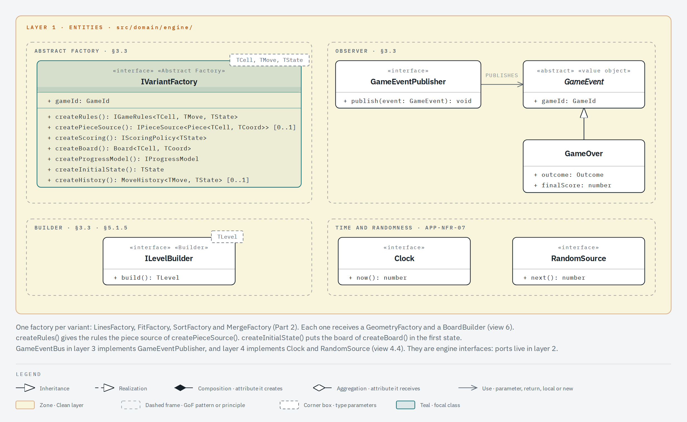
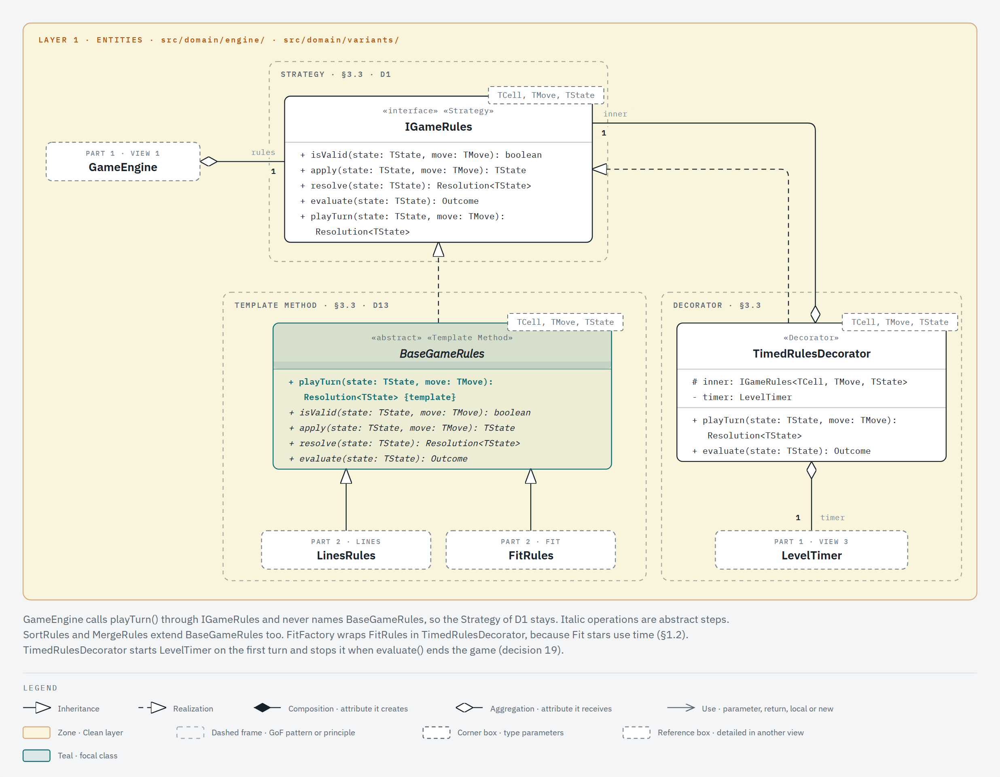

# Class diagram

Status: draft for review with the professor, 2026-10-30. Updated on 2026-10-31 with the team decisions that follow the class and the consultation of 2026-10-30 (decisions 15 to 24), with the design review proposals of decisions 25 to 31, and with the pattern decisions 32 to 36 of 2026-11-01. Updated on 2026-11-02 with the corrections of that class: uses between layers (decision 23), an `execute()` in every use case, and a `Logger` port that takes a log entry (decision 37). Parts 1 and 2 cover layer 1: the generic engine and the four variants. Parts 3 and 4 cover layers 2 to 4: the use cases, the adapters, the presenters and the drivers.

This page answers statement §4.1 for the client. It shows the generic types in UML template notation, how each variant instantiates them, the layers each class lives in, and the design patterns. Each part opens with a map that names every class, grouped by pattern, with no members. Small views then show the members, with at most seven classes each. IDs such as A1, D1 and Q8 refer to [`docs/REQUIREMENTS.md`](../REQUIREMENTS.md). The layers themselves are in [layers.md](layers.md). The extensibility diagram, with the engine in the center and the extension points around it, is in [extensibility.md](extensibility.md). The use case flows, each with a class view and a sequence diagram, are in [flows.md](flows.md).

## How to read it

- The colored zone is the Clean layer, with the colors of [layers.md](layers.md). Parts 1 and 2 are layer 1, entities, so their zones are yellow.
- In parts 3 and 4, one view can show several layers. The zones are bands, with the outer layer at the top and the inner layer at the bottom, so every dependency points down.
- A dashed frame groups the classes of one GoF pattern or one design principle. Its label names the source, for example `STRATEGY · §3.3 · D1`.
- A stereotype such as `«Strategy»` marks the role of one class in that pattern. Zone, frame and stereotype never carry the same information.
- The dashed box at the top right of a class holds its type parameters. This is the UML template notation that §4.1 asks for. A class declares there every parameter that its members name, for example `TCoord`. A bound on a parameter goes in the same box, for example `TState extends BoardState‹TCell, TCoord› & Cloneable‹TState›` on `GameEngine`. No line draws a bound, because a bound is not a parameter, a return value or a local variable.
- Every operation shows the type of each parameter and its return type. One operation has the same signature in every view. Every use case box shows `execute()` with the request and response types of its `UseCase` binding. In the class of 2026-11-02 the professor said that a class with no operations, or with operations that leave out their parameters, is wrong.
- The teal class is the focal class of the view.
- An italic class name or operation is abstract.
- A solid line with an open arrowhead is a use: the other class is an attribute, a parameter, a return value, a local variable or a `new`. Every dependency between two layers is a use. When the class keeps the other class in an attribute, the arrow end names the attribute and its multiplicity, even when it is 1, for example `games 1`. Otherwise the line carries a verb, for example `PLAY()` or `«create»`.
- Inside one layer, a diamond at the end of the holder marks an attribute only where it makes a GoF pattern visible: Strategy, Decorator, Composite, Observer, Command, State, Adapter, or a builder or a factory that holds its geometry factory. It is hollow (aggregation) when the value comes from outside, and filled (composition) when the class creates it. The other end names the attribute and its multiplicity. Any other attribute is a use with the attribute name and its multiplicity, also between an aggregate and its parts or an entity and its value objects, because the class box already shows the attribute. In the class of 2026-11-02 the professor kept the diamond for a pattern: «Aquí sí porque quiero hacer visible el patrón estratégico» (decision 23).
- No line starts or ends on a dashed frame. A map draws a line between two groups from the chip of the class that holds, calls or implements to the chip of the class it needs, with the same rule as a view: an attribute shows its name and multiplicity, for example `phase 1`, and any other use shows a verb, for example `CREATES`. A line from frame to frame would claim that every class of one group uses every class of the other. In the session of 2026-11-03 the professor asked about such a line: «todas esas usan los tres bloques de abajo, a lo mejor la respuesta es no». A map draws only the main dependencies, one or a few for each pair of groups. The view of each group shows the rest.
- The legend of each view lists only the line kinds that the view draws.
- In the variant views, a lollipop (a circle on a short line) is an engine interface that the class implements. Its label names the type that each parameter takes, for example `IGameRules‹PlacePiece, LinesState›`.
- In a map, a chip is one class with its name only. Every line of a map starts and ends on a chip. The group header names the view that shows the members, for example `VIEW 2`.
- In the variants map, a dashed chip is an engine type. Each class in its row implements or extends it.
- A dashed box with no members is a class that another view details. Its eyebrow names that view, for example `PART 1 · VIEW 1`.
- Under the name of a use case, an ID such as `APP-FR-08` names the requirement it serves.
- `UseCase` and `UseCaseAspect` name architecture roles, not game concepts. `UseCase` is the generic input port, the «input boundary» of Clean Architecture, and every use case implements it (decision 9). `UseCaseAspect` is the abstract base of the AOP decorators of view 3.1. APP-NFR-11 asks one aspect to cover the four variants, so all use cases need one shared contract, and its name states that role. The professor's rule «Tiene que tener semántica del problema» (class of 2026-10-16) applies to the entities, the concrete use cases and the ports, and they follow it: for example `ApplyMove`, `MoveHistory` and `RunningGameStore`.
- `«port»` marks an interface of layer 2 that an outer layer implements. Ports live in the application layer (decision 25). The engine and layer 3 have other interfaces that an outer layer implements, such as `Clock` and `KeyValueStore`. They carry `«interface»` only. `«aggregate root»` marks the entity that guards a game (decision 26). A question in the stereotype line, such as `«composition root» · Q9`, marks a placement that the professor's answer can move.
- Sprint 1 builds the engine in `src/domain/engine/`, one issue at a time. The other classes are planned. View 2 draws two members that the code adds: `GridTopology.key(c: TCoord): CoordKey`, because the board stores its cells by a key, and a `contains: (c: TCoord) => boolean` parameter on `GridTopology.line()`, so the topology stops the line at the edge of the board. `Board.contains(c: TCoord): boolean` exposes the same test. `Board.line()` through a coordinate outside the shape yields nothing. The `Board` constructor throws a `RangeError` for an initial entry outside the shape and for an entry whose key differs from `GridTopology.key()` of its coordinate. It copies each entry, so the caller and the board share no tuple. `Piece.translated(offset: TCoord, topology: GridTopology<TCoord, string, string>): Piece<TCell, TCoord>` moves the shape through `ShapeNode.translated()`, so the triangle test of decision 16 can translate a piece. Issue #86 closes the primitive types of view 2 (APP-NFR-25): `GridTopology<TCoord, TAxis extends string, TDirection extends string>` and `Board<TCell, TCoord, TAxis extends string>` carry the closed axis and direction unions of each topology, `ring()` takes a `Radius` (a whole number of zero or more), `region()` a `RegionSize` (a whole number of one or more), `rotate()` and `rotated()` a `Turns` (any whole number). Each `of()` accepts only a safe integer (`Number.isSafeInteger`) and stores `-0` as `0`, and `key()` returns `CoordKey`, a branded string. `Board.topology` and the shape operations take `string` for the unions they do not read, and `BoardState.board` is a `Board<TCell, TCoord, string>`, so `GameEngine`, `IGameRules` and `BoardState` gain no type parameter. The README table «Primitive types» gives the reason for each primitive that stays. `GamePhase.resume(): GamePhase` ends a pause, and `GamePhase.name` names the phase. `Resolution<TState>` holds the state, an `accepted` flag and the `Outcome`, and `Outcome` is the closed union `playing`, `victory` or `game-over`. `GameEngine` takes its `GameId` and its `GameEventPublisher` in the constructor, exposes `phase` and `resume()`, and has no `MoveHistory` yet: undo (APP-FR-08) is Sprint 3 work in `docs/ROADMAP.md`. `SeededPieceSource` takes a `seed` and builds its own `Mulberry32Random`, an engine `RandomSource` with the Mulberry32 generator, so the same seed gives the same pieces. Each source and `Mulberry32Random` has `clone()`, which copies the position or the generator state (decision 31). The seed is an integer from 0 to 4294967295, and any other number throws a `RangeError`, so no seed is truncated into another. `FixedListPieceSource` throws a `RangeError` on a list that holds `undefined`, and it reads its list once. `IRandomSeeded` holds the `seed`. `BaseGameRules` adds the protected step `noValidMove(state: TState): boolean`, the end check of decision 33, so each variant `evaluate()` reuses it. `ProgressRecord` is a draft with `gameId`, `score`, `levelId` and `stars`: view 4 shows these fields, and the real progress models of Sprint 3 can add fields. `GameResult.of()` throws a `RangeError` for a decimal or negative move count, a score that is not finite, and a time that is not finite or is negative. `ProgressRecord.of()` throws one for a score that is not finite and for stars that are not finite or are negative. Stars can be decimal, because no requirement says that they are whole numbers (decision 36).

## Part 1: the generic engine

`src/domain/engine/`. It imports no variant and no framework (rules `domain-no-framework` and `engine-no-variants`).

### Map of the engine

### View 1: the turn

### View 2: board and pieces

### View 3: undo and redo

### View 4: piece sources, scoring and progress

### View 5: wiring a variant

### View 6: geometry and board

### View 7: the rules template

## Part 2: the four variants

`src/domain/variants/<variant>/`. Each variant imports the engine and never another variant (rule `variants-isolated`).

### Map of the variants

### Hexa Lines

### Hexa Fit

### Hexa Sort

### Hexa Merge

| Variant    | `TCell`                              | `TMove`                                    | `TState`                | Undo                        | Piece source                           | Progress                   |
| ---------- | ------------------------------------ | ------------------------------------------ | ----------------------- | --------------------------- | -------------------------------------- | -------------------------- |
| Hexa Lines | `Color` of the engine                | `PlacePiece`                               | `LinesState`            | none                        | `SeededPieceSource`                    | `HighScoreProgress`        |
| Hexa Fit   | `PieceId`                            | `FitMove`: place, remove or rotate a piece | `FitState`              | `RedoableHistory`, no limit | `FixedListPieceSource`                 | `LevelProgress` with stars |
| Hexa Sort  | `ColorStack` of engine `Color` tiles | `PlaceStack`                               | `SortState`             | none                        | seeded or fixed, chosen per level (A4) | `LevelProgress` with stars |
| Hexa Merge | `MergeTile`, an `IMergeable`         | `Slide`                                    | `MergeState<MergeTile>` | `MoveHistory`, limit 1      | `SeededPieceSource`, tiles of 2 or 4   | `HighScoreProgress`        |

The variant classes stay generic over `TCoord`, like the engine, so a variant runs on any geometry (decisions 16 and 17). Each variant class that names `TCoord` declares it in its template box. Each variant factory keeps the `GeometryFactory<TCoord>` it receives in its `geometry` attribute. Today the composition root passes `HexGeometry`, so a running game binds `TCoord` to `HexCoord`. In a lollipop binding, a variant state such as `LinesState` stands for `LinesState<TCoord>`. Hexa Lines and the other game names stay as display names. The class names drop the `Hexa` prefix.

## Part 3: the use cases

`src/application/`, layer 2. It imports only `src/domain/` and `src/application/` (rule `application-imports-only-domain`). Each use case names the requirement it serves.

### Map of the use cases

### View 3.1: the use case contract and its aspects

### View 3.2: playing a game

### View 3.3: progress, levels and leaderboard

### View 3.4: account and settings

### View 3.5: results and response models

## Part 4: adapters, presenters and drivers

Layer 3, `src/adapters/`, and layer 4, `src/infrastructure/` and `app/`. Layer 3 imports only layers 1 and 2 and its own code (rule `adapters-imports-only-inner-layers`). Layer 4 has no dependency rule yet ([layers.md](layers.md)). The HTTP repositories live in layer 4, `src/infrastructure/api/`, and implement the ports of layer 2 directly (decision 22).

### Map of the adapters, presenters and drivers

### View 4.1: presenting a game

### View 4.2: repositories

### View 4.3: game events and sound

### View 4.4: wiring

## Use case flows

One use case can cross every layer. [flows.md](flows.md) follows one call through the layers: a class view of that use case only, and a UML sequence diagram with the same class names. It draws one flow for each distinct path and names the path that each other use case follows.

### Flow 1: apply a move

### Flow 2: save progress

### Flow 3: start a game

### Flow 4: undo a move

### Flow 5: sign in

## Patterns

The fourteen patterns of §3.3 all appear, and all fourteen stay after the team audit of 2026-10-30 (D14). Eleven live in layer 1; Adapter, Facade and Singleton live in layers 3 and 4. D7 asks for a written reason for each one, so the Reason column names the requirement behind it. In the Views column, a plain number is a view of part 1, and `3.1` is view 1 of part 3.

| Pattern          | Classes                                                                                                                                                                                | Reason                                                                                                                                                               | Views                              |
| ---------------- | -------------------------------------------------------------------------------------------------------------------------------------------------------------------------------------- | -------------------------------------------------------------------------------------------------------------------------------------------------------------------- | ---------------------------------- |
| Strategy         | `IGameRules`, `IScoringPolicy`, `IPieceSource`, `IProgressModel`, `GridTopology<TCoord, TAxis, TDirection>`; `StateMapper` and `CellRenderer` in the outer layers                      | Mandatory (§3.3). The variation dimensions of §1.5. D1 and D4.                                                                                                       | 1, 2, 4, 7, the four variants, 4.1 |
| Abstract Factory | `IVariantFactory` and one factory per variant; `GeometryFactory<TCoord>` with `HexGeometry` and `SquareGeometry`                                                                       | Mandatory (§3.3). The geometry family absorbs the square, triangle and 3D rows of §8 (D4, D11).                                                                      | 5, 6 and the four variants         |
| Template Method  | `BaseGameRules.playTurn()`                                                                                                                                                             | The turn skeleton (§3.1, §3.3). An abstract base class, as §3.3 describes it (D13).                                                                                  | 1, 7                               |
| State            | `GamePhase` and its five phases                                                                                                                                                        | The game lifecycle (§3.3, D2). The menu is navigation in the presentation layer, so no `MenuState` exists (D14).                                                     | 1                                  |
| Command          | `MoveCommand`, `MoveHistory`, `RedoableHistory`; the Memento `MoveCommand.before`                                                                                                      | Undo and redo (§3.3, §5.1.8). The cloned state in `MoveCommand.before` is the Memento: `GameEngine` is the originator and `MoveHistory` the caretaker (decision 34). | 1, 3                               |
| Prototype        | `Cloneable`: `Board`, `Piece`, `BoardState`, `IPieceSource`, `RandomSource`                                                                                                            | Undo snapshots, rotation and the piece preview (§3.3, D3). The rollback of a turn covers the piece source in the state (decision 31).                                | 2, 4                               |
| Composite        | `ShapeNode`, `CellNode`, `ShapeGroup`                                                                                                                                                  | Pieces made of cells, Fit figures made of regions (§3.3, piece shape row of §8). Only the shapes: Fit stars are data (decision 36).                                  | 2                                  |
| Iterator         | `Board.line()`, `ring()` and `neighborhood()`; `IPieceSource`; `IGameRules.validMoves()`                                                                                               | Traversal by axis, ring and neighbors (§3.1, §3.3). The piece sequence, finite or endless (decision 32). The lazy list of valid moves (§3.1, decision 33).           | 2, 4, 7                            |
| Decorator        | `ScoringDecorator`, `ComboMultiplierDecorator`; `TimedRulesDecorator`; `UseCaseAspect` and its four aspects                                                                            | The Lines combo and streak multiplier (§1.1), scoring row of §8. Fit stars use time (§1.2, D14). The aspects of §3.5 (A2).                                           | 4, 7, Lines, 3.1                   |
| Builder          | `ILevelBuilder`, `FitLevelBuilder`, `SortLevelBuilder`; `BoardBuilder`, the DDD factory of the board                                                                                   | Levels of parts from configuration files, built step by step (§3.3, §5.1.5), the Fit check of A5. Two construction paths for the board (D9).                         | 5, 6, Fit, Sort                    |
| Observer         | `GameEventPublisher` and the `GameEvent` classes; `GameEventBus` in layer 3                                                                                                            | Score, audio and screens react to game events (§3.3). `GameEventBus` is not a Mediator (decision 35).                                                                | 1, 5, 4.3                          |
| Adapter          | `LocalProgressRepository` and the other local repositories in layer 3; `ApiProgressRepository` and the other HTTP repositories in layer 4; `DeviceKeyValueStore` and the other drivers | A new database or backend means a new adapter, and the use cases do not change (§3.3, §3.4).                                                                         | 4.2, 4.4                           |
| Facade           | `AudioManager`                                                                                                                                                                         | Sound effects and music behind one interface, with mute (§3.3, §5.1.10).                                                                                             | 4.3                                |
| Singleton        | `AudioManager` and `SessionManager`, created once by `CompositionRoot`                                                                                                                 | §3.3 allows single-scope dependency injection in place of a classic Singleton. One instance for the whole app (D12, Q9).                                             | 4.3, 4.4                           |

Two patterns outside the fourteen are named on purpose. Memento lives inside the Command row and adds no row (decision 34). Visitor is discarded: D3 allows it only inside the shape Composite, and no class implements it (decision 35).

## Decisions to check with the team

1. **Template Method by composition.** Replaced by decision 21 on 2026-10-30. This draft kept the skeleton in `GameEngine.play()` and took the steps from `IGameRules` (Strategy), so a variant never extended a base class. The professor may expect the inheritance form of §3.3, with an abstract turn class and one subclass per variant.
2. **`GamePhase`, not `GameState`.** The State pattern classes are phases, because `TState` already names the state of a game. [layers.md](layers.md) uses the same name.
3. **Undo is optional per variant.** `GameEngine` holds zero or one `MoveHistory`, and the variant factory decides. Fit gets `RedoableHistory` with no limit, Merge gets `MoveHistory` with limit 1, and Lines and Sort get none. So Hexa Lines never implements `IUndoable` (§3.2). The engine gives each capability through `undoable()` and `redoable()` (decision 27).
4. **`IRedoable` is our addition.** The statement lists `IUndoable`, `ITimed` and `IRandomSeeded`. Merge undoes one move and never redoes, so redo gets its own interface (§3.2 ISP, §5.1.8).
5. **`Color` and `GameId` live in the engine.** Lines and Sort both use `Color`, and rule `variants-isolated` forbids one variant from importing another. `GameId` is open, so a new variant does not change it (decision 30). Since issue #129 the code holds it: `Color.of(name)` in `src/domain/engine/color.ts` rejects an empty or blank name with a `RangeError`, and `equals()` compares two colors by name, because `of()` makes a new object on each call. A Lines cell is a `Color`, and each tile of a Sort `ColorStack` is a `Color`.
6. **One piece type for the four variants.** Every piece is a `Piece<TCell, TCoord>`: a shape plus the content it puts on the board. A Sort piece is one cell with a stack, and a Merge spawn is one cell with a tile. So `IPieceSource<Piece<TCell, TCoord>>` serves the four variants.
7. **The board changes in place.** `Board.set()` changes the board, and `clone()` takes the snapshot for undo and for the piece preview. The alternative is an immutable board, where each move returns a new board. Then undo keeps the old board, and Prototype applies only to pieces. A cell is a value: `clone()` copies the references to the cells and shares the cell objects, so nobody changes a cell in place. `BoardShape.of()` rejects an empty shape with a `RangeError`. `BoardShape` has no topology, so it cannot compare two coordinates: the `Board` constructor rejects a shape where two coordinates have the same `GridTopology.key()`, which also catches a topology whose keys collide.
8. **The Merge rules are generic.** `MergeRules<TCell extends IMergeable<TCell>>` is the bounded generic of §3.1. The Merge factory binds it to `MergeTile`. Only one cell type uses it today. The bound states which capability the rules need from a cell.
9. **One generic input port.** Every use case implements `UseCase<TRequest, TResponse>`, so one aspect class can wrap any use case (§3.5). [layers.md](layers.md) shows the same generic port. Each use case binds it, for example `UseCase‹ApplyMoveRequest‹TMove›, MoveResult‹TCell, TCoord››`. The cost: a use case cannot add a second method to its port.
10. **`RunningGameStore` (proposal).** The game use cases need the running engine between two calls. A port in layer 2 holds it, and `InMemoryRunningGameStore` in layer 3 implements it. It is the repository of the aggregate root (decision 26). The alternative: the presenter keeps the engine and passes it in each request, which puts a domain object inside the request model.
11. **`AccountGateway` (proposal).** `Register` and `Login` call the backend through this port. [layers.md](layers.md) shows it. `ApiAccountGateway` in layer 4 implements it (decision 22).
12. **`SettingsStore` (proposal).** `UpdateSettings` keeps the mute option and the language through this port. [layers.md](layers.md) shows it. `LocalSettingsStore` implements it over `KeyValueStore`.
13. **Singleton in the composition root.** Replaced by decision 18 on 2026-10-30. This draft gave `CompositionRoot` a static `instance()`, the classic form of §3.3. Q9 still decides its file.
14. **State mappers and cell renderers.** `StateMapper<TCell>` in layer 3 turns each cell of the plain response into a `CellView` (decision 29), and one `CellRenderer` per variant draws them (D3). Q8 decides where the renderers live and whether the variant factory provides them.
15. **Builder on the levels and on the board.** The statement puts Builder on the levels of Fit and Sort (§3.3), so `ILevelBuilder`, `FitLevelBuilder` and `SortLevelBuilder` stay. A builder builds an object made of parts, never a flat record, and each step returns the builder. `FitLevelBuilder` adds the header, the figure, the pieces and the witness. `SortLevelBuilder` adds the header with `withHeader()`, asks `BoardBuilder` for the board region with `withRegion(radius)`, and adds the goals and the piece source with `withGoals()` and `withSource()`. Only `build()` returns the level. In class on 2026-10-30 the professor put a builder on the board too. It builds the logical structure of the board and nothing more. In DDD terms, this builder is the factory of the board. So `BoardBuilder` in layer 1 is a Builder and the DDD factory of the board. It holds a `GeometryFactory` and has two construction paths: `withRegion(size)` for Lines, Sort and Merge, and `withFigure(figure)` for the Fit figure (§1.2). The level builders ask it for the board, and `LinesFactory` and `MergeFactory` use it with no level. Reasons: the two construction paths, the square, triangle and 3D rows of §8 (D4), and the generic coordinate of decision 16. Team decision D9. Views 5 and 6.
16. **A generic engine: the topology does every coordinate calculation.** The engine names carry no geometry: `Board<TCell, TCoord, TAxis>` and `GridTopology<TCoord, TAxis, TDirection>`. `TAxis` and `TDirection` are the closed name unions of one topology (issue #86). `HexCoord` and `HexTopology` are only the hexagonal family (decision 17). `Board` is the `HexBoard<TCell>` of statement §3.1, which calls its names «orientativos». `TCoord` reaches `Piece`, `ShapeNode`, `BoardShape`, `BoardState` and the moves (`PlacePiece.at`, `PlaceStack.at`). `GameEngine` declares `TCoord` next to `TCell`, `TMove` and `TState`, and bounds `TState` by `BoardState<TCell, TCoord> & Cloneable<TState>` in its template box. `IVariantFactory`, `RunningGameStore` and the game use cases declare `TCoord` too, because their members name `Board<TCell, TCoord, string>`, `Piece<TCell, TCoord>` or `MoveResult<TCell, TCoord>`. `IGameRules` and `BaseGameRules` take two type parameters, `TMove` and `TState`: none of their members names a cell or a coordinate. The variant classes drop the `Hexa` prefix, for example `LinesRules` and `FitFactory`. `GridTopology` owns `rotate()`, `translate()` and `region()`, and a coordinate only holds its values. Adding two coordinates one component at a time works for hexagons and squares. It fails for triangles, because the parity of column plus row decides whether a triangle points up or down. With this rule, triangular cells and a 3D board (§8) each mean one more coordinate type and one more topology, plus new level data. In class on 2026-10-30 the professor asked for one generic board for hexagons, triangles and squares. The square test double of D4 cannot catch the parity coupling, because a square adds coordinates the same way a hexagon does. Issue #69 adds an engine test that translates a piece by an odd offset with a triangle double. The type system also enforces the rule of issue #69. `TCoord` has no bound, so engine code cannot read a component of a coordinate: `c.q` does not compile. Engine code must ask the topology for every calculation. Team decision D10. Views 1, 2 and 6.
17. **A geometry family (Abstract Factory).** `GeometryFactory<TCoord>` in layer 1 creates the coordinate, the topology and the piece shapes of one geometry. `HexGeometry` is the real family. `SquareGeometry` is the minimal family of the engine tests (D4, APP-NFR-13). `BoardBuilder`, the level builders and each `IVariantFactory` receive it by composition, so no class exists per game and geometry. The factory gives the parts, and the Builder assembles them. Screen layout per geometry stays in layer 4, outside the domain factory. Team decision D11. View 6 and view 3 of [extensibility.md](extensibility.md).
18. **Single scope, not a static Singleton.** §3.3 names «Singleton (o inyección de dependencias con alcance único)», with `AudioManager` and `SessionManager` as its examples. `CompositionRoot` creates `AudioManager` and `SessionManager` once and injects them. No class has a static `instance()`, so a test can pass its own. `AudioManager` was `AudioFacade`, and it stays the audio Facade. `SessionManager` was `SecureSessionStore`, and it implements `SessionStore`. Team decision D12. Views 4.3 and 4.4.
19. **`TimedRulesDecorator`.** It implements `IGameRules`, wraps an inner `IGameRules` and times the game with a `LevelTimer`. It starts the timer on the first turn and stops it when `evaluate()` ends the game. `FitFactory` wraps `FitRules` in it, because Fit stars use time (§1.2). It follows the Decorator example of §3.3. Team decision D14. View 7.
20. **No `MenuState`.** State keeps D2: `GamePhase` covers the lifecycle of one game, and the menu is navigation in the presentation layer. A `MenuState` in layer 1 would put navigation in the domain. Team decision D14. View 1.
21. **Template Method in an abstract base class.** The abstract `BaseGameRules` implements `IGameRules`. Its template method `playTurn()` calls the abstract steps `isValid()`, `apply()`, `resolve()` and `evaluate()`. Each variant rules class extends it. When `resolve()` rejects the move, `playTurn()` returns that rejected resolution and does not call `evaluate()`. A rejected move never ends the game, and two guards enforce it. `Resolution.evaluated()` on a rejected resolution throws a `RangeError`, so a custom `playTurn()` that evaluates a rejected resolution fails, and `GameEngine.play()` rethrows that error with the state kept. For a rejected resolution that still carries a final outcome, `GameEngine.play()` returns `playing`, keeps the phase `playing` and publishes no event. The engine computes the next phase before it commits the turn. An outcome that the phases do not know throws a `RangeError`, and the state and the phase stay as they were. When a turn throws, the rollback covers the whole state and the phase. The piece source lives in the state (decision 31), and the state `clone()` clones it. So a turn that is retried after a throw draws the same piece, and a move that `resolve()` rejects leaves the source at its old position. `GameEngine` depends only on the interface `IGameRules`, so the Strategy of D1 stays, and a decorator such as `TimedRulesDecorator` can wrap any rules. This is the inheritance form of §3.3, and it replaces decision 1. Team decision D13. Views 1 and 7.
22. **No `BackendApi` port (Q7, option B).** The HTTP repositories and their DTO mapper live in layer 4, `src/infrastructure/api/`. `ApiProgressRepository`, `ApiLevelRepository`, `ApiLeaderboardGateway` and `ApiAccountGateway` implement the layer 2 ports directly, and `ApiDtoMapper` turns DTOs into domain values. The `BackendApi` port of the first draft named transport types in its methods, for example `signIn(body: CredentialsDto): Promise<SessionDto>`. In class on 2026-10-30 the professor called this structural coupling: the port ties the use cases to the shape of the HTTP data. Now no port names a transport type. The team closed Q7 on 2026-10-30. View 4.2 and the map of Part 4.
23. **Uses between layers, diamonds only for a GoF pattern.** In the consultation of 2026-10-30 the professor said that a port kept as an attribute is an aggregation. In the class of 2026-11-02 he corrected it. He asked for explicit dependencies (use, extend, implement) between layers, and for a diamond only where it is needed, such as an entity that holds a Strategy. He added that the rule is for the relations between layers. So every dependency between two layers is a use: a solid line with an open arrowhead. When the class keeps the other class in an attribute, the arrow end names the attribute and its multiplicity. Inside one layer, a diamond stays only where it makes a GoF pattern visible: «Aquí sí porque quiero hacer visible el patrón estratégico». Patterns: Strategy (`GameEngine` with `IGameRules` and `IScoringPolicy`, `Board` with `GridTopology`, `GamePresenter` with `StateMapper`), Decorator (`UseCaseAspect`, `ScoringDecorator`, `ComboMultiplierDecorator` and `TimedRulesDecorator` with their inner object), Composite (`ShapeGroup` with its children), Observer (`GameEventBus` with its listeners), Command (`MoveHistory` and `RedoableHistory` with their commands, `GameEngine` with its `MoveHistory` invoker), State (`GameEngine` with its `GamePhase`), Adapter (`LocalProgressRepository` with `KeyValueStore`), and a builder or a factory that holds its geometry factory. A domain relation without a pattern is a use with the attribute name and its multiplicity, because the class box already shows the attribute: `BoardState` with its `Board`, `Board` with its `BoardShape` and `Piece` with its `ShapeNode`. Any other attribute is also a use, for example a use case that keeps a port of its own layer. Views of parts 1 to 4 and of [extensibility.md](extensibility.md).
24. **An adapter reads the level file.** An adapter in an outer layer reads each level file and returns `LevelDefinition`, plain data. `FitLevelBuilder` and `SortLevelBuilder` get that data and never read a file. In class on 2026-10-30 the professor said that a domain builder builds the logical structure and nothing more, and that storage or messaging would make it no longer a domain builder. Views 3.3, Fit and Sort.
25. **Ports live only in layer 2.** A port is an interface that layer 2 owns and an outer layer implements, because a use case may depend only on ports of its own layer (§3.4). `Clock`, `RandomSource` and `GameEventPublisher` stay in the engine: the engine takes time, randomness and its event sink by injection (rule R-domain-determinism), and it may not import layer 2. So they are engine interfaces, not ports. `KeyValueStore` is an interface of layer 3 that the local repositories use. Layer 4 implements all four. Views 1, 5, 3.1, 4.2 and the map of Part 4.
26. **`GameEngine` is the aggregate root of a game (proposal).** The aggregate holds the state with its board, the `GamePhase` and the optional `MoveHistory`. Its invariant: a game changes only through `play()`, and `play()` applies a move only while `phase.canPlay()` is true. `snapshot(): TState` returns a clone, so no caller changes the board outside the root. `RunningGameStore` is the repository of this root. The scoring policy is the domain service: `IScoringPolicy.score()` computes points from two states, keeps no game data and belongs to no entity. The resolution stays in the rules, because it changes the board inside the aggregate. View 1 and the map of Part 1.
27. **Capabilities through typed accessors.** `GameEngine.undoable(): IUndoable | undefined` and `redoable(): IRedoable | undefined` return the capability that the variant factory gave. `UndoMove` and `RedoMove` call them and return a failed `Result` when the answer is `undefined`. So no use case checks the concrete history class, and a new history type changes no use case. Views 1, 3 and 3.2.
28. **Use cases return a `Result`.** In Clean Architecture an exception must not reach the screen. `UseCase.execute(request: TRequest)` returns `Promise<Result<TResponse>>`. `Result<T, E = UseCaseError>` holds a value or an error, and `Result.success(value: T)` and `Result.failure(error: E)` create it. `UseCaseError` has a `code`, a `message` and a `retryable` flag. `RetryAspect` runs the use case again while the error is retryable, and the presenter shows the message through `GameViewModel.error`. Views 3.1, 3.5 and 4.1.
29. **A plain response model.** Layer 2 never returns the mutable `Board` or the engine to layer 3. `MoveResult<TCell, TCoord>` holds copies of the cells (`[TCoord, TCell][]`), the score, the `Outcome` and the undo and redo flags. `ApplyMove` builds it from `GameEngine.snapshot()`: `Board.cells()` gives the copies, and `Board.get(at)` reads one cell. The other game use cases return it too. `StateMapper<TCell>` turns each cell into a `CellView`. The game use cases declare `TCoord` in their template box, as `GameEngine` does (decision 16). Views 3.2, 3.5, 4.1 and 4.4.
30. **An open `GameId` (proposal).** `GameId` is a value object over a validated string, not a closed list of the four games. `GameId.of(value: string): GameId` rejects an empty value, and any value that is not a lowercase kebab-case slug such as `hexa-lines`, with a `RangeError`: a space, a tab or an uppercase letter is an error. Each variant factory declares its own id in `gameId`. So a fifth variant adds a factory with a new id and changes no engine file. Only the composition root and the game selector list the games. Team decision D15. [`docs/EXTENSIBILITY.md`](../EXTENSIBILITY.md) lists the new files and the files that do not change. View 1 of [extensibility.md](extensibility.md).
31. **The variant factory creates the whole family.** Statement §3.3 asks one factory per variant for the rules, the piece source, the scoring policy and the board. `IVariantFactory` has `createPieceSource(): IPieceSource<Piece<TCell, TCoord>> [0..1]` and `createBoard(): Board<TCell, TCoord, string>` next to `createRules()` and `createScoring()`. `createInitialState()` puts the board and the piece source in the first state, and the rules draw from the source of the state. A variant with no piece source returns none, and its state holds no source. `BoardState` has no source field: the state type of a variant adds it. `IPieceSource` and `RandomSource` are `Cloneable` (Prototype, decision 7). `SeededPieceSource.clone()` and `FixedListPieceSource.clone()` copy their position, and `Mulberry32Random.clone()` copies its generator state. No clone replays the draws. The state `clone()` clones its source, so the copy and the rollback of `GameEngine.play()` cover the source, and the engine has no code for it (decision 21). View 5 and view 1 of [extensibility.md](extensibility.md).
32. **`IPieceSource` is Strategy and Iterator.** `IPieceSource<TPiece>` keeps `hasNext(): boolean` and `next(): TPiece`, and adds `[Symbol.iterator](): Iterator<TPiece>`. So a rules class or a test reads the pieces with `for...of`, and the language protocol replaces a custom loop. The Strategy stays: the variant factory picks the source. `SeededPieceSource` never ends, because `hasNext()` is always true. `FixedListPieceSource` ends after its last piece, so the Fit tray is finite. A caller that reads a seeded source with `for...of` stops the loop itself. Team decision D16. View 4.
33. **`IGameRules.validMoves()`.** Statement §3.1 says that the rules «define los movimientos válidos». `isValid(state, move)` checks one move, and `validMoves(state: TState): Iterable<TMove>` gives the valid moves. Each variant writes it as a lazy generator: it walks the board with `Board.line()`, `ring()` and `neighborhood()` and yields one valid move at a time. The end condition «no valid move» of Lines, Sort and Merge asks for the first move and stops there, so it never builds the full list. A hint or a test can read more moves from the same generator. `BaseGameRules` leaves the method abstract, and `TimedRulesDecorator` passes it to its inner rules. `IGameRules` keeps two type parameters, `TMove` and `TState`, because the method names no cell and no coordinate. Team decision D17. Views 1 and 7.
34. **Memento in the undo history.** `MoveCommand.before` is a Memento. `GameEngine` is the originator: before it applies a move, it clones the state with `BoardState.clone()` (Prototype) and keeps the clone in a new `MoveCommand`. The cloned `TState` is the memento. `MoveHistory` is the caretaker: it keeps the commands and never reads the state inside them. `undo()` gives the kept state back to the engine. Memento is not one of the fourteen patterns of §3.3, so it adds no row to the patterns table. The Command row names it. Team decision D18. View 3.
35. **No Visitor and no Mediator.** D3 allows a Visitor only inside the shape Composite, where the node types are closed and the operations grow. Today `ShapeNode` declares each operation (`cells()`, `area()`, `rotated()` and `translated()`), and no class implements a Visitor. A Visitor over the variants would make every new variant edit every visitor, and that breaks the extensibility test (APP-NFR-06). So the design discards Visitor, and the reasoning of D3 stays as its record. `GameEventBus` is an Observer: it implements `GameEventPublisher` and sends each event to its listeners. It does not coordinate classes that call each other, so the design does not claim Mediator. Team decision D19. Views 2 and 4.3.
36. **Composite only for shapes, and stars are data.** Composite stays in `ShapeNode`, `CellNode` and `ShapeGroup`, because a piece and a Fit figure are trees of cells (piece shape row of §8). An `EndCondition` composite and a `StarRule` composite were proposed and discarded: no source declares a variation in end conditions or star rules, and D5 asks for a written reason for each abstraction. Fit stars are data. Each level file holds two thresholds per star: a move count and a time. `FitLevelBuilder` reads them from `LevelDefinition` and puts them in the `FitLevel` (decision 24). `LevelProgress` compares the moves and the elapsed time of the `GameResult` with them. Team decision D20. View 2 and the Fit view.
37. **The `Logger` port takes a log entry, not a message.** `Logger.log(entry: UseCaseLogEntry): void` receives the name of the use case, the outcome (`"success"` or `"failure"`), the elapsed time when `TimingAspect` measures it, and the `UseCaseError` of a failed `Result`. `LoggingAspect` and `TimingAspect` build the entry. `ConsoleLogger`, the adapter in layer 4, writes the text. In the class of 2026-11-02 the professor said that a message parameter makes the caller build the message, and that the message belongs in the implementation of the port, a secondary adapter. So no use case and no aspect formats a message. View 3.1 and the map of Part 3.
38. **`Range<T>` for two-sided limits, and `GoalCount` for the Sort goal.** `Range<T>` in `src/domain/engine/range.ts` is a closed interval `[min, max]` over any ordered type, with `contains(value: T): boolean`. `Range.of(min, max, compare)` takes a `Compare<T>` function, and `Range.ofNumbers(min, max)` compares numbers. Both throw `RangeError("A Range needs min <= max.")` when min comes after max. It mirrors the `Range<T>` of hexablock-api. The seed of `Mulberry32Random` (0 to 4294967295) and the chance of a 4 of `mergeTileSource()` (0 to 1) check their limits with it, and keep their messages. `GoalCount.of(n)` in `src/domain/variants/hexa-sort/goal-count.ts` holds the goal of a Sort level: a safe integer of 1 or more, with no upper bound (decision on issue #129). A goal of 0 won before the first move, so `SortLevel.goalsNeeded` and `SortState.goalsNeeded` are a `GoalCount`, not a bare number (gaps G108.1 and G116.5). `RegionSize`, `Radius` and `Turns` keep their own checks, because each one is already a value object with one bound.

## Render the images

The maps and the views come from the HTML files in [`classes/views/`](classes/views/). Each file holds one inline SVG drawn with the diagram-design skill. Open the file in a browser to see the drawing. The `.png` image next to it is that SVG rendered at scale 2 by a headless browser. After you edit a file, export the image again with `/diagram-design:export-diagram docs/architecture/classes/views/<view>.html --png-only`, then run `pnpm format`. The formatter changes the HTML layout only; the drawing stays the same. Commit each `.html` file together with its `.png` image. When a class is added or removed, update its map and its view in the same commit.
