# Class diagram

Status: draft for review with the professor, 2026-10-30. Parts 1 and 2 cover layer 1: the generic engine and the four variants. Parts 3 and 4 cover layers 2 to 4: the use cases, the adapters, the presenters and the drivers.

This page answers statement §4.1 for the client. It shows the generic types in UML template notation, how each variant instantiates them, the layers each class lives in, and the design patterns. Each part opens with a map that names every class, grouped by pattern, with no members. Small views then show the members, with at most seven classes each. IDs such as A1, D1 and Q8 refer to [`docs/REQUIREMENTS.md`](../REQUIREMENTS.md). The layers themselves are in [layers.md](layers.md).

## How to read it

- The colored zone is the Clean layer, with the colors of [layers.md](layers.md). Parts 1 and 2 are layer 1, entities, so their zones are yellow.
- In parts 3 and 4, one view can show several layers. The zones are bands, with the outer layer at the top and the inner layer at the bottom, so every dependency points down.
- A dashed frame groups the classes of one GoF pattern or one design principle. Its label names the source, for example `STRATEGY · §3.3 · D1`.
- A stereotype such as `«Strategy»` marks the role of one class in that pattern. Zone, frame and stereotype never carry the same information.
- The dashed box at the top right of a class holds its type parameters. This is the UML template notation that §4.1 asks for.
- The teal class is the focal class of the view.
- In the variant views, a lollipop (a circle on a short line) is an engine interface that the class implements. Its label names the type that each parameter takes, for example `IGameRules‹Color, PlacePiece, LinesState›`.
- In a map, a chip is one class with its name only. The group header names the view that shows the members, for example `VIEW 2`.
- In the variants map, a dashed chip is an engine type. Each class in its row implements or extends it.
- A dashed box with no members is a class that another view details. Its eyebrow names that view, for example `PART 1 · VIEW 1`.
- Under the name of a use case, an ID such as `APP-FR-08` names the requirement it serves.
- `«port»` marks an interface that an outer layer implements. A question in the stereotype line, such as `«port» · Q7`, marks a placement that the professor's answer can move.
- Every class is planned. Today `src/` holds one README per layer folder and the API client in `src/infrastructure/api/client.ts`.

## Part 1: the generic engine

`src/domain/engine/`. It imports no variant and no framework (rules `domain-no-framework` and `engine-no-variants`).

### Map of the engine

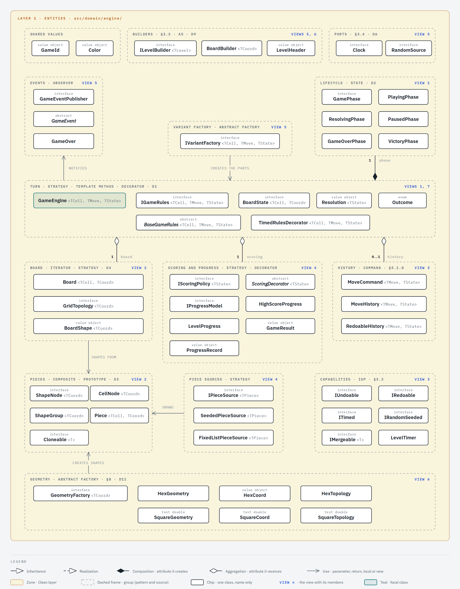

### View 1: the turn

### View 2: board and pieces

### View 3: undo and redo

### View 4: piece sources, scoring and progress

### View 5: wiring a variant

## Part 2: the four variants

`src/domain/variants/<variant>/`. Each variant imports the engine and never another variant (rule `variants-isolated`).

### Map of the variants

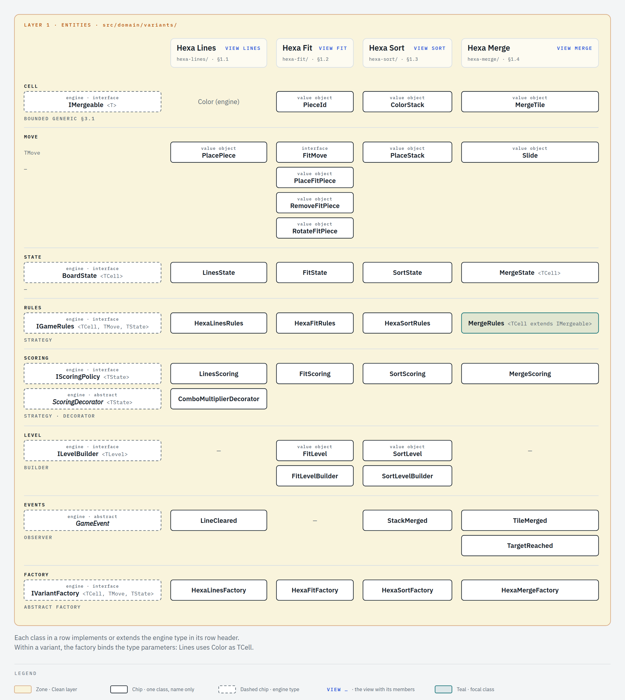

### Hexa Lines

### Hexa Fit

### Hexa Sort

### Hexa Merge

| Variant    | `TCell`                      | `TMove`                                    | `TState`                | Undo                        | Piece source                           | Progress                   |
| ---------- | ---------------------------- | ------------------------------------------ | ----------------------- | --------------------------- | -------------------------------------- | -------------------------- |
| Hexa Lines | `Color`                      | `PlacePiece`                               | `LinesState`            | none                        | `SeededPieceSource`                    | `HighScoreProgress`        |
| Hexa Fit   | `PieceId`                    | `FitMove`: place, remove or rotate a piece | `FitState`              | `RedoableHistory`, no limit | `FixedListPieceSource`                 | `LevelProgress` with stars |
| Hexa Sort  | `ColorStack`                 | `PlaceStack`                               | `SortState`             | none                        | seeded or fixed, chosen per level (A4) | `LevelProgress`            |
| Hexa Merge | `MergeTile`, an `IMergeable` | `Slide`                                    | `MergeState<MergeTile>` | `MoveHistory`, limit 1      | `SeededPieceSource`, tiles of 2 or 4   | `HighScoreProgress`        |

## Part 3: the use cases

`src/application/`, layer 2. It imports only `src/domain/` and `src/application/` (rule `application-imports-only-domain`). Each use case names the requirement it serves.

### Map of the use cases

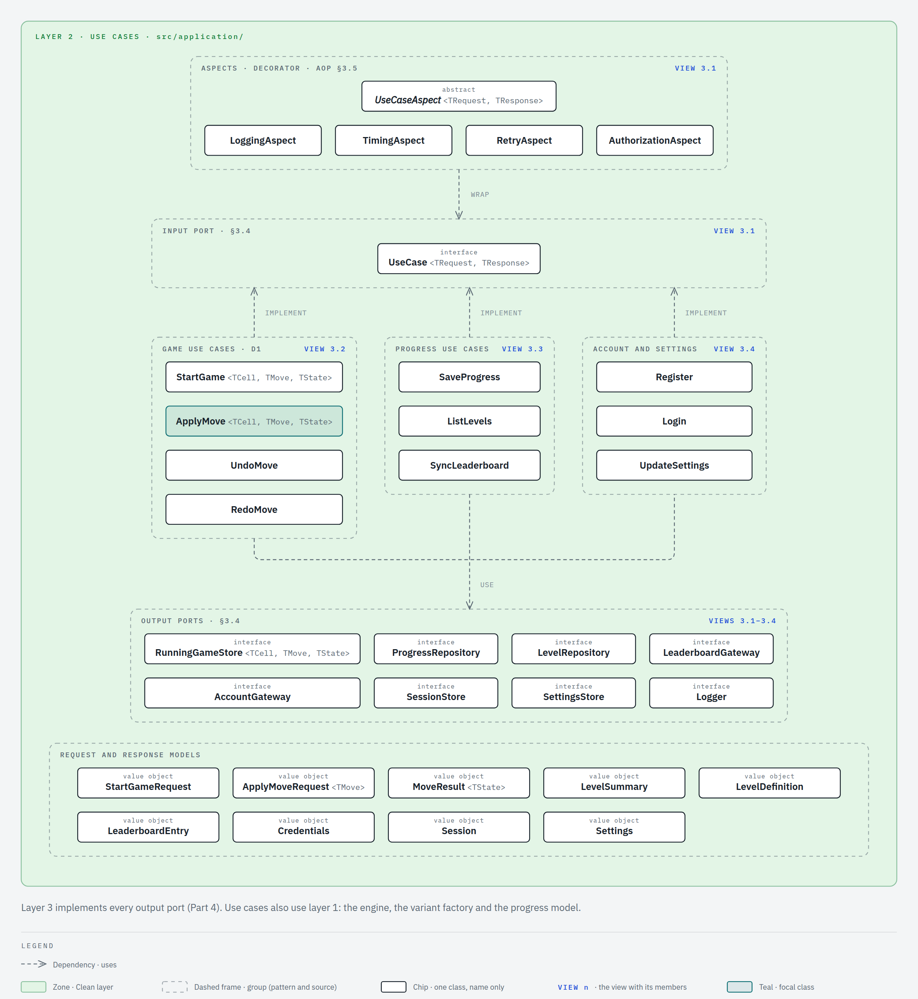

### View 3.1: the use case contract and its aspects

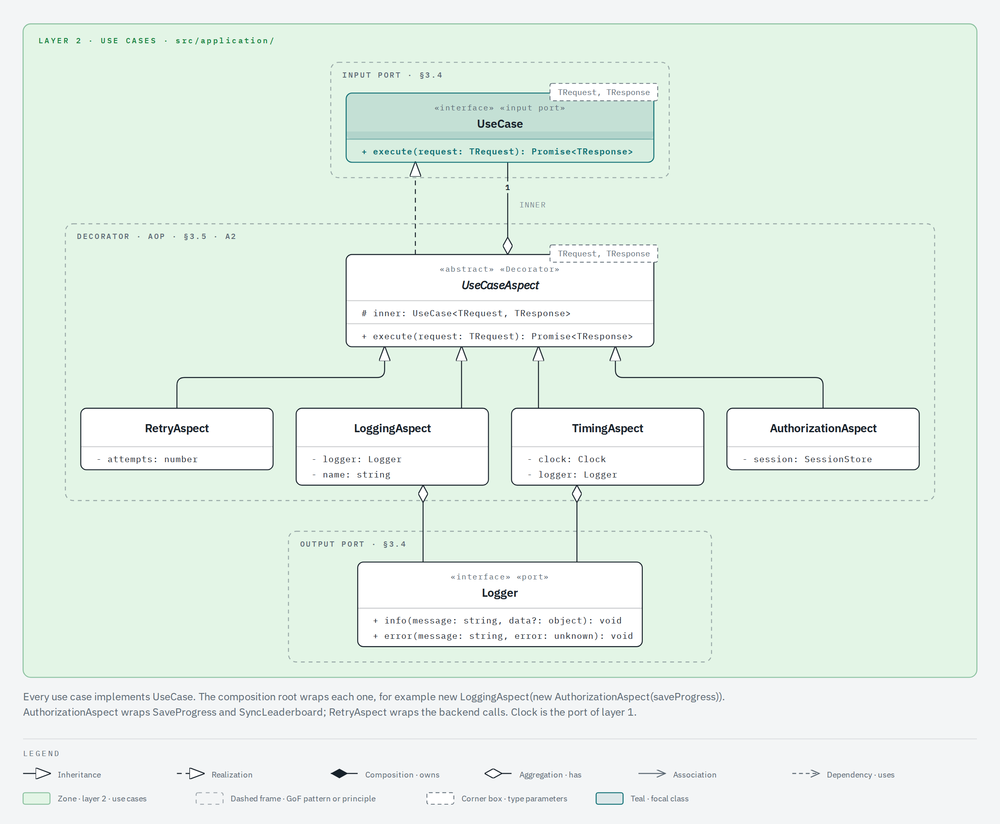

### View 3.2: playing a game

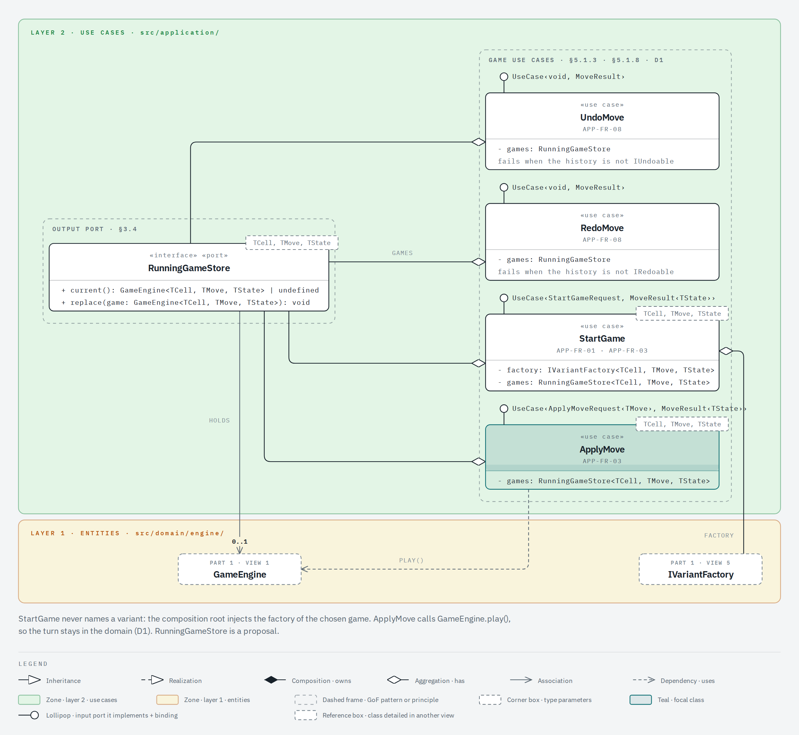

### View 3.3: progress, levels and leaderboard

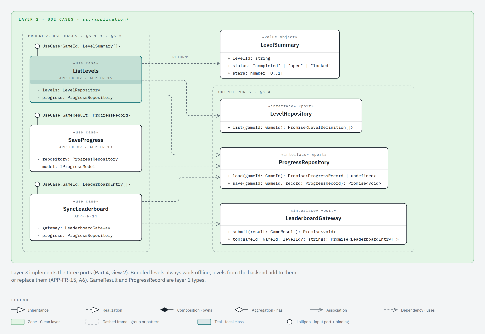

### View 3.4: account and settings

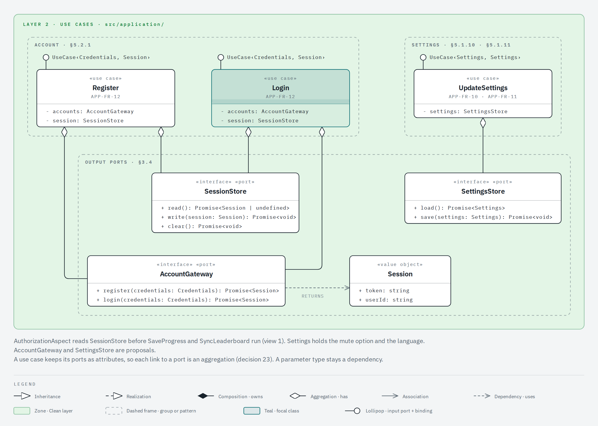

## Part 4: adapters, presenters and drivers

Layer 3, `src/adapters/`, and layer 4, `src/infrastructure/` and `app/`. These layers have no dependency rule yet ([layers.md](layers.md)).

### Map of the adapters, presenters and drivers

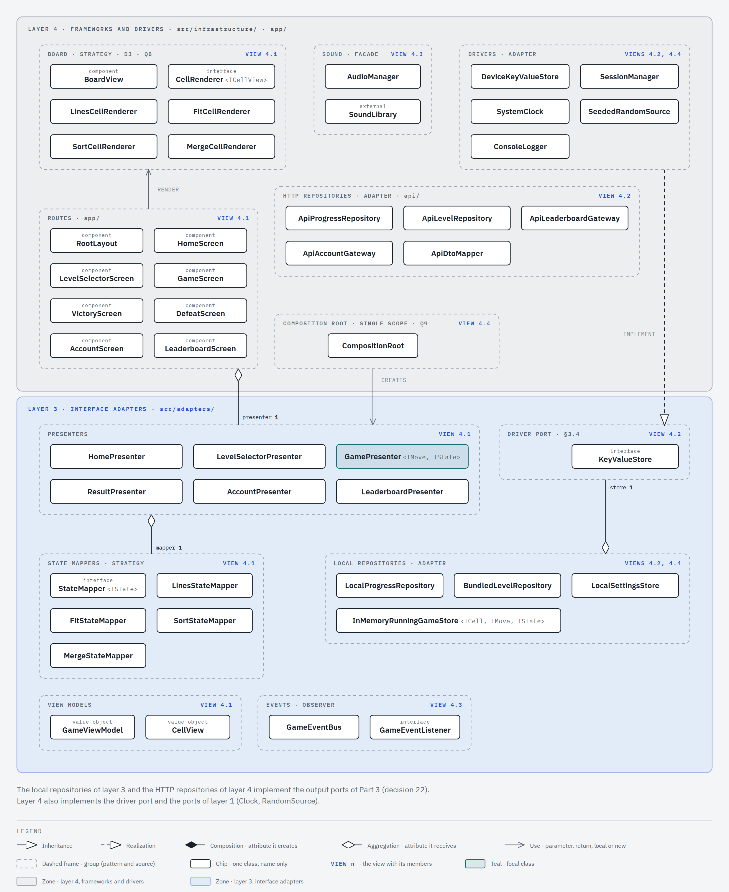

### View 4.1: presenting a game

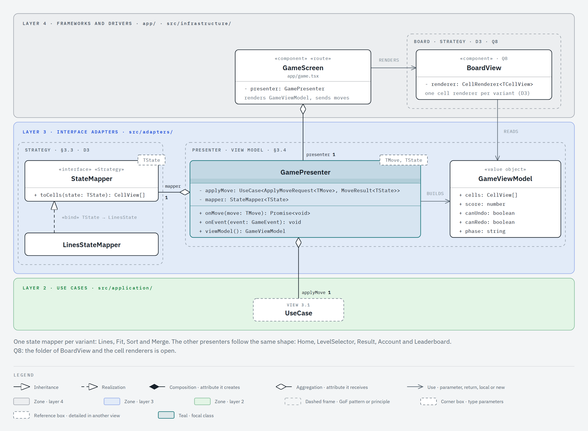

### View 4.2: repositories

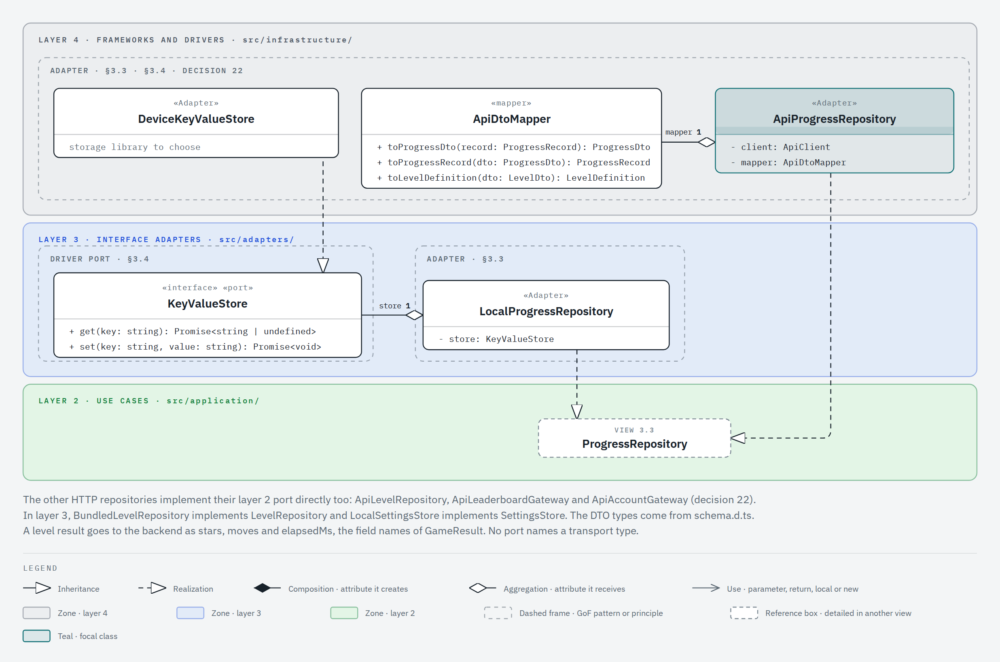

### View 4.3: game events and sound

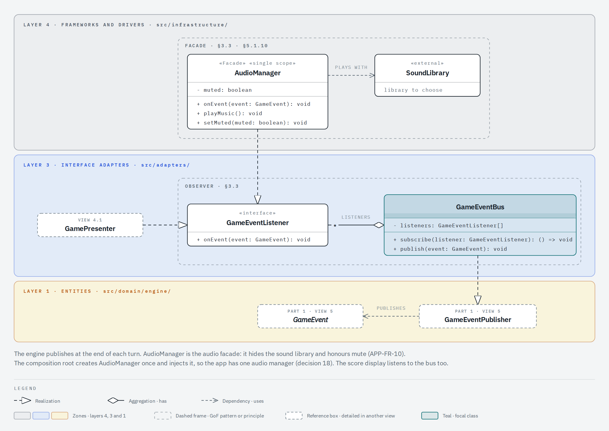

### View 4.4: wiring

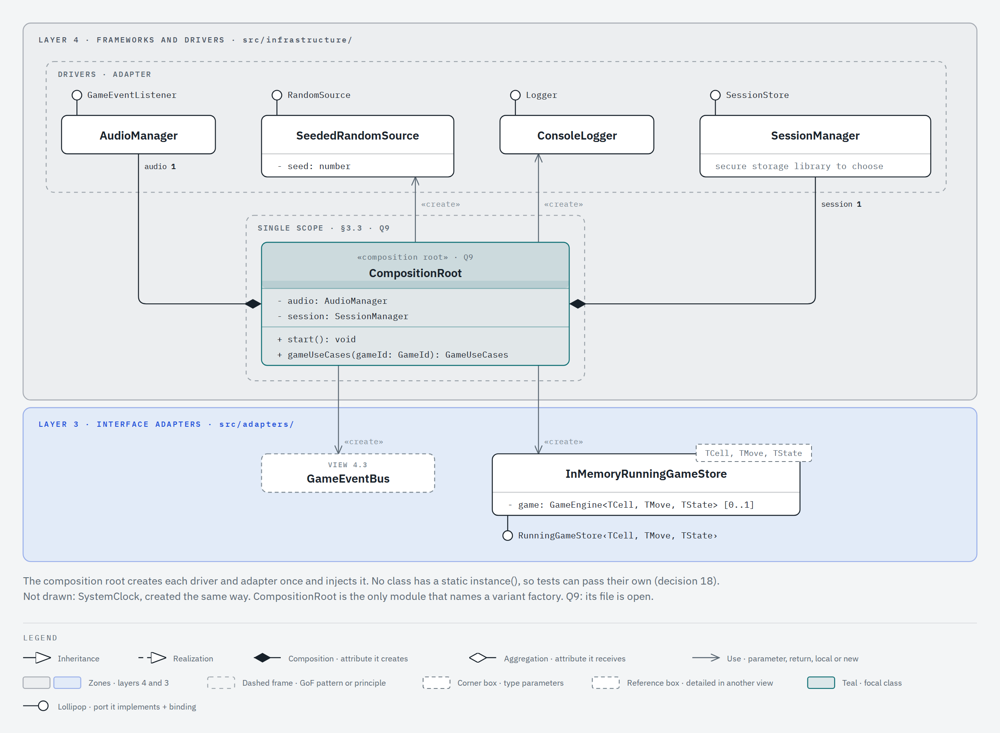

## Patterns

The fourteen patterns of §3.3 all appear. Eleven live in layer 1; Adapter, Facade and Singleton live in layers 3 and 4. D7 asks for a written reason for each one, so the Reason column names the requirement behind it. In the Views column, a plain number is a view of part 1, and `3.1` is view 1 of part 3.

| Pattern          | Classes                                                                                                                                      | Reason                                                                                       | Views                           |
| ---------------- | -------------------------------------------------------------------------------------------------------------------------------------------- | -------------------------------------------------------------------------------------------- | ------------------------------- |
| Strategy         | `IGameRules`, `IScoringPolicy`, `IPieceSource`, `IProgressModel`, `GridTopology`; `StateMapper` and `CellRenderer` in the outer layers       | Mandatory (§3.3). The variation dimensions of §1.5. D1 and D4.                               | 1, 2, 4, the four variants, 4.1 |
| Abstract Factory | `IVariantFactory` and one factory per variant                                                                                                | Mandatory (§3.3).                                                                            | 5 and the four variants         |
| Template Method  | `GameEngine.play()`                                                                                                                          | The turn skeleton (§3.1, §3.3, D1).                                                          | 1                               |
| State            | `GamePhase` and its five phases                                                                                                              | The game lifecycle (§3.3, D2).                                                               | 1                               |
| Command          | `MoveCommand`, `MoveHistory`, `RedoableHistory`                                                                                              | Undo and redo (§3.3, §5.1.8).                                                                | 1, 3                            |
| Prototype        | `Cloneable`: `HexBoard`, `Piece`, `BoardState`                                                                                               | Undo snapshots, rotation and the piece preview (§3.3, D3).                                   | 2                               |
| Composite        | `ShapeNode`, `CellNode`, `ShapeGroup`                                                                                                        | Pieces made of cells, Fit figures made of regions (§3.3, piece shape row of §8).             | 2                               |
| Iterator         | `HexBoard.line()`, `ring()` and `neighborhood()`                                                                                             | Traversal by axis, ring and neighbors (§3.1, §3.3).                                          | 2                               |
| Decorator        | `ScoringDecorator`, `ComboMultiplierDecorator`; `UseCaseAspect` and its four aspects                                                         | The Lines combo and streak multiplier (§1.1), scoring row of §8. The aspects of §3.5 (A2).   | 4, Lines, 3.1                   |
| Builder          | `ILevelBuilder`, `FitLevelBuilder`, `SortLevelBuilder`                                                                                       | Levels from configuration files (§3.3, §5.1.5), the Fit check of A5.                         | 5, Fit, Sort                    |
| Observer         | `GameEventPublisher` and the `GameEvent` classes; `GameEventBus` in layer 3                                                                  | Score, audio and screens react to game events (§3.3).                                        | 1, 5, 4.3                       |
| Adapter          | `LocalProgressRepository`, `ApiProgressRepository` and the other repositories; `HttpBackendApi`, `DeviceKeyValueStore` and the other drivers | A new database or backend means a new adapter, and the use cases do not change (§3.3, §3.4). | 4.2, 4.4                        |
| Facade           | `AudioFacade`                                                                                                                                | Sound effects and music behind one interface, with mute (§3.3, §5.1.10).                     | 4.3                             |
| Singleton        | `CompositionRoot`                                                                                                                            | One instance of each adapter for the whole app (§3.3, Q9).                                   | 4.4                             |

## Decisions to check with the team

1. **Template Method by composition.** §3.3 describes Template Method as an abstract class with the variant steps in subclasses. D1 keeps the skeleton in `GameEngine.play()` and takes the steps from `IGameRules` (Strategy), so a variant never extends the engine. The cost: the professor may expect the inheritance form, with an abstract turn class and one subclass per variant.
2. **`GamePhase`, not `GameState`.** The State pattern classes are phases, because `TState` already names the state of a game. [layers.md](layers.md) uses the same name.
3. **Undo is optional per variant.** `GameEngine` holds zero or one `MoveHistory`, and the variant factory decides. Fit gets `RedoableHistory` with no limit, Merge gets `MoveHistory` with limit 1, and Lines and Sort get none. So Hexa Lines never implements `IUndoable` (§3.2).
4. **`IRedoable` is our addition.** The statement lists `IUndoable`, `ITimed` and `IRandomSeeded`. Merge undoes one move and never redoes, so redo gets its own interface (§3.2 ISP, §5.1.8).
5. **`Color` and `GameId` live in the engine.** Lines and Sort both use `Color`, and rule `variants-isolated` forbids one variant from importing another.
6. **One piece type for the four variants.** Every piece is a `Piece<TCell>`: a shape plus the content it puts on the board. A Sort piece is one cell with a stack, and a Merge spawn is one cell with a tile. So `IPieceSource<Piece<TCell>>` serves the four variants.
7. **The board changes in place.** `HexBoard.set()` changes the board, and `clone()` takes the snapshot for undo and for the piece preview. The alternative is an immutable board, where each move returns a new board. Then undo keeps the old board, and Prototype applies only to pieces.
8. **The Merge rules are generic.** `MergeRules<TCell extends IMergeable<TCell>>` is the bounded generic of §3.1. The Merge factory binds it to `MergeTile`. Only one cell type uses it today. The bound states which capability the rules need from a cell.
9. **One generic input port.** Every use case implements `UseCase<TRequest, TResponse>`, so one aspect class can wrap any use case (§3.5). [layers.md](layers.md) asks for one interface per use case: here that interface is a binding, for example `UseCase‹ApplyMoveRequest‹TMove›, MoveResult‹TState››`. The cost: a use case cannot add a second method to its port.
10. **`RunningGameStore` (proposal).** The game use cases need the running engine between two calls. A port in layer 2 holds it, and `InMemoryRunningGameStore` in layer 3 implements it. The alternative: the presenter keeps the engine and passes it in each request, which puts a domain object inside the request model.
11. **`AccountGateway` (proposal).** `Register` and `Login` call the backend through this port. [layers.md](layers.md) names no port for them yet. `ApiAccountGateway` in layer 3 implements it.
12. **`SettingsStore` (proposal).** `UpdateSettings` keeps the mute option and the language through this port. [layers.md](layers.md) left that storage open. `LocalSettingsStore` implements it over `KeyValueStore`.
13. **Singleton in the composition root.** `CompositionRoot.instance()` is the classic form of §3.3. The rest of the app receives its dependencies by injection and never calls `instance()`. Q9 decides its file.
14. **State mappers and cell renderers.** `StateMapper<TState>` in layer 3 turns the state of a variant into `CellView` values, and one `CellRenderer` per variant draws them (D3). Q8 decides where the renderers live and whether the variant factory provides them.

## Render the images

The maps and the views come from the HTML files in [`classes/views/`](classes/views/). Each file holds one inline SVG drawn with the diagram-design skill. Open the file in a browser to see the drawing. The `.png` image next to it is that SVG rendered at scale 2 by a headless browser. After you edit a file, export the image again with `/diagram-design:export-diagram docs/architecture/classes/views/<view>.html --png-only`, then run `pnpm format`. The formatter changes the HTML layout only; the drawing stays the same. Commit each `.html` file together with its `.png` image. When a class is added or removed, update its map and its view in the same commit.
