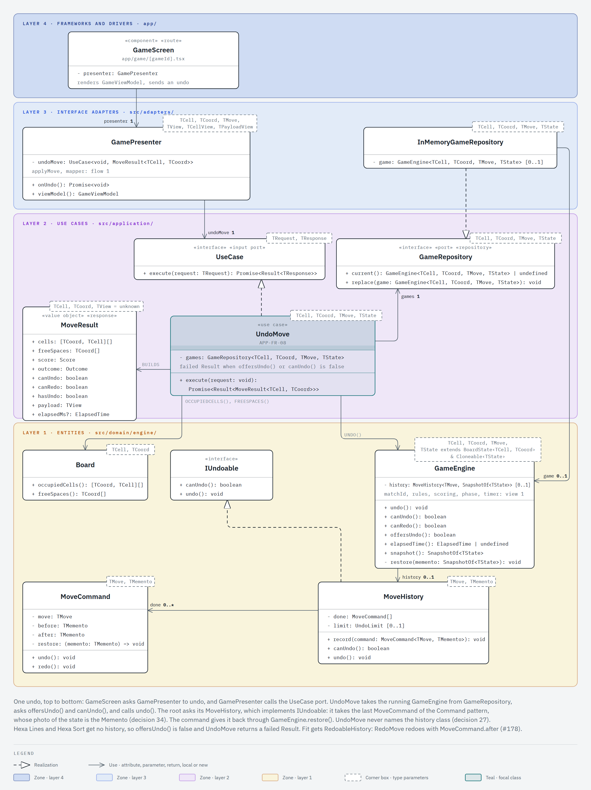
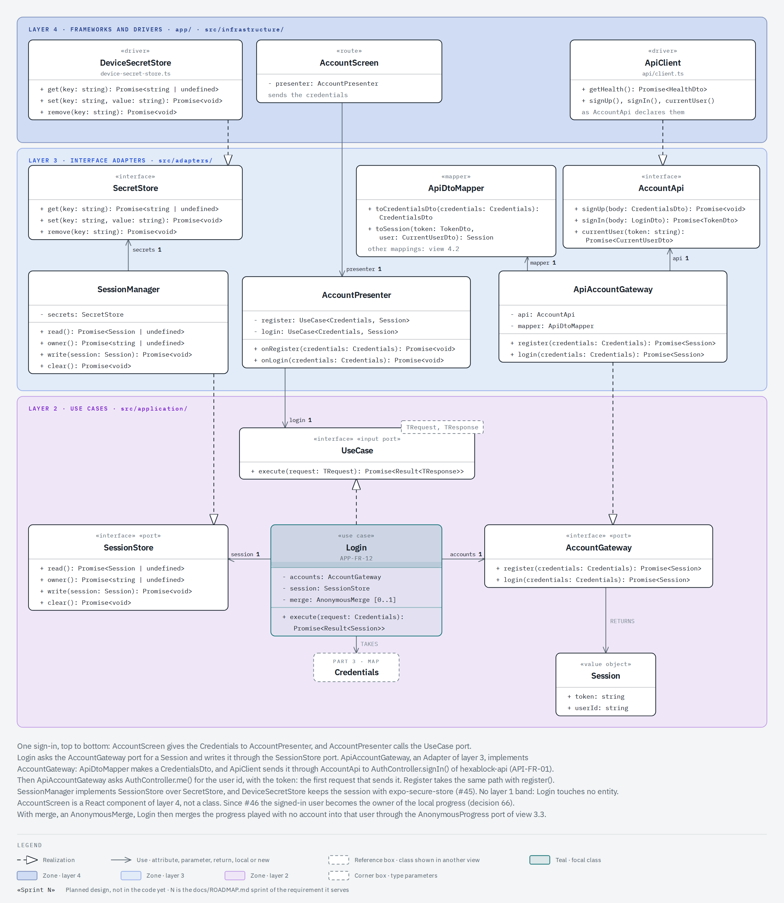

# Use case flows

Status: draft for team review, 2026-11-04.

This page shows how one use case crosses the four Clean layers of the client. In the class of 2026-11-03 the professor asked to see a pair of use cases and how the layers interact in each. He also wanted to see how the product talks to the backend. So this page has one flow for each path that shows something new: `ApplyMove` stays inside the app, `SaveProgress` saves a result on the device and its diagrams draw the path to `hexablock-api` (D27 moves that path to `SyncProgress`), `StartGame` wires a variant from its factory, `UndoMove` runs the Command history, and `Login` signs in against the backend and keeps the session. The other use cases follow one of these paths, and the table [Other use cases](#other-use-cases) names it. Each flow has two views with the same class names:

- A class view of the use case only. It draws every class of the slice, from the screen to the engine, in the layer bands of parts 3 and 4 of [classes.md](classes.md).
- A UML sequence diagram. It shows the calls in time order, from the screen to the inner layers and back.

The layers themselves are in [layers.md](layers.md). The full class diagram is in [classes.md](classes.md).

## Use case 1: apply a move

`ApplyMove` (APP-FR-03) plays one move. The player plays a move on `GameScreen`, and `GamePresenter.onMove()` takes it: the `MoveControls` of the game build the move and play it (#175). `FitControls` build a `PlaceFitPiece` or a `RemoveFitPiece` from a press on a space, and the controls of the other variants come with #174, #176 and #177. `GamePresenter` calls the `UseCase` port, and `ApplyMove` takes the running `GameEngine` through the `GameRepository` port. The engine plays the turn with its `IGameRules` strategy: the rules change a copy of the state only through the business methods of the state, and the engine adds the points of the turn, a `Score`, with `BoardState.addPoints()` (decisions 7 and 41 of [classes.md](classes.md)). A turn that ends the game records one `GameOver` event in the engine, which tells nobody. After the turn, `ApplyMove` takes the events with `GameEngine.takeEvents()` and publishes each one to the `GameEventPublisher` port; a publisher failure keeps the answer a success, and `MoveResult.failedDeliveries` carries it (#342) (decisions 26 and 29, #233). `ApplyMove` asks the photo of the state, `GameEngine.snapshot()`, for the copy of its board with `boardCopy()` and for its score, and copies the occupied cells and the free spaces of that board and the `view()` of the photo, the `payload`, into a plain `MoveResult`, and the presenter maps each occupied cell, each free space and the payload with its `StateMapper` into `GameViewModel` (#170). No HTTP call runs.

View 3.2 of [classes.md](classes.md) shows `ApplyMove` with layers 2 and 1 only, and view 4.1 shows the presenter without the use case. So this view joins both slices and does not repeat either view.

### Class view

### Sequence diagram

## Use case 2: save progress

`SaveProgress` (APP-FR-09, APP-FR-13) saves the result of a finished game. `VictoryScreen` gives the `GameResult` to `ResultPresenter`, which calls the `UseCase` port. `SaveProgress` loads the `GameProgress` of its game through the `ProgressRepository` port, or starts one when the game has none, records the result in it with its `IProgressModel` strategy, and saves it through the same port (S3-04, classes.md decisions 56 and 57). `LocalProgressRepository` in layer 3 implements that port over `KeyValueStore` (#164), and view 4.2 shows it. `SaveProgress` always saves to the local repository and needs no session, so a player with no account saves in the same way (D27 in [REQUIREMENTS.md](../REQUIREMENTS.md)). The response comes back to the screen as a `Result` with no value. The path to the backend belongs to `SyncProgress`, not to `SaveProgress`: it pushes the local progress through its gateway port to `ProgressController.sync()` of `hexablock-api` (API-FR-02) and merges the answer into `GameProgress` with the rule of DS-12. #46 builds `SyncProgress` and its gateway port.

The diagrams of this flow still draw the path before D27: `ApiProgressRepository` in layer 4 implements `ProgressRepository`, `ApiDtoMapper` makes a `ProgressDto`, and `ApiClient` sends it to `ProgressController.sync()`. #46 draws them again with `SyncProgress` ([Proposals in these views](#proposals-in-these-views)).

This flow takes `SaveProgress` and not `SyncLeaderboard`, for two reasons:

- APP-FR-13 says that the app sends its local progress to the backend. `SaveProgress` keeps that progress, and its diagrams draw the HTTP path that `SyncProgress` takes over (D27).
- No view gives `ApiLeaderboardGateway` a member, and no view says what `SyncLeaderboard` does with its `ProgressRepository`. A sequence diagram of it would invent its steps.

The endpoint that `SyncProgress` calls is use case 1 of the API flows, in `hexablock-api/docs/architecture/flows.md`.

### Class view

### Sequence diagram

## Use case 3: start a game

`StartGame` (APP-FR-01, APP-FR-03) opens a new game of the chosen variant. The player opens a game on `GameScreen`. `GamePresenter.onStart(levelId?)` calls the `UseCase` port with a `StartGameRequest`, which names the chosen level of a game with levels. `StartGame` asks its `GameFactories` port for the `GameFactory` of that level, and then asks that `GameFactory` for the started game (decisions 40 and 59 of [classes.md](classes.md)). `LevelGameFactories` in layer 3 implements the port. For a level id, it asks `LevelRepository.levelOf()` for the `LevelDefinition` of the level, and the `LevelVariant` of the game creates the level builder of the variant and gives it to `LevelDefinition.buildWith()`. The definition directs the builder: `withTopology()`, `withSection()` and `build()` (decision 15). The `LevelVariant` creates the variant factory of the built level, and `LevelGameFactories` creates a `GameFactory` over it. A request with no level id, as Lines and Merge send, gets the `GameFactory` of the variant factory that the composition root registered. A start of Fit or Sort with no level id starts the first level that the registry holds, so the game screen works until the level screen passes a level id (#173). `GameFactory` asks its `MatchIdGenerator` for a new `MatchId`, builds the local `GameStateId` and `BoardId` from it with `GameStateId.of(matchId)` and `BoardId.of(matchId)` (decision 52), and asks its `IVariantFactory` for the timer with `createTimer(matchId)`, the rules with `createRules()`, the scoring, the history and the first state. A variant with a timer gets its rules wrapped in `TimedRulesDecorator`, and the root keeps the same timer (decision 19). The composition root gives `GameFactory` the `GameId` of the chosen game and the variant factory that answers `isFor()` for it (#234). It gives the three ids to `createInitialState(matchId, stateId, boardId)` and the same `MatchId` to the new `GameEngine`, so the state has its own id and belongs to the game (decisions 7 and 26). In a Hexa Fit game, `FitFactory.createTimer(matchId)` builds the `LevelTimerId` of the new `LevelTimer` from the `MatchId` (decision 50); `GameFactory` does not see that id, so the diagram does not draw it. Each variant factory builds its board with `BoardBuilder`, and `BoardBuilder` asks its `GeometryFactory` for the topology. `LinesFactory`, `SortFactory` and `MergeFactory` give it a region with `withRegion(size)`, and `FitFactory` gives it the figure of the level with `withFigure(figure)`. `FitFactory` and `SortFactory` take the level that the level builder built. `GameFactory` creates `GameEngine` and starts it. `StartGame` keeps it in `GameRepository` and returns a `MoveResult`. No HTTP call runs.

Why this use case: it is the only path that builds a game. It shows the Abstract Factory of the variant, the Builder of the level and of the board and the geometry family in one call. So it shows why no class exists per game and figure (D11): the variant comes from the factory that the composition root injects, and the figure comes from the `GeometryFactory` that the factory and the builder keep.

### Class view

### Sequence diagram

![StartGame sequence: GameScreen calls onStart(levelId) on GamePresenter, which calls execute() on StartGame; StartGame calls factoryFor(levelId) on LevelGameFactories; an alt fragment shows the request with a level id, where LevelGameFactories calls levelOf() on BundledLevelRepository, creates the level builder, calls buildWith() on LevelDefinition, which calls withTopology(), withSection() and build() on the level builder, and creates the variant factory and a GameFactory, and the request with no level id, which gets the registered GameFactory; StartGame calls createGame() on that GameFactory; GameFactory calls next() on the MatchIdGenerator for a MatchId, builds a GameStateId and a BoardId from it, calls createTimer(matchId), createRules(), createScoring() and createHistory() on IVariantFactory, creates GameEngine, and calls createInitialState() with the three ids; an alt fragment shows the two paths of BoardBuilder, withRegion() for Lines, Sort and Merge and withFigure() for Fit, and BoardBuilder asks GeometryFactory for the topology in build(); GameFactory starts GameEngine and returns it; StartGame calls replace() on InMemoryGameRepository, reads the snapshot, the occupied cells and the free spaces of its boardCopy(), and returns a Result with a MoveResult](flows/views/seq-3-start-game.png)

The lifeline `ids` is the `MatchIdGenerator`, and two self messages of `GameFactory` build the local ids from the `MatchId`. The `LevelVariant` of the game lives in the file of `LevelGameFactories`, so the diagram draws its calls on the lifeline `factories`. The diagram has sixteen lifelines, so its SVG is 2172 units wide, not 1240, and its text is smaller in the image than in the other sequence diagrams.

## Use case 4: undo a move

`UndoMove` (APP-FR-08) takes back the last move. The player taps undo on `GameScreen`. `GamePresenter` calls the `UseCase` port, and `UndoMove` takes the running `GameEngine` through the `GameRepository` port. It asks the root whether the variant offers undo and whether a move can be undone, with `offersUndo()` and `canUndo()`. When one answer is false, `UndoMove` returns a failed `Result`. Otherwise it calls `GameEngine.undo()`: the root asks its `MoveHistory`, which implements `IUndoable`, to undo its last `MoveCommand`, and the command gives its `before` state back to the engine through the private `GameEngine.restore()`. `UndoMove` then builds the `MoveResult` as `ApplyMove` does. No HTTP call runs.

Why this use case: it is the only path through the Command pattern and the capabilities of §3.2. `UndoMove` never names `MoveHistory`: it calls only the root, `GameEngine.offersUndo()`, `canUndo()` and `undo()`, and the root asks its history (decisions 27 and 52, #234). So Hexa Lines needs no undo code (ISP). `MoveCommand.before`, the photo of the state before the move, is the Memento of decision 34.

### Class view

### Sequence diagram

![UndoMove sequence: GameScreen calls onUndo() on GamePresenter, which calls execute() on UndoMove; UndoMove calls current() on InMemoryGameRepository and offersUndo() and canUndo() on GameEngine; an alt fragment returns Result.failure(error) when one answer is false, and otherwise calls undo() on GameEngine, which calls undo() on MoveHistory, which calls undo() on MoveCommand, which calls restore() on GameEngine, then reads snapshot(), the occupied cells and the free spaces of its boardCopy(), canUndo(), canRedo(), offersUndo() and elapsedTime(), and returns a Result with a MoveResult](flows/views/seq-4-undo-move.png)

## Use case 5: sign in

`Login` (APP-FR-12) signs the player in. The player sends the credentials on `AccountScreen`. `AccountPresenter` calls the `UseCase` port, and `Login` calls the `AccountGateway` port. `ApiAccountGateway` in layer 4 implements that port: `ApiDtoMapper` makes a `CredentialsDto`, and `ApiClient` sends it to `AuthController.signIn()` of `hexablock-api` (API-FR-01). On success, `ApiDtoMapper` turns the `TokenDto` into a `Session`, and `Login` writes it through the `SessionStore` port, which `SessionManager` implements. On a rejected sign-in, `Login` returns a failed `Result`.

Why this use case: it is the second path to the backend, and the only one that writes the session that `AuthorizationAspect` reads before `SyncProgress` and `SyncLeaderboard` run (D27). `SaveProgress` and `ListLevels` need no session. It also shows a use case that touches no entity: the view has no layer 1 band. `SessionManager` is the single-scope driver of decision 18.

The same endpoint is use case 2 of the API flows, in `hexablock-api/docs/architecture/flows.md`.

### Class view

### Sequence diagram

## Other use cases

Each other use case follows the path of one flow above. Its own classes are in the views of Part 3 and Part 4 of [classes.md](classes.md).

| Use case          | Path                                                                                                                                                                                                                                                                                        |
| ----------------- | ------------------------------------------------------------------------------------------------------------------------------------------------------------------------------------------------------------------------------------------------------------------------------------------- |
| `RedoMove`        | Same path as flow 4: it asks `GameEngine.canRedo()` and calls `GameEngine.redo()`, and the root asks the `IRedoable` of its history. In Hexa Fit, `RedoableHistory` redoes the last undone `MoveCommand` with its `after` photo (#178).                                                     |
| `ListLevels`      | Same path as flow 2, except that it reads: it calls `LevelRepository.list()` and `ProgressRepository.load()` and returns one `LevelSummary` per level of the chosen figure. `BundledLevelRepository` gives the bundled levels (A6). It reads the local progress and needs no session (D27). |
| `SyncProgress`    | Planned by D27 (#46). Same path to the backend as the flow 2 diagrams, except that it goes through its own gateway port and needs the session. It pushes the local progress and merges the answer into `GameProgress` with the rule of DS-12. No view draws it yet.                         |
| `SyncLeaderboard` | Same path to the backend as the flow 2 diagrams, except that it goes through the `LeaderboardGateway` port and `ApiLeaderboardGateway`. No view gives `ApiLeaderboardGateway` a member yet.                                                                                                 |
| `Register`        | Same path as flow 5, except that it calls `AccountGateway.register()`, and the HTTP call goes to `AuthController.signUp()`.                                                                                                                                                                 |
| `UpdateSettings`  | Same path as flow 5 up to the port, except that it stays in the app: `LocalSettingsStore` in layer 3 implements the `SettingsStore` port over `KeyValueStore`. No HTTP call runs.                                                                                                           |

## How to read the class views

- The zones are the Clean layers, with the colors of [layers.md](layers.md): dark blue for layer 4, light blue for layer 3, purple for layer 2 and yellow for layer 1. The outer layer is at the top, so every dependency between layers points down.
- The lines follow the notation of [classes.md](classes.md). A use arrow joins two layers. A realization joins an adapter to its port, a use case to `UseCase`, or an engine class to the interface it implements, such as `MoveHistory` to `IUndoable`. A filled diamond goes only from an aggregate root to an internal entity of its aggregate (decision 23), and no flow view draws one, because none draws the composition of the root with an internal entity. A hollow diamond joins a decorator to the type that it wraps, with the label `decorate 1` (decision 23, change of 2026-11-24), and no flow view draws that pair. Every other attribute is a use with the attribute name and its multiplicity, a piece of a GoF pattern included. So `GamePresenter` keeps its `StateMapper` as `mapper 1`, `GameEngine` keeps its `IGameRules` as `rules 1` and its `MoveHistory` as `history 0..1`, `MoveHistory` keeps its `MoveCommand` objects as `done 0..*`, and `LinesFactory` and `BoardBuilder` keep the `GeometryFactory` they receive as `geometry 1`.
- No box carries a role label of a pattern, such as `«Strategy»`: the interface of a pattern carries only `«interface»`, and the footnote of each view names its patterns (decision 23).
- No line starts or ends on a dashed frame. A dashed box with an eyebrow, such as `Credentials` with `PART 3 · MAP`, is a class that another view details. A line may end on it, because it is one class.
- The views draw the input port `UseCase` as an interface box, not as a lollipop. A box lets the presenter point at the port it holds.
- The teal class is the focal class: the use case.
- A flow view shows more than the seven classes of the other views, because it follows one call through every layer.
- Each legend lists only the line kinds that its view draws.

## How to read the sequence diagrams

- Time runs down. Each lifeline is one object of a class of the class view. Its header names the object, its class and its layer, in the color of that layer.
- A solid line with a filled arrowhead is a call. Its label is the operation of the class view with its arguments. A dashed line with an open arrowhead is a return, with the returned value.
- A white bar on a lifeline is an activation: the object runs.
- A call through a port goes to the adapter that runs. The header says which port the adapter implements, for example `implements GameRepository`. The caller holds only the port, and the composition root binds the port to the adapter. So the call can go out to an outer layer while the dependency still points down.
- A `loop` fragment repeats its calls. Its guard, in square brackets, says what it repeats over.
- An `alt` fragment shows a choice. A dashed line divides its operands, and the guard of each operand says when it runs. `[else]` runs when no other guard holds.
- A `ref` box stands for an interaction that another diagram or view details. Its text names that diagram. The box covers the lifelines that take part.
- A call labelled `«create»` makes a new object, for example `GameEngine` in the `StartGame` diagram.
- In the `SaveProgress` and `Login` diagrams, the thick teal call is the HTTP call that leaves the app. The dashed teal line is the app boundary. The grey header is the backend.

## Proposals in these views

- `ApplyMoveRequest` holds the move only. `ResultPresenter.onFinish()` and `ApiClient.syncProgress()` are planned members. Today `ApiClient` has `getHealth()` only.
- The composition root binds `ProgressRepository` to `LocalProgressRepository` for every player, with or without an account (D27 in [REQUIREMENTS.md](../REQUIREMENTS.md), decided on 2026-11-19 and 2026-11-22 on #325). The local key carries the user, and the progress played without an account merges into the first account that signs in. #45 and #46 build the key with the user, the anonymous space and `SyncProgress`.
- Flow 2: `SaveProgress`, the `ProgressRepository` port, `GameProgress` and `LocalProgressRepository` are code since #164, but the composition root does not build `SaveProgress` yet. `VictoryScreen`, `ResultPresenter`, `ApiDtoMapper.toProgressDto()` and `ApiClient.syncProgress()` are planned. The class view and the sequence diagram of flow 2 still show the path before D27, where `ApiProgressRepository` implements `ProgressRepository`. #46 draws them again with `SyncProgress` and its gateway port, which have no code yet.
- The route path of `ProgressController.sync()` waits on the OpenAPI export of the endpoint.
- `ListLevels`, the `LevelRepository` port and `BundledLevelRepository` are code since #168, but the composition root does not build `ListLevels` yet, because no screen calls it. Its request holds the game and the chosen figure. It lists only the levels of that figure, in the order of their files, and each level is completed, open or locked (decision 58 of [classes.md](classes.md); S3-12 and S3-08 in #151, «Propuesta, pendiente del equipo»). A figure with no level gives an empty list.
- Flow 1: the move controls of `GameScreen` exist: `LinesControls`, `FitControls`, `SortControls` and `MergeControls` in `src/infrastructure/ui/` (#174 to #177), and `src/infrastructure/registered-games.ts` gives each game its controls. `GamePresenter.onEvent(event: GameEvent)` is a planned member, for `GameEventBus` (view 4.3 of [classes.md](classes.md)).
- Flow 3: `StartGameRequest.levelId`, the `GameFactories` port, `LevelGameFactories` and `GamePresenter.onStart(levelId?)` are code since #172 (decision 59 of [classes.md](classes.md); S3-13 in #151, «Propuesta, pendiente del equipo»). The level definition reaches the level builder through `LevelGameFactories`: it asks `LevelRepository.levelOf()` for the definition of the chosen level, and the `LevelVariant` of the game creates the level builder of the variant and gives it to `LevelDefinition.buildWith()`, which directs it. The game screen does not pass a level id yet: the level selector of #173 does. Until then a start of Fit or Sort with no level id gets the first-content level that the registry holds. The sequence diagram draws the code: each variant factory calls `BoardBuilder`.
- Flow 4: `GamePresenter.undoMove` and `GamePresenter.onUndo()` exist since #178, with `redoMove` and `onRedo()`; the move controls of the game show the buttons, and `FitControls` show both. `MoveHistory.undo()` returns `void`, and `GameEngine` takes the state back through its private `restore(memento)`: the engine gives each `MoveCommand` this method as a function (decision 34, #159). Since #178 each `MoveCommand` also keeps `after`, the photo after its move, and `redo()` gives it back through the same function.
- Flow 5: `AccountPresenter.login`, `AccountPresenter.onLogin(credentials: Credentials)`, the `client` and `mapper` attributes of `ApiAccountGateway`, `ApiDtoMapper.toCredentialsDto()`, `ApiDtoMapper.toSession()` and `ApiClient.signIn()` are planned members. No view gives `Credentials` a member. The endpoint name follows view 3.3 of the API class diagram: `AuthController.signIn(body: CredentialsDto): Promise<TokenDto>`. The answer to a rejected sign-in, a rejected `Promise` that `Login` turns into `Result.failure(error)`, is an assumption for team review.

## Render the images

The class views come from [`classes/views/flow-1-apply-move.html`](classes/views/flow-1-apply-move.html), [`classes/views/flow-2-save-progress.html`](classes/views/flow-2-save-progress.html), [`classes/views/flow-3-start-game.html`](classes/views/flow-3-start-game.html), [`classes/views/flow-4-undo-move.html`](classes/views/flow-4-undo-move.html) and [`classes/views/flow-5-login.html`](classes/views/flow-5-login.html). The sequence diagrams come from [`flows/views/seq-1-apply-move.html`](flows/views/seq-1-apply-move.html), [`flows/views/seq-2-save-progress.html`](flows/views/seq-2-save-progress.html), [`flows/views/seq-3-start-game.html`](flows/views/seq-3-start-game.html), [`flows/views/seq-4-undo-move.html`](flows/views/seq-4-undo-move.html) and [`flows/views/seq-5-login.html`](flows/views/seq-5-login.html). Each file holds one inline SVG, as the class views do. The `.png` image next to it is that SVG alone, in a page 1236 px wide, rendered at scale 2 by a headless browser. Commit each `.html` file together with its `.png` image.
