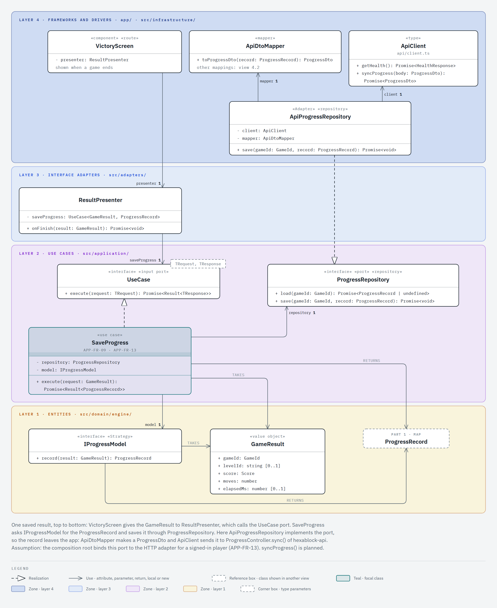

# Use case flows

Status: draft for team review, 2026-11-04.

This page shows how one use case crosses the four Clean layers of the client. In the class of 2026-11-03 the professor asked to see a pair of use cases and how the layers interact in each. He also wanted to see how the product talks to the backend. So this page has two use cases: `ApplyMove` stays inside the app, and `SaveProgress` sends a result to `hexablock-api`. Each use case has two views with the same class names:

- A class view of the use case only. It draws every class of the slice, from the screen to the engine, in the layer bands of parts 3 and 4 of [classes.md](classes.md).
- A UML sequence diagram. It shows the calls in time order, from the screen to the inner layers and back.

The layers themselves are in [layers.md](layers.md). The full class diagram is in [classes.md](classes.md).

## Use case 1: apply a move

`ApplyMove` (APP-FR-03) plays one move. The player taps a cell on `GameScreen`. `GamePresenter` calls the `UseCase` port, and `ApplyMove` takes the running `GameEngine` through the `RunningGameStore` port. The engine plays the turn with its `IGameRules` strategy. `ApplyMove` copies the cells of `Board` into a plain `MoveResult`, and the presenter maps each cell with its `StateMapper` into `GameViewModel`. No HTTP call runs.

View 3.2 of [classes.md](classes.md) shows `ApplyMove` with layers 2 and 1 only, and view 4.1 shows the presenter without the use case. So this view joins both slices and does not repeat either view.

### Class view

### Sequence diagram

## Use case 2: save progress

`SaveProgress` (APP-FR-09, APP-FR-13) saves the result of a finished game. `VictoryScreen` gives the `GameResult` to `ResultPresenter`, which calls the `UseCase` port. `SaveProgress` asks its `IProgressModel` strategy for the `ProgressRecord` and saves it through the `ProgressRepository` port. `ApiProgressRepository` in layer 4 implements that port: `ApiDtoMapper` makes a `ProgressDto`, and `ApiClient` sends it to `ProgressController.sync()` of `hexablock-api` (API-FR-02). The response comes back as a `Result` to the screen.

This flow takes `SaveProgress` and not `SyncLeaderboard`, for two reasons:

- APP-FR-13 says that the app sends its local progress to the backend, and `SaveProgress` serves it. View 4.2 shows the HTTP path of its port: `ApiProgressRepository` keeps `ApiClient` and `ApiDtoMapper.toProgressDto()`.
- No view gives `ApiLeaderboardGateway` a member, and no view says what `SyncLeaderboard` does with its `ProgressRepository`. A sequence diagram of it would invent its steps.

The same endpoint is use case 1 of the API flows, in `hexablock-api/docs/architecture/flows.md`.

### Class view

### Sequence diagram

## How to read the class views

- The zones are the Clean layers, with the colors of [layers.md](layers.md): dark blue for layer 4, light blue for layer 3, purple for layer 2 and yellow for layer 1. The outer layer is at the top, so every dependency between layers points down.
- The lines follow the notation of [classes.md](classes.md). A use arrow joins two layers. A realization joins an adapter to its port, or a use case to `UseCase`. A diamond stays inside one layer and only where it makes a GoF pattern visible (decision 23): `GamePresenter` keeps its `StateMapper` strategy, and `GameEngine` keeps its `IGameRules` strategy.
- The views draw the input port `UseCase` as an interface box, not as a lollipop. A box lets the presenter point at the port it holds.
- The teal class is the focal class: the use case.
- A flow view shows more than the seven classes of the other views, because it follows one call through every layer.
- Each legend lists only the line kinds that its view draws.

## How to read the sequence diagrams

- Time runs down. Each lifeline is one object of a class of the class view. Its header names the object, its class and its layer, in the color of that layer.
- A solid line with a filled arrowhead is a call. Its label is the operation of the class view with its arguments. A dashed line with an open arrowhead is a return, with the returned value.
- A white bar on a lifeline is an activation: the object runs.
- A call through a port goes to the adapter that runs. The header says which port the adapter implements, for example `implements RunningGameStore`. The caller holds only the port, and the composition root binds the port to the adapter. So the call can go out to an outer layer while the dependency still points down.
- A `loop` fragment repeats its calls. Its guard, in square brackets, says what it repeats over.
- In the `SaveProgress` diagram, the thick teal call is the HTTP call that leaves the app. The dashed teal line is the app boundary. The grey header is the backend.

## Proposals in these views

- `ApplyMoveRequest` holds the move only. `ResultPresenter.onFinish()` and `ApiClient.syncProgress()` are planned members. Today `ApiClient` has `getHealth()` only.
- The composition root binds `ProgressRepository` to `ApiProgressRepository` for a signed-in player. This is an assumption for team review: the docs do not say yet when `LocalProgressRepository` runs instead.
- The route path of `ProgressController.sync()` waits on the OpenAPI export of the endpoint.

## Render the images

The class views come from [`classes/views/flow-1-apply-move.html`](classes/views/flow-1-apply-move.html) and [`classes/views/flow-2-save-progress.html`](classes/views/flow-2-save-progress.html). The sequence diagrams come from [`flows/views/seq-1-apply-move.html`](flows/views/seq-1-apply-move.html) and [`flows/views/seq-2-save-progress.html`](flows/views/seq-2-save-progress.html). Each file holds one inline SVG, as the class views do. The `.png` image next to it is that SVG alone, in a page 1236 px wide, rendered at scale 2 by a headless browser. Commit each `.html` file together with its `.png` image.
