# Clean Architecture layers

Status: draft for review with the professor, 2026-10-30. Updated on 2026-10-31 to match the class diagram: one generic input port, the ports of decisions 10 to 12, engine interfaces that are not ports, and the presentation pattern. Updated on 2026-11-02: the `Logger` port takes a log entry, and its adapter writes the text (decision 37 of the class diagram). Updated on 2026-11-07: the status text and the planned marks of the diagram follow the code in `src/` (issue #147). Updated on 2026-11-15: the composition root, its game registry and the first adapters and drivers exist (issue #162). Updated on 2026-11-16: the text catalog exists (issue #154). Updated on 2026-11-16: the home screen, the game selector map and `HomePresenter` exist (issue #169). Updated on 2026-11-16: the `KeyValueStore` driver interface and its driver `DeviceKeyValueStore` exist (issue #155).

This page answers one question: in which layer does each piece of the client live? It follows the statement (§3.4, §4.2) and the layer rules in `.dependency-cruiser.cjs`. Part of the client exists today. `src/domain/` holds the engine and the four variants. `src/application/` holds the first use cases, `StartGame` and `ApplyMove`, with the input port `UseCase`, the ports `GameRepository`, `Logger` and `GameEventPublisher`, and the aspects `UseCaseAspect` and `LoggingAspect`. `src/adapters/` holds `InMemoryGameRepository`, the adapter of `GameRepository`, `NullGameEventPublisher`, a publisher that does nothing until `GameEventBus` exists, the text catalog in `src/adapters/texts/`, with one Spanish and one English entry for each visible text, `HomePresenter`, the presenter of the home screen and of the game selector map, and the `KeyValueStore` driver interface. `src/infrastructure/` holds the API client in `src/infrastructure/api/`, the composition root in `src/infrastructure/composition-root.ts` with its game registry, the drivers `SystemClock`, `SeededRandomSource`, `ConsoleLogger`, `SequentialMatchIds` and `DeviceKeyValueStore` (the `KeyValueStore` over AsyncStorage), the board components in `src/infrastructure/board/`: `BoardView`, the `CellRenderer` interface and the screen layout of each figure, and the shared parts of the screens in `src/infrastructure/ui/`. `app/` holds the root layout, which only calls the root, the home screen, the game selector map and the game route, a placeholder until #170. The other screens and the other adapters and drivers are planned. The diagram marks each planned piece. Component names follow the statement (§3.1, §3.4) and the [class diagram](classes.md). They are not final. The engine names carry no geometry: `Board<TCell, TCoord>` is the `HexBoard<TCell>` of §3.1 (decision 16 of the class diagram). IDs such as A1, D3 and Q7 refer to [`docs/REQUIREMENTS.md`](../REQUIREMENTS.md). The classes of layer 1 are in the [class diagram](classes.md).

## Diagram

Statement §4.2 asks for four concentric layers. Mermaid draws them as a stack: layer 4, the outer ring, is at the top, and layer 1, the center, is at the bottom. Every arrow goes from the component that imports to the component it imports. No arrow points up, toward an outer layer. Some arrows stay inside one layer, for example from the presenters to the mappers.

- Solid arrow: uses (imports). Dotted arrow: realization, the class implements an interface. Mermaid draws no hollow triangle, so the dotted line and its label `implements` stand for the UML realization.
- Rounded node: a port, an interface that layer 2 owns and an outer layer implements. Ports live in the application layer, because a use case may depend only on ports of its own layer (§3.4). So only layer 2 has rounded nodes.
- Plain box: a class or an interface that is not a port. The engine owns `Clock` and `RandomSource`, and layer 3 owns `KeyValueStore`. An outer layer implements them too, but they are interfaces of their own layer, not ports (decision 25 of the class diagram).
- Dashed border and the suffix "(planned)": the component does not exist yet. A solid border means the file exists today. A solid node whose label has a "planned:" part exists in part: only the names after "planned:" do not exist yet.
- A label that names a question (Q8 or Q9) marks a placement the team has not settled. The box sits where this draft puts it, and the professor's answer can move it.
- Colors: layer 1 yellow, layer 2 purple, layers 3 and 4 blue. The course colors three layers: the domain yellow, the application purple and the infrastructure blue. With four layers, layers 3 and 4 together are the blue infrastructure, so the team draws layer 3 light blue and layer 4 dark blue. The class views use the same colors.
- The legend is a box inside the drawing, below layer 1, so the image carries it too. It repeats the colors, the node shapes and the two arrows.

```mermaid
flowchart TB
  subgraph L4["Layer 4: Frameworks and drivers"]
    subgraph APP["app/"]
      ROUTES["Expo Router routes<br/>_layout.tsx calls the root, index.tsx (home),<br/>map.tsx (game selector map), game/[gameId].tsx<br/>(placeholder until #170)"]
      SCREENS["Level selector, game, victory and defeat<br/>routes: the MVP views (planned)"]
    end
    subgraph INFRA["src/infrastructure/"]
      API["api/client.ts: createApiClient<br/>api/schema.d.ts: generated OpenAPI types"]
      STORAGE["DeviceKeyValueStore: local storage driver<br/>over AsyncStorage"]
      APIREPOS["api/: ApiProgressRepository, ApiLevelRepository,<br/>ApiLeaderboardGateway, ApiAccountGateway<br/>and ApiDtoMapper (planned)"]
      SECURE["SessionManager: secure token storage,<br/>single scope (planned)"]
      AUDIO["AudioManager: audio facade over the<br/>sound library, single scope (planned)"]
      CLOCK["SystemClock"]
      RNG["SeededRandomSource"]
      MATCHIDS["SequentialMatchIds: the one id generator"]
      LOGGER["ConsoleLogger: writes the log text"]
      VIEWS["board/: BoardView, CellRenderer, BoardLayout<br/>and the three figure layouts;<br/>planned: the cell renderers (Q8)"]
      ROOT["composition-root.ts: CompositionRoot<br/>and GameRegistry (file: Q9)"]
      UI["ui/: the scene, the wood signs, the buttons<br/>and useHomePresenter"]
    end
  end

  subgraph L3["Layer 3: Interface adapters, src/adapters/"]
    PRESENTERS["MVP presenters and view models, one per screen:<br/>HomePresenter; planned: the others"]
    MAPPERS["State mappers per variant: one cell<br/>to one CellView (planned)"]
    EVENTBUS["GameEventBus: delivers game events<br/>to presenters, score and audio (planned)"]
    NULLPUB["NullGameEventPublisher: does nothing<br/>until GameEventBus exists"]
    LOCALREPO["LocalProgressRepository and<br/>LocalSettingsStore (planned)"]
    LEVELREPO["BundledLevelRepository (planned)"]
    GAMEREPO["InMemoryGameRepository"]
    TEXTS["texts/: the text catalog, one Spanish<br/>and one English entry for each key"]
    KV["KeyValueStore interface"]
  end

  subgraph L2["Layer 2: Use cases, src/application/"]
    UC["Generic use cases: StartGame, ApplyMove, UndoMove;<br/>planned: RedoMove, ListLevels,<br/>SaveProgress, SyncLeaderboard, Register,<br/>Login, UpdateSettings"]
    ASPECTS["Aspect decorators over the use cases:<br/>logging; planned: timing, retry,<br/>authorization"]
    MODELS["Request and response models,<br/>Result#lt;T, E#gt; and UseCaseError"]
    INPORTS(["UseCase#lt;TRequest, TResponse#gt;: one generic<br/>input port, each use case binds it"])
    PPORT(["ProgressRepository port (planned)"])
    LBPORT(["LeaderboardGateway port (planned)"])
    LVPORT(["LevelRepository port (planned)"])
    GRPORT(["GameRepository port"])
    ACCPORT(["AccountGateway port (planned)"])
    SESSPORT(["SessionStore port (planned)"])
    SETPORT(["SettingsStore port (planned)"])
    LOGPORT(["Logger port: takes a UseCaseLogEntry"])
    EVPORT(["GameEventPublisher port: ApplyMove delivers<br/>the events that the engine records"])
  end

  subgraph L1["Layer 1: Entities"]
    subgraph VARIANTS["src/domain/variants/"]
      LINES["hexa-lines"]
      FIT["hexa-fit"]
      SORT["hexa-sort"]
      MERGE["hexa-merge"]
    end
    subgraph ENGINE["src/domain/engine/"]
      CORE["GameEngine#lt;TCell, TCoord, TMove, TState#gt;, the aggregate root,<br/>Board#lt;TCell, TCoord#gt;, Piece, GridTopology#lt;TCoord#gt;, GameId,<br/>BoardBuilder, GeometryFactory with HexGeometry, SquareGeometry<br/>and TriangleGeometry, with their coordinates and topologies"]
      CONTRACTS["Contracts that a variant implements:<br/>IGameRules#lt;TMove, TState#gt; through BaseGameRules,<br/>IScoringPolicy#lt;TState#gt;, BoardState#lt;TCell, TCoord#gt;"]
      STRATS["Strategies with engine classes:<br/>IPieceSource#lt;TPiece#gt;: SeededPieceSource, FixedListPieceSource;<br/>IProgressModel: HighScoreProgress, LevelProgress;<br/>GameProgress, the progress of one game"]
      CAPS["Capability interfaces: IRandomSeeded with its engine class<br/>SeededPieceSource, IMergeable#lt;TCell#gt;, IUndoable and IRedoable with<br/>MoveHistory, ITimed with LevelTimer; planned:<br/>RedoableHistory"]
      DPORTS["Clock, RandomSource and<br/>MatchIdGenerator interfaces"]
      CMDSTATE["GamePhase classes, MoveCommand"]
      FACTORY["IVariantFactory: creates the rules, piece source,<br/>scoring, board, initial state and history;<br/>planned: progress model (Q8)"]
    end
  end

  ROUTES --> ROOT
  ROUTES --> PRESENTERS
  ROUTES --> TEXTS
  ROUTES --> UI
  UI --> ROOT
  UI --> PRESENTERS
  SCREENS --> VIEWS
  SCREENS --> PRESENTERS
  SCREENS --> TEXTS
  VIEWS --> PRESENTERS
  ROOT -->|wires every layer| L3
  STORAGE -.->|implements| KV
  LOGGER -.->|implements| LOGPORT
  CLOCK -.->|implements| DPORTS
  RNG -.->|implements| DPORTS
  MATCHIDS -.->|implements| DPORTS

  PRESENTERS --> MAPPERS
  MAPPERS --> CORE
  APIREPOS --> API
  APIREPOS -.->|implement| PPORT & LBPORT & LVPORT & ACCPORT
  LOCALREPO --> KV
  LOCALREPO -.->|implement| PPORT & SETPORT
  LEVELREPO -.->|implements| LVPORT
  GAMEREPO -.->|implements| GRPORT
  GAMEREPO --> CORE

  ASPECTS -->|wraps| UC
  ASPECTS --> LOGPORT
  ASPECTS --> DPORTS
  UC --> MODELS
  UC --> PPORT
  UC --> LBPORT
  UC --> LVPORT
  UC --> GRPORT
  UC --> ACCPORT
  UC --> SETPORT
  UC --> EVPORT
  UC --> CORE

  LINES & FIT & SORT & MERGE -.->|implement| CONTRACTS
  LINES & FIT & SORT & MERGE -.->|implement| FACTORY
  LINES & FIT & SORT & MERGE -->|factories pick| STRATS & CAPS
  MERGE -.->|MergeTile implements IMergeable| CAPS
  CORE --> CONTRACTS
  CORE --> STRATS
  CORE --> DPORTS
  CORE --> CAPS
  CORE --> CMDSTATE
  UC --> FACTORY

  PRESENTERS -->|calls| INPORTS
  PRESENTERS --> MODELS
  UC -.->|implements| INPORTS
  ASPECTS -.->|implements| INPORTS
  ASPECTS --> SESSPORT
  UC -->|Login and Register write| SESSPORT
  SECURE -.->|implements| SESSPORT
  EVENTBUS -.->|implements| EVPORT
  NULLPUB -.->|implements| EVPORT
  PRESENTERS -->|listens| EVENTBUS
  AUDIO -->|listens| EVENTBUS

  subgraph LEGEND["Legend"]
    direction LR
    LGL4["Layer 4: frameworks and drivers"]
    LGL3["Layer 3: interface adapters"]
    LGL2["Layer 2: use cases"]
    LGL1["Layer 1: entities"]
    LGPORT(["Rounded node: a port of layer 2"])
    LGPLAN["Dashed border: planned"]
    LGFROM["Importer"] -->|uses| LGTO["Imported"]
    LGIMPL["Implementation"] -.->|realization: implements| LGIFACE["Interface"]
  end

  %% Invisible links keep the layers stacked from outer to inner, with the legend last.
  KV & MAPPERS & GAMEREPO & NULLPUB & TEXTS ~~~ ASPECTS
  PPORT & LBPORT & LVPORT & GRPORT & ACCPORT & SESSPORT & SETPORT & LOGPORT & EVPORT & INPORTS ~~~ CORE & LINES & FIT & SORT & MERGE
  L1 ~~~ LEGEND

  classDef planned stroke-dasharray: 5 5
  class SCREENS,APIREPOS,SECURE,AUDIO planned
  class MAPPERS,EVENTBUS,LOCALREPO,LEVELREPO planned
  class PPORT,LBPORT,LVPORT,ACCPORT,SESSPORT,SETPORT planned
  class LGPLAN planned

  style L4 fill:#cfdcf3,stroke:#1e3a8a,color:#111827
  style APP fill:#cfdcf3,stroke:#1e3a8a,color:#111827
  style INFRA fill:#cfdcf3,stroke:#1e3a8a,color:#111827
  style L3 fill:#e2ebf8,stroke:#1d4ed8,color:#111827
  style L2 fill:#efe7f8,stroke:#7e22ce,color:#111827
  style L1 fill:#fef3c7,stroke:#b45309,color:#111827
  style VARIANTS fill:#fde68a,stroke:#b45309,color:#111827
  style ENGINE fill:#fde68a,stroke:#b45309,color:#111827
  style LEGEND fill:#ffffff,stroke:#4b5563,color:#111827
  style LGL4 fill:#cfdcf3,stroke:#1e3a8a,color:#111827
  style LGL3 fill:#e2ebf8,stroke:#1d4ed8,color:#111827
  style LGL2 fill:#efe7f8,stroke:#7e22ce,color:#111827
  style LGL1 fill:#fef3c7,stroke:#b45309,color:#111827
```

## Layers and allowed dependencies

The "May depend on" column repeats `.dependency-cruiser.cjs`. `pnpm arch` checks `src/` and `app/` with it, and `test/gates/architecture-gate.test.ts` tests each rule. Layer 4 has no rule yet, so its column repeats the folder README and says "no rule".

| Layer                     | Folder                           | What lives there                                                                                                                                                                                                                                                                                                        | May depend on                                                                                                                                                                |
| ------------------------- | -------------------------------- | ----------------------------------------------------------------------------------------------------------------------------------------------------------------------------------------------------------------------------------------------------------------------------------------------------------------------- | ---------------------------------------------------------------------------------------------------------------------------------------------------------------------------- |
| 1. Entities               | `src/domain/engine/`             | The generic engine: `Board<TCell, TCoord, TAxis>`, `Piece`, `GridTopology<TCoord, TAxis, TDirection>` (D4), `BoardBuilder`, the geometry family with `HexCoord` and `HexTopology`, `GameEngine<TCell, TCoord, TMove, TState>` and the contracts it uses. The interfaces for time and randomness (R-domain-determinism). | Only `src/domain/` code. Never a variant, a package or a Node module. Rules: `domain-imports-only-domain`, `domain-no-framework`, `engine-no-variants`.                      |
| 1. Entities               | `src/domain/variants/<variant>/` | One folder per game. Each one holds its cell type, its move, its state, its `IGameRules` implementation, its scoring policy and its factory.                                                                                                                                                                            | `src/domain/engine/` and its own folder. Never another variant, a package or a Node module. Rules: `domain-imports-only-domain`, `domain-no-framework`, `variants-isolated`. |
| 2. Use cases              | `src/application/`               | The generic use cases, the ports they need (repositories, gateways, running game, session, settings, logger), the request and response models, `Result` and the aspect decorators.                                                                                                                                      | Only `src/domain/` and `src/application/` code. No package. Rule: `application-imports-only-domain`.                                                                         |
| 3. Interface adapters     | `src/adapters/`                  | Presenters and view models (MVP), state mappers, the local repositories, `InMemoryGameRepository`, the event publisher, the `KeyValueStore` driver interface and the text catalog.                                                                                                                                      | `src/application/`, `src/domain/` and its own folder. Never a driver of `src/infrastructure/`, a package or a Node module. Rule: `adapters-imports-only-inner-layers`.       |
| 4. Frameworks and drivers | `src/infrastructure/`            | The composition root and its game registry; the shared parts of the screens in `ui/`; the HTTP client, its generated types and the HTTP repositories (Q7 closed); storage, session, audio, system clock, seeded random source, match id generator, logger.                                                              | Every inner layer and any package, per `src/infrastructure/README.md`. No rule.                                                                                              |
| 4. Frameworks and drivers | `app/`                           | Expo Router routes only (`AGENTS.md`).                                                                                                                                                                                                                                                                                  | Every inner layer and any package. No rule.                                                                                                                                  |

## Where each piece lives

- **Generic engine:** layer 1, `src/domain/engine/`. `Board<TCell, TCoord, TAxis>`, `GameEngine<TCell, TCoord, TMove, TState>` (D1) and the contracts `IGameRules`, `IPieceSource<TPiece>`, `IScoringPolicy<TState>` and `IProgressModel`. The shared implementations (seeded or fixed piece source, high score or levels with stars) live here too. They take time and randomness through the `Clock` and `RandomSource` interfaces of the engine. `GameEngine` is the aggregate root of a game: a game changes only through `play()`, and `play()` applies a move only while the phase allows it. The state of the game is an entity inside the aggregate: it has an id of its own, and it keeps the `MatchId` of its game. The rules change it only through its business methods, and the engine adds the points with `BoardState.addPoints()` (decisions 7 and 26). The scoring policy is the Strategy that the root holds (decision 26). The geometry family (`GeometryFactory` with `HexGeometry`) creates the coordinate, the topology and the piece shapes, and `BoardBuilder` builds the board from them. The abstract `BaseGameRules` holds the turn skeleton as a template method.
- **The four variants:** layer 1, `src/domain/variants/hexa-lines/`, `hexa-fit/`, `hexa-sort/` and `hexa-merge/`. Each one extends `BaseGameRules` for its own cell type, for example `MergeTile` for Hexa Merge (A1), and writes its scoring policy, its state and its factory. The state of a variant is an entity: its business methods carry each change of the board, and the rules call them. It writes no piece source, progress model or capability class: those live in the engine, and the variant factory picks them (decision 3). A variant imports the engine. The engine never imports a variant.
- **Abstract Factory per variant:** layer 1. The interface `IVariantFactory` lives in `src/domain/engine/`, and each variant folder holds one implementation. It creates the whole family of statement §3.3: the rules, the piece source (`createPieceSource()`), the scoring policy and the board (`createBoard()`, with `BoardBuilder`), plus the progress model, the initial state and the optional history (decision 31). `StartGame` receives a factory and never names a variant. The cell renderer that D3 assigns to this factory cannot live here. Q8 asks where the renderer goes, and its answer can move the factory too.
- **Capability interfaces:** layer 1, `src/domain/engine/`. `IMergeable<TCell>` is the bound on the Hexa Merge cell (§3.1). `IUndoable`, `ITimed` and `IRandomSeeded` stay separate (§3.2, ISP). The engine classes `MoveHistory`, `RedoableHistory`, `LevelTimer` and `SeededPieceSource` implement them. `SeededPieceSource` is a value object, as every piece source is: a draw returns the next source and changes nothing (decision 51). The variant factory gives a game only the ones it uses, so Hexa Lines gets no `IUndoable` (decision 3). `LevelTimer` is an entity inside the `GameEngine` aggregate: its `LevelTimerId` is local, and the variant factory builds it from the `MatchId` of the game (decisions 50 and 52). The root answers for them with `undo()`, `redo()`, `canUndo()`, `canRedo()`, `offersUndo()` and `elapsedTime()`, and it hands out no capability, so no use case asks for a concrete class (decision 27, #234). `IRedoable` is our addition: Hexa Fit redoes, and Hexa Merge only undoes (§5.1.8).
- **Command and State:** layer 1, `src/domain/engine/`. `MoveCommand` wraps each move, so the history supports undo and redo: unlimited in Hexa Fit, one move in Hexa Merge (§3.3). `GamePhase` has one class per phase of a game: Playing, Resolving, Paused, GameOver and Victory (§3.3). The name avoids a clash with the `TState` type parameter. The menu belongs to the presentation layer, not to `GamePhase` (D2).
- **Game events (Observer):** the `GameEventPublisher` port lives in layer 2, `src/application/` (#233). The engine records its events at the end of a turn and tells nobody, and `ApplyMove` delivers them to the port after the turn. Today the only event is `GameOver`. `LineCleared`, `StackMerged` and `TileMerged` are planned events, and each one will extend the abstract `GameEvent`, as `GameOver` does (§3.3). `GameEventBus` in layer 3 implements the port. The presenters, the score display and `AudioManager`, the audio facade in layer 4, listen to it, so the engine never knows about sound or screens.
- **Use cases:** layer 2, `src/application/`. One generic set for the four variants:
  - `StartGame`, `ApplyMove`, `UndoMove`, `SaveProgress` and `SyncLeaderboard`. The game use cases keep the running engine through `GameRepository`, the repository port of the game aggregate, and `InMemoryGameRepository` in layer 3 implements it (decision 10).
  - `RedoMove`: redo in Hexa Fit (statement §5.1.8).
  - `ListLevels`: the level selector with its progress indicator and locked levels (§5.1.2).
  - `Register` and `Login`: sign-up and sign-in against the backend (§5.2.1), through the `AccountGateway` port, which `ApiAccountGateway` in layer 4 implements (decision 11). They write the token through the `SessionStore` port.
  - `UpdateSettings`: the mute option and the language (§5.1.10, §5.1.11), through the `SettingsStore` port, which `LocalSettingsStore` in layer 3 implements over `KeyValueStore` (decision 12).
- **Input port:** layer 2, `src/application/`, one generic interface, `UseCase<TRequest, TResponse>` (decision 9). Each use case binds it, for example `UseCase<ApplyMoveRequest<TMove>, MoveResult<TCell, TCoord>>`. The presenters depend on the interface, not on the class. Each aspect decorator implements the same interface to wrap any use case. Tests call the same interface.
- **Results and response models:** layer 2. `execute()` returns `Promise<Result<TResponse>>`: a use case reports a failure as a `Result` with a `UseCaseError` and never throws to the screen (decision 28). The response is plain data: `MoveResult` copies the cells and never carries the `Board` or the engine (decision 29).
- **Session:** the `SessionStore` port lives in layer 2. `SessionManager`, the secure token storage in layer 4, implements it. `Login` and `Register` write the token through it. The authorization aspect reads it before `SaveProgress` and `SyncLeaderboard` run (§3.5).
- **AOP decorators:** layer 2, `src/application/`. Each decorator implements the same use case interface and wraps a use case (§3.5, A2). `RetryAspect` runs the use case again while the error of its `Result` is retryable. A decorator logs through the `Logger` port and reads the time through the `Clock` interface of the engine, because `application-imports-only-domain` forbids a logging package there. The lint rule of R-domain-determinism covers `src/application/` too, so a decorator never calls `Date.now`. The decorator passes a `UseCaseLogEntry` with the use case name, the outcome, the time and the error, never a prebuilt message. The concrete logger lives in layer 4 and writes the text (decision 37 of the class diagram).
- **Repositories:** the ports (`ProgressRepository`, `LeaderboardGateway`, `LevelRepository`) live in layer 2. The local implementations live in layer 3, `src/adapters/`, and use `KeyValueStore`, a driver interface of layer 3. The HTTP implementations and their DTO mapper live in layer 4, `src/infrastructure/api/`, next to the HTTP client, and implement the layer 2 ports directly (Q7, option B). No port names a transport type. A new database or backend means a new adapter, and the use cases do not change.
- **API client:** layer 4, `src/infrastructure/api/client.ts`. It uses the types in `schema.d.ts`, which `pnpm api:generate` writes from the backend OpenAPI document. `pacts/hexablock-app-hexablock-api.json` is the contract the consumer test writes for this client. It is a test artifact, not a layer.
- **Screens:** layer 4, `app/` (Expo Router routes; the home screen and the game selector map exist, and the game route is a placeholder until #170). Their presenters and view models live in layer 3. A screen shows each text through a key of the text catalog in layer 3, `src/adapters/texts/`: `es.ts` and `en.ts` hold one Spanish and one English entry for each key (APP-FR-11, rule R-text-catalog in `AGENTS.md`). The catalog lives in layer 3, so a presenter can read it too. Since #165 the React Native board components live in `src/infrastructure/board/` (S3-07 in #151, «Propuesta, pendiente del equipo»): `BoardView`, the `CellRenderer<TCellView>` interface, and `BoardLayout<TCoord>` with `HexLayout`, `SquareLayout` and `TriangleLayout`. The cell renderer of each variant is planned in the same folder. Q8 still waits on the professor, and his answer can move them.
- **Presentation pattern: Model-View-Presenter (MVP).** MVP is a presentation pattern, so it works inside Clean Architecture and orders only layers 3 and 4. The view is a route in layer 4, for example `GameScreen` with `BoardView`: it shows a `GameViewModel` and forwards each input to its presenter. The presenter (`GamePresenter`) and the view model live in layer 3: the presenter calls a use case through `UseCase`, maps the plain response to the view model and gives it to the view. The view model is plain data that the presenter builds, not an object that the view binds to, so the pattern is MVP and not MVVM. The model is layers 1 and 2.
- **Dependency-injection composition root:** layer 4, `src/infrastructure/composition-root.ts` (S3-06 in #151, «Propuesta, pendiente del equipo», issue #162). It is the only module that imports from every layer. It builds the drivers and the adapters once, injects them into the use cases and wraps the use cases in the aspect decorators. Today it builds `SystemClock`, `SeededRandomSource`, `ConsoleLogger`, `SequentialMatchIds`, the one id generator of `MatchId`, and `NullGameEventPublisher`, which goes to `ApplyMove`. Its `GameRegistry` maps each `GameId` to its variant factory, and `src/infrastructure/registered-games.ts` lists the four games. Until #172, `StartGame` takes its factory in its constructor, so the root builds one `StartGame`, `ApplyMove` and `UndoMove` per game over one `InMemoryGameRepository`. `app/_layout.tsx` only calls it, through `CompositionRootProvider`, and the routes read it with `useCompositionRoot()`. It will create `AudioManager` and `SessionManager` once, so they have a single scope (§3.3). Q9 still waits on the professor, and his answer can move the root.

## Open questions for the professor

The numbers match the question list in [`docs/REQUIREMENTS.md`](../REQUIREMENTS.md) §11.

- **Q7. Where does the backend repository live?** Closed by the team on 2026-10-30 with option B. `ApiProgressRepository` needs the HTTP client and its generated DTO types, and both live in `src/infrastructure/api/`. Option A kept the repository in `src/adapters/` behind a `BackendApi` port that layer 3 owned. Option B moves the repository and its DTO mapper to `src/infrastructure/api/`, where they implement the layer 2 port directly. The methods of `BackendApi` named transport types, for example `signIn(body: CredentialsDto): Promise<SessionDto>`. In class on 2026-10-30 the professor called this structural coupling: a port that names transport types ties the use cases to the shape of the HTTP data. The diagram shows option B.
- **Q8. Where do the variant factory and the cell renderer live?** D3 says the variant factory provides the cell renderer. A cell renderer is a React Native component, and `domain-no-framework` forbids React in `src/domain/`. Option A: the domain factory builds only domain objects, and a second factory per variant in an outer layer builds the renderer. Option B: the whole factory moves to an outer layer. Which layer should hold the React Native board and cell components: layer 3 next to the presenters, or layer 4?
- **Q9. Where does the composition root live?** It imports every layer, so it belongs in layer 4. Option A: `app/_layout.tsx`, the Expo Router root. Option B: a module in `src/infrastructure/` that `app/_layout.tsx` calls, so `app/` keeps routes only. Which one do you expect?
