# Clean Architecture layers

Status: draft for review with the professor, 2026-10-30.

This page answers one question: in which layer does each piece of the client live? It follows the statement (§3.4, §4.2) and the layer rules in `.dependency-cruiser.cjs`. The engine is not written yet. Today `src/` holds one README per layer folder plus the API client in `src/infrastructure/api/`. Component names follow the statement (§3.1, §3.4) and the [class diagram](classes.md). They are not final. The engine names carry no geometry: `Board<TCell, TCoord>` is the `HexBoard<TCell>` of §3.1 (decision 16 of the class diagram). IDs such as A1, D3 and Q7 refer to [`docs/REQUIREMENTS.md`](../REQUIREMENTS.md). The classes of layer 1 are in the [class diagram](classes.md).

## Diagram

Statement §4.2 asks for four concentric layers. Mermaid draws them as a stack: layer 4, the outer ring, is at the top, and layer 1, the center, is at the bottom. Every arrow goes from the component that imports to the component it imports. No arrow points up, toward an outer layer. Some arrows stay inside one layer, for example from the presenters to the mappers.

- Solid arrow: uses (imports). Dotted arrow: implements an interface.
- Rounded node: a port, an interface at a layer boundary that the inner layer owns. A plain box can also hold interfaces, such as the engine contracts, when they do not sit on a layer boundary.
- Dashed border and the suffix "(planned)": the component does not exist yet. A solid border means the file exists today.
- A label that names a question (Q8 or Q9) marks a placement the team has not settled. The box sits where this draft puts it, and the professor's answer can move it.
- Colors: layer 4 gray, layer 3 blue, layer 2 green, layer 1 yellow.

```mermaid
flowchart TB
  subgraph L4["Layer 4: Frameworks and drivers"]
    subgraph APP["app/"]
      ROUTES["Expo Router routes<br/>_layout.tsx, index.tsx (home)"]
      SCREENS["Game selector, level selector, game,<br/>victory and defeat routes (planned)"]
    end
    subgraph INFRA["src/infrastructure/"]
      API["api/client.ts: createApiClient<br/>api/schema.d.ts: generated OpenAPI types"]
      STORAGE["Local storage driver (planned)"]
      APIREPOS["api/: ApiProgressRepository, ApiLevelRepository,<br/>ApiLeaderboardGateway, ApiAccountGateway<br/>and ApiDtoMapper (planned)"]
      SECURE["SessionManager: secure token storage,<br/>single scope (planned)"]
      AUDIO["AudioManager: audio facade over the<br/>sound library, single scope (planned)"]
      CLOCK["SystemClock (planned)"]
      RNG["SeededRandomSource (planned)"]
      LOGGER["ConsoleLogger (planned)"]
      VIEWS["BoardView and cell renderers,<br/>React Native (planned, folder: Q8)"]
      ROOT["Composition root (planned, file: Q9)"]
    end
  end

  subgraph L3["Layer 3: Interface adapters, src/adapters/"]
    PRESENTERS["Presenters and view models,<br/>one per screen (planned)"]
    MAPPERS["State mappers per variant (planned)"]
    EVENTBUS["GameEventBus: delivers game events<br/>to presenters, score and audio (planned)"]
    LOCALREPO["LocalProgressRepository (planned)"]
    LEVELREPO["BundledLevelRepository (planned)"]
    KV(["KeyValueStore port (planned)"])
  end

  subgraph L2["Layer 2: Use cases, src/application/"]
    UC["Generic use cases (planned):<br/>StartGame, ApplyMove, UndoMove, RedoMove,<br/>ListLevels, SaveProgress, SyncLeaderboard,<br/>Register, Login, UpdateSettings"]
    ASPECTS["Aspect decorators over the use cases<br/>(planned): logging, timing, retry,<br/>authorization"]
    PPORT(["ProgressRepository port (planned)"])
    LBPORT(["LeaderboardGateway port (planned)"])
    LVPORT(["LevelRepository port (planned)"])
    LOGPORT(["Logger port (planned)"])
    INPORTS(["Input ports, one interface per use case (planned)"])
    SESSPORT(["SessionStore port (planned)"])
  end

  subgraph L1["Layer 1: Entities"]
    subgraph VARIANTS["src/domain/variants/"]
      LINES["hexa-lines (planned)"]
      FIT["hexa-fit (planned)"]
      SORT["hexa-sort (planned)"]
      MERGE["hexa-merge (planned)"]
    end
    subgraph ENGINE["src/domain/engine/"]
      CORE["Board#lt;TCell, TCoord#gt;, Piece, GridTopology#lt;TCoord#gt;,<br/>BoardBuilder, GeometryFactory with HexGeometry,<br/>HexCoord and HexTopology,<br/>GameEngine#lt;TCell, TMove, TState#gt; (planned)"]
      CONTRACTS["Engine contracts: IGameRules#lt;TCell, TMove, TState#gt;<br/>and its base class BaseGameRules,<br/>IPieceSource#lt;TPiece#gt;, IScoringPolicy#lt;TState#gt;,<br/>IProgressModel (planned)"]
      DPORTS(["Clock and RandomSource ports (planned)"])
      CAPS["Capability interfaces: IMergeable#lt;TCell#gt;,<br/>IUndoable, ITimed, IRandomSeeded (planned)"]
      CMDSTATE["MoveCommand and GamePhase classes (planned)"]
      FACTORY["IVariantFactory interface (planned, Q8)"]
      EVPORT(["GameEventPublisher port (planned)"])
    end
  end

  ROUTES --> ROOT
  ROUTES --> PRESENTERS
  SCREENS --> VIEWS
  SCREENS --> PRESENTERS
  VIEWS --> PRESENTERS
  ROOT -->|wires every layer| L3
  STORAGE -.->|implements| KV
  LOGGER -.->|implements| LOGPORT
  CLOCK -.->|implements| DPORTS
  RNG -.->|implements| DPORTS

  PRESENTERS --> MAPPERS
  MAPPERS --> CORE
  APIREPOS --> API
  APIREPOS -.->|implement| PPORT & LBPORT & LVPORT
  LOCALREPO --> KV
  LOCALREPO -.->|implements| PPORT
  LEVELREPO -.->|implements| LVPORT

  ASPECTS -->|wraps| UC
  ASPECTS --> LOGPORT
  ASPECTS --> DPORTS
  UC --> PPORT
  UC --> LBPORT
  UC --> LVPORT
  UC --> CORE

  LINES & FIT & SORT & MERGE -.->|implement| CONTRACTS
  CORE --> CONTRACTS
  CORE --> DPORTS
  CORE --> CAPS
  CORE --> CMDSTATE
  CORE --> EVPORT
  LINES & FIT & SORT & MERGE -.->|implement| CAPS
  LINES & FIT & SORT & MERGE -.->|implement| FACTORY
  UC --> FACTORY

  PRESENTERS -->|calls| INPORTS
  UC -.->|implements| INPORTS
  ASPECTS -.->|implements| INPORTS
  ASPECTS --> SESSPORT
  UC -->|Login and Register write| SESSPORT
  SECURE -.->|implements| SESSPORT
  EVENTBUS -.->|implements| EVPORT
  PRESENTERS -->|listens| EVENTBUS
  AUDIO -->|listens| EVENTBUS

  %% Invisible links keep the layers stacked from outer to inner.
  KV & MAPPERS ~~~ ASPECTS
  PPORT & LBPORT & LVPORT & LOGPORT & INPORTS & SESSPORT ~~~ CORE & LINES & FIT & SORT & MERGE

  classDef planned stroke-dasharray: 5 5
  class SCREENS,APIREPOS,STORAGE,SECURE,AUDIO,CLOCK,RNG,LOGGER,VIEWS,ROOT planned
  class PRESENTERS,MAPPERS,EVENTBUS,LOCALREPO,LEVELREPO,KV planned
  class UC,ASPECTS,PPORT,LBPORT,LVPORT,LOGPORT,INPORTS,SESSPORT planned
  class LINES,FIT,SORT,MERGE,CORE,CONTRACTS,DPORTS,CAPS,CMDSTATE,FACTORY,EVPORT planned

  style L4 fill:#f3f4f6,stroke:#4b5563,color:#111827
  style APP fill:#e5e7eb,stroke:#4b5563,color:#111827
  style INFRA fill:#e5e7eb,stroke:#4b5563,color:#111827
  style L3 fill:#dbeafe,stroke:#1d4ed8,color:#111827
  style L2 fill:#dcfce7,stroke:#15803d,color:#111827
  style L1 fill:#fef3c7,stroke:#b45309,color:#111827
  style VARIANTS fill:#fde68a,stroke:#b45309,color:#111827
  style ENGINE fill:#fde68a,stroke:#b45309,color:#111827
```

## Layers and allowed dependencies

The "May depend on" column repeats `.dependency-cruiser.cjs`. `pnpm arch` checks `src/` and `app/` with it, and `test/gates/architecture-gate.test.ts` tests each rule. Layers 3 and 4 have no rule yet, so their column repeats the folder README and says "no rule".

| Layer                     | Folder                           | What lives there                                                                                                                                                                                                                                                             | May depend on                                                                                                                                                                |
| ------------------------- | -------------------------------- | ---------------------------------------------------------------------------------------------------------------------------------------------------------------------------------------------------------------------------------------------------------------------------- | ---------------------------------------------------------------------------------------------------------------------------------------------------------------------------- |
| 1. Entities               | `src/domain/engine/`             | The generic engine: `Board<TCell, TCoord>`, `Piece`, `GridTopology<TCoord>` (D4), `BoardBuilder`, the geometry family with `HexCoord` and `HexTopology`, `GameEngine<TCell, TMove, TState>` and the contracts it uses. Ports for time and randomness (R-domain-determinism). | Only `src/domain/` code. Never a variant, a package or a Node module. Rules: `domain-imports-only-domain`, `domain-no-framework`, `engine-no-variants`.                      |
| 1. Entities               | `src/domain/variants/<variant>/` | One folder per game. Each one holds its cell type, its `IGameRules` implementation, its scoring policy and its factory.                                                                                                                                                      | `src/domain/engine/` and its own folder. Never another variant, a package or a Node module. Rules: `domain-imports-only-domain`, `domain-no-framework`, `variants-isolated`. |
| 2. Use cases              | `src/application/`               | The generic use cases, the ports they need (repositories, gateways, logger) and the aspect decorators.                                                                                                                                                                       | Only `src/domain/` and `src/application/` code. No package. Rule: `application-imports-only-domain`.                                                                         |
| 3. Interface adapters     | `src/adapters/`                  | Presenters, view models, mappers and the local repository implementations.                                                                                                                                                                                                   | `src/application/` and `src/domain/`, per `src/adapters/README.md`. No rule: `pnpm arch` does not check this folder.                                                         |
| 4. Frameworks and drivers | `src/infrastructure/`            | The HTTP client, its generated types and the HTTP repositories (Q7 closed); storage, session, audio, system clock, seeded random source, logger.                                                                                                                             | Every inner layer and any package, per `src/infrastructure/README.md`. No rule.                                                                                              |
| 4. Frameworks and drivers | `app/`                           | Expo Router routes only (`AGENTS.md`).                                                                                                                                                                                                                                       | Every inner layer and any package. No rule.                                                                                                                                  |

## Where each piece lives

- **Generic engine:** layer 1, `src/domain/engine/`. `Board<TCell, TCoord>`, `GameEngine<TCell, TMove, TState>` (D1) and the contracts `IGameRules`, `IPieceSource<TPiece>`, `IScoringPolicy<TState>` and `IProgressModel`. The shared implementations (seeded or fixed piece source, high score or levels with stars) live here too. They take time and randomness through the `Clock` and `RandomSource` ports. The geometry family (`GeometryFactory` with `HexGeometry`) creates the coordinate, the topology and the piece shapes, and `BoardBuilder` builds the board from them. The abstract `BaseGameRules` holds the turn skeleton as a template method.
- **The four variants:** layer 1, `src/domain/variants/hexa-lines/`, `hexa-fit/`, `hexa-sort/` and `hexa-merge/`. Each one implements `IGameRules` for its own cell type, for example `MergeTile` for Hexa Merge (A1). A variant imports the engine. The engine never imports a variant.
- **Abstract Factory per variant:** layer 1. The interface `IVariantFactory` lives in `src/domain/engine/`, and each variant folder holds one implementation. It builds the rules, piece source, scoring policy and progress model. `StartGame` receives a factory and never names a variant. The cell renderer that D3 assigns to this factory cannot live here. Q8 asks where the renderer goes, and its answer can move the factory too.
- **Capability interfaces:** layer 1, `src/domain/engine/`. `IMergeable<TCell>` is the bound on the Hexa Merge cell (§3.1). `IUndoable`, `ITimed` and `IRandomSeeded` stay separate (§3.2, ISP): a variant implements only the ones it uses, so Hexa Lines does not implement `IUndoable`. `IRedoable` is our addition: Hexa Fit redoes, and Hexa Merge only undoes (§5.1.8).
- **Command and State:** layer 1, `src/domain/engine/`. `MoveCommand` wraps each move, so the history supports undo and redo: unlimited in Hexa Fit, one move in Hexa Merge (§3.3). `GamePhase` has one class per phase of a game: Playing, Resolving, Paused, GameOver and Victory (§3.3). The name avoids a clash with the `TState` type parameter. The menu belongs to the presentation layer, not to `GamePhase` (D2).
- **Game events (Observer):** the `GameEventPublisher` port lives in layer 1, `src/domain/engine/`, because the engine notifies at the end of each turn. It publishes events such as `LineCleared`, `StackMerged`, `TileMerged` and `GameOver` (§3.3). `GameEventBus` in layer 3 implements it. The presenters, the score display and `AudioManager`, the audio facade in layer 4, listen to it, so the engine never knows about sound or screens.
- **Use cases:** layer 2, `src/application/`. One generic set for the four variants:
  - `StartGame`, `ApplyMove`, `UndoMove`, `SaveProgress` and `SyncLeaderboard`.
  - `RedoMove`: redo in Hexa Fit (statement §5.1.8).
  - `ListLevels`: the level selector with its progress indicator and locked levels (§5.1.2).
  - `Register` and `Login`: sign-up and sign-in against the backend (§5.2.1). They write the token through the `SessionStore` port.
  - `UpdateSettings`: the mute option and the language (§5.1.10, §5.1.11). How it stores the settings is not designed yet.
- **Input ports:** layer 2, `src/application/`, one interface per use case. The presenters depend on the interface, not on the class. Each use case implements its interface, and each aspect decorator implements the same interface to wrap it. Tests call the same interfaces.
- **Session:** the `SessionStore` port lives in layer 2. `SessionManager`, the secure token storage in layer 4, implements it. `Login` and `Register` write the token through it. The authorization aspect reads it before `SaveProgress` and `SyncLeaderboard` run (§3.5).
- **AOP decorators:** layer 2, `src/application/`. Each decorator implements the same use case interface and wraps a use case (§3.5, A2). It logs through the `Logger` port and reads the time through the `Clock` port, because `application-imports-only-domain` forbids a logging package there. The concrete logger lives in layer 4.
- **Repositories:** the ports (`ProgressRepository`, `LeaderboardGateway`, `LevelRepository`) live in layer 2. The local implementations live in layer 3, `src/adapters/`, and use the `KeyValueStore` driver port. The HTTP implementations and their DTO mapper live in layer 4, `src/infrastructure/api/`, next to the HTTP client, and implement the layer 2 ports directly (Q7, option B). No port names a transport type. A new database or backend means a new adapter, and the use cases do not change.
- **API client:** layer 4, `src/infrastructure/api/client.ts`. It uses the types in `schema.d.ts`, which `pnpm api:generate` writes from the backend OpenAPI document. `pacts/hexablock-app-hexablock-api.json` is the contract the consumer test writes for this client. It is a test artifact, not a layer.
- **Screens:** layer 4, `app/` (Expo Router routes; only the home screen exists). Their presenters and view models live in layer 3. The folder for the React Native board and cell components is open (Q8).
- **Dependency-injection composition root:** layer 4. It builds the adapters, injects them into the use cases and wraps the use cases in the aspect decorators. It creates `AudioManager` and `SessionManager` once, so they have a single scope (§3.3). Its file is open (Q9).

## Open questions for the professor

The numbers match the question list in [`docs/REQUIREMENTS.md`](../REQUIREMENTS.md) §11.

- **Q7. Where does the backend repository live?** Closed by the team on 2026-10-30 with option B. `ApiProgressRepository` needs the HTTP client and its generated DTO types, and both live in `src/infrastructure/api/`. Option A kept the repository in `src/adapters/` behind a `BackendApi` port that layer 3 owned. Option B moves the repository and its DTO mapper to `src/infrastructure/api/`, where they implement the layer 2 port directly. The methods of `BackendApi` named transport types, for example `signIn(body: CredentialsDto): Promise<SessionDto>`. In class on 2026-10-30 the professor called this «acoplamiento estructural» (recording 46:52). The diagram shows option B.
- **Q8. Where do the variant factory and the cell renderer live?** D3 says the variant factory provides the cell renderer. A cell renderer is a React Native component, and `domain-no-framework` forbids React in `src/domain/`. Option A: the domain factory builds only domain objects, and a second factory per variant in an outer layer builds the renderer. Option B: the whole factory moves to an outer layer. Which layer should hold the React Native board and cell components: layer 3 next to the presenters, or layer 4?
- **Q9. Where does the composition root live?** It imports every layer, so it belongs in layer 4. Option A: `app/_layout.tsx`, the Expo Router root. Option B: a module in `src/infrastructure/` that `app/_layout.tsx` calls, so `app/` keeps routes only. Which one do you expect?
