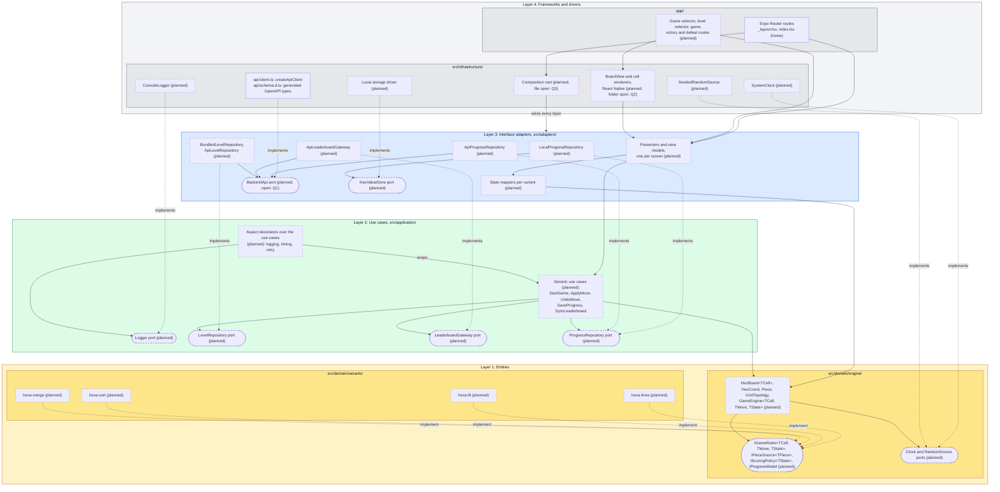

# Clean Architecture layers

Status: draft for review with the professor, 2026-10-30.

This page answers one question: in which layer does each piece of the client live? It follows the statement (§3.4, §4.2) and the layer rules in `.dependency-cruiser.cjs`. The engine is not written yet. Today `src/` holds one README per layer folder plus the API client in `src/infrastructure/api/`. Component names follow the statement (§3.1, §3.4). They are not final.

## Diagram

Layer 4 is at the top and layer 1 is at the bottom. Every arrow goes from the component that imports to the component it imports, so every arrow points down, toward the domain.

- Solid arrow: uses (imports). Dotted arrow: implements an interface.
- Rounded node: a port (an interface that an inner layer owns).
- Dashed border and the suffix "(planned)": the component does not exist yet. A solid border means the file exists today.
- Colors: layer 4 gray, layer 3 blue, layer 2 green, layer 1 yellow.

## Layers and allowed dependencies

The "May depend on" column repeats `.dependency-cruiser.cjs`. `pnpm arch` checks `src/` and `app/` with it, and `test/gates/architecture-gate.test.ts` tests each rule. Layers 3 and 4 have no rule yet, so their column repeats the folder README and says "no rule".

| Layer                     | Folder                           | What lives there                                                                                                                                                                                    | May depend on                                                                                                                                                                |
| ------------------------- | -------------------------------- | --------------------------------------------------------------------------------------------------------------------------------------------------------------------------------------------------- | ---------------------------------------------------------------------------------------------------------------------------------------------------------------------------- |
| 1. Entities               | `src/domain/engine/`             | The generic engine: `HexBoard<TCell>`, `HexCoord`, `Piece`, grid topology (D4), `GameEngine<TCell, TMove, TState>` and the contracts it uses. Ports for time and randomness (R-domain-determinism). | Only `src/domain/` code. Never a variant, a package or a Node module. Rules: `domain-imports-only-domain`, `domain-no-framework`, `engine-no-variants`.                      |
| 1. Entities               | `src/domain/variants/<variant>/` | One folder per game. Each one holds its cell type, its `IGameRules` implementation, its scoring policy and its factory.                                                                             | `src/domain/engine/` and its own folder. Never another variant, a package or a Node module. Rules: `domain-imports-only-domain`, `domain-no-framework`, `variants-isolated`. |
| 2. Use cases              | `src/application/`               | The generic use cases, the ports they need (repositories, gateways, logger) and the aspect decorators.                                                                                              | Only `src/domain/` and `src/application/` code. No package. Rule: `application-imports-only-domain`.                                                                         |
| 3. Interface adapters     | `src/adapters/`                  | Presenters, view models, mappers and repository implementations.                                                                                                                                    | `src/application/` and `src/domain/`, per `src/adapters/README.md`. No rule: `pnpm arch` does not check this folder.                                                         |
| 4. Frameworks and drivers | `src/infrastructure/`            | The HTTP client and its generated types, storage, system clock, seeded random source, logger.                                                                                                       | Every inner layer and any package, per `src/infrastructure/README.md`. No rule.                                                                                              |
| 4. Frameworks and drivers | `app/`                           | Expo Router routes only (`AGENTS.md`).                                                                                                                                                              | Every inner layer and any package. No rule.                                                                                                                                  |

## Where each piece lives

- **Generic engine:** layer 1, `src/domain/engine/`. `HexBoard<TCell>`, `GameEngine<TCell, TMove, TState>` (turn skeleton, D1) and the contracts `IGameRules`, `IPieceSource<TPiece>`, `IScoringPolicy<TState>` and `IProgressModel`. The shared implementations (seeded or fixed piece source, high score or levels with stars) live here too. They take time and randomness through the `Clock` and `RandomSource` ports.
- **The four variants:** layer 1, `src/domain/variants/hexa-lines/`, `hexa-fit/`, `hexa-sort/` and `hexa-merge/`. Each one implements `IGameRules` for its own cell type, for example `MergeTile` for Hexa Merge (A1). A variant imports the engine. The engine never imports a variant.
- **Abstract Factory per variant:** layer 1, one factory in each variant folder. It builds the rules, piece source, scoring policy and progress model. The cell renderer that D3 assigns to this factory cannot live here (Q2).
- **Use cases:** layer 2, `src/application/`. One generic set for the four variants: `StartGame`, `ApplyMove`, `UndoMove`, `SaveProgress` and `SyncLeaderboard`.
- **AOP decorators:** layer 2, `src/application/`. Each decorator implements the same use case interface and wraps a use case (§3.5, A2). It logs through the `Logger` port, because `application-imports-only-domain` forbids a logging package there. The concrete logger lives in layer 4.
- **Repositories:** the ports (`ProgressRepository`, `LeaderboardGateway`, `LevelRepository`) live in layer 2. The implementations live in layer 3, `src/adapters/`: one for local storage and one for the backend. The storage driver and the HTTP client live in layer 4. A new database or backend means a new adapter, and the use cases do not change.
- **API client:** layer 4, `src/infrastructure/api/client.ts`. It uses the types in `schema.d.ts`, which `pnpm api:generate` writes from the backend OpenAPI document. `pacts/hexablock-app-hexablock-api.json` is the contract the consumer test writes for this client. It is a test artifact, not a layer.
- **Screens:** layer 4, `app/` (Expo Router routes; only the home screen exists). Their presenters and view models live in layer 3. The folder for the React Native board and cell components is open (Q2).
- **Dependency-injection composition root:** layer 4. It builds the adapters, injects them into the use cases and wraps the use cases in the aspect decorators. Its file is open (Q3).

## Open questions for the professor

1. **Where does the backend repository live?** `ApiProgressRepository` needs the HTTP client and its generated DTO types, and both live in `src/infrastructure/api/`. Option A: the repository stays in `src/adapters/` and talks to a `BackendApi` port that layer 3 owns; the HTTP client implements that port (the diagram shows this option). Option B: the repository and its DTO mapper move to `src/infrastructure/api/` and implement the layer 2 port directly. Option A keeps layer 3 free of HTTP code but adds one interface. Which one do you expect?
2. **Where do the variant factory and the cell renderer live?** D3 says the variant factory provides the cell renderer. A cell renderer is a React Native component, and `domain-no-framework` forbids React in `src/domain/`. Option A: the domain factory builds only domain objects, and a second factory per variant in an outer layer builds the renderer. Option B: the whole factory moves to an outer layer. Which layer should hold the React Native board and cell components: layer 3 next to the presenters, or layer 4?
3. **Where does the composition root live?** It imports every layer, so it belongs in layer 4. Option A: `app/_layout.tsx`, the Expo Router root. Option B: a module in `src/infrastructure/` that `app/_layout.tsx` calls, so `app/` keeps routes only. Which one do you expect?
