# The web build

The web build lets the team open every screen in a browser (#287). It is a tool for the team, not a deliverable (decision of 2026-11-16): the repository has no web test suite and no place that publishes the build. The phone stays the first target. **The web does not prove the phone: no screen of this page was seen on a phone.** Touch, the safe areas, the speed and the storage of a device still need a phone or an emulator.

## Build and open it

```bash
pnpm web:build        # expo export --platform web: one static HTML page per route in dist/
npx expo serve        # serves dist/ on a local address
```

`app.json` sets `web.output` to `static`. The README explains the choice in [Getting Started](../../README.md#getting-started). `dist/` is git-ignored.

## The screenshots

Each screenshot shows one screen of the export at a phone width (430 × 932) and at a desktop width (1280 × 800). Each one is the viewport only, at a device scale of 1.

| Screen                 | Phone                                                       | Desktop                                                         |
| ---------------------- | ----------------------------------------------------------- | --------------------------------------------------------------- |
| Home                   | 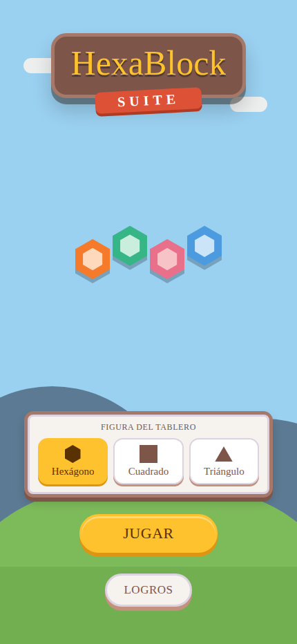                  | 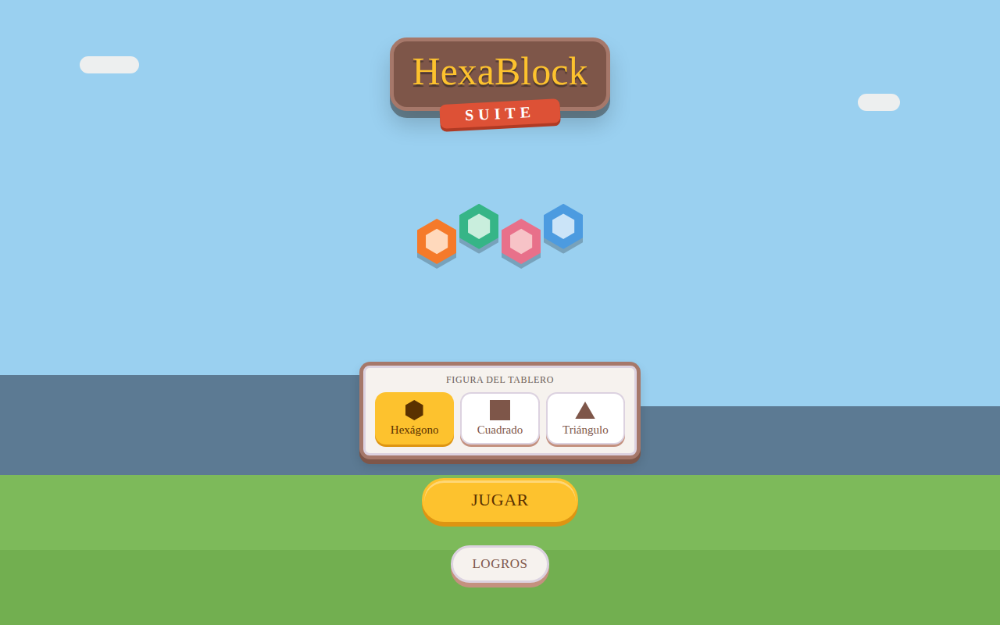                  |
| Game selector map      | 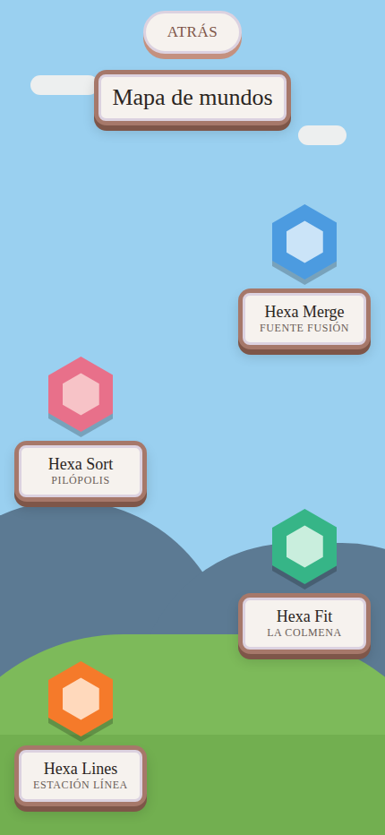                    | 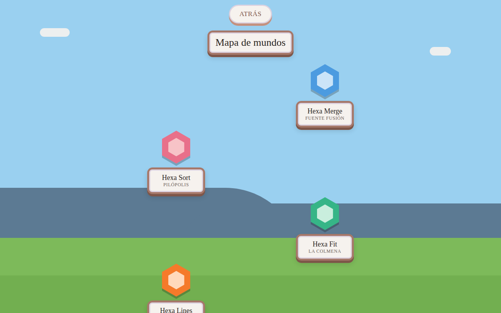                    |
| Hexa Lines game screen | 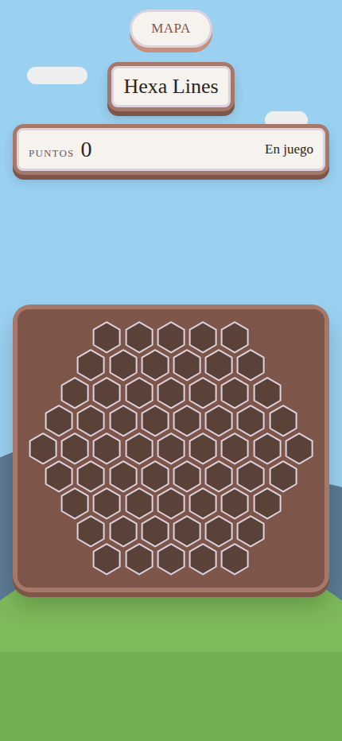 | 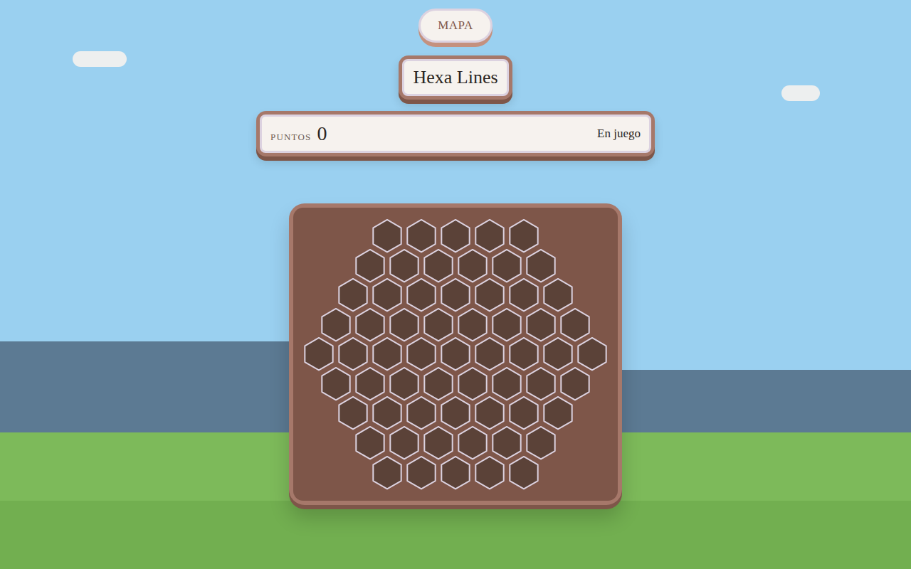 |
| Hexa Fit game screen   | 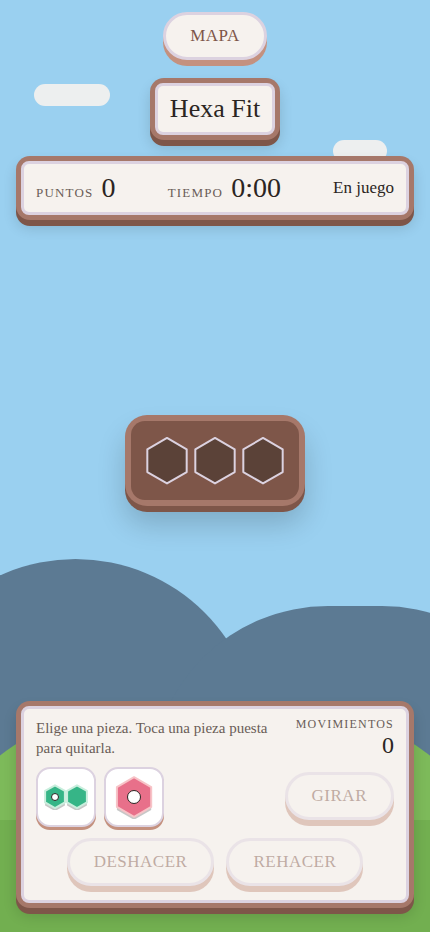     | 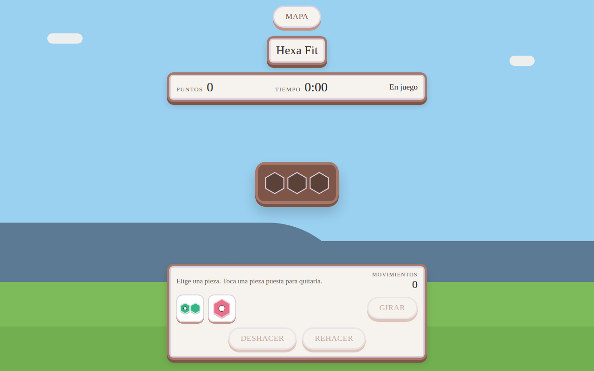     |
| Hexa Sort game screen  | 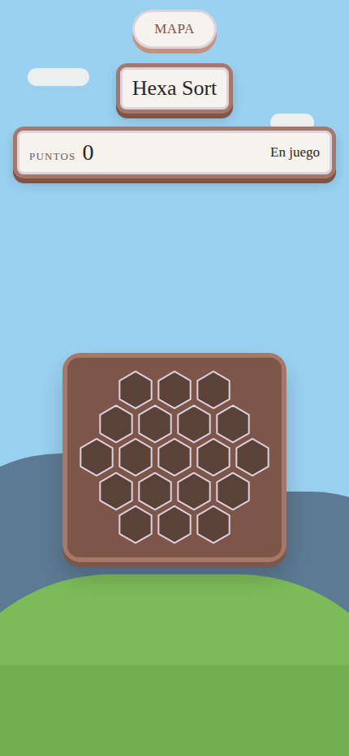   | 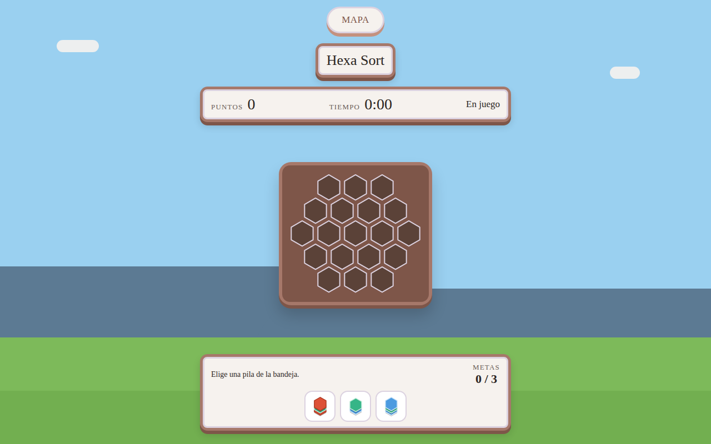   |
| Hexa Merge game screen | 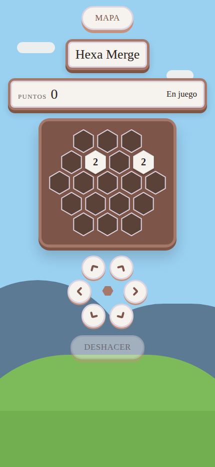 | 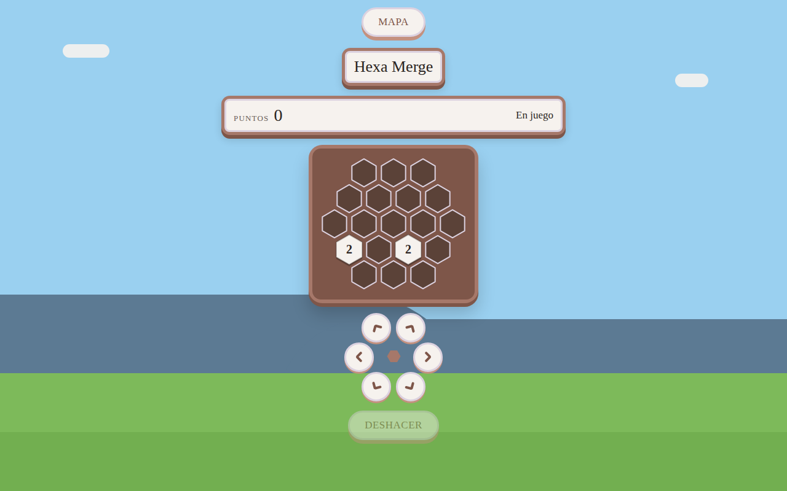 |
| Achievements           | 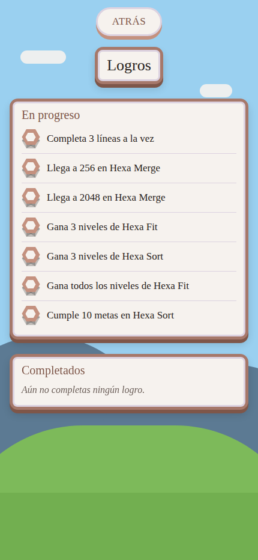  | 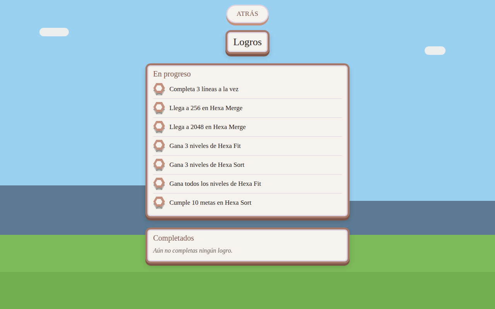  |

How they were taken, on 2026-11-22:

- The code is `main` at `c8bf267` with the changes of #287, before their commit.
- `pnpm web:build` built the export, and `npx expo serve` served `dist/` on `localhost`.
- A Playwright 1.64.1 script outside the repository drove headless Chromium with a fresh profile. The script set the viewport with `viewport: { width, height }`. A `--window-size` flag gives a wrong width in headless Chromium (#319): the window cannot be narrower than 500 px, so a picture at 430 px is cut from a page laid out at 500 px. The script never used it.
- The home screen, the map and the achievements screen opened by their address. Each game screen opened with a click on its world on the map, on the hexagon. A reload of each game screen also opens it.
- The script kept the browser console of each screen. With the hexagon, the default figure, no screen showed an error or a warning. The console shows only the log lines of the use cases, such as `StartGame: success`.

## What works on the web

Measured in the export on 2026-11-22, in headless Chromium:

- Each screen of the table opens at both widths, and the flow between them works: home, map, game screen and back, and the achievements screen.
- The four game screens start their game and draw the board. With the hexagon, each page hydrates with no error or warning, also after a reload of a game screen. Another figure gives a hydration error on a reload (see below, #333).
- On a wide window the content of each screen stays in a centered column of at most 560 points (`CONTENT_WIDTH` in `src/infrastructure/ui/theme.ts`), and the scenery fills the window. On a phone the column fills the screen.
- The device storage works on the web with no second adapter. `DeviceKeyValueStore` uses AsyncStorage, and AsyncStorage keeps each value in the `localStorage` of the browser. The test wrote the key `progress:hexa-fit` with three won Fit levels into `localStorage` and reloaded the achievements screen. The screen listed «Gana 3 niveles de Hexa Fit» as completed. No screen of the app writes a value yet, so the test proved the read only. The write of the AsyncStorage web module is `window.localStorage.setItem()`.
- Hexa Merge also takes the arrow keys and Q, E, Z and C on the web (#292).

## What does not work yet

- The page is wider than the window at both widths, on every screen: `scrollWidth` is 559 at a width of 430 and 1664 at a width of 1280. The hills of the scenery overflow. #331 fixes it.
- A page of the export is rendered at build time with no query. A reload of the map or of a game screen with a figure other than the hexagon, such as `/map?figure=square`, gives the React hydration error #418. React then draws the page again in the browser, and the screen shows the right figure.
- The texts still speak of a touch, such as «Toca una pieza puesta para quitarla» on the Hexa Fit screen.
- A press is a mouse click: the web build proves no touch, no swipe on a touch screen and no safe area.
